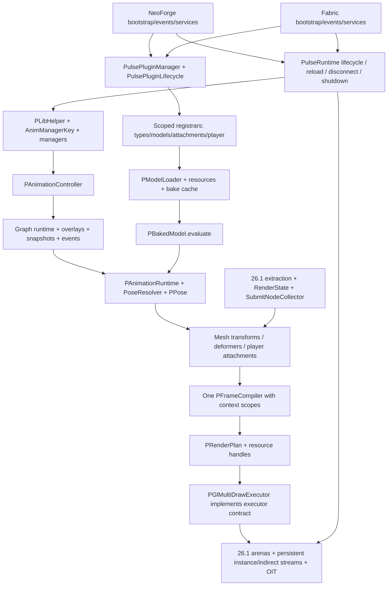

# PulseLib 26.1.2 MultiLoader: журнал и план переноса

Дата инвентаризации: **2026-10-21**. Рабочая ветка: **`26.1.2-multiloader`**.

**Этапы 0, 1, 2 и 3 выполнены; 3.3 — текущая завершённая контрольная точка.** Перенесено современное animation/graph/pose ядро с overlays/transitions/snapshots/root motion; renderer 26.1 использует общий PPose evaluator. **153 JUnit tests**, **123 canonical animation/deformer types / 847 members**, реальные NeoForge graph/overlay/RESTART/reload/identity/shutdown checks прошли. Все шесть PGl implementations и assets сохранены. Fabric пока skeleton до этапа 6; полная render-plan/OIT/GUI интеграция — следующий **этап 4**. Журнал текущей сессии — раздел 15.

## 1. Источники и безопасное продолжение

| Назначение | Ветка | Зафиксированный HEAD |
| --- | --- | --- |
| Техническая основа Minecraft 26.1.2, NeoForge, RenderState, GPU | `26.1` | `67bea7ccc6bd1d4d15f417179ef82d5a7b8aacb1` |
| Канонический публичный API, MultiLoader, современная функциональность и регрессии | `1.21.1-multiloader` | `7ce6f024b307bb821ce543344d3896c8e1fcf26b` |

Локальные ветки и `origin/*` совпали; HEAD обеих веток дополнительно проверены через GitHub API. Исходники анализировались из этих Git objects, а не из неотслеживаемых файлов рабочего каталога. [Технический источник](https://github.com/ArcAnc/PulseLib/tree/67bea7ccc6bd1d4d15f417179ef82d5a7b8aacb1), [функциональный источник](https://github.com/ArcAnc/PulseLib/tree/7ce6f024b307bb821ce543344d3896c8e1fcf26b).

Перед работой прочитан [AGENTS.md функционального источника](https://github.com/ArcAnc/PulseLib/blob/7ce6f024b307bb821ce543344d3896c8e1fcf26b/AGENTS.md). Для переносимого Java: TAB indentation, Allman braces, точка цепочки на предыдущей строке, развёрнутые методы/блоки, сохранение Javadoc/import groups, авторов и дат по Git history, лицензионные заголовки, package nonnull annotations и точные `@Nullable`. В подэтапе 1.1 `AGENTS.md` и Java `.editorconfig` перенесены в рабочее дерево из pinned MultiLoader source.

Исходное состояние: активна `26.1-multiloader`, HEAD `67bea7c`, отслеживаемых изменений нет. Целевая `26.1.2-multiloader` отсутствовала и создана непосредственно от `26.1`. Найдены **165 неотслеживаемых файлов** в `common/logs/` и `fabric/runs/` — игровые миры, настройки, логи и диагностика прежних запусков. Они не являются исходниками миграции и не включаются в commit. Не очищать их через `git clean`, не использовать как disposable test worlds. В текущей сессии их содержимое сохранено.

Исходные ветки не изменять; полного merge не делать; push и публикации требуют отдельного разрешения. Зафиксированные SHA использовать даже при продвижении удалённых веток. Обновление baseline — отдельное осознанное решение, а не следствие нового HEAD.

При следующем запуске:

1. Прочитать этот документ и `git log --oneline --decorate -8`.
2. Проверить `git status --short --branch`, HEAD исходных веток и принадлежность текущей истории `26.1.2-multiloader`.
3. При чужих изменениях сохранить их; существующую целевую ветку не пересоздавать и не reset-ить.
4. Начать **этап 4 — renderer 26.1 + modern render plans/queue/GUI/OIT** из раздела 15. Этап 3 и завершённые подэтапы не повторять. После каждого подэтапа — проверки, запись результата здесь, отдельный локальный commit. После крупного этапа остановиться.

## 2. Артефакты этапа 0 и методика

Все пути в таблице относительны к этому документу.

| Артефакт | Содержание |
| --- | --- |
| [api-1.21.1-multiloader.ndjson](26.1.2-multiloader/api-1.21.1-multiloader.ndjson) | Канонический baseline: 373 доступных public/protected типа и 2236 членов |
| [api-26.1.ndjson](26.1.2-multiloader/api-26.1.ndjson) | Технический baseline: 334 доступных типа и 2042 члена |
| [api-delta.ndjson](26.1.2-multiloader/api-delta.ndjson) | Разность объявленных сигнатур, заголовков и import contexts по FQCN |
| [class-migration-map.tsv](26.1.2-multiloader/class-migration-map.tsv) | Все 533 именованных типа обеих веток, включая внутренние; наличие, API delta, этап, целевой слой, решение и адаптация |
| [source-dependencies.ndjson](26.1.2-multiloader/source-dependencies.ndjson) | Все production Java units: packages, imports, внутрибиблиотечные зависимости, Minecraft/loader references, package annotations, Git blob SHA |
| [source-manifest.json](26.1.2-multiloader/source-manifest.json) | SHA источников, охват модулей, перечни тестов/testmod/assets/shaders, Mixins и точные service providers |
| [checksums.sha256](26.1.2-multiloader/checksums.sha256) | SHA-256 шести сгенерированных файлов данных |
| [ExtractApi.java](tools/ExtractApi.java), [inventory.py](tools/inventory.py), [verify_inventory.py](tools/verify_inventory.py) | Воспроизводимая инвентаризация и проверка её корректности |

`ExtractApi` использует JDK 25 Compiler Tree API в режиме **parse-only**: разрешение внешних классов, Gradle и загрузка Minecraft не нужны. Единица идентичности — package + цепочка имён объявленных типов, включая вложенные, а не имя Java-файла. Методы учитываются по возвращаемому типу, generic bounds, именам, типам/порядку параметров, varargs, throws и modifiers. Сохранены annotations, defaults аннотаций, параметры с именами, поля с initializers, extends/implements/permits, record components, imports и исходный blob SHA.

Интерфейсные public members, public/protected вложенные типы, enum constants/`values`/`valueOf`, default constructors, record canonical constructors/accessors/`equals`/`hashCode`/`toString` учитываются, даже когда не написаны явно. Private/package-private типы входят в общую карту; недоступные через внешний тип объявления не попадают в публичный baseline. Данные охватывают production Common/Fabric/NeoForge, включая публичные implementation/Mixin/backend классы, без автоматического исключения `@ApiStatus.Internal`. Testmod и JUnit учитываются отдельно, не как API библиотеки.

**Границы baseline:** это полный перечень доступных исходных объявлений с контекстом, а не доказательство бинарной/поведенческой совместимости. Типы в сигнатурах записаны в исходном написании; imports позволяют различить, например, старый и новый `RenderType`. Wildcard imports, наследуемые внешние Minecraft методы, bridges, erasure и annotation propagation требуют semantic/compiled проверки на этапе 7. `api-delta` — консервативное сравнение заголовков, сигнатур и используемых imports; annotation metadata/default values/constant initializers нужно дополнительно сравнивать по baseline. `same-declarations` **не означает** одинаковое поведение: `AnimManagerKey` и `PAnimationPoseResolver` — реальные примеры.

Воспроизведение без изменения исходников и без сети, из корня репозитория, с Python 3.12+ и полным JDK 25 в PATH:

```bash
python3 docs/porting/tools/inventory.py --check
python3 docs/porting/tools/verify_inventory.py
```

Для намеренного пересоздания данных из тех же pinned SHA: `python3 docs/porting/tools/inventory.py`. Инструмент читает Git objects во временный каталог, не переключает ветки и не меняет runtime-код. На этапе 7 извлекать **результат миграции отдельно**, не перезаписывать канонический baseline. Сначала сверить FQCN и declared signatures, затем разрешить imports/иерархию с classpath обеих версий; каждому несовпадению назначить adapter/overload либо документированную Minecraft-причину. Одного rename `ResourceLocation` или списка файлов недостаточно.

| Охват | `26.1` | `1.21.1-multiloader` |
| --- | ---: | ---: |
| Всего tracked files | 344 | 582 |
| Production Java units, включая package-info | 286 | 342 |
| Все именованные типы, включая вложенные/внутренние | 416 | 458 |
| Доступные public/protected типы | 334 | 373: Common 353, Fabric 10, NeoForge 10 |
| JUnit source files, включая support/package-info | 0 | 22: 20 test classes и 2 вспомогательных файла |
| Java-файлы внешнего testmod | 0 | 62 |
| Testmod resource files | 0 | 46 |
| Shader resources | 10 | 40 |

Объединённая карта: **341 общий FQCN**, **117 только в MultiLoader**, **75 только в 26.1**. Среди общих — **122 с разницей деклараций/import context**, **219 с одинаковыми декларациями**. Это показатели статического анализа, не результаты компиляции или игровых тестов.

## 3. Dependency map и границы модулей

Целевая структура: `common/`, `fabric/`, `neoforge/`, `buildSrc/`, `tests/`. Common содержит единое ядро и единый клиентский renderer; наличие Minecraft client classes в Common допустимо, загрузка их на dedicated server — нет. Common не содержит ссылок на NeoForge/Fabric API. Loader-код не копирует граф, managers, loaders, pose evaluation, compiler или GPU backend.



Это карта целевых runtime-зависимостей; точные статические import edges обеих исходных веток находятся в `source-dependencies.ndjson`. `same_package_candidates` — консервативные зависимости по идентификаторам внутри package, а не доказанный call graph. Imports могут быть неиспользуемыми; reflective discovery, service providers и callback lifecycle представлены отдельно в manifest и на диаграмме.

В `26.1` обнаружено **14 production units с прямыми NeoForge references**. Их нельзя целиком положить в Common:

| Классы/подсистема | Разделение при переносе |
| --- | --- |
| `PLib`, `CommonEvents`, `ClientEvents`, `PulseLibEvents` | Bootstrap/events остаются в NeoForge; с этапа 2 регистрация расширений только через современные plugins |
| `PLibAnimationTicker`, `InstanceAnimationManager`, `SingletonAnimationManager` | Вычисления и cache lifecycle в Common; подписки/tick/entity leave callbacks в loader |
| `PLibRegistration` | Канальные/event/deformer registries в Common; DeferredRegister игрового demo content в testmod |
| `PRenderStagesHandler`, `PRenderTypes`, `PResourceCache` | Стадии/ресурсы и pipeline logic в Common; event wiring и регистрация shaders/atlas/reload в loader |
| `PAttachmentAnchorResolvers`, `PLibArmorHandler` | Общие операции установки anchors/layers; loader вызывает их из своих hooks |
| `PArmorClientExtensions` | NeoForge; в Common современный `PArmorModelProvider`, Fabric использует свой armor hook |

В современном Common прямых loader imports/references не найдено. Три ServiceLoader-контракта: `IPulsePlatform`, `IPulseCameraService`, `IPulsePluginFinder`; в manifest зафиксированы все шесть descriptors, по три на загрузчик. `PulseClientServices` и client registrars не должны инициализироваться на физическом сервере. Ровно один provider каждого сервиса должен попадать в соответствующий loader JAR.

## 4. Class migration map: ключевые контракты

Package prefix: `com.arcanc.pulselib`. В столбце «наличие» сначала `26.1`, затем MultiLoader. Полные FQCN, вложенные типы и все declared signature deltas см. в TSV/NDJSON; здесь зафиксированы смысловые решения, которые нельзя вывести из совпадения имён.

| Класс/подсистема | Наличие | API и современные изменения | Что переиспользовать / что перенести | Адаптация Minecraft 26.1.2 |
| --- | --- | --- | --- | --- |
| `content.animatable.PAnimatable<T>` | да / да | Две основные сигнатуры совпадают; современный контракт доступа после завершения owner construction | Сохранить FQCN/generic/методы; применить современную семантику manager access | Ключ из extract phase передавать в submit state; не создавать controllers в owner constructor |
| `PAnimationController<T>` | да / да | Добавлен `setGraphSnapshotContexts`; precise graph events, snapshot base, cyclic/reverse cursor fixes | Современная реализация, без восстановления старых event loops | Узкая адаптация запросов entity/render state; core math не зависит от loader |
| `PAnimationManager<T>` | да / да | Добавлены `getManager(AnimManagerKey)`, synchronized `initializeControllers()`; H18, атомарное создание и защита рекурсии | Современные factories, registrar, maps; старый constructor callback удалить | Независимый owner/key; callbacks вызывать после construction, refresh usage из renderer/ticker |
| `instance.InstanceAnimationManager` | да / да | `removeUnused()` без NeoForge event; identity map и обновление last-used, L25 | Современный cache/lifecycle; platform ticks отдельно | `net.minecraft.Util` в старой ветке против `net.minecraft.util.Util` в 26.1; entity removal/chunk unload hooks |
| `singleton.SingletonAnimationManager` | да / да | Современный `getManager(key)`; shared cache индексируется owner identity + key, lazy controllers | Перенести современный owner-key cache; одна реализация managers | Client lifecycle вызывает cleanup; не разделять cache по renderer/platform |
| `AnimManagerKey` | да / да | Сигнатуры совпадают, поведение существенно изменено: runtime ID стека и зарезервированный sign bit | Современные factories; старый hash(item/count/components) убрать | ItemStack Mixin и реальные copy/split paths 26.1; UUID/block position/dimension factories адаптировать |
| `util.helpers.PLibHelper` | да / да | Современные `createInstanceManager`, `createSingletonManager`, `getManager(owner/key/stack)`, GUI helper; boolean factory overload сохранён | Современное единообразие доступа; state factories 26.1 допустимы как дополнительные overloads | `GuiGraphics` → `GuiGraphicsExtractor` и submit context; `ResourceLocation` → `Identifier` |
| `content.model.animation.PAnimation` | да / да | Добавлены `forEachCyclicEvent` overloads; modern sampling; C1/H1/H2 | Современные события/sampling/compiled data; форматные codecs согласовать с 26.1 | Resource identifier types; core time остаётся в ticks, `query.anim_time` в seconds |
| `PAnimationGraphRuntime` | да / да | 13 новых declared signatures; overlay speed/restart/stop, precise tracks, sampleBasePose/samplePose, L1/L4/reverse | Целиком современная runtime-семантика + PPoseSnapshot; не второй graph implementation | Адаптировать model binding/context capture, без привязки к loader/render backend |
| `PAnimationPoseResolver` | да / да | Основные сигнатуры совпадают; visibility и activeBones теперь берутся из вычисленной pose | Современная реализация и contexts; не отдельный bone sampler в renderer | Матрицы и render-state данные подавать через единый PPose pipeline |
| `PAnimationRuntime` | да / да | Два новых `captureGraphBase` overloads; graph samplePose и accumulated base, snapshot continuity | Современное вычисление TRS/visibility/masks; прежняя graph-layer approximation заменяется | `PBakedModel.evaluate` остаётся единой точкой; adapter к 26.1 mesh context |
| `content.model.PModel` | да / да | Поля `bones`, `meshes`, `boneMeshes`, `animations` и их generics совпадают; после удаления комментариев реализации совпадают | Публичные поля сохранить, не вводить новую модель данных | Сам класс не требует loader API; adapt loaders/baking вокруг него |
| `content.model.baked.PBakedModel` | да / да | Современные draw overloads и pose resolver; обе ветки уже имеют `evaluate` | Современное animation-facing API; 26.1 baking/material/buffer integration сохранить | `RenderType` новый package, `Identifier`, GPU-backed geometry и mesh deformation |
| `PBakedBone`, `PBakedMesh`, deformers | да / да; есть новые buffer/stream types | `mixBone` ещё существует в обеих ветках; это не основание использовать его как параллельный evaluator | Современный PPose и semantic channels; 26.1 GPU buffers/subdivision сохраняются | `PSubdividedMeshCache`, PGpuDeformerBuffers, buffer lifetime; legacy vertex buffer классы не копировать механически |
| `content.renderer.PRenderer` и Entity/Block/Item renderers | да / да | Старый современный contract принимает owner/MultiBufferSource; 26.1 принимает RS/CameraRenderState/SubmitNodeCollector, отличаются generics | FQCN/операции/extension hooks MultiLoader сохранить через adapter/overload; 26.1 state extraction/submission — техническая основа | EntityRenderState, BlockEntityRenderState, ItemStackRenderState, CameraRenderState, special item renderer; каждый unavoidable signature delta записать |
| `PRenderQueue`, `PRenderContexts` | queue да / да; contexts нет / да | Modern PGeometryData/PDynamicGeometry/PInstanceHeader; `flushOpaque`, combined sort, local scopes, destination-aware composition; cleanup spelling отличается | Одна современная очередь/compiler; scopes — контексты одного pipeline; никаких двух конкурирующих world queues | GUI/offscreen scope захватывать и восстанавливать при deferred SubmitNodeCollector исполнении, включая исключения |
| `plan.PFrameCompiler` | да / да | `<S,P,M,I>` → канонический `<S>` с handles; compileOpaque/Combined/All/discard; L18/H13 | Современный compiler и pass tests; убрать MC RenderType knowledge из compiler | OIT capability predicate передаёт backend, не loader; depth/alpha semantics сохраняются |
| `plan.PRenderPlan`, `PDrawGroup` | да / да | Modern негeneric plan имеет packed `groups` + `instances`, draw commands/baseInstance | Современная структура; bridge handles к существующей geometry arena | Сохранить baseVertex/baseInstance/indexCount/indexType, indirect draw и instance layout |
| `PRenderExecutor`, capabilities/matrix/host/frame | нет / да | Новые канонические contracts, включая fallback strategies | Перенести contracts; `PGlMultiDrawExecutor` реализует их непосредственно либо через узкий adapter | Capture frame по 26.1 RenderSystem/CameraRenderState; capability probe без смены алгоритмов |
| `renderer.gl.PGl*` | да / нет | Нативный 26.1 GPU backend; не заменять старым `legacy.Gl*` | Все шесть основных классов, fences, persistent streams, geometry batching, indirect paths, OIT и shaders сохраняются | RenderPipeline/RenderPass/GpuTextureView/ScissorState; modern render plan → существующие draw batches |
| `renderer.legacy.Gl*` | нет / да | Даже публичные backend классы входят в baseline | Не переносить второй работающий backend. Сначала проверить возможность source-compatible фасадов поверх PGl backend; несовместимости документировать по каждому FQCN | Старые raw GL/VertexBuffer API не соответствуют новой Blaze3D integration |
| `content.registration.PLibRegistration` | да / да | `init(IEventBus)` → `init()`; старые игровые DeferredRegister-подклассы в современном API отсутствуют | Современные AnimationChannelReg/AnimationEventReg/DeformerReg сохранить; demo registries вынести | Внутренние registry consumers остаются; public extension registration проходит через plugins |
| `api.plugin`, `api.registration`, `plugin` | нет / да | Канонические аннотация, common/client interfaces, 6 registrars, finder/scanner/candidate/lifecycle/manager | Перенести полностью; scoped/atomic registration, deterministic discovery, side filtering до class loading, model reload retry | NeoForge mod scan/root discovery; Fabric mod roots/dev classpath grouping; ASM поддержка bytecode Java 25 |
| `platform` | нет / да | IPulsePlatform, IPulseCameraService, PulseServices, PulseClientServices | Сохранить ServiceLoader architecture и ровно один provider на платформу | 26.1 passenger/camera API; client camera classes не трогать на server |
| `content.player.animation` и attachments | да / да | Современные frame/hierarchy/root/camera transformations, public spaces overloads, M-P2/M-P3 | Современные definitions/instances/masks/blend modes/first-person rig; per-player UUID runtime | Сохранить 26.1 setupAnim/submit/Camera.alignWithEntity/hand hooks, адаптировать к новой математике и state extraction |
| `data.PModelLoader`, `PLoadedModel`, parsers/cache | да / да | Modern `modelResourceCandidates(id)`, `loadModel(..., id)`; 26.1 bulk `loadModels(..., consumer)` и physical candidates | Сохранить канонические singular API через batch adapters; concurrent reload safety современного cache; не потерять 26.1 resource loading | PreparableReloadListener.SharedState в 26.1, atlas/Identifier/texture views; GLB embedded и внешние image URI сохраняются |
| `PResourceCache`, texture atlas, utilities | да / да | Modern plugin model declarations, loader-free registration hooks; другие metadata names и texture-name fallback | Публичные helper signatures и modern model registration; текущие 26.1 atlas/baking/URI algorithms адаптировать | `PLibSpriteMetadata`/`PLibMetadata`, reload signatures, atlas registration, Identifier; не заменять texture resolution только ради старого helper body |

Для каждого вспомогательного класса/вложенного типа TSV задаёт слой и соответствующую политику из этой таблицы. Решение `compatibility-review` означает обязательную проверку адаптера, а не разрешение удалить API. Переименование/удаление canonical PulseLib API в этапе 0 **не принято**.

## 5. Реестр исправлений и доказательства для следующих этапов

История функционального источника: `e591523` (исходная MultiLoader структура), `62eca18` (plugins/demos), `4b22a67` (C1 и группа исправлений), `5c22705` (M-P2), `a96f947` (M-P3), `a9d98d8` (reverse overlays), `5ae0264` (ItemStack identity), `2587dd2` (H13/H15/H18), `5b59617` (современные sampling/lifetime fixes и cleanup), `7ce6f02` (Gradle). Использовать итоговые файлы pinned HEAD: поздние изменения могут дополнять или заменять ранние patch hunks. Не cherry-pick-ить большие commits целиком.

| ID / контракт | Отличие и источник реализации | Обязательная проверка после переноса |
| --- | --- | --- |
| M-A3 | ticksToSeconds + sampling contexts; некоторые 26.1 contexts уже делят на 20, нужна согласованность всех paths | PAnimationTimeTest; sampling harness |
| M-A4 | PExpressionEvaluator больше не хранит глобальные TIME_ONLY values по quantized clip time | PExpressionEvaluationTest: разные query resolvers/contexts при одном времени |
| H2 | PAnimationTrackSampler + 4-point channel overloads; настоящие соседние pre/post control points | PCatmullRomSamplingTest, оригинальный animation fixture |
| H1 | PMolangEulerRotationValue.evaluateEuler + интерполяция до quaternion conversion | PGeckoEulerSamplingTest, Gecko 360°/720°; PGltfQuaternionSamplingTest сохраняет SLERP |
| L25 | InstanceAnimationManager identity map с refresh timestamp | InstanceAnimationManagerTest; 21+ секунд, два cleanup cycles, removal/chunk unload/disconnect в игре |
| C1 | PCyclicAnimationEvents, precise double tracks, directional boundary contract | PCyclicAnimationEventsTest: multi-cycle/large times/reverse/departure/arrival |
| H18 | Lazy initializeControllers, owner/key cache, единые helper getters | PAnimationManagerAccessTest; реальные field initializer owners, независимые graphs/stacks |
| L1 + reverse | Один runtime instance на overlay definition, frozen pose при нулевой скорости, независимые fades, finite negative speed | POverlayLifecycleTest/POverlayReverseTest и loaded-model lifecycle harness |
| L4 | PPoseSnapshot, PPoseMixer и graph captureGraphBase сохраняют последнюю вычисленную TRS/visibility при RESTART | PPoseMixerTransitionTest/PGraphRestartTest, не только сравнение имён/time |
| M-P2 | Современные PPlayerAnimationSpace/Frame/anchor matrices и visual root pivot | PPlayerHierarchyTest, PlayerMotionHarness phase mp2, несколько игроков/definitions/masks |
| M-P3 | Camera bind hierarchy и displacement в правильных пространствах | PPlayerCameraTest; actual Camera position/quaternion, phase all |
| H13 | compileOpaque + ранний flush Entity/Block opaque до transparency | PFrameCompilerPassTest; реальные depth/RGB перед водой/стеклом |
| H14 | Destination-aware OIT, Fabulous vanilla targets, depth peeling/composition и restoration | H14Harness: 38 offscreen cases + world/weather pixels, reload и resize |
| H15 | PRenderContexts local scope, GUI/entity dispatcher boundary, discard/restoration при исключении | RenderRegressionHarness: GUI/offscreen/nested targets и реальные renderer entrypoints |
| L18 | compileCombined сортирует обычную alpha transparency глобально между нужными stages; OIT batches отдельно | PFrameCompilerPassTest + пересекающиеся Entity/BlockEntity transparency pixels |
| ItemStack identity | transient volatile ID; copy намеренно сохраняет identity, частичный split разделяет, полный перенос переносит ID; counter не держит stacks/controllers | PItemStackAnimationIdsTest + ItemStackIdentityHarness: copy/split/stacking, реальные menu/network/NBT round trips, cache cleanup/reentry |

Molang persistent variables, root motion, overlays, typed channels, custom interpolation и negative playback входят в функциональный контракт. ID стека не попадает в NBT/Data Components; новый deserialized Java stack получает новую runtime identity. Идентичность не обещается между сетевыми заменами объектов. Преобразования времени ограничить Molang query boundary: нельзя глобально заменить ticks на seconds во всех clip/event clocks.

## 6. Toolchain и потенциальные конфликты

| Компонент | В `26.1` | В MultiLoader source | Решение для этапа 1 |
| --- | --- | --- | --- |
| Minecraft / Java | 26.1.2 / 25 | 1.21.1 / 21 | 26.1.2 / 25, включая Gradle JVM и compilation toolchain |
| NeoForge | 26.1.2.95 | 21.1.216 | Сначала сохранить 26.1.2.95; подтвердить artifact resolution/metadata |
| ModDevGradle | 2.0.141 | 2.0.140 | 26.1-compatible MDG, starting point 2.0.141; проверить Common NeoForm setup |
| Gradle wrapper | 9.2.1 | 9.2.1 | Проверить совместимость выбранного Loom; при необходимости отдельное изменение wrapper |
| Fabric Loader / API | отсутствуют | 0.19.5 / 0.116.17+1.21.1 | Выбрать и зафиксировать подтверждённые 26.1.2 versions по Fabric metadata; старый API не подходит |
| Fabric Loom | отсутствует | 1.12.7, `fabric-loom` | Unobfuscated `net.fabricmc.fabric-loom`; конкретную версию и Gradle requirement проверить перед изменениями |
| Mappings / NeoForm | Нет Parchment в base | Parchment 2024.11.17, NeoForm 1.21.1-20240808.144430 | Старые mappings не переносить. Для Common подтвердить 26.1.2 NeoForm/vanilla setup; plain Minecraft, без NeoForge patches |
| Runtime libraries | jgltf 2.0.3, Jackson 2.13.x с ranges | Те же библиотеки pinned; JUnit 5.11.4, ASM 9.9.1 | Сохранить нужные transitive libs и loader jar inclusion; проверить ASM/Mixin чтение Java 25 classfiles |
| Library version | 1.1.5.3 | 1.2.0 | На этапе 0 без изменений; для функционального MultiLoader релиза ориентир 1.2.x, не 2.0 |

Официальная документация подтверждает: 26.1 unobfuscated, Fabric использует новый Loom plugin без mappings/remap, обычные dependency configurations и `jar` вместо `remapJar`; Java 25 обязательна. Для NeoForm изменён формат версии; NeoForge рекомендует MDG 2.0.141 на момент release article. Это не подтверждение текущих последних версий и не проверка сборки. [Fabric 26.1](https://www.fabricmc.net/2026/03/14/261.html), [NeoForge 26.1](https://neoforged.net/news/26.1release/).

Основные конфликты, требующие отдельных проверяемых адаптаций:

1. `ResourceLocation` → `Identifier`, перемещение `RenderType`, `Util`, reload API, texture atlas и special item renderers. Сохранить имена PulseLib; Minecraft types менять по необходимости.
2. Owner-facing PRenderer против extraction/submission RS contract. Сначала проверить overloads/adapters; нельзя молча сократить extension hooks или потерять nullable/additionalData semantics.
3. Singular model loading API против рабочего 26.1 batch/physical resource discovery. Обернуть batch в современный контракт, сохранив atlas order и ошибку missing resource; не откатывать обновлённую 26.1 resource loading реализацию.
4. Современные resource handles/packed commands против PBakedMesh + InstanceData в PGl executor. Согласовать layout, index offsets и GPU deformation offsets; capability fallback не должен превращать instancing в обычный per-object renderer.
5. H14 source использует старую vanilla transparency chain. Переносить поведение через 26.1 RenderPass/targets, а не копировать старые JSON/injection descriptors. В текущем PGl backend уже четыре OIT слоя и target-indexed state; их сохранить.
6. GUI extraction/deferred submission: scope должен пережить правильный участок collector execution; одних ThreadLocal guards вокруг extract недостаточно без проверки порядка выполнения.
7. Общий пакет с client types не равен server-safe classloading. Проверять bootstrap graph, plugin side filtering до `Class.forName`, client factory isolation, Mixins lists и ServiceLoader descriptors.
8. ItemStack 26.1 registry-bound construction/ItemStackTemplate: runtime ID применяется к живому ItemStack; tests не должны создавать stacks до готовности registries. Проверить актуальные copy/split signatures. [Fabric: ItemStackTemplate](https://www.fabricmc.net/2026/03/14/261.html).
9. `legacy.Gl*` присутствуют в публичном baseline; фасады должны использовать тот же backend. Необоснованное удаление этих типов или создание второго GPU engine недопустимы.
10. В обеих ветках `pulselib*.mixins.json` указывает JAVA_21 при Java 25 target. Не менять в этапе 0; проверить поддерживаемые Mixin compatibility levels в выбранном 26.1 toolchain.
11. Common sources компилируются и включаются в loader JARs по convention plugins MultiLoader. Исключить двойные resources/package-info, service providers чужой платформы и demo assets в release JAR.
12. Старые testmod README ссылки на удалённые `docs/reviews/*` не являются доступными результатами проверки. Changelog содержит исторические счётчики тестов; текущий source manifest точнее. Ни прежние логи в рабочем дереве, ни прошлый PASS не подтверждают миграцию.

## 7. Поэтапный план и критерии приёмки

Подэтапы ниже — границы небольших локальных commits. Если один подэтап перестаёт быть обозримым, делить дальше и указывать точный integration debt. Крупный этап завершён только после всех его критериев; успешная компиляция не заменяет запуск игры.

| Этап / подэтап | Работа и отдельный результат | Проверки для завершения |
| --- | --- | --- |
| **0 — выполнен** | Pin SHA, новая ветка от 26.1, dependency/class/API map, план и воспроизводимые tools | AST + javac/javap fixture; полное покрытие sources/types; regeneration/checksums; diff scope; сохранность веток и исходных untracked файлов |
| **1.1 — выполнен** | buildSrc/common/neoforge/fabric skeleton от 26.1; verified dependency pins/Java 25; AGENTS/style; источник/ресурсы остаются 26.1 | `:common:compileJava`, `:neoforge:build`; Fabric project/tasks конфигурируются; Common compile classpath не опирается на NeoForge patches |
| **1.2 — выполнен** | Отделить 14 NeoForge-bound units/hooks; сохранить 26.1 RenderState/GPU/shaders/atlas и рабочий bootstrap | Common без loader references; NeoForge client + dedicated server startup/normal stop; renderer на прежних assets. При необходимости минимальный изолированный test fixture, не полная миграция testmod |
| **2.1 — выполнен** | Canonical plugin/registrar/lifecycle/platform contracts и loader discovery; ServiceLoader descriptors | Scanner/manager/lifecycle JUnit перенести уже здесь; annotation sides, deterministic IDs, deduplication/atomic registration/model retry |
| **2.2 — выполнен** | Перевести registries/resources/attachments/player declarations на plugins; удалить старый extension event path | NeoForge common/client plugins реально обнаружены; dedicated server не загружает client plugin; нет повторных типов/controllers; registry smoke и normal exit |
| **3.1 — выполнен** | Canonical managers/helper/AnimManagerKey/ItemStack runtime ID + 26.1 ItemStackMixin | ManagerAccess/InstanceManager/ItemStackIds JUnit; реальная transformed stack copy/split/stacking identity; construction и cleanup |
| **3.2 — выполнен** | Modern channels/interpolation/Molang/Gecko/glTF sampling + события | Time/Expression/CatmullRom/GeckoEuler/GltfQuaternion/CyclicEvents JUnit и оригинальные fixtures; negative playback |
| **3.3 — выполнен** | Graph/overlays/transitions/PPoseSnapshot/runtime/resolver/masks/root motion; новый PPose — единственный evaluator | OverlayLifecycle/Reverse, PoseMixerTransition, GraphRestart JUnit; backend compile adapter локализован, без второго manager/pose pipeline |
| **4.1** | Modern PFrameCompiler/PRenderPlan/capabilities/handles; PGl executor bridge; одна очередь | PFrameCompilerPassTest; instanced/indirect command layout и baseInstance проверены; 26.1 native RenderPass paths сохраняются |
| **4.2** | Renderer + RenderState consumption modern poses, H13/L18, context-aware GUI H15 | NeoForge реальные Entity/BlockEntity/Item/GUI pixels/depth; opaque early flush; global alpha ordering; offscreen nesting/exceptions |
| **4.3** | H14 на native 26.1 targets; resource lifetime/reload/disconnect/shutdown | Четыре слоя/depth peeling, Fabulous/water/glass/particles/weather; GPU deformers/instancing; реальные buffer/texture deletion и GL state restoration |
| **5.1** | Modern player frames/spaces/masks/blend/root/camera math и attachment registration | PlayerHierarchy/PlayerCamera JUnit, независимость нескольких UUID/definitions |
| **5.2** | 26.1 first-/third-person rig/item/camera/ModelPart/armor/deformer hooks | NeoForge PlayerMotionHarness + обе model formats; ROOT masks, additive/override, camera quaternion/position, transform restoration |
| **6.1** | Fabric 26.1.2 bootstrap/discovery/services/reload/registration/events/Mixins/access rules | Fabric build + dedicated server/normal exit, plugins/side filtering; no NeoForge in Common |
| **6.2** | Fabric client/stage/GUI/transparency/armor hooks поверх того же Common/PGl backend | Fabric client, parity с NeoForge: ItemStack ID, H13/H14/H15, deformation/instancing/lifecycle/player. Ни одного дубликата ядра |
| **7.1** | Завершить перенос внешнего testmod/harnesses/реальных assets, автоматизированных disposable worlds, packaging и regression suites | Полный build/JUnit обоих loader JARs, Jar content checks, оба dedicated servers и jar plugin discovery |
| **7.2** | Полная client GPU matrix, API report against frozen baseline, renderer comparison against frozen 26.1 | Реальные игровые результаты с exit codes/артефактами; список каждого API delta с причиной; контролируемый GPU profiling при возможности |

Регрессионные тесты переносить вместе с соответствующим исправлением в этапах 2–6. Этап 7 завершает и объединяет testmod/harnesses, а не впервые включает тестирование. Не отключать существующие тесты и не заменять ожидания заглушками.

## 8. План проверки результата миграции

Команды ниже — **запланированные**, в этапе 0 не выполнялись. Они основаны на актуальном MultiLoader testmod README, но потребуют адаптации Gradle conventions/harness Mixins к 26.1; не считать их заранее рабочими.

```bash
./gradlew build --no-daemon
./gradlew :common:test :fabric:test :neoforge:test --no-daemon
./gradlew :neoforge:runServer -PpulseTestMod -PpulseSmokeAuto --no-daemon
./gradlew :fabric:runServer -PpulseTestMod -PpulseSmokeAuto --no-daemon
./gradlew :neoforge:runClient -PpulseTestMod -PpulseSmokeAuto -PpulseSmokeWorld --no-daemon
./gradlew :fabric:runClient -PpulseTestMod -PpulseSmokeAuto -PpulseSmokeWorld --no-daemon
```

Отдельные client runs на обоих loaders:

| Флаги помимо `-PpulseTestMod` | Что подтверждают |
| --- | --- |
| `-PpulseSmokeAuto`, затем `-PpulseGeckoDemo` | Реальные glTF/Gecko rigs, sampling, overlay/restart/reverse, GPU deformation и explicit cleanup |
| `-PpulseSmokeAuto -PpulseSmokeWorld` | H13/H15/H18, opaque world depth, GUI/offscreen, natural disconnect и manager lifetime |
| `-PpulseOitTest`, затем `-PpulseOitTest -PpulseSmokeWorld` | H14 offscreen/world/weather pixels, state restoration, reload, resize |
| `-PpulsePlayerMotionTest -PpulseMotionPhase=all` | M-P2/M-P3 actual camera/anchor/item poses, multiple definitions, reload и respawn |
| `-PpulseItemIdentityTest` | Реальные transformed ItemStack, inventory/menu operations, copy/split/merge, serialization, cleanup/reentry |
| `-PpulseOitPerf`, затем `-PpulseOitPerf -PpulseSmokeWorld` | Опциональные GPU timestamps/mean/p95/allocations, после функциональных проверок |
| `-PpulseTestJar` вместо `-PpulseTestMod` | Discovery установленного JAR отдельно от development roots; для 26.1 без старого intermediary remap |

Для каждой проверки сохранять source commit, команду, Java/loader/driver, exit code, JUnit XML либо screenshots/CSV, покрытые режимы и ограничения. Требуются ожидаемые assertions/PASS **и** нормальное завершение без crash/hang; gradle exit 0 при перехваченной server ошибке недостаточен. Fast/Fancy/Fabulous проверять, если режимы доступны в 26.1.2. Старые пользовательские миры не использовать.

Перед финалом сравнить API по всем FQCN, включая implementation types, вложенные registrars и fields/constants. Отчёт должен отдельно перечислить сохранённые, изменённые, отсутствующие types/signatures и Minecraft-specific причины; adapter/overload проверяется перед признанием несовместимости. Новый render-state generic допустим по необходимости, удаление modern plugin/graph API ради сборки — нет.

Renderer сравнивать с `67bea7c`: persistent buffers/fences, instance/indirect draws, CPU/GPU deformers, четыре OIT слоя и cleanup. Дополнительно подтвердить новые исправления из таблицы. Для performance сравнения нужны одинаковые сцены/resolution/settings/driver/warmup и GPU timings; FPS несопоставимых запусков не является доказательством.

## 9. Проверки и контрольная точка этапа 0

В этой сессии использован OpenJDK **25.0.4.1**. Реально пройдено:

- `python3 docs/porting/tools/inventory.py` — оба frozen source trees успешно разобраны, seven artifacts сформированы.
- `python3 docs/porting/tools/verify_inventory.py` — generic/varargs/throws, protected/private/nested/interface members, record accessors/compact constructors, enum members и несколько declarators проверены; количество членов семи fixture types сверено с независимо скомпилированным `javac`/`javap`; source/type/policy coverage и checksums прошли.
- `python3 docs/porting/tools/inventory.py --check` — все семь артефактов воспроизводятся из pinned commits.
- `git diff --cached --check` и проверка staged paths — только `docs/porting/`; исходные Java/Gradle/resources не менялись.
- Проверены неизменность SHA исходных веток и содержимого 165 первоначальных untracked файлов.

Это проверки **инвентаризации**, а не tests/build PulseLib. Не выполнялись `./gradlew build`, JUnit библиотеки, client/server/GPU runs или profiling. Работоспособность исходного renderer принимается из технического источника по условию задачи и не была повторно подтверждена в игре этой сессией.

Контрольный локальный commit этапа 0: **`588c15e22389d22934bf9a572c8bf3c415f824bf`**, `docs: inventory PulseLib 26.1.2 multiloader migration (stage 0)`.

На момент завершения этапа 0 оставались открыты точные Fabric/Loom/NeoForm pins, render-state API adapters, legacy public facades, 26.1 transparency/GUI injection points и игровые регрессии. Pins подтверждены в 1.1; остальные вопросы остаются для следующих этапов. Массовый перенос Java в этапе 0 не выполнялся.


## 10. Контрольная точка 1.1 — структура Gradle и компилируемая общая основа

**Дата: 2026-10-21. Статус подэтапа 1.1: выполнен. Статус всего этапа 1: частично выполнен.** Продолжение начато с commit `588c15e` после чтения журнала, Git history и канонического AGENTS.md. Исходные ветки по-прежнему указывают на frozen SHA из раздела 1. Этап 0 не выполнялся повторно, baseline не пересоздавался.

### Изменения и граница переноса

- Корневой проект теперь агрегирует `common`, `neoforge`, `fabric`. В `buildSrc` перенесены `multiloader-common`, `multiloader-loader`, `multiloader-publishing` из `7ce6f02`, с узкими изменениями для Java 25 и unobfuscated Minecraft. Common sources/resources включаются в loader JARs по исходной MultiLoader convention, без копий исходников.
- **Common: 135 Java units** — 117 существующих типов/файлов без package-info, 16 существующих package-info и 2 добавленных package-info. Это замкнутая по зависимостям часть модели/анимационной математики, channels/interpolation/Molang, deformer definitions/packing, player pose value types, resource descriptors, helpers и registry storage. Код остаётся из `26.1`; современная семантика ещё не объявляется перенесённой.
- **NeoForge: 153 собственных Java units**; вместе с Common `compileJava` получает 288 уникальных исходников. Временно здесь остаются managers/controllers/runtime, baked model/loaders, renderer, Mixins и bootstrap, зависящие от пока не отделённых hooks. Это **переходная граница 1.1**, а не окончательное размещение общего ядра. В 1.2 остаток платформенно-независимого кода необходимо переместить в Common после отделения 14 NeoForge-bound units и проверок patched API.
- Все шесть PGl-классов остаются одной неизменённой реализацией в `neoforge/src/main/java/.../renderer/gl/`. RenderState implementations, Entity/Block/Item renderer и shader algorithms не редактировались. Нет второго GPU backend и нет Fabric-копии renderer.
- Все исходные assets, 10 shader resources и `logo.png` перемещены в `common/src/main/resources`; AT и Mixins config находятся в `neoforge/src/main/resources`, NeoForge metadata — в `neoforge/src/main/templates`. В NeoForge JAR сохраняются прежние resource paths и байты, включая исходные Gecko/glTF ZIPs и player templates.
- Fabric подключён через `net.fabricmc.fabric-loom`, без mappings/Parchment/remapping. Его собственных Java entrypoints и Mixins пока нет; он компилирует ту же общую основу и формирует **неполный skeleton JAR**, не подтверждающий функциональность Fabric. Полная платформа остаётся этапом 6. Incomplete Fabric variant исключён из существующих upload aggregates/Maven repository publication tasks; Common не публикуется как самостоятельный мод. Публикация не запускалась.
- NeoForge client/server/gameTestServer/data run configurations перенесены в модуль. Они ещё не запускались. Старый root `localRuntime` и root data paths больше не служат точками настройки: loader build настраивается в `neoforge/build.gradle`.
- `AGENTS.md` и `.editorconfig` перенесены из MultiLoader. Существующие Java headers/style/package annotations сохранены без форматирующей переработки; два отсутствовавших package-info в `content.registration` и `content.model.textures` перенесены из канонической ветки с адаптацией к JSpecify. В 26.1 отсутствуют `net.minecraft.FieldsAreNonnullByDefault` / `MethodsReturnNonnullByDefault`; используется `@NullMarked`, как в технической ветке. Поддельные Minecraft annotation classes не создавались.
- `mod_version` сохранён **1.1.5.3**: эта контрольная точка не является готовым MultiLoader релизом. Gradle heap 3 GiB и отключённый configuration cache следуют исходной MultiLoader architecture. Для wrapper зафиксирован executable bit. Добавлены ignore rules для module runs/logs/crash diagnostics; 165 исходных игровых файлов сохранены, ни один не добавлен в commit.

Существующие FQCN, методы, generic-параметры, поля и тела Java-классов не менялись. Канонический API baseline `1.21.1-multiloader` остаётся замороженным; совместимость с ним пока не достигнута и не заявляется. Новая структура не вводит альтернативных managers/plugins/pose evaluators.

### Подтверждённый toolchain

Публичные Maven/Fabric metadata и точные артефакты прочитаны 2026-10-21; Gradle дополнительно разрешил их при сборке. Выбран совместимый набор, без требования использовать каждую последнюю опубликованную версию.

| Компонент | Закреплённая версия | Доказательство |
| --- | --- | --- |
| Minecraft / Java target | 26.1.2 / 25 | vanilla NeoForm и оба loader compile; PulseLib classfile major 69 |
| Gradle / JVM | 9.2.1 / OpenJDK 25.0.4.1 | `stage11Evidence` report; wrapper не обновлялся |
| NeoForge | 26.1.2.95 | [точный POM](https://maven.neoforged.net/releases/net/neoforged/neoforge/26.1.2.95/neoforge-26.1.2.95.pom), успешная сборка |
| NeoForm для Common | 26.1.2-1 | [точный POM](https://maven.neoforged.net/releases/net/neoforged/neoform/26.1.2-1/neoform-26.1.2-1.pom); тот же coordinate указан в NeoForge moddev config |
| ModDevGradle | 2.0.141 | Сохранён из технической ветки; plugin resolved/configured, оба MDG модуля собраны |
| Loom | 1.15.5 | [Gradle module metadata](https://maven.fabricmc.net/net/fabricmc/fabric-loom/1.15.5/fabric-loom-1.15.5.module): runtime plugin API 9.2.0, plugin JVM 21; реально работает на JVM 25/Gradle 9.2.1 |
| Fabric Loader | 0.19.5 | [Fabric metadata для 26.1.2](https://meta.fabricmc.net/v2/versions/loader/26.1.2) помечает версию stable; artifact разрешён Gradle |
| Fabric API | 0.155.3+26.1.2 | [точный POM](https://maven.fabricmc.net/net/fabricmc/fabric-api/fabric-api/0.155.3+26.1.2/fabric-api-0.155.3+26.1.2.pom), artifact разрешён Gradle |

Runtime jgltf/Jackson версии перенесены pinned из канонической MultiLoader convention. MDG 26.1 отклоняет `additionalRuntimeClasspath` из старого loader build; удалена только эта устаревшая configuration, библиотеки поступают через обычный `implementation` и NeoForge JarJar/Fabric include. NeoForm/Parchment настройки 1.21.1 и Fabric `modImplementation`/`remapJar` не перенесены.

### Реально выполненные проверки

```bash
./gradlew :common:compileJava :neoforge:build :fabric:tasks --no-daemon --console=plain
./gradlew build stage11Evidence -I docs/porting/tools/stage1-evidence.gradle --no-daemon --console=plain
```

Обе итоговые команды завершились **exit 0 / BUILD SUCCESSFUL**. Второй запуск включает полный `build` всех трёх модулей. Первая попытка со старым `additionalRuntimeClasspath` не прошла конфигурацию и была исправлена; первая версия вспомогательного evidence script обращалась к Project через task delegate и была исправлена до успешной проверки. Ошибки не скрыты переходом к следующему подэтапу.

[stage1-evidence.gradle](tools/stage1-evidence.gradle) воспроизводимо сохраняет `build/reports/porting/stage-1.1-build.json`: Gradle/JVM, реальные compile inputs/classpaths и пути JAR. Проверка завершилась `STAGE 1.1 CLASSPATH PASS`:

- Common компилируется с **`common/build/moddev/artifacts/vanilla-26.1.2-1.jar`**; в resolved artifacts нет NeoForge, FML, Fabric Loader или Fabric API. Допустимый `net.neoforged:mergetool:api` — annotation/tooling dependency vanilla NeoForm, не NeoForge-patched Minecraft.
- Common compiler получает 135 уникальных Java source paths; NeoForge — 288, Fabric — те же 135 Common paths. Дубликатов compile inputs нет.
- Проверкой ZIP/classfile содержимого подтверждены отсутствие дублирующихся entries и major version 69 у всех PulseLib classes. NeoForge metadata и Fabric JSON развернуты без `${...}` placeholders. В NeoForge JAR присутствуют все шесть PGl-классов и `PAnimationManager`; внутри обоих loader JAR по шесть bundled library JAR.
- Все **308 tracked source/resource/template файлов** исходной `26.1` найдены ровно в одном целевом месте и совпали побайтно с frozen Git objects. Assets/shaders/logo внутри всех трёх JAR также совпали побайтно с исходными ресурсами. Исходные SHA и 165 первоначальных неотслеживаемых игровых файлов проверены отдельно — без изменений.

Полученные локальные артефакты:

| Модуль | JAR | PulseLib class files |
| --- | --- | ---: |
| Common, development artifact | `common/build/libs/pulselib-26.1.2-common-1.1.5.3.jar` | 197 |
| NeoForge | `neoforge/build/libs/pulselib-26.1.2-neoforge-1.1.5.3.jar` | 472 |
| Fabric skeleton | `fabric/build/libs/pulselib-26.1.2-fabric-1.1.5.3.jar` | 197 |

JUnit sources ещё не перенесены: итоговые test tasks имеют `NO-SOURCE`. Это **не** успешный прогон канонических регрессий. Client/server/GPU tests, resource reload, disconnect и profiling в 1.1 не запускались. Идентичность исходников и наличие PGl classes подтверждают сохранность реализации, но не заменяют проверку renderer в игре. Это обязательная часть 1.2/4, а не выполненный критерий всего этапа 1.

Loom сообщает, что исходная Jackson version `2.13.2.1` не соответствует semver при include; сборка проходит, версия зависимости не менялась. В промежуточном полном запуске Gradle также сообщил о deprecated features относительно Gradle 10; целевой wrapper остаётся 9.2.1. Эти сообщения не являются результатами игровых проверок.

Контрольный локальный commit: **`build: establish 26.1.2 multiloader modules (stage 1.1)`**; SHA находится через `git log -1 --format='%H %s' --grep='stage 1.1'` и приводится в отчёте сессии. Push/publish не выполнялись.

### Следующее действие после 1.1 — подэтап 1.2 (выполнено; см. раздел 11)

1. Работать с уже созданными модулями; не повторять перенос структуры и анализ frozen baseline.
2. Отделить event wiring у 14 NeoForge-bound units (перечень раздела 3), затем переместить оставшиеся общие managers/runtime/baked/loaders/renderer/Mixins из NeoForge в Common по реальным compile dependencies. Не создавать новый renderer или копию для Fabric. Узкие 26.1 platform hooks не должны подменять канонический plugin API следующего этапа.
3. Сохранить текущие source bodies/алгоритмы PGl renderer и RenderState integration; проверить plain vanilla Common compile для ранее используемых NeoForge patched methods/fields. Источник их адаптации — техническая ветка, API — frozen MultiLoader.
4. Собрать NeoForge и провести **client + dedicated server startup/normal shutdown**, renderer smoke на исходных assets в отдельных новых run directories. Не использовать сохранённые `common/logs`/`fabric/runs` как новые тестовые миры.
5. Только после всех критериев 1.2 отметить весь этап 1 выполненным, обновить журнал, сделать отдельный локальный commit и остановиться перед plugins (этап 2).


## 11. Контрольная точка 1.2 — общее ядро и проверенная NeoForge integration

**Дата: 2026-10-21. Подэтап 1.2 и весь этап 1 выполнены.** Продолжение начато с `908b17a73a2c2488af97928bf1ec7e5531d359e0` (`build: establish 26.1.2 multiloader modules (stage 1.1)`). Прочитаны этот журнал, история и AGENTS.md. Frozen исходные ветки и baseline этапа 0 не изменены. Этап 2 не начинался.

### Размещение и принятые решения

- **Common: 278 Java units**, включая managers/controllers/runtime, baked models/loaders, Entity/Block/Item renderer, render compiler/queue, все шесть PGl-классов, общие Mixins, shaders и resources. Код по-прежнему технической ветки `26.1`; перенос современной семантики managers/poses/graphs не объявляется выполненным. Нет второго renderer, второй очереди или дополнительного поколения managers.
- **NeoForge: 8 собственных Java units**, 286 compile inputs вместе с Common. Здесь остаются `PLib`, legacy `ClientEvents` / `CommonEvents` / `PulseLibEvents`, `PArmorClientExtensions`, узкий `NeoForgeClientLifecycle` и package metadata. NeoForge API не импортируется и не упоминается в Common Java; Common compile classpath содержит vanilla NeoForm, Mixin tooling и обычные библиотеки, без NeoForge/FML/Fabric Loader/API.
- `NeoForgeClientLifecycle` связывает общие операции с tick, render stages, pipeline/atlas registration, renderer layers и render-state modifiers. `PLibAnimationTicker` и `PRenderStagesHandler` выполняют общие операции без event types. У manager cleanup удалены NeoForge subscriptions; единственный tick callback находится в loader adapter. Алгоритмы managers пока прежние: **H18 и L25 остаются этапом 3**.
- `PulseRuntime.beforeResourceReload()` и `disconnected()` используют каноническое расположение класса и собирают существующие lifecycle operations. NeoForge вызывает cleanup при client level unload и `GameShuttingDownEvent`, для которого гарантирован ещё действующий GL context. Это не заменяет полные lifecycle regression tests этапов 4/7.
- NeoForge-patched `EntityRenderState.partialTick` заменён общим snapshot interface/Mixin (`PPartialTickRenderState`, `EntityPartialTickRenderStateMixin`, `EntityRendererExtractionMixin`). Значение берётся из vanilla extraction parameter; потребители используют `PRenderState.partialTick(state)`. Living attachment snapshot также хранится через общий interface/Mixin вместо NeoForge `getRenderData`.
- Канонические `SpriteContentsAccessor` и `LivingEntityRendererAccessor` адаптированы к 26.1: доступ к `originalImage` и вызов защищённого `addLayer` не требуют NeoForge patches. Нужные vanilla visibility rules находятся в общем AT, NeoForge включает этот AT в JAR; Fabric имеет эквивалентный **`accessWidener v2 official`**. Старые RenderType/Parchment правила 1.21.1 не копировались.
- `PClientRenderHooks` — узкая внутренняя граница двух loader extensions: stencil aspect и отрисовка руки с original player. Vanilla 26.1.2 не имеет stencil-bearing TextureFormat; NeoForge устанавливает собственный predicate и свою перегрузку arm rendering. Это не новая plugin/platform-services architecture и не замена будущим `PulseServices` / `IPulsePlatform`.
- `PResourceCache` получает fail-fast resource registration callback из NeoForge, который вызывает существующий `PulseLibEvents.RegisterResourceEvent`. **Это единственный временный legacy bridge до этапа 2**. Следующий этап обязан заменить его современными `PulsePluginManager` / `PulsePluginLifecycle`, не оставив параллельную регистрацию. В Common `PLibRegistration` оставлены только built-in runtime registries channels/events/deformers; demo DeferredRegisters вынесены в fixture.
- Исходные 16 demo Java files находятся в `tests/stage1/neoforge/java/`, сохранив FQCN и headers. Они подключаются только с `-PpulseStage1Smoke`; source set и metadata `pulselib_stage1` не входят в release JAR. Fixture активирует прежние Entity/BlockEntity/Item registrations, распаковывает исходные model/texture ZIPs только в build output и создаёт тестовую сцену. Это минимальная проверка этапа 1, не перенос канонического testmod/regression harness этапа 7.
- Оригинальные ZIP assets содержат trailing commas в demo item JSON, которые StrictJsonParser 26.1 отвергает. В fixture добавлены отдельные корректные `items/test_block.json` и его base item model; оригинальные архивы сохранены. Отсутствующие blockstate/particle references у старых demo base models дают warnings, но PulseLib geometry отображается. Полный testmod/assets перенос остаётся этапом 7.

### API в этой контрольной точке

FQCN/generics и реализация перенесённого ядра сохранены. Канонический baseline `api-1.21.1-multiloader.ndjson` и остальные шесть данных инвентаризации прошли frozen checksum check; baseline не регенерировался. Полная совместимость с ним будет оцениваться после переноса этапов 2–6, а не по одному совпадению имён файлов.

Изменения на прежней NeoForge event boundary перечислены явно:

| Технический API `26.1` | После разделения | Причина / дальнейшая судьба |
| --- | --- | --- |
| `PLibRegistration.init(IEventBus)` | `init()` | Каноническая форма; Common хранит только runtime registries. Demo nested registries отсутствуют в каноническом API и доступны только в fixture через `Stage1Content` |
| `PAttachmentAnchorResolvers.init(IEventBus)` | `init()` | Неиспользуемый bus удалён; соответствует каноническому вызову |
| `PRenderTypes.register(IEventBus)` | `register(Consumer<RenderPipeline>)` | Loader event adapter передаёт `event::registerPipeline`; pipeline definitions не изменены |
| `PResourceCache.register(IEventBus)` | Atlas registration в NeoForge adapter; внутренний `setResourceRegistrar(Consumer<Map<Identifier, PModelResource>>)` | Временный bridge, удалить/заменить при plugins в этапе 2; пользовательская модель регистрации будет канонической |
| Event parameters `PLibAnimationTicker`, manager `removeUnused`, `PRenderStagesHandler`, `PLibArmorHandler.register` | Общие операции без event parameters; `PLibArmorHandler.addLayers(EntityRenderer<?, ?>)` | NeoForge handlers находятся в NeoForge. RenderState generics адаптированы к 26.1; modern animation/render API ещё предстоит перенести |
| `PLivingAttachmentLayer.RENDER_DATA` | Общий snapshot на LivingEntityRenderState | NeoForge-only storage key из `26.1` отсутствует в каноническом API. Его `getRenderData` dependency устранена |
| Чтение patched `state.partialTick`, `SpriteContents.getOriginalImage()` | Shared snapshot и accessor | Vanilla Common compile; значения и назначение сохраняются |

Новые snapshot/hook types служат внутренней Minecraft 26.1 integration. Публичные возможности PulseLib не упрощались для компиляции; ни plugins, ни новое animation core пока не заменялись старой альтернативой. Исторические differences `26.1` относительно modern baseline (разделы 3–6) остаются в плане.

### Проверки, завершившиеся успешно

```bash
./gradlew :common:compileJava :neoforge:compileJava --no-daemon --console=plain
./gradlew build :neoforge:stage1SmokeClasses :neoforge:prepareClientRun :neoforge:prepareServerRun -PpulseStage1Smoke --no-daemon --console=plain
./gradlew build stage12Evidence -I docs/porting/tools/stage1.2-evidence.gradle --no-daemon --console=plain
./gradlew :neoforge:stage1SmokeClasses -PpulseStage1Smoke --no-daemon --console=plain
```

Все итоговые команды — **exit 0 / BUILD SUCCESSFUL**. [stage1.2-evidence.gradle](tools/stage1.2-evidence.gradle) сохраняет полный локальный `build/reports/porting/stage-1.2-build.json` и проверяет vanilla Common classpath, отсутствие loader references, уникальность compiler inputs/JAR entries, наличие единственного общего PGl backend и исключение fixture classes из release. Fabric `validateAccessWidener` проходит. JUnit tasks имеют **NO-SOURCE**: канонические тесты ещё не перенесены, это не JUnit PASS.

[Структурированный результат](evidence/stage-1.2.json) содержит counts, source/JAR hashes, изменённые исходные файлы и границы runtime coverage. Итоговые артефакты, version **1.1.5.3**:

| Модуль | Compile Java units / собственных | PulseLib class files | JAR |
| --- | ---: | ---: | --- |
| Common | 278 / 278 | 448 | `common/build/libs/pulselib-26.1.2-common-1.1.5.3.jar` |
| NeoForge | 286 / 8 | 466 | `neoforge/build/libs/pulselib-26.1.2-neoforge-1.1.5.3.jar` |
| Fabric skeleton | 278 / 0 | 448 | `fabric/build/libs/pulselib-26.1.2-fabric-1.1.5.3.jar` |

У всех PulseLib classes major version **69**. Все **308** оригинальных source/resource/template files найдены в одном целевом месте, **279** совпали побайтно; список 29 изменённых файлов приведён в JSON. Пять PGl-классов полностью совпадают с frozen `26.1`, в шестом (`PGlWeightedBlendedOit`) изменены только import и stencil predicate call. Все прежние assets/logo и **10 shaders** совпали с Git source и содержимым всех трёх JAR. Все **165** изначальных пользовательских игровых файлов проверены по SHA-256 и не изменены. Исходные ветки остались на SHA раздела 1.

### Реальные NeoForge runtime checks

Среда: Minecraft **26.1.2**, NeoForge **26.1.2.95**, OpenJDK **25.0.4.1**, NVIDIA **GTX 1660 Ti**, driver **615.78.08**, OpenGL **4.6**. Результаты — smoke coverage, без сравнений FPS и без заявления о полном прохождении H13/H14/H15/L18.

1. `./gradlew :neoforge:runServer -PpulseStage1Smoke --no-daemon --console=plain` — сервер в `neoforge/build/stage1-runs/server`, новый мир `stage1-smoke`, loopback `127.0.0.1:25576`. Bootstrap достиг `Done`, принял клиента с test content, после console `stop` сохранил все dimensions, закрыл FML и завершился **exit 0 / BUILD SUCCESSFUL**. Для opt-in server task включён `standardInput = System.in`, иначе Gradle не передаёт console command.
2. `./gradlew :neoforge:runClient -PpulseStage1Smoke --debug-jvm --no-daemon --console=plain` — `neoforge/build/stage1-runs/client`, подключение quick play к этому серверу. Финальный run автоматически сохранил [screenshot](evidence/stage-1.2-world.png), проверил не менее 20 submissions каждого типа и запросил обычный `Minecraft.stop()`. Получено **Entity=5072, BlockEntity=1266, Item=2081**, `Stopping!`, **exit 0 / BUILD SUCCESSFUL**. На screenshot видны обе Entity, две BlockEntity, item в руке и hotbar. Первый и второй smoke runs также завершились нормально; отдельный третий debug run после длительной паузы потерял соединение и не засчитан как smoke PASS.
3. Через `ij-debugger` получены реальные stack/values в `PGlMultiDrawExecutor.draw`: `multiDraw=true`, `persistent=true`, instance buffer **130**, indirect buffer **131**, batch/commands **2**, persistent mapping **11520 bytes**; стек `draw -> drawOpaquePipeline -> drawGroups -> execute -> PRenderQueue.flush`. Несуспендирующий logpoint после OIT accumulation `drawGroups` дал `layer=0`, ошибок expression evaluation в финальном run нет. Ранний сложный log expression не смог вывести inferred local List types и был заменён; отсутствие его вывода не трактовалось как отсутствие GPU draw. Agent breakpoints и временная IDE remote config удалены; user breakpoints не менялись.
4. `./gradlew :neoforge:runServer -I docs/porting/tools/stage1-server-check.gradle --no-daemon --console=plain` — отдельный новый `server-library`, порт `25577`, **без test mod**. Получены `Done`, console `stop`, сохранение всех dimensions, закрытие FML и **exit 0 / BUILD SUCCESSFUL**. `classloading.log` содержит 70 PulseLib classes, без `ClientEvents`, `PulseRuntime`, `NeoForgeClientLifecycle`, `PClientRenderHooks`, renderer/Mixin/resource-cache classes или test fixture. При shutdown была задержка ~69 s: read-only `jcmd Thread.print` показал `Server thread -> ChunkMap.synchronize.join` и `IOWorker-chunk -> RegionFile.writeHeader -> pwrite`. Процесс дождался записи и завершился сам; задержка не скрыта PASS marker и не лечилась изменением renderer.

Для воспроизведения подготовить `eula.txt`, `server.properties` и client `options.txt` **в новых build run directories**, не в прежних `common/logs` / `fabric/runs`. Параметры smoke server: loopback, offline mode для локального dev client, flat world, view/simulation distance 5; library-only check использовал корректный `generator-settings` с bedrock/dirt/grass layers. Клиентский fixture сохраняет screenshot на 100-м world tick и завершает проверку на 300-м. Не считать один marker достаточным: проверить нормальный выход Gradle и отсутствие crash/hang. Полные runtime logs/classloading trace локально остаются в соответствующих build/run directories; [краткие выдержки реальных logs](evidence/stage-1.2-runtime.txt), compact evidence и screenshot сохранены в Git.

### Ограничения и исправленные промежуточные ошибки

- Начальный Fabric AW header `named` отвергнут unobfuscated Loom; исправлен на `official`, validate/compile прошли. Новый fixture адаптирован с integer permission level на Minecraft 26.1 `PermissionSet.ALL_PERMISSIONS`.
- Тестовые trailing commas устранены в отдельных fixture JSON. Модели/ZIPs не удалялись. Warnings о sampler declarations и demo particle/blockstate references остаются; pixel regression не выполнялась.
- Первый server run не получал `stop` через Gradle stdin и был завершён через shutdown hook; он не засчитан как normal-stop check. Последующий run с stdin forwarding завершился console `stop`, exit 0. Попытка второго сервера до остановки первого не получила lock тестового мира и тоже не засчитана. В standalone init script исправлена обработка included `buildSrc` до успешного запуска.
- Полная Fabric functionality/клиент/сервер **не проверены**; Fabric JAR остаётся skeleton, publication disabled. Общий renderer уже компилируется для обеих платформ, но Fabric bootstrap/hooks/services остаются этапом 6.
- Canonical plugin discovery/lifecycle и animation/player regressions ещё не перенесены. Resource reload/disconnect lifecycle имеет общие hooks и был задействован при штатном выходе, но полные pixel/buffer leak/deformer/math regressions, Graphics modes и performance comparison остаются этапами 3–7.

Контрольный локальный commit: **`refactor: share 26.1 rendering core and verify NeoForge (stage 1.2)`**. Точный SHA доступен через `git log -1 --format='%H %s' --grep='stage 1.2'` и приведён в отчёте сессии. Push/publish не выполнялись.

### Следующий этап после 1.2 — 2, современная система плагинов (выполнено; см. раздел 12)

1. Продолжать от этой контрольной точки; не повторять inventory, scaffold и перенос renderer в Common.
2. Взять из **`7ce6f024b307bb821ce543344d3896c8e1fcf26b`** полный canonical `api/plugin`, `api/registration`, plugin finders/candidates/scanner/lifecycle/manager и platform/client services с зависимыми контрактами. Сохранить FQCN, generics, methods и side restrictions; пользоваться frozen class/API maps раздела 2.
3. Заменить legacy `PulseLibEvents` extension registration и временный callback `PResourceCache` каноническим `PulsePluginManager` / `PulsePluginLifecycle`. Не оставлять два bootstrap paths регистрации. Сохранить внутренние registries `PLibRegistration`, устранив дублирование, и использовать существующий NeoForge adapter для hooks.
4. Перенести реальные plugin discovery/lifecycle tests, проверить отсутствие duplicate registration и client classloading на dedicated server. Если этап нужно разделить, сделать проверяемые подэтапы с отдельными commits; непрошедшие критерии не отмечать выполненными.
5. Снова выполнить необходимые build/server/client checks в изолированных directories, обновить журнал, создать локальный commit и остановиться перед этапом 3. Не расширять этот этап до замены animation core или renderer pose integration.


## 12. Этап 2 — современная система плагинов

### Подэтап 2.1 — канонический API и общее plugin-ядро

**2026-10-21: подэтап 2.1 выполнен, этап 2 пока частично выполнен.** Начальное состояние: чистая `26.1.2-multiloader`, HEAD `7ffa7ca16a8edf38b0ab79c5c7efc8172e40870f`; этапы 0/1 не повторялись. Исходные ветки на frozen SHA. Прочитаны журнал, история и AGENTS.md.

Из `7ce6f024b307bb821ce543344d3896c8e1fcf26b` перенесены 25 Java sources: канонические `api/plugin`, все scoped registrars, `IPulsePluginFinder`, candidate/scanner/lifecycle/manager, platform service contracts и три настоящих plugin JUnit suites. В `PRegistry` перенесены `entries`, `validateAll`, `registerAll`: batch validation до применения обеспечивает сохранение канонической транзакционной семантики registrars. Public FQCN, generics, signatures, lifecycle и обработка ошибок сохранены. Minecraft `ResourceLocation` заменён `Identifier`; удалённые default-nullability annotations заменены `@NullMarked`, как в этапе 1. Исходные авторы/даты сохранены, тестовые headers дополнены по Git history (ArcAnc, 12.10.2026). Common test source set использует vanilla NeoForm; ASM test dependency `9.9.1` взята из канонической ветки.

Проверено:

```bash
./gradlew :common:test :neoforge:compileJava :fabric:compileJava --no-daemon --console=plain
java docs/porting/tools/ExtractApi.java . > /tmp/pulselib-stage2/current-api.ndjson
```

Gradle: **exit 0 / BUILD SUCCESSFUL**. JUnit: **17 tests, 0 failures, 0 errors, 0 skipped** (scanner 3, lifecycle 3, manager 11). Проверены bytecode discovery без загрузки отсутствующего client superclass, side filtering до class loading, phase order, idempotence, terminal discovery failures, recursive discovery, isolation duplicate/invalid plugins, batch rollback, model retry без повторного constructor. XML находятся в `common/build/test-results/test`. Отдельное сравнение Compiler Tree API с frozen baseline подтвердило заголовки и declared signatures всех **24 canonical types**, включая nested types, из api/plugin/platform и `PRegistry`; допускается только замена Minecraft identifier type. Первая проверка сравнивала строки после сортировки и была исправлена: нормализация `ResourceLocation → Identifier` выполняется до сортировки. Канонический baseline не менялся.

Предупреждение Java 25 о deprecated `ThreadDeath` относится к сохранённой канонической обработке fatal errors; тесты проходят. Client/server runs пока относятся к предыдущему этапу, не являются проверкой новой loader integration.

Это самостоятельная проверяемая контрольная точка API: новый process-wide manager **ещё не подключён** к loader bootstrap, поэтому не возникает двух активных систем регистрации. В 2.2 требуется установить ServiceLoader providers, связать NeoForge setup с manager, удалить legacy `PulseLibEvents` и временный resource callback, перенести reload hook и перевести fixture на plugins. До этого весь этап 2 не считается завершённым.

Локальный commit 2.1: **`6edb47a6ce3ad4206a01cdd46c801da840085177`**, `feat: port canonical plugin contracts and lifecycle (stage 2.1)`. Продолжить в этой же сессии подэтап 2.2 и остановиться перед этапом 3 после выполнения критериев этапа 2.


### Подэтап 2.2 — loader discovery, единственная plugin-регистрация и reload

**2026-10-21: подэтап 2.2 и весь этап 2 выполнены.** Работа продолжена от 2.1, без изменения исходных веток. Новый manager подключён к loader bootstrap, старый extension event path удалён. Этап 3 не начинался.

Принятые решения и изменения:

- `CommonEvents` запускает `PulsePluginManager.registerCommon()` через NeoForge common setup work queue. `ClientEvents.ensurePulseClientContentRegistered()` использует канонический synchronized/public контракт, устанавливает anchors и вызывает `registerClient()`. Manager гарантирует idempotence, поэтому вызовы из setup, item extensions и reload не создают повторных регистраций.
- Удалены `PulseLibEvents` со всеми пятью extension registration events, `PResourceCache.postEvent()` и временный `setResourceRegistrar`. В Common `PLibRegistration` остаются встроенные runtime registries; Minecraft content fixture регистрируется обычным NeoForge способом. Нет второго механизма регистрации расширений.
- `PResourceCache` приведён к каноническому final/static owner contract. `reloadRegistrations()` сначала собирает новый staging map через manager, затем публикует его; при fatal error прежний cache не очищается заранее. Сохранён 26.1 atlas lookup через `AtlasManager` и дополнительный `getModelResource(Identifier)`, нужный существующему loader/cache. GPU renderer не переписан.
- Перенесён канонический `ResourceReloadMixin`: callback в `ReloadableResourceManager.createReload` собирает model declarations **до** atlas/model work, на initial load и следующих reloads. Он находится в client Mixins и дополнительно проверяет `PackType.CLIENT_RESOURCES`. Старый вызов из регистрации reload listeners удалён, иначе initial callbacks исполнялись бы дважды.
- Установлены по три ServiceLoader providers для NeoForge и Fabric: platform, camera и plugin finder. Common не поставляет loader providers. NeoForge finder использует FML annotation scan metadata без загрузки кандидатов; Fabric finder сохраняет каноническую обработку loader roots, development classpath groups и compiled siblings. Fabric bootstrap/render lifecycle остаются этапом 6; наличие providers не объявляется завершением Fabric runtime.
- Для NeoForge `FMLLoader.getDist()` адаптирован к `FMLLoader.getCurrent().getDist()`. Прочитаны точные локальные FML 11.0.15 sources: annotation `EnumHolder` и `ModFileScanData` сохранили канонический контракт; finder не заменялся альтернативным scanner.
- Canonical camera services подключены к существующему `CameraMixin`: математические вычисления `26.1` оставлены, прежний NeoForge-only shadow с тремя аргументами заменён вызовом `PulseClientServices.CAMERA`. `NeoForgeCameraAccessor` расположен в отдельном loader client Mixins config. Общий `CameraAccessor` и Fabric service адаптированы к 26.1 read-only vector views через три узких mutable basis accessors. Сохранены yaw/pitch/roll, обновление basis vectors и invalidation cached camera matrices; это integration change, не перенос современного player core этапа 5.
- Исходный stage 1 rendering fixture теперь сам является обнаруживаемым `IPulseClientPlugin`, без ручной передачи instance в manager. Дополнительные external common/server plugins проверяют side gating и once-only регистрацию реального channel. Opt-in `-PpulseStage2Probe` включает assertions и classloading trace; `-PpulseVerificationDir=stage2-runs` выбирает новые isolated directories. Fixture отсутствует во всех release JAR.
- В [plugins.md](../../wiki/plugins.md) описаны актуальные callbacks, physical sides, registrar scopes, ошибки и переход с событий. Регистрационные примеры resources/attachments/player/items и API reference обновлены; старая event-регистрация больше не рекомендуется. Остальные подсистемы wiki по-прежнему описывают техническое ядро, пока их функциональность не перенесена.

### Проверки этапа 2

```bash
./gradlew build stage2Evidence -I docs/porting/tools/stage2-evidence.gradle --no-daemon --console=plain
python3 docs/porting/tools/verify_plugin_api.py --report build/reports/porting/stage-2-api.json
./gradlew :neoforge:runServer -PpulseStage1Smoke -PpulseStage2Probe -PpulseVerificationDir=stage2-runs --no-daemon --console=plain
./gradlew :neoforge:runClient -PpulseStage1Smoke -PpulseStage2Probe -PpulseVerificationDir=stage2-runs --no-daemon --console=plain
```

Итоговые build, client и dedicated server — **exit 0**. Сервер завершён обычной console-командой `stop`, с сохранением всех dimensions и закрытием FML. Полный build повторён после isolation JUnit working directories и снова прошёл; client/server не выдаются за проверенные только по marker. Первый client run также прошёл; финальный дополнительно проверяет real camera service и наличие новых render submissions после reload.

**JUnit: 22 tests, 0 failures, 0 errors, 0 skipped.** Исходные 17 plugin regression tests сохранены. Дополнительно: actual Java 25 plugin bytecode scanner (1), public registrar scope/wrong phase/atomic type batch/model conflict/escaped builder contracts (3). Перенесён канонический Fabric development-roots test (1). XML находятся в `common/build/test-results/test` и `fabric/build/test-results/test`; counts и SHA-256 XML сохранены в [stage-2.json](evidence/stage-2.json). Animation/manager/player suites ещё не перенесены — их результаты не заявляются.

[verify_plugin_api.py](tools/verify_plugin_api.py) воспроизводимо сравнивает Compiler Tree API declarations с frozen baseline, не перезаписывая его. **38 canonical types** (plugin API, nested types, registrars, lifecycle, services, loader providers, runtime/cache/bootstrap) сохраняют типы, modifiers, generics, record components, annotations и полные member contracts. Единственное переименование — Minecraft `ResourceLocation → Identifier`. Сохранены четыре дополнительных 26.1 helper methods: три camera basis accessors и `PResourceCache.getModelResource`. Имя публичного `ClientEvents.registerClientEvents` parameter приведено к каноническому `bus`; поведение не изменено. Отчёт — [stage-2-api.json](evidence/stage-2-api.json). Проверка parse-only; compiled/поведенческая проверка всей библиотеки остаётся этапом 7.

[stage2-evidence.gradle](tools/stage2-evidence.gradle) проверяет отсутствие loader dependencies/references в Common, legacy event classes и временного callback, ровно один service provider каждого типа в loader JAR и ни одного в Common, отсутствие fixture classes и duplicate JAR entries, наличие общего GPU backend. Локальный полный отчёт — `build/reports/porting/stage-2-build.json`.

| Модуль | Java inputs | PulseLib class files | Статус |
| --- | ---: | ---: | --- |
| Common | 301 | 480 | Vanilla NeoForm compile, JUnit, без loader providers |
| NeoForge | 312 | 492 | Build, реальные plugins/client/server/reload checks |
| Fabric | 305 | 484 | Build, development-roots JUnit, 3 providers; полноценный runtime ещё не готов |

Во всех PulseLib class files major **69**, версия библиотеки **1.1.5.3**. Все **6 PGl source files** и **18 assets files (включая 10 shaders)** побайтно совпали с контрольной точкой 1.2. Assets в JAR совпали с исходными файлами. Никакие алгоритмы GPU deformation, instancing, indirect draw или OIT в этом этапе не удалялись и не заменялись.

### Реальная NeoForge plugin/runtime verification

Среда та же, что в 1.2: Minecraft 26.1.2 / NeoForge 26.1.2.95 / Java 25.0.4.1 / NVIDIA GTX 1660 Ti. Новые directories: `neoforge/build/stage2-runs/{client,server}`; новый мир `stage2-smoke`, loopback `127.0.0.1:25576`, offline dev client. View/simulation distance 5, flat generator с явными layers, `sync-chunk-writes=false` для disposable test world. Старые пользовательские миры не использовались; сравнений производительности с этапом 1 не делалось.

- NeoForge обнаружил **3 candidate** в отдельном fixture mod `pulselib_stage1`. Dedicated server загрузил `stage2_common` и `stage2_server`; client — `stage1_client` и `stage2_common`. Discovery на клиенте выполняется один раз, plugin instances не пересоздаются.
- Server assertions: common construction/channel/event/deformer callbacks — **по одному**; server construction **1**, client construction/models **0**. Повторный `registerCommon()` не меняет counters; `registerClient()` на сервере отклоняется до client phases. В JVM classloading trace **0 `net.minecraft.client.*`**, отсутствуют client plugin, client bootstrap, camera service, renderer и client registrars. Client trace не содержит server-only plugin class. Side restriction проверена до загрузки класса, а не только до constructor.
- Client assertions: construction **1**, attachment/player-animation/animated-attachment phases — **по одному**, models **2** (initial + настоящий `Minecraft.reloadResourcePacks()`). Оба прохода собрали **4 model declarations**. Реальный NeoForge camera provider проверен с roll **17°**, quaternion и up vector, затем исходная камера восстановлена.
- После reload продолжились реальные Entity/BlockEntity/Item submissions: итоговые counts **1644 / 1618 / 2300**, отдельно требуется минимум 20 новых submissions каждого типа после начала reload. [Screenshot после reload](evidence/stage-2-after-reload.png) включает открытый inventory и исходную сцену; он является smoke artifact, не H15 pixel regression. Client запросил обычный `Minecraft.stop()`, завершился exit 0; server — normal stop/exit 0.

Краткие реальные log excerpts: [stage-2-runtime.txt](evidence/stage-2-runtime.txt). Structured counts, JAR hashes, classloading hashes, условия и ограничения: [stage-2.json](evidence/stage-2.json). Полные runtime logs, world, screenshots и classloading traces остаются в build run directories. Test fixture source содержит assertions; marker без выхода процесса не считался достаточным.

### Исправленные побочные эффекты и ограничения

При первой активации настоящего JUnit Minecraft Bootstrap использовал default working directory Common и перезаписал `common/logs/latest.log`. Это обнаружено проверкой сохранности. Оригинал сохранился в созданном Log4j archive `2026-10-19-1.log.gz` и **восстановлен побайтно** с SHA-256 `dee52d8bdc8efefa64ee141f836a8d5d0968cfaefba461f368b399f1c1047bf1`; все созданные в этой сессии test logs перенесены в `common/build/reports/porting/recovered-test-logs`. Convention теперь задаёт **`<module>/build/test-runs/test`** для JUnit, включая Common/Fabric/NeoForge. После изменения все 22 tests повторно прошли, snapshot 165 защищённых файлов сохранился. Девять Fabric run files уже отличались от контрольной точки 1.2 до переноса (timestamps до начала 2.1, после пользовательских запусков); их текущие значения сохранены, не откатывались. Поэтому прежний checksum baseline 1.2 не выдаётся за новый исходный снимок сессии.

Предупреждения Java 25 о каноническом `ThreadDeath` handler и JOML Unsafe остаются; они не являются test failures. GPU sampler и исходные demo particle/blockstate warnings остаются от 1.2. Нет необъяснённых compile/JUnit/runtime failures этапа 2. Полная Fabric integration, современное animation/player core, ItemStack identity, H13/H14/H15/L18 pixel tests и полный GPU resource lifecycle остаются следующими этапами. Успешный model reload smoke не заменяет эти регрессии.

Контрольный локальный commit 2.2: **`feat: integrate side-safe plugin discovery and reload (stage 2.2)`**. SHA определяется через `git log -1 --format='%H %s' --grep='stage 2.2'` и приводится в отчёте сессии. Исходные ветки сохранены; push/publish не выполнялись.

### Следующее действие после этапа 2 — подэтап 3.1 (выполнено; см. раздел 13)

1. Прочитать этот журнал и history 2.1/2.2. Не повторять перенос plugin architecture и не восстанавливать `PulseLibEvents` / временный callback. Источник modern API остаётся frozen `7ce6f024b307bb821ce543344d3896c8e1fcf26b`.
2. Перенести современные `PAnimationManager`, `InstanceAnimationManager`, `SingletonAnimationManager`, `AnimManagerKey`, `PLibHelper` и связанные manager contracts. Устранить старое создание controllers из constructor; сохранить безопасную lazy initialization **H18**, last-used refresh **L25**, owner/key identity и reverse speed semantics. Не оставлять две реализации managers.
3. Перенести `PItemStackAnimationData` / `PItemStackAnimationIds` / 26.1-adapted `ItemStackMixin`. Runtime IDs не сохранять в NBT/Data Components, не менять stacking/copy/split. Обновить старые инструкции `wiki/pulselib-items.md` про component-based keys одновременно с реальным изменением семантики, не раньше.
4. Перенести канонические manager/ItemStack tests и проверить настоящую transformed stack identity в игре/server, constructor safety, cleanup, а также сохранение plugin/build/renderer checks этапа 2. Существующий `stage12Evidence` / `stage2Evidence` и API tool можно переиспользовать; JUnit теперь запускается в build test directories.
5. Если необходимые API dependencies выходят за обозримый подэтап, локализовать adapter и documented integration debt, не восстанавливая старое core. После проверяемого результата обновить журнал, создать локальный commit и остановиться согласно границам этапа 3. Этапы 3.2/3.3 выполняются только после завершения текущей контрольной точки; не объявлять весь этап 3 завершённым до всех его критериев.


## 13. Подэтап 3.1 — менеджеры и runtime identity ItemStack

**2026-10-21: подэтап 3.1 выполнен; весь этап 3 частично выполнен.** Начальное состояние: чистая `26.1.2-multiloader`, HEAD **`1d15b6378433bf37e5f8c611ac83260cde07ea30`**. Прочитаны AGENTS.md, журнал и history. Использован frozen modern source **`7ce6f024b307bb821ce543344d3896c8e1fcf26b`**; исходные ветки остаются на SHA раздела 1. Этапы 0–2 не повторялись, GPU backend и plugin architecture не заменялись.

### Реализация и границы

- `PAnimationManager` больше не вызывает owner callback в constructor. Канонический synchronized `initializeControllers()` лениво регистрирует factories после создания owner, запрещает рекурсию, сначала собирает временный map и публикует controllers только при полном успехе. Ошибка допускает retry; `createControllers()` сохранён как protected compatibility method. `getControllers`, `getManager` и `tick` используют ту же инициализацию (**H18**).
- `InstanceAnimationManager` перенесён целиком: `IdentityHashMap` хранит непосредственно manager references, каждый render access обновляет last-used timestamp (**L25**), TTL остаётся строго `lastUse + 5000 < now`. Сохранены package-private deterministic time seams; owner/manager `equals` или изменяемый `hashCode` не влияют на регистрацию. Constructors не создают controllers.
- `SingletonAnimationManager` разделяет cache по **owner reference + context key**, обновляет timestamp и лениво создаёт независимые controllers. Non-Item singleton owners поддержаны. `cleanUp()` освобождает cache, сохраняя identity живого ItemStack; второй manager implementation не оставлен.
- Перенесены canonical `PAnimatable`, `AnimManagerKey`, manager factories/lookup overloads `PLibHelper`, а также `PItemAnimatable`. Создание manager из field initializer не вызывает `getAnimationManager` у недостроенного owner. Entity/BlockEntity автоматически получают instance ownership, другие owners — singleton; explicit factories сохраняют выбранную стратегию.
- В `PBlockRenderer`, `PEntityRenderer`, `PItemRenderer` изменён **только manager lookup + import**: `PLibHelper.getManager(owner, key)` уважает выбранную owner стратегию. Pose evaluation/queue/RenderState/SubmitNodeCollector/GPU алгоритмы остаются `26.1` до 3.3/4. Нет параллельных managers или второй очереди.
- `PItemStackAnimationData`, `PItemStackAnimationIds`, `ItemStackMixin` перенесены с канонической клиентской областью применения. Atomic session counter не хранит stack/manager references, не возвращает zero и не переполняется с повторным использованием ID. Поле `transient volatile long`, lazy synchronized assignment. Только непустые `PItemAnimatable` stacks получают ID; identity assignment не создаёт controllers.
- Из vanilla 26.1.2 source JAR проверены реальные `copy()`, `copyWithCount(int)` и `split(int)`: `split` вызывает `copyWithCount` до shrink, тот вызывает `copy`. Существующие RETURN injections подходят без смены algorithm. Обычная копия наследует ID; partial split выделяет новый detached ID; full split переносит ID и обнуляет source. Item keys используют sign bit, другие factory keys неотрицательны. NBT/Data Components/network codecs не модифицировались.
- Как в canonical source, Mixin расположен в **client** list. На dedicated server identity extension не загружается; client-only key factory не является server contract. В fixture `TestBlockItem` теперь реализует `PItemAnimatable`. Старые 26.1 items, использовавшие только `PAnimatable`, должны принять canonical item interface для stack identity. [items wiki](../../wiki/pulselib-items.md) обновлена: прежние component-based рекомендации удалены, copy-sharing limitation и loader registration объяснены.

### Публичный API и локализованный integration debt

[verify_manager_api.py](tools/verify_manager_api.py) сравнивает **13 canonical types** (включая registrar nested records) и все declared public/protected members с immutable stage 0 baseline. Сохранены FQCN, generics, parameter names/types, modifiers, record components, manager methods и поля. [Отчёт](evidence/stage-3.1-api.json) явно отличает сохранённые контракты, MC adaptation, дополнительные методы 26.1 и ещё не перенесённый метод; baseline не перегенерировался.

1. **Minecraft adaptation:** `PItemAnimatable.getPulseItemRenderer()` возвращает **`@Nullable SpecialModelRenderer<?>`** вместо удалённого `BlockEntityWithoutLevelRenderer`. Имя/default/null semantics сохранены; используется существующий 26.1 special-model API. Accessor не подменяет регистрацию renderer через platform hooks.
2. **До этапа 4:** `PLibHelper.renderModelInGui(...)` пока отсутствует, как и до 3.1. Старый `GuiGraphics`/PoseStack immediate draw контракт требует адаптации к новой GUI extraction/SubmitNodeCollector и локальному render context. **Весь PLibHelper не объявляется полностью API-compatible**, missing method указан в отчёте `deferredToStage4`; не добавлена пустая заглушка и не скопирован старый GUI draw. Четыре имеющихся `livingRenderState`/`entityRenderState` factories 26.1 сохранены дополнительно.
3. **До 3.3:** canonical `InstanceAnimationManagerTest` вызывает существующий `graph.tick(model, 12)` вместо ещё не перенесённого `tickPrecise(model, 12)`. Integral delta 12 представляется точно; все assertions сохранены, включая time 13, saved parameters, controller identity и strict TTL. Это не объявляется проверкой нового graph runtime; после переноса вернуть canonical вызов.

Современный `PAnimationController`/`PAnimationGraphRuntime`/pose evaluator целиком ещё не переносились. H18/L25 применены сейчас; M-A3/M-A4/H1/H2/C1 и graph/overlay/root-motion fixes не объявляются выполненными до 3.2/3.3. Отрицательная и нулевая raw playback speed дополнительно проверены через manager tick; полная reverse/overlay suite остаётся по плану.

### Проверки

```bash
./gradlew :common:test :neoforge:compileStage1SmokeJava :fabric:compileJava -PpulseStage1Smoke --no-daemon --console=plain
./gradlew build stage2Evidence -I docs/porting/tools/stage2-evidence.gradle --no-daemon --console=plain
python3 docs/porting/tools/verify_manager_api.py --report build/reports/porting/stage-3.1-api.json
python3 docs/porting/tools/verify_plugin_api.py --report build/reports/porting/stage-3.1-plugin-api.json
./gradlew :neoforge:runServer -PpulseStage1Smoke -PpulseStage2Probe -PpulseStage31Probe -PpulseVerificationDir=stage31-runs --no-daemon --console=plain
./gradlew :neoforge:runClient -PpulseStage1Smoke -PpulseStage2Probe -PpulseStage31Probe -PpulseVerificationDir=stage31-runs --no-daemon --console=plain
```

Все итоговые команды успешны. **Full build, client и dedicated server — exit 0**, сервер остановлен console `stop`, все dimensions сохранены, FML закрыт. Финальный client run повторён с assertion после штатного shutdown hook. `git diff --check` — успешно. В начальной compile-команде отсутствовал `-PpulseStage1Smoke` (opt-in task не существовал); исправленная команда прошла. При адаптации fixture исправлены имя registered item и generic capture manager helper; unresolved compile errors нет.

**JUnit: 40 tests / 0 failures / 0 errors / 0 skipped.** 22 plugin/scanner/registrar/Fabric roots tests предыдущего этапа сохранены. Перенесены 15 настоящих canonical tests: ManagerAccess 9, InstanceManager 3, ItemStackIds 3. Дополнительно 3 проверки: retry factory без partial publication, recursive callback/retry, manager tick с negative/zero speed. ManagerAccess теперь 12 tests. Проверяются constructors/field initialization, owner/key isolation, независимость graph runtimes, cleanup, TTL refresh/boundary, 1000 изменяющих hash owners, 100000 ID allocations, exhaustion и concurrent allocation. JUnit по-прежнему работает внутри `<module>/build/test-runs/test`.

| Модуль | Java inputs | PulseLib class files | Результат |
| --- | ---: | ---: | --- |
| Common | 305 | 484 | Vanilla compile, JUnit, без loader imports/dependencies/providers |
| NeoForge | 316 | 496 | Build + real client/server/identity/reload/shutdown |
| Fabric | 309 | 488 | Build + development-roots test; полный runtime остаётся этапом 6 |

Во всех class files major **69**, версия библиотеки **1.1.5.3**. `stage2Evidence` подтвердил Common boundary, services, отсутствие legacy registration/duplicate entries/fixture в release JAR. Plugin API **38 types** по-прежнему совпадает с baseline с прежними MC adaptations. Все **6 PGl sources** и **18 assets (10 shaders)** побайтно совпадают с 2.2; render algorithms не менялись.

### Реальные NeoForge identity/runtime checks

Новые изолированные directories **`neoforge/build/stage31-runs/{client,server}`**, disposable мир **`stage31-smoke`**, loopback `127.0.0.1:25576`, Minecraft 26.1.2 / NeoForge 26.1.2.95 / Java 25.0.4.1 / NVIDIA GTX 1660 Ti. Настройки перенесены только из предыдущего disposable test run; пользовательские worlds не использовались.

`Stage31ItemIdentityProbe` берёт direct-regression subset канонического `ItemStackIdentityHarness`; реальные Mixins применяются в клиенте, assertions работают с настоящими ItemStack, registry access, codecs, container и controllers. **16 direct scenarios**: независимые одинаковые stacks; повторное чтение; copy до/после назначения; 100-copy chain; copyWithCount; partial/full split и refill; count/component/durability mutation; EMPTY; обычные items; 100000 копий без manager allocation; 8 concurrent readers/copy callers; NBT/network round trips; vanilla component equality/merge. Существующие injected field flags `transient/volatile` проверены reflection. Независимые stacks получили разные managers/controllers и clip phases **8 / 28**; копия повторно использовала manager/phase.

Это прямой subset, **не весь исходный игровой harness**: menu/chest/hotbar/offhand/drop/pickup/reconnect/GC/reopen сценарии, server-level `hurtAndBreak` и полный disconnect lifecycle остаются этапом 7. Здесь durability проверена `setDamageValue`, а не server damage callback. Copy-sharing limitation канонического API сохранена: независимые `copy()` одного source делят ID/phase; ID не persist и не network sync.

После настоящего resource reload вновь собраны 4 model declarations, plugin constructors/common/client phases не повторились, models вызван дважды. Финальные actual submissions **Entity 1616 / BlockEntity 1523 / Item 1625**, probe требует минимум 20 новых каждого типа после reload. [Screenshot после reload](evidence/stage-3.1-after-reload.png) просмотрен: исходная сцена/анимированные объекты/предмет видны. Это smoke, не pixel/performance/H13/H14/H15 regression.

При обычном `Minecraft.stop()` библиотека выполнила свой lifecycle cleanup; fixture listener с `LOWEST` priority **только проверил** оба cache (`0 / 0`) и неизменность ID удерживаемого stack. Probe не вызывает cleanup вместо production hook. Dedicated server сохранил корректные common/server plugins; classloading trace содержит **0 `net.minecraft.client.*`** и не загружает identity Mixin.

Artifacts: [structured results](evidence/stage-3.1.json), [runtime excerpts](evidence/stage-3.1-runtime.txt), [manager API](evidence/stage-3.1-api.json). XML/log/classloading/JAR hashes включены в structured results; полные logs/worlds остаются в build directories. Все **167** защищённых пользовательских файлов `common/logs` / `fabric/runs`, обнаруженных до этой сессии, побайтно сохранены, новых файлов там не создано. Их число отличается от 165 предыдущего этапа из-за исходного состояния этой сессии, не из-за наших тестов.

Нет необъяснённых failures подэтапа. Остаются прежние Java25 `ThreadDeath`/JOML Unsafe и исходные demo warnings; они не заменяют test results. GPU pixel/resource/performance и Fabric/player integration не объявляются проверенными. Локальный commit: **`feat: port lazy animation managers and item stack identity (stage 3.1)`**; SHA доступен через `git log -1 --format='%H %s' --grep='stage 3.1'` и в отчёте сессии. Push/publish не выполнялись.

### Следующее действие после 3.1 — подэтап 3.2 (выполнено; см. раздел 14)

1. Прочитать этот раздел и commit 3.1; не повторять plugin/bootstrap/managers/ItemStack port. Не менять frozen baseline или исходные branches.
2. Из pinned modern SHA перенести channels/interpolation/Molang/Gecko/glTF sampling и events с зависимыми value contracts. Сохранить canonical API и настоящие regression suites. Проверить **M-A3 seconds**, **M-A4 TIME_ONLY cache**, **H2 four-point Catmull-Rom**, **H1 Euler turns**, **C1 cyclic events**, reverse playback, custom typed channels/interpolation. Не упрощать для компиляции.
3. Локализовать зависимости на pose/graph runtime; не восстанавливать constructor registration или component-based item keys. Полный PPose/graph/overlay/root-motion port — 3.3; интеграция GPU render plan/GUI/OIT — 4.
4. Повторить необходимые JUnit/build/API checks, затем opt-in NeoForge runtime smoke в новом disposable directory. `-PpulseStage31Probe` сохраняет identity/shutdown regression; `-PpulseStage2Probe` — plugin/reload/classloading. Не запускать JUnit в module root и не использовать пользовательские run dirs.
5. Обновить результаты, создать отдельный локальный commit, остановиться. До конца 3.3 не отмечать весь этап 3 выполненным. На 3.3 вернуть `tickPrecise` в InstanceManager test; на 4 адаптировать отсутствующий `PLibHelper.renderModelInGui` с локальным GUI context; полный ItemStack world/menu harness и Fabric identity checks — 7/6.


## 14. Подэтап 3.2 — sampling, Molang, interpolation и события

**2026-10-21: подэтап 3.2 выполнен; весь этап 3 частично выполнен.** Продолжено от **`bd04a15b3d920336889d7e667057add0535d334e`** в `26.1.2-multiloader`. Источник — frozen modern **`7ce6f024b307bb821ce543344d3896c8e1fcf26b`**; исходные branches сохранены. Этапы 0–3.1 не повторялись. До начала найдены три пользовательские правки форматирования: `PAnimatable.java`, `instance/InstanceAnimationManager.java`, `ItemStackMixin.java`. Их исходный diff сохранён, содержимое побайтно проверено после работы; **эти три файла не включены в commit 3.2**. Проверки выполнялись с этими исходными formatting-only правками в worktree.

### Что перенесено и переиспользовано

- **H2:** canonical `PAnimationTrackSampler` выбирает четыре соседних ключа и локальный segment alpha. `PInterpolationType.catmullRom(t, p0, p1, p2, p3)` реализует uniform Catmull-Rom; граничные соседи дублируются, overshoot не ограничивается, pre/post discontinuities и duplicate timestamps сохраняют стороны. Старый одноаргументный `catmullRom(t)` сохранён для compatibility, реальная кривая рассчитывается по точкам.
- `PAnimationChannelType` получил canonical default four-point overload, делегирующий существующему two-point контракту пользовательского channel. Built-in Vector3f channel использует настоящий spline; quaternion channel сохраняет shortest-path slerp. Typed channels, registration IDs, custom easing и generic value contracts не переименовывались. Дополнительный regression проверяет downstream channel, реализующий только прежний двухточечный контракт.
- **H1:** `PMolangEulerRotationValue.evaluateEuler(...)` и sampler интерполируют Gecko Euler degrees **до** quaternion conversion, сохраняя полные положительные/отрицательные обороты, XYZ Molang, pre/post, STEP, custom easing и Catmull-Rom. glTF quaternion path остаётся отдельным и проходит реальный binary glTF decoding test.
- **M-A4:** перенесены modern `MolangParser` и `PExpressionEvaluator`. Нет глобального TIME_ONLY cache/time quantization, каждый expression использует фактический context. `clearTimeCache()` и constructors сохранены с канонической no-cache семантикой. Random/die-roll expressions классифицируются STATEFUL, не складываются в constants. Parser language и persistent variables не упрощались.
- **M-A3:** `PAnimationEvaluationContext.ticksToSeconds(...)` задаёт единственную единицу на Molang boundary. Default `PAnimation.calculateBoneTransformations` создаёт `anim_time` в секундах; supplied context повторно не конвертируется. Три renderer context builders и `PAnimationPoseResolver.defaultContexts` используют этот helper вместо существовавшего `/20.0f`. Clip/keyframe clocks остаются в game ticks.
- **C1:** перенесён `PCyclicAnimationEvents` и оба `PAnimation.forEachCyclicEvent` overloads. Integer cycle windows/double time сохраняют порядок и boundary markers без epsilon duplicates, в том числе reverse/multiple cycles/короткие clips/большие времена. Непредставимые или патологические intervals отклоняются **до** partial dispatch, events не обрезаются молча. Controller использует canonical precise dispatch; исправлен initial reverse marker. `seek`/`syncCycle` сбрасывают interpolation cursor, как в modern source.
- C1 требует graph clock beyond float precision: перенесены **только** `Playback` double clocks, `PreciseEventTrack`, двухаргументный `tickPrecise`, точное wrapping/phase/sampling времени и advance guard. Старый `tick` и четырёхкомпонентный float `EventTrack` — views того же единственного update; второго runtime не создано. Graph overlays/RESTART snapshot/pose evaluator пока прежние и завершаются в 3.3. В `InstanceAnimationManagerTest` возвращён canonical `tickPrecise(model, 12)`; debt пункта 13.3 закрыт.
- `PPose.scalarChannelCount()` перенесён как узкий canonical accessor для общего `PTransitionTestSupport`; остальная pose architecture не заменялась. `PAnimationRuntime` не менялся. `PBakedModel`, GPU compiler/queue, shaders и шесть PGl implementations не менялись.
- Gecko parser/decoders и event data/side/registration contracts уже содержали эквивалентную логику; их не заменяли ради одинаковых имён файлов. В glTF уже был правильный little-endian binary decoding. Сохранена **26.1 mesh/node placement** реализация `PGltfModelParser`, связанная с работающей графической основой; public parser/decoder API соответствует canonical. Современные parser sampling tests подтверждают decoding. NeoForge registry `Optional<Holder>` и `Direction.getUnitVec3i()` adaptations в event effects сохранены вместо возврата старого Minecraft API.

[Wiki Molang](../../wiki/molang-animations.md) и [events](../../wiki/animation-events.md) описывают seconds/no-cache/spline/Euler и precise cyclic windows.

### Проверки и API

```bash
./gradlew :common:test :neoforge:compileStage1SmokeJava :fabric:compileJava -PpulseStage1Smoke --no-daemon --console=plain
./gradlew build stage2Evidence -I docs/porting/tools/stage2-evidence.gradle --no-daemon --console=plain
python3 docs/porting/tools/verify_animation_api.py --report build/reports/porting/stage-3.2-api.json
python3 docs/porting/tools/verify_manager_api.py --report build/reports/porting/stage-3.2-manager-api.json
python3 docs/porting/tools/verify_plugin_api.py --report build/reports/porting/stage-3.2-plugin-api.json
./gradlew :neoforge:runServer -PpulseStage1Smoke -PpulseStage2Probe -PpulseStage31Probe -PpulseStage32Probe -PpulseVerificationDir=stage32-runs --no-daemon --console=plain
./gradlew :neoforge:runClient -PpulseStage1Smoke -PpulseStage2Probe -PpulseStage31Probe -PpulseStage32Probe -PpulseVerificationDir=stage32-runs --no-daemon --console=plain
```

Итоговые compile/build/API и реальные client/server runs — **exit 0**. `stage2Evidence` вновь подтвердил loader-free Common, ServiceLoader providers, отсутствие legacy registration, fixture и duplicate entries в release JAR. `git diff --check` прошёл. Все **6 PGl sources**, **18 assets / 10 shaders** совпадают побайтно с 3.1; mod version **1.1.5.3**, class major **69**.

**JUnit: 87 / 0 failures / 0 errors / 0 skipped.** Прежние 40 tests сохранены; добавлены 46 canonical sampling/event cases и 1 custom-channel compatibility case. Suites: Time **4**, Expression **7**, CatmullRom **5**, GeckoEuler **4**, GltfQuaternion **1**, CyclicEvents **25**, CustomChannel **1**. C1 включает 2000 randomized windows против независимой absolute timeline, reverse seams, equal timestamps, float/double API shape, clocks `2^24`, `1e12`, `1e20`, refusal at unrepresentable advance и atomic failure. Expression suite проверяет 1000 независимых contexts, sub-tick values, custom resolvers, variables/random и измеряет evaluator cost без порога производительности. Ни тесты, ни реальные assets не отключались и не заменялись заглушками.

Canonical `PAnimationTimeTest` раньше создавал MC renderer context из null arguments. В 26.1.2 constructor сразу требует GPU atlas, поэтому первая такая попытка дала NPE в `EntityRendererProvider.Context`, а не в PulseLib time evaluation. Чистая default-context часть сохранена в JUnit, **все 60 renderer comparisons** (3 renderer × 4 tick values × 5 partial ticks) перенесены в `Stage32TimeProbe` и выполнены на настоящих созданных platform renderer instances. Другие три canonical time methods и все их assertions сохранены. Не добавлялись mocks/Unsafe, GPU API не подменялась для headless test. При адаптации fixture также исправлен constructor `TestBlockItemRenderer(PModelData)`; итоговая компиляция успешна.

| Модуль | Java inputs | PulseLib class files | Результат |
| --- | ---: | ---: | --- |
| Common | 307 | 487 | Vanilla compile + JUnit; без loader providers |
| NeoForge | 318 | 499 | Build + real client/server/time/identity/reload/cleanup |
| Fabric | 311 | 491 | Build + development roots; полный runtime — этап 6 |

[verify_animation_api.py](tools/verify_animation_api.py) сравнивает **59 canonical types / 368 имеющихся public/protected members**, включая nested records/interfaces, generics, annotations и literal constants. Единственная type normalization — Minecraft `ResourceLocation → Identifier`. Executable nonconstant field initializer bodies рассматриваются как implementation, аналогично method bodies; изменённые hashes показаны отдельно. Это выявило два **уже существовавших 26.1** SOUND/PARTICLE registry lookups через `Optional<Holder>`; поле и его тип не изменились. Baseline/checksums не перегенерировались. Source declaration check не заменяет compiled/behavioral API audit этапа 7.

[API report](evidence/stage-3.2-api.json) явно перечисляет **21 ещё не перенесённый member** в трёх partial owners: controller snapshot-context setter (1), graph overlay/snapshot/partial-tick methods (12), PPose channel/visibility/copy methods (8). Они относятся к **3.3**, не объявлены завершёнными. Полные 13 manager/identity types и 38 plugin types по-прежнему проходят предыдущие API verifiers. `PLibHelper.renderModelInGui` остаётся debt этапа 4.

### Реальный runtime и ограничения

Новый disposable мир **`stage32-smoke`** в **`neoforge/build/stage32-runs/{client,server}`**, loopback `127.0.0.1:25576`, та же Minecraft/NeoForge/Java/NVIDIA среда. Рабочие пользовательские worlds не использовались; 167 защищённых файлов в `common/logs` / `fabric/runs` сохранены, новых файлов там нет.

Финальный клиент выполнил **60 renderer time assertions**, прежние **16 ItemStack identity scenarios**, независимые controller phases, plugin once-only registration, настоящий `Minecraft.reloadResourcePacks()` (4 model declarations на initial/reload), camera service и минимум 20 новых submissions каждого типа после reload. Итог **Entity 1602 / BlockEntity 1602 / Item 1645**. Штатный shutdown освободил оба manager registry и сохранил ID удерживаемого stack. Клиент — normal stop/exit 0; dedicated server — console `stop`, сохранение всех dimensions, закрытие FML/exit 0. В server classloading trace **0 `net.minecraft.client.*`**, identity Mixin не загружается.

При просмотре [первого fresh-world screenshot](evidence/stage-3.2-first-lighting.png) обнаружено затемнение правых объектов **и ванильной поверхности**. Это не объявлено исправленным: в первом run lighting inputs не фиксировались. Попытка дополнительного наблюдения через **ij-debugger** оказалась неуспешной: debugger остановился на breakpoint, помеченном IDE как `user`, method-expression type resolution не сработал; diagnostic client завершился **137**, этот запуск **не считается PASS**. Автоматическая approval review отклонила удаление user-owned breakpoint с причиной изменения пользовательского IDE state вне разрешённой debugging scope. Удалён только agent-owned logpoint; пользовательский breakpoint оставлен. Собственная Remote configuration удалена, активных debug sessions нет.

Без изменения production renderer в opt-in fixture добавлен read-only lighting evidence. Повторный normal run прошёл: на ticks **100 / 210** (до/после reload) SKY и raw brightness **15 / 15** с обеих сторон; [финальный screenshot](evidence/stage-3.2-after-reload.png) просмотрен, освещение обычное. Причина первоначального затемнения не доказана; сохранить оба изображения для fresh-world/light-ready и GPU pixel regression этапов **4/7**, не считать повторный smoke доказательством устранения renderer/lighting bug. H13/H14/H15/L18/OIT/GUI/performance и полный GPU lifecycle здесь не проверялись. Шесть низкоуровневых GPU files неизменны; новых обходов или упрощений renderer не вводилось.

Итоги: [structured evidence](evidence/stage-3.2.json), [runtime excerpts](evidence/stage-3.2-runtime.txt), [API/debt](evidence/stage-3.2-api.json). XML/JAR/log/classloading/source hashes включены; полные logs и disposable worlds остаются в build directories и `/tmp/pulselib-stage32`. Предупреждения `ThreadDeath`/JOML Unsafe и demo assets прежние. Локальный commit: **`feat: port canonical sampling Molang and precise animation events (stage 3.2)`**; SHA — через `git log -1 --format='%H %s' --grep='stage 3.2'` и в отчёте. Push/publish не выполнялись.

### Следующее действие после 3.2 — подэтап 3.3 (выполнено; см. раздел 15)

1. Продолжать от commit 3.2; сохранить три исходные пользовательские formatting changes, если они всё ещё присутствуют. Не повторять 3.1/3.2 или plugin bootstrap. Использовать frozen modern SHA, не менять исходные branches и baseline.
2. Перенести целиком canonical graph/overlays/transitions/PPoseSnapshot/PPose/PPoseMixer/runtime/resolver/masks/root motion и зависимые contracts. Полностью заменить существующие реализации, без второй системы вычисления позы. Использовать 21 missing member из stage-3.2 API report как часть checklist; дополнить отчёт новыми типами. `PAnimationGraphRuntime` сейчас содержит modern C1 clock subset, но overlays/RESTART ещё прежние.
3. Сохранить исправления **L1 overlay zero speed**, **L4 restart latest evaluated pose**, interruption/reverse policies и **M-P2 root-motion spaces**; перенести настоящие OverlayLifecycle/OverlayReverse/GraphRestart/PoseMixerTransition suites, общий `PTransitionTestSupport` уже на месте. InstanceManager test уже использует `tickPrecise`, повторно адаптировать его к float не нужно.
4. Адаптировать renderer boundary к единственному modern PPose настолько, чтобы compile/runtime checks прошли; полный GPU render-plan/GUI/OIT port — этап 4. Не восстанавливать `PBakedBone.mixBone` как альтернативное ядро, не удалять indirect/instancing/deformers. Camera/player spaces и attachments завершаются этапом 5.
5. Сохранить 87 JUnit и 60 real renderer-time assertions. `-PpulseStage32Probe` добавляет time/light evidence к `-PpulseStage31Probe` identity/cleanup и `-PpulseStage2Probe` plugin/reload/classloading. Использовать новый isolated run directory, тесты — только в build test-runs. Дополнительный диагностический exit 137 не является проверкой renderer.
6. Выполнить необходимые checks, записать actual API/runtime/debt, сделать отдельный локальный commit и остановиться перед этапом 4. Весь этап 3 считать завершённым только после критериев 3.3; полные Fabric/client pixel regressions и финальный API audit остаются 6/7.


## 15. Подэтап 3.3 — современный graph/pose runtime

**2026-10-22: подэтап 3.3 и весь этап 3 выполнены.** Продолжено от **`9f5fdb0fa99980525e56b35653d6979f16db3b57`**, исходные branches на frozen SHA раздела 1. Источник — **`7ce6f024b307bb821ce543344d3896c8e1fcf26b`**. Прочитаны AGENTS.md, history, результаты 3.1/3.2; inventory, bootstrap, manager identity и sampling повторно не переносились. Этап 4 не начинался.

### Реализация и границы

- Полностью заменены `PAnimationGraphRuntime`, `PAnimationRuntime`, `PAnimationPoseResolver`, `PAnimationState`, `PPose`, `PPoseMixer`, `PRootMotionRuntime` каноническими современными реализациями; добавлен `PPoseSnapshot`. Graph/parameters/transitions/condition/easing/transform/value contracts уже совпадали по поведению и не переписывались ради имён. C1 precise clocks/events 3.2 сохранены в полной modern graph реализации.
- **L1:** overlay допускает zero speed; **reverse playback** и смена знака, restart/stop/fade-out/retrigger/slot lifecycle используют canonical implementation. Overlays отделены от base transition state, scalar/TRS/visibility channel presence и masks сохранены. Нет второй системы managers или graph runtime.
- **L4:** RESTART захватывает последнюю вычисленную base pose на tick boundary, включая preceding controllers и актуальные Molang queries. Snapshot копирует pose data, хранит channel presence/visibility и не зависит от дальнейших изменений source layer. `PPoseMixer.Transition` сохраняет корректные weighted/masked/additive/mesh-space snapshots/interruption policies. В controller добавлены canonical `setGraphSnapshotContexts` и callback в precise graph tick; остальной raw/event/lazy-manager код 3.1/3.2 сохранён.
- `PPose` — единая indexed pose с отдельными translation/rotation/scale/scalar/visibility flags; runtime/resolver используют её для sampling, graph blending и hierarchy transforms. `PBakedModel.evaluate` уже делегировал `PAnimationRuntime` и теперь получает современную реализацию без второго evaluator. Canonical публичные raw/local helper methods сохранены как API utilities; они не являются отдельным активным renderer pipeline.
- **M-P2:** canonical root-motion sampler и model/reference hierarchy spaces сохранены; независимые tests проверяют inverse previous-root rotation, reverse motion и различие model-space/explicit-root delta. Применение motion к игрокам и камера **M-P3** — этап 5; эти игровые hooks не объявляются перенесёнными сейчас.
- Три renderer обхода Entity/BlockEntity/Item больше **не вызывают `PBakedBone.mixBone`**. Они используют full local transform и visibility из modern pose resolver. Новый package-private **`PRenderPoseContexts`** сохраняет один resolver на model identity / controller collection identity / partial tick в пределах уже существующего context map. Это устраняет повторное stateful Molang evaluation при обходе костей. Новый render context получает новую pose; вложенные/другие models и fractions не используют чужой sample. Нет static/global pose cache или дополнительной очереди.
- **Явная временная граница до этапа 4:** `PRenderPoseContexts` — узкий внутренний bridge к защищённым renderer hooks 26.1. Он не реализует отдельное animation ядро и не заменяет modern `PFrameCompiler`/`PRenderPlan`, которые ещё предстоит интегрировать. Protected renderer signatures, SubmitNodeCollector paths, layers, instancing/indirect/OIT backend не упрощались. Полная canonical baked/renderer API adaptation и `PLibHelper.renderModelInGui` остаются этапом 4.
- `PBakedBone` / `PBakedModel` drawing code, все **6 PGl sources**, **18 assets / 10 shaders** побайтно совпадают с 3.2. CPU deformer/channel definitions не дублировались; их public contracts проверены вместе с animation API. Существующие GPU buffers/streams/deformation implementation не заменялись CPU draws.

[Wiki animatables/controllers](../../wiki/animatables-and-controllers.md) дополнена graph ownership, overlay controls, snapshots, render-context reuse и root-motion spaces.

### Пользовательские изменения и точное содержимое commit

При старте были **9 незакоммиченных formatting-only файлов**. Исходный diff и все файлы сохранены в `/tmp/pulselib-stage33/preexisting*`. **Шесть несвязанных файлов сохранены побайтно и исключены из commit:** `PAnimatable`, `InstanceAnimationManager`, `ItemStackMixin`, `PAnimationChannel`, `PCyclicAnimationEvents`, `MolangParser`.

Три файла пересекаются с необходимым переносом: `PAnimationController`, `PAnimationGraphRuntime`, `PItemRenderer`. Для них подготовлены отдельные intended-index versions в `/tmp/pulselib-stage33/index/<path>`; working versions сохраняют пользовательское форматирование в сохранившихся участках. В целиком заменённом graph runtime прежние formatting hunks переносились там, где сохранился соответствующий код. Старые реализации не удерживались ради formatting hunks удалённого алгоритма. User formatting в этих трёх working versions отличается от intended-index versions только оформлением, не token content; исходный backup остаётся доступен.

Дополнительно выполнен **полный build + все JUnit именно с intended commit source inputs**: временный init script `/tmp/pulselib-stage33/index-check.gradle` подменил compileJava inputs девяти файлов, не меняя worktree. Для шести незатронутых файлов взято HEAD содержимое, для трёх пересекающихся — новая migration implementation без посторонних formatting edits. Поэтому проверен и worktree, и конкретный будущий commit; после commit пользовательские formatting differences остаются незакоммиченными. Хеши и способ projection записаны в evidence. Сборочные artifacts локальные, не публиковались.

### Проверки

```bash
./gradlew :common:test :neoforge:compileStage1SmokeJava :fabric:compileJava -PpulseStage1Smoke --no-daemon --console=plain
./gradlew build stage2Evidence -I docs/porting/tools/stage2-evidence.gradle --no-daemon --console=plain
./gradlew build stage2Evidence -I docs/porting/tools/stage2-evidence.gradle -I /tmp/pulselib-stage33/index-check.gradle --no-daemon --console=plain
python3 docs/porting/tools/verify_animation_api.py --include-pose --report build/reports/porting/stage-3.3-api.json
python3 docs/porting/tools/verify_manager_api.py --report build/reports/porting/stage-3.3-manager-api.json
python3 docs/porting/tools/verify_plugin_api.py --report build/reports/porting/stage-3.3-plugin-api.json
./gradlew :neoforge:runServer -PpulseStage1Smoke -PpulseStage2Probe -PpulseStage31Probe -PpulseStage32Probe -PpulseStage33Probe -PpulseVerificationDir=stage33-runs --no-daemon --console=plain
./gradlew :neoforge:runClient -PpulseStage1Smoke -PpulseStage2Probe -PpulseStage31Probe -PpulseStage32Probe -PpulseStage33Probe -PpulseVerificationDir=stage33-runs --no-daemon --console=plain
```

Все итоговые compile/build/API/client/server команды — **exit 0**. Dedicated server остановлен console `stop`, все dimensions сохранены, FML закрыт. Client вызвал обычный `Minecraft.stop`; обе manager registries пусты и held ItemStack ID не изменился. `git diff --check` успешен. Начальная compile попытка выявила пропущенный explicit `LinkedHashSet` import при раскрытии wildcard и JSpecify type-use position у qualified nested provider; оба исправлены. Для private field используется `PAnimationPoseResolver.@Nullable MolangContextProvider<T>`; public API не изменился. Unresolved compile/JUnit failures нет.

**JUnit: 153 / 0 failures / 0 errors / 0 skipped.** Прежние **87** cases сохранены. Перенесены полностью canonical **POverlayLifecycleTest 17**, **POverlayReverseTest 14**, **PGraphRestartTest 18**, **PPoseMixerTransitionTest 13** — всего **62**. Добавлены **2 renderer-context tests** (stateful Molang один раз при обходе костей; изоляция model/controllers/fraction) и **2 root-motion space tests**. Проверены zero speed на 100000 ticks, reverse/fade/restart controls, latest evaluated pose при interruptions, immutable snapshots, weighted/masked/additive/mesh-space composition, visibility/scalar channels, preceding controllers и frame contexts. Assertions и assets не заменены заглушками; renderer-time assertions 3.2 продолжают выполняться в настоящем клиенте.

| Модуль | Java inputs | PulseLib class files | Результат |
| --- | ---: | ---: | --- |
| Common | 309 | 491 | Vanilla compile + 152 JUnit cases, без loader providers |
| NeoForge | 320 | 503 | Build + real graph/client/server/reload/cleanup |
| Fabric | 313 | 495 | Build + 1 development-roots test; full runtime — этап 6 |

Class major **69**, Java **25.0.4.1**, mod version **1.1.5.3**. `stage2Evidence` подтверждает Common boundary, единственные loader services, отсутствие legacy extension registration, duplicates и fixture в release JAR. Старые immutable API/checksum files не перегенерировались.

`verify_animation_api.py --include-pose` строго проверяет **123 canonical animation/pose/deformer types / 847 declared members**, теперь **без разрешённых missing graph/pose members**. Все **21** отсутствовавших в 3.2 member закрыты. Дополнительно проходят прежние **13 manager/identity** и **38 plugin** type checks. [Полный отчёт](evidence/stage-3.3-api.json). Это source declarations и behavioral tests выбранной области; compiled audit всей библиотеки — этап 7, baked/renderer signatures — этап 4. Нет нового переименования PulseLib API.

### Реальный NeoForge graph/runtime smoke

Новые directories **`neoforge/build/stage33-runs/{client,server}`**, disposable мир **`stage33-smoke`**, прежняя Minecraft 26.1.2 / NeoForge 26.1.2.95 / NVIDIA GTX 1660 Ti среда. 167 защищённых пользовательских файлов `common/logs` / `fabric/runs` сохранились, новых файлов там нет; исходные worlds не запускались.

`Stage33GraphProbe` использует два реальных fixture Entity и оригинальные glTF clips `idle`/`walk`. Только внутри opt-in test mod он заменяет контроллеры scene owners modern graph instances. Общая immutable graph definition не создаёт общего runtime. Проверены zero-speed overlay cursor, независимость второго owner, RESTART во время blend, отрицательная скорость с overlay restart, stop/fade-out и продолжение graph после настоящего model reload. На tick 220 graph time **124.0**, sample/render submission продолжались. Прежние **60 renderer time assertions**, **16 ItemStack scenarios**, plugin discovery/idempotence/camera/model reload checks также прошли.

После reload вновь собраны 4 model declarations, минимум 20 новых submissions каждого типа; итоги **Entity 1616 / BlockEntity 1618 / Item 1624**. [Screenshot после reload](evidence/stage-3.3-after-reload.png) просмотрен. Client/server завершились штатно с exit 0; server classloading trace содержит **0 `net.minecraft.client.*`**, identity Mixin не загружается. Debugger/пользовательские IDE breakpoints в этой сессии не трогались.

Связанный с 3.2 fresh-world lighting вопрос остаётся для controlled pixel harness: в этом запуске до/после reload ванильные inputs для **x=-1: SKY/raw 0**, **x=+1: 15**. На снимке соответствующая половина сцены темнее, включая ванильную поверхность. Это concrete input evidence, а не исправление генерации/доставки light data; причину появления этих vanilla inputs здесь не исследовали. Перед H13/H14/H15 pixel tests этапов 4/7 обеспечить light-ready conditions и фиксировать входные lighting values. Smoke не выдаётся за pixel/OIT/GUI/performance regression.

Artifacts: [structured evidence](evidence/stage-3.3.json), [runtime excerpts](evidence/stage-3.3-runtime.txt), [API](evidence/stage-3.3-api.json). XML/log/JAR/source/classloading hashes включены; полные logs и worlds — в build directories. Прежние Java25 `ThreadDeath`/JOML Unsafe и demo warnings остаются. Нет новых graphics fallbacks, отключённых тестов или удалённых backend features. Локальный commit: **`feat: integrate canonical graph poses overlays and transitions (stage 3.3)`**; SHA — через `git log -1 --format='%H %s' --grep='stage 3.3'` и в отчёте. Push/publish не выполнялись.

### Следующее действие — этап 4

1. Прочитать раздел 15, history 3.3 и API/evidence. Не повторять animation/manager/plugin перенос. Сохранить оставшиеся пользовательские formatting changes; не reset/overwrite исходные branches или immutable baseline.
2. Разбить большой renderer этап на проверяемые checkpoints. **4.1:** canonical `PFrameCompiler` / `PRenderPlan` / `PRenderExecutor` / capabilities и современная queue architecture; использовать `PGlMultiDrawExecutor` как backend, без второй очереди или CPU draw вместо instancing. Закрыть baked/renderer API differences, сохраняя разрешённые MC26 RenderState/SubmitNodeCollector generics. Bridge `PRenderPoseContexts` может передавать готовую PPose в новый plan вместо повторной оценки; не создавать альтернативный evaluator.
3. **4.2:** H13 opaque order, L18 глобальная transparent sorting и H14 OIT/Fabulous/depth/water/glass/particles/weather integration. Шесть PGl implementations — техническая база; алгоритмы менять только по доказанной необходимости. Проверить persistent buffers, instance/indirect streams и GPU deformers, reload/disconnect/shutdown lifecycle.
4. **4.3:** H15 GUI/offscreen local render context и `PLibHelper.renderModelInGui` (нужна MC26 GUI extraction/SubmitNodeCollector adaptation). Сохранить исходное назначение метода и custom renderer hooks. Entity/Item GUI не должны уходить в world queue. Полноценные player/camera/armor integrations остаются этапом 5.
5. Сохранить 153 JUnit, 123-type animation/deformer API + manager/plugin checks и opt-in `pulseStage33Probe` вместе с предыдущими flags. Реальные GPU checks запускать в новых isolated directories; light readiness и одинаковые scene/settings фиксировать до pixel/performance comparisons. Недостаточно одного PASS marker без normal exit.
6. После каждой проверяемой части обновлять журнал и создавать отдельный локальный commit. Не объявлять весь этап 4 завершённым до реальных Entity/BlockEntity/Item/GUI/transparency/deformation/instancing checks. Полная Fabric integration — 6, финальные compiled API и regression harnesses — 7.
