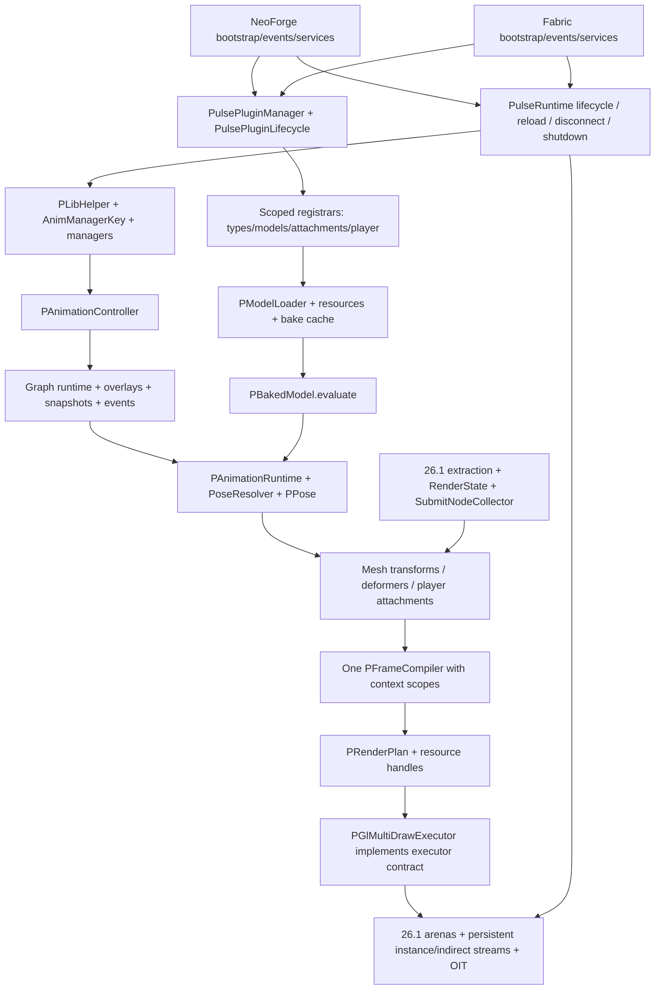

# PulseLib 26.1.2 MultiLoader: журнал и план переноса

Дата инвентаризации: **2026-10-21**. Рабочая ветка: **`26.1.2-multiloader`**.

**Этапы 0–4 выполнены в зафиксированных границах NeoForge; player/OIT depth regression закрыта — раздел 39.** 4.3c закрывает standalone item/player held-item target eligibility, direct offscreen item scopes и H15/glint boundary: 132 item pixels, 32 vanilla glint comparisons, GUI/helper/context regression 192/208/44; build / 188 JUnit / API и четыре client + два dedicated server exit 0. **5.1 выполнен:** canonical player core, 27 типов / 203 API-члена, 214 JUnit и real UUID/definitions/reload smoke — раздел 32. **5.2a выполнен:** exact attachment matrices / hand queue, 996 matrix cases, оба model formats и GPU hand draws — раздел 33. **5.2b.1 выполнен:** extracted ROOT / native Camera ownership и M-P3 — раздел 34. **5.2b.2a выполнен:** extracted rig / shared PlayerModel lifetime — раздел 35. **5.2b.2b выполнен:** native ModelPart/hand/item snapshots и scopes — раздел 36. **5.2b.2c.1 выполнен:** cube binding snapshots / deferred recovery — раздел 37. **5.2b.2c.2a выполнен:** frozen geometry queued ModelPart — раздел 40. **5.2b.2c.2b выполнен:** extraction/main/armor geometry, 239 JUnit, 80 armor nodes, native/custom models и GPU draws — раздел 41. **5.2b.3 выполнен:** callback scopes / target eligibility, 348 native checks / 48 queue cases — раздел 42. **Player/OIT fix выполнен: 252 player / 32 H13 / 1152 H14 PASS, раздел 39.** **5.2b.4a выполнен:** native/custom/deformed armor pixels, 288 states / 1512 comparisons / 324 depth witnesses — раздел 43. **5.2b.4b выполнен: animated rig/armor и registered anchor pixels, 1440 states / 7560 comparisons; glTF animated mesh-node fix — раздел 44. 5.2b.4c.1 выполнен: third-person legacy global/item attachments, ordinary-alpha fix и hideVanilla extraction guard — раздел 45; явный ordinary/OIT policy без новых render types — раздел 46. 5.2b.4c.2a выполнен: persistent first-person armor, 216 states / 9072 comparisons — раздел 47. 5.2b.4c.2b.1 выполнен: animated water/glass, 1920 states / 10800 comparisons — раздел 48. 5.2b.4c.2b.2 выполнен: animated particles/weather, 1440 states / 38880 comparisons — раздел 49. 5.2b.5a выполнен: server root-extraction isolation — раздел 50. 5.2b.5b выполнен: native respawn/reload — раздел 51. 6.1a выполнен: Fabric dedicated-server bootstrap — раздел 52. 6.1b.1 выполнен: client bootstrap/CPU reload/access targets — раздел 53. 6.1b.2a выполнен: native atlas/textured reload — раздел 54. 6.1b.2b выполнен: world lifecycle и 46 Common Mixins / 39 targets — раздел 55. 6.1 завершён в описанных bootstrap/lifecycle/audit границах. 6.2a выполнен: native pipelines/world stages и ordinary-alpha GPU witness — раздел 56. 6.2b выполнен: Fabric native OIT/target parity, 36 phases / 1152 cases — раздел 57. 6.2c.1 выполнен: Fabric native PiP factory / canonical GUI helper, 208 regions — раздел 58. 6.2c.2 выполнен: native ItemStack identity / menu/network и item GUI consumers, 384 regions — раздел 59. 6.2d.1 выполнен: Fabric living/player layers и attachment snapshots, 93 living / 4 avatar instances на epoch, 224 regions — раздел 60. 6.2d.2a выполнен: canonical armor provider / native frozen poses на обоих loaders, 192 regions — раздел 61. 6.2d.2b выполнен: native arm/geometry и GPU instancing parity обоих loaders, 192 GPU regions — раздел 62. Этап 6 завершён в описанных bootstrap/runtime/parity границах; 7.1a выполнен: external bootstrap JAR / canonical assets / automated disposable runs — раздел 63; 7.1 частично выполнен, 7.1b.1 выполнен: canonical demo content/source/JAR — раздел 64; следующий checkpoint — 7.1b.2 external regression harnesses/full flags; весь 5.2b.4 частично выполнен.** Fabric runtime — 6, финальная матрица — 7. Рефактор render-thread scopes — раздел 31.

Отдельное исправление запуска от **2026-10-24** — раздел 23: `-PpulseTestMod` пока не подключает канонический testmod и теперь отклоняется до запуска игры. Статус этапов миграции и следующий checkpoint не изменились.

## 1. Источники и безопасное продолжение

| Назначение | Ветка | Зафиксированный HEAD |
| --- | --- | --- |
| Техническая основа Minecraft 26.1.2, NeoForge, RenderState, GPU | `26.1` | `67bea7ccc6bd1d4d15f417179ef82d5a7b8aacb1` |
| Канонический публичный API, MultiLoader, современная функциональность и регрессии | `1.21.1-multiloader` | `7ce6f024b307bb821ce543344d3896c8e1fcf26b` |

Локальные ветки и `origin/*` совпали; HEAD обеих веток дополнительно проверены через GitHub API. Исходники анализировались из этих Git objects, а не из неотслеживаемых файлов рабочего каталога. [Технический источник](https://github.com/ArcAnc/PulseLib/tree/67bea7ccc6bd1d4d15f417179ef82d5a7b8aacb1), [функциональный источник](https://github.com/ArcAnc/PulseLib/tree/7ce6f024b307bb821ce543344d3896c8e1fcf26b).

Перед работой прочитан [AGENTS.md функционального источника](https://github.com/ArcAnc/PulseLib/blob/7ce6f024b307bb821ce543344d3896c8e1fcf26b/AGENTS.md). Для переносимого Java: TAB indentation, Allman braces, точка цепочки на предыдущей строке, развёрнутые методы/блоки, сохранение Javadoc/import groups, авторов и дат по Git history, лицензионные заголовки, package nonnull annotations и точные `@Nullable`. В подэтапе 1.1 `AGENTS.md` и Java `.editorconfig` перенесены в рабочее дерево из pinned MultiLoader source.

Исходное состояние: активна `26.1-multiloader`, HEAD `67bea7c`, отслеживаемых изменений нет. Целевая `26.1.2-multiloader` отсутствовала и создана непосредственно от `26.1`. Найдены **165 неотслеживаемых файлов** в `common/logs/` и `fabric/runs/` — игровые миры, настройки, логи и диагностика прежних запусков. Они не являются исходниками миграции и не включаются в commit. Не очищать их через `git clean`, не использовать как disposable test worlds. В текущей сессии их содержимое сохранено.

Исходные ветки не изменять; полного merge не делать; push и публикации требуют отдельного разрешения. Зафиксированные SHA использовать даже при продвижении удалённых веток. Обновление baseline — отдельное осознанное решение, а не следствие нового HEAD.

При следующем запуске:

1. Прочитать этот документ и `git log --oneline --decorate -8`.
2. Проверить `git status --short --branch`, HEAD исходных веток и принадлежность текущей истории `26.1.2-multiloader`.
3. При чужих изменениях сохранить их; существующую целевую ветку не пересоздавать и не reset-ить.
4. Player/OIT world depth ordering исправлен и проверен по разделу 39; продолжить **7.1b.2 — canonical external regression harnesses, native injections и full test flags** по разделу 64. Canonical demo content и source/JAR modes 7.1b.1 завершены; не переносить повторно. Packaging/JAR discovery/disposable automation 7.1a завершены на обоих loaders; не переносить повторно. Native arm bridges, frozen deformation и portable GPU instancing 6.2d.2b проверены на обоих loaders; этап 6 завершён в описанных границах. Не повторять выполненные consumers. Canonical armor provider / native selection/setup/snapshot lifetime 6.2d.2a выполнен на обоих loaders; не повторять. Living/player layer registration и attachment snapshot 6.2d.1 выполнены; не повторять. Native ItemStack identity / item GUI consumers 6.2c.2 выполнен; не повторять. GUI/PiP factory/helper 6.2c.1 выполнен; не повторять. World OIT/native-target matrix 6.2b выполнена; не повторять. Native pipeline registration/world-stage routing/ordinary alpha 6.2a выполнены; не переносить повторно. World lifecycle и полный Common Mixin application audit 6.1b.2b выполнены; не повторять. Native atlas/textured reload 6.1b.2a выполнен; не повторять. Client bootstrap/CPU reload/access-target checks 6.1b.1 выполнены; не повторять. Server bootstrap 6.1a выполнен; не повторять. Real respawn/reload выполнен; не повторять. Server root-extraction isolation выполнена; не повторять. Animated particles/weather 5.2b.4c.2b.2 выполнены в описанных границах; не переносить повторно. Water/glass 5.2b.4c.2b.1 выполнен; не переносить повторно. Persistent first-person armor 5.2b.4c.2a выполнена; не переносить повторно. Third-person legacy global/item attachments 5.2b.4c.1 выполнены; не переносить повторно. Animated rig/armor / registered callbacks 5.2b.4b выполнен; не переносить повторно. Native/custom/deformed armor depth 5.2b.4a выполнен; не переносить повторно. Callback isolation / target eligibility 5.2b.3 выполнена; не переносить повторно. Extraction/main/armor integration 5.2b.2c.2b выполнена; не переносить повторно. Frozen geometry submitted ModelPart 5.2b.2c.2a выполнена; не переносить повторно. Cube binding lifetime 5.2b.2c.1 выполнен; не переносить повторно. Native ModelPart/hand/item lifetime 5.2b.2b выполнен; не переносить повторно. Extracted rig / PlayerModel lifetime 5.2b.2a завершён; не переносить повторно. Этапы 0–4, H15/Item/glint, player core 5.1, attachments 5.2a и ROOT/Camera 5.2b.1 завершены в зафиксированных границах; не переносить их повторно. 6 — Fabric runtime, 7 — финальная матрица. После следующего проверяемого подэтапа — проверки, запись результата, отдельный local commit и остановка.

## 2. Артефакты этапа 0 и методика

Все пути в таблице относительны к этому документу.

| Артефакт | Содержание |
| --- | --- |
| [api-1.21.1-multiloader.ndjson](26.1.2-multiloader/api-1.21.1-multiloader.ndjson) | Канонический baseline: 373 доступных public/protected типа и 2236 членов |
| [api-26.1.ndjson](26.1.2-multiloader/api-26.1.ndjson) | Технический baseline: 334 доступных типа и 2042 члена |
| [api-delta.ndjson](26.1.2-multiloader/api-delta.ndjson) | Разность объявленных сигнатур, заголовков и import contexts по FQCN |
| [class-migration-map.tsv](26.1.2-multiloader/class-migration-map.tsv) | Все 533 именованных типа обеих веток, включая внутренние; наличие, API delta, этап, целевой слой, решение и адаптация |
| [source-dependencies.ndjson](26.1.2-multiloader/source-dependencies.ndjson) | Все production Java units: packages, imports, внутрибиблиотечные зависимости, Minecraft/loader references, package annotations, Git blob SHA |
| [source-manifest.json](26.1.2-multiloader/source-manifest.json) | SHA источников, охват модулей, перечни тестов/testmod/assets/shaders, Mixins и точные service providers |
| [checksums.sha256](26.1.2-multiloader/checksums.sha256) | SHA-256 шести сгенерированных файлов данных |
| [ExtractApi.java](tools/ExtractApi.java), [inventory.py](tools/inventory.py), [verify_inventory.py](tools/verify_inventory.py) | Воспроизводимая инвентаризация и проверка её корректности |

`ExtractApi` использует JDK 25 Compiler Tree API в режиме **parse-only**: разрешение внешних классов, Gradle и загрузка Minecraft не нужны. Единица идентичности — package + цепочка имён объявленных типов, включая вложенные, а не имя Java-файла. Методы учитываются по возвращаемому типу, generic bounds, именам, типам/порядку параметров, varargs, throws и modifiers. Сохранены annotations, defaults аннотаций, параметры с именами, поля с initializers, extends/implements/permits, record components, imports и исходный blob SHA.

Интерфейсные public members, public/protected вложенные типы, enum constants/`values`/`valueOf`, default constructors, record canonical constructors/accessors/`equals`/`hashCode`/`toString` учитываются, даже когда не написаны явно. Private/package-private типы входят в общую карту; недоступные через внешний тип объявления не попадают в публичный baseline. Данные охватывают production Common/Fabric/NeoForge, включая публичные implementation/Mixin/backend классы, без автоматического исключения `@ApiStatus.Internal`. Testmod и JUnit учитываются отдельно, не как API библиотеки.

**Границы baseline:** это полный перечень доступных исходных объявлений с контекстом, а не доказательство бинарной/поведенческой совместимости. Типы в сигнатурах записаны в исходном написании; imports позволяют различить, например, старый и новый `RenderType`. Wildcard imports, наследуемые внешние Minecraft методы, bridges, erasure и annotation propagation требуют semantic/compiled проверки на этапе 7. `api-delta` — консервативное сравнение заголовков, сигнатур и используемых imports; annotation metadata/default values/constant initializers нужно дополнительно сравнивать по baseline. `same-declarations` **не означает** одинаковое поведение: `AnimManagerKey` и `PAnimationPoseResolver` — реальные примеры.

Воспроизведение без изменения исходников и без сети, из корня репозитория, с Python 3.12+ и полным JDK 25 в PATH:

```bash
python3 docs/porting/tools/inventory.py --check
python3 docs/porting/tools/verify_inventory.py
```

Для намеренного пересоздания данных из тех же pinned SHA: `python3 docs/porting/tools/inventory.py`. Инструмент читает Git objects во временный каталог, не переключает ветки и не меняет runtime-код. На этапе 7 извлекать **результат миграции отдельно**, не перезаписывать канонический baseline. Сначала сверить FQCN и declared signatures, затем разрешить imports/иерархию с classpath обеих версий; каждому несовпадению назначить adapter/overload либо документированную Minecraft-причину. Одного rename `ResourceLocation` или списка файлов недостаточно.

| Охват | `26.1` | `1.21.1-multiloader` |
| --- | ---: | ---: |
| Всего tracked files | 344 | 582 |
| Production Java units, включая package-info | 286 | 342 |
| Все именованные типы, включая вложенные/внутренние | 416 | 458 |
| Доступные public/protected типы | 334 | 373: Common 353, Fabric 10, NeoForge 10 |
| JUnit source files, включая support/package-info | 0 | 22: 20 test classes и 2 вспомогательных файла |
| Java-файлы внешнего testmod | 0 | 62 |
| Testmod resource files | 0 | 46 |
| Shader resources | 10 | 40 |

Объединённая карта: **341 общий FQCN**, **117 только в MultiLoader**, **75 только в 26.1**. Среди общих — **122 с разницей деклараций/import context**, **219 с одинаковыми декларациями**. Это показатели статического анализа, не результаты компиляции или игровых тестов.

## 3. Dependency map и границы модулей

Целевая структура: `common/`, `fabric/`, `neoforge/`, `buildSrc/`, `tests/`. Common содержит единое ядро и единый клиентский renderer; наличие Minecraft client classes в Common допустимо, загрузка их на dedicated server — нет. Common не содержит ссылок на NeoForge/Fabric API. Loader-код не копирует граф, managers, loaders, pose evaluation, compiler или GPU backend.



Это карта целевых runtime-зависимостей; точные статические import edges обеих исходных веток находятся в `source-dependencies.ndjson`. `same_package_candidates` — консервативные зависимости по идентификаторам внутри package, а не доказанный call graph. Imports могут быть неиспользуемыми; reflective discovery, service providers и callback lifecycle представлены отдельно в manifest и на диаграмме.

В `26.1` обнаружено **14 production units с прямыми NeoForge references**. Их нельзя целиком положить в Common:

| Классы/подсистема | Разделение при переносе |
| --- | --- |
| `PLib`, `CommonEvents`, `ClientEvents`, `PulseLibEvents` | Bootstrap/events остаются в NeoForge; с этапа 2 регистрация расширений только через современные plugins |
| `PLibAnimationTicker`, `InstanceAnimationManager`, `SingletonAnimationManager` | Вычисления и cache lifecycle в Common; подписки/tick/entity leave callbacks в loader |
| `PLibRegistration` | Канальные/event/deformer registries в Common; DeferredRegister игрового demo content в testmod |
| `PRenderStagesHandler`, `PRenderTypes`, `PResourceCache` | Стадии/ресурсы и pipeline logic в Common; event wiring и регистрация shaders/atlas/reload в loader |
| `PAttachmentAnchorResolvers`, `PLibArmorHandler` | Общие операции установки anchors/layers; loader вызывает их из своих hooks |
| `PArmorClientExtensions` | NeoForge; в Common современный `PArmorModelProvider`, Fabric использует свой armor hook |

В современном Common прямых loader imports/references не найдено. Три ServiceLoader-контракта: `IPulsePlatform`, `IPulseCameraService`, `IPulsePluginFinder`; в manifest зафиксированы все шесть descriptors, по три на загрузчик. `PulseClientServices` и client registrars не должны инициализироваться на физическом сервере. Ровно один provider каждого сервиса должен попадать в соответствующий loader JAR.

## 4. Class migration map: ключевые контракты

Package prefix: `com.arcanc.pulselib`. В столбце «наличие» сначала `26.1`, затем MultiLoader. Полные FQCN, вложенные типы и все declared signature deltas см. в TSV/NDJSON; здесь зафиксированы смысловые решения, которые нельзя вывести из совпадения имён.

| Класс/подсистема | Наличие | API и современные изменения | Что переиспользовать / что перенести | Адаптация Minecraft 26.1.2 |
| --- | --- | --- | --- | --- |
| `content.animatable.PAnimatable<T>` | да / да | Две основные сигнатуры совпадают; современный контракт доступа после завершения owner construction | Сохранить FQCN/generic/методы; применить современную семантику manager access | Ключ из extract phase передавать в submit state; не создавать controllers в owner constructor |
| `PAnimationController<T>` | да / да | Добавлен `setGraphSnapshotContexts`; precise graph events, snapshot base, cyclic/reverse cursor fixes | Современная реализация, без восстановления старых event loops | Узкая адаптация запросов entity/render state; core math не зависит от loader |
| `PAnimationManager<T>` | да / да | Добавлены `getManager(AnimManagerKey)`, synchronized `initializeControllers()`; H18, атомарное создание и защита рекурсии | Современные factories, registrar, maps; старый constructor callback удалить | Независимый owner/key; callbacks вызывать после construction, refresh usage из renderer/ticker |
| `instance.InstanceAnimationManager` | да / да | `removeUnused()` без NeoForge event; identity map и обновление last-used, L25 | Современный cache/lifecycle; platform ticks отдельно | `net.minecraft.Util` в старой ветке против `net.minecraft.util.Util` в 26.1; entity removal/chunk unload hooks |
| `singleton.SingletonAnimationManager` | да / да | Современный `getManager(key)`; shared cache индексируется owner identity + key, lazy controllers | Перенести современный owner-key cache; одна реализация managers | Client lifecycle вызывает cleanup; не разделять cache по renderer/platform |
| `AnimManagerKey` | да / да | Сигнатуры совпадают, поведение существенно изменено: runtime ID стека и зарезервированный sign bit | Современные factories; старый hash(item/count/components) убрать | ItemStack Mixin и реальные copy/split paths 26.1; UUID/block position/dimension factories адаптировать |
| `util.helpers.PLibHelper` | да / да | Современные `createInstanceManager`, `createSingletonManager`, `getManager(owner/key/stack)`, GUI helper; boolean factory overload сохранён | Современное единообразие доступа; state factories 26.1 допустимы как дополнительные overloads | `GuiGraphics` → `GuiGraphicsExtractor` и submit context; `ResourceLocation` → `Identifier` |
| `content.model.animation.PAnimation` | да / да | Добавлены `forEachCyclicEvent` overloads; modern sampling; C1/H1/H2 | Современные события/sampling/compiled data; форматные codecs согласовать с 26.1 | Resource identifier types; core time остаётся в ticks, `query.anim_time` в seconds |
| `PAnimationGraphRuntime` | да / да | 13 новых declared signatures; overlay speed/restart/stop, precise tracks, sampleBasePose/samplePose, L1/L4/reverse | Целиком современная runtime-семантика + PPoseSnapshot; не второй graph implementation | Адаптировать model binding/context capture, без привязки к loader/render backend |
| `PAnimationPoseResolver` | да / да | Основные сигнатуры совпадают; visibility и activeBones теперь берутся из вычисленной pose | Современная реализация и contexts; не отдельный bone sampler в renderer | Матрицы и render-state данные подавать через единый PPose pipeline |
| `PAnimationRuntime` | да / да | Два новых `captureGraphBase` overloads; graph samplePose и accumulated base, snapshot continuity | Современное вычисление TRS/visibility/masks; прежняя graph-layer approximation заменяется | `PBakedModel.evaluate` остаётся единой точкой; adapter к 26.1 mesh context |
| `content.model.PModel` | да / да | Поля `bones`, `meshes`, `boneMeshes`, `animations` и их generics совпадают; после удаления комментариев реализации совпадают | Публичные поля сохранить, не вводить новую модель данных | Сам класс не требует loader API; adapt loaders/baking вокруг него |
| `content.model.baked.PBakedModel` | да / да | Современные draw overloads и pose resolver; обе ветки уже имеют `evaluate` | Современное animation-facing API; 26.1 baking/material/buffer integration сохранить | `RenderType` новый package, `Identifier`, GPU-backed geometry и mesh deformation |
| `PBakedBone`, `PBakedMesh`, deformers | да / да; есть новые buffer/stream types | `mixBone` ещё существует в обеих ветках; это не основание использовать его как параллельный evaluator | Современный PPose и semantic channels; 26.1 GPU buffers/subdivision сохраняются | `PSubdividedMeshCache`, PGpuDeformerBuffers, buffer lifetime; legacy vertex buffer классы не копировать механически |
| `content.renderer.PRenderer` и Entity/Block/Item renderers | да / да | Старый современный contract принимает owner/MultiBufferSource; 26.1 принимает RS/CameraRenderState/SubmitNodeCollector, отличаются generics | FQCN/операции/extension hooks MultiLoader сохранить через adapter/overload; 26.1 state extraction/submission — техническая основа | EntityRenderState, BlockEntityRenderState, ItemStackRenderState, CameraRenderState, special item renderer; каждый unavoidable signature delta записать |
| `PRenderQueue`, `PRenderContexts` | queue да / да; contexts нет / да | Modern PGeometryData/PDynamicGeometry/PInstanceHeader; `flushOpaque`, combined sort, local scopes, destination-aware composition; cleanup spelling отличается | Одна современная очередь/compiler; scopes — контексты одного pipeline; никаких двух конкурирующих world queues | GUI/offscreen scope захватывать и восстанавливать при deferred SubmitNodeCollector исполнении, включая исключения |
| `plan.PFrameCompiler` | да / да | `<S,P,M,I>` → канонический `<S>` с handles; compileOpaque/Combined/All/discard; L18/H13 | Современный compiler и pass tests; убрать MC RenderType knowledge из compiler | OIT capability predicate передаёт backend, не loader; depth/alpha semantics сохраняются |
| `plan.PRenderPlan`, `PDrawGroup` | да / да | Modern негeneric plan имеет packed `groups` + `instances`, draw commands/baseInstance | Современная структура; bridge handles к существующей geometry arena | Сохранить baseVertex/baseInstance/indexCount/indexType, indirect draw и instance layout |
| `PRenderExecutor`, capabilities/matrix/host/frame | нет / да | Новые канонические contracts, включая fallback strategies | Перенести contracts; `PGlMultiDrawExecutor` реализует их непосредственно либо через узкий adapter | Capture frame по 26.1 RenderSystem/CameraRenderState; capability probe без смены алгоритмов |
| `renderer.gl.PGl*` | да / нет | Нативный 26.1 GPU backend; не заменять старым `legacy.Gl*` | Все шесть основных классов, fences, persistent streams, geometry batching, indirect paths, OIT и shaders сохраняются | RenderPipeline/RenderPass/GpuTextureView/ScissorState; modern render plan → существующие draw batches |
| `renderer.legacy.Gl*` | нет / да | Даже публичные backend классы входят в baseline | Не переносить второй работающий backend. Сначала проверить возможность source-compatible фасадов поверх PGl backend; несовместимости документировать по каждому FQCN | Старые raw GL/VertexBuffer API не соответствуют новой Blaze3D integration |
| `content.registration.PLibRegistration` | да / да | `init(IEventBus)` → `init()`; старые игровые DeferredRegister-подклассы в современном API отсутствуют | Современные AnimationChannelReg/AnimationEventReg/DeformerReg сохранить; demo registries вынести | Внутренние registry consumers остаются; public extension registration проходит через plugins |
| `api.plugin`, `api.registration`, `plugin` | нет / да | Канонические аннотация, common/client interfaces, 6 registrars, finder/scanner/candidate/lifecycle/manager | Перенести полностью; scoped/atomic registration, deterministic discovery, side filtering до class loading, model reload retry | NeoForge mod scan/root discovery; Fabric mod roots/dev classpath grouping; ASM поддержка bytecode Java 25 |
| `platform` | нет / да | IPulsePlatform, IPulseCameraService, PulseServices, PulseClientServices | Сохранить ServiceLoader architecture и ровно один provider на платформу | 26.1 passenger/camera API; client camera classes не трогать на server |
| `content.player.animation` и attachments | да / да | Современные frame/hierarchy/root/camera transformations, public spaces overloads, M-P2/M-P3 | Современные definitions/instances/masks/blend modes/first-person rig; per-player UUID runtime | Сохранить 26.1 setupAnim/submit/Camera.alignWithEntity/hand hooks, адаптировать к новой математике и state extraction |
| `data.PModelLoader`, `PLoadedModel`, parsers/cache | да / да | Modern `modelResourceCandidates(id)`, `loadModel(..., id)`; 26.1 bulk `loadModels(..., consumer)` и physical candidates | Сохранить канонические singular API через batch adapters; concurrent reload safety современного cache; не потерять 26.1 resource loading | PreparableReloadListener.SharedState в 26.1, atlas/Identifier/texture views; GLB embedded и внешние image URI сохраняются |
| `PResourceCache`, texture atlas, utilities | да / да | Modern plugin model declarations, loader-free registration hooks; другие metadata names и texture-name fallback | Публичные helper signatures и modern model registration; текущие 26.1 atlas/baking/URI algorithms адаптировать | `PLibSpriteMetadata`/`PLibMetadata`, reload signatures, atlas registration, Identifier; не заменять texture resolution только ради старого helper body |

Для каждого вспомогательного класса/вложенного типа TSV задаёт слой и соответствующую политику из этой таблицы. Решение `compatibility-review` означает обязательную проверку адаптера, а не разрешение удалить API. Переименование/удаление canonical PulseLib API в этапе 0 **не принято**.

## 5. Реестр исправлений и доказательства для следующих этапов

История функционального источника: `e591523` (исходная MultiLoader структура), `62eca18` (plugins/demos), `4b22a67` (C1 и группа исправлений), `5c22705` (M-P2), `a96f947` (M-P3), `a9d98d8` (reverse overlays), `5ae0264` (ItemStack identity), `2587dd2` (H13/H15/H18), `5b59617` (современные sampling/lifetime fixes и cleanup), `7ce6f02` (Gradle). Использовать итоговые файлы pinned HEAD: поздние изменения могут дополнять или заменять ранние patch hunks. Не cherry-pick-ить большие commits целиком.

| ID / контракт | Отличие и источник реализации | Обязательная проверка после переноса |
| --- | --- | --- |
| M-A3 | ticksToSeconds + sampling contexts; некоторые 26.1 contexts уже делят на 20, нужна согласованность всех paths | PAnimationTimeTest; sampling harness |
| M-A4 | PExpressionEvaluator больше не хранит глобальные TIME_ONLY values по quantized clip time | PExpressionEvaluationTest: разные query resolvers/contexts при одном времени |
| H2 | PAnimationTrackSampler + 4-point channel overloads; настоящие соседние pre/post control points | PCatmullRomSamplingTest, оригинальный animation fixture |
| H1 | PMolangEulerRotationValue.evaluateEuler + интерполяция до quaternion conversion | PGeckoEulerSamplingTest, Gecko 360°/720°; PGltfQuaternionSamplingTest сохраняет SLERP |
| L25 | InstanceAnimationManager identity map с refresh timestamp | InstanceAnimationManagerTest; 21+ секунд, два cleanup cycles, removal/chunk unload/disconnect в игре |
| C1 | PCyclicAnimationEvents, precise double tracks, directional boundary contract | PCyclicAnimationEventsTest: multi-cycle/large times/reverse/departure/arrival |
| H18 | Lazy initializeControllers, owner/key cache, единые helper getters | PAnimationManagerAccessTest; реальные field initializer owners, независимые graphs/stacks |
| L1 + reverse | Один runtime instance на overlay definition, frozen pose при нулевой скорости, независимые fades, finite negative speed | POverlayLifecycleTest/POverlayReverseTest и loaded-model lifecycle harness |
| L4 | PPoseSnapshot, PPoseMixer и graph captureGraphBase сохраняют последнюю вычисленную TRS/visibility при RESTART | PPoseMixerTransitionTest/PGraphRestartTest, не только сравнение имён/time |
| M-P2 | Современные PPlayerAnimationSpace/Frame/anchor matrices и visual root pivot | PPlayerHierarchyTest, PlayerMotionHarness phase mp2, несколько игроков/definitions/masks |
| M-P3 | Camera bind hierarchy и displacement в правильных пространствах | PPlayerCameraTest; actual Camera position/quaternion, phase all |
| H13 | compileOpaque + ранний flush Entity/Block opaque до transparency | PFrameCompilerPassTest; реальные depth/RGB перед водой/стеклом |
| H14 | Destination-aware OIT, Fabulous vanilla targets, depth peeling/composition и restoration | H14Harness: 38 offscreen cases + world/weather pixels, reload и resize |
| H15 | PRenderContexts local scope, GUI/entity dispatcher boundary, discard/restoration при исключении | RenderRegressionHarness: GUI/offscreen/nested targets и реальные renderer entrypoints |
| L18 | compileCombined сортирует обычную alpha transparency глобально между нужными stages; OIT batches отдельно | PFrameCompilerPassTest + пересекающиеся Entity/BlockEntity transparency pixels |
| ItemStack identity | transient volatile ID; copy намеренно сохраняет identity, частичный split разделяет, полный перенос переносит ID; counter не держит stacks/controllers | PItemStackAnimationIdsTest + ItemStackIdentityHarness: copy/split/stacking, реальные menu/network/NBT round trips, cache cleanup/reentry |

Molang persistent variables, root motion, overlays, typed channels, custom interpolation и negative playback входят в функциональный контракт. ID стека не попадает в NBT/Data Components; новый deserialized Java stack получает новую runtime identity. Идентичность не обещается между сетевыми заменами объектов. Преобразования времени ограничить Molang query boundary: нельзя глобально заменить ticks на seconds во всех clip/event clocks.

## 6. Toolchain и потенциальные конфликты

| Компонент | В `26.1` | В MultiLoader source | Решение для этапа 1 |
| --- | --- | --- | --- |
| Minecraft / Java | 26.1.2 / 25 | 1.21.1 / 21 | 26.1.2 / 25, включая Gradle JVM и compilation toolchain |
| NeoForge | 26.1.2.95 | 21.1.216 | Сначала сохранить 26.1.2.95; подтвердить artifact resolution/metadata |
| ModDevGradle | 2.0.141 | 2.0.140 | 26.1-compatible MDG, starting point 2.0.141; проверить Common NeoForm setup |
| Gradle wrapper | 9.2.1 | 9.2.1 | Проверить совместимость выбранного Loom; при необходимости отдельное изменение wrapper |
| Fabric Loader / API | отсутствуют | 0.19.5 / 0.116.17+1.21.1 | Выбрать и зафиксировать подтверждённые 26.1.2 versions по Fabric metadata; старый API не подходит |
| Fabric Loom | отсутствует | 1.12.7, `fabric-loom` | Unobfuscated `net.fabricmc.fabric-loom`; конкретную версию и Gradle requirement проверить перед изменениями |
| Mappings / NeoForm | Нет Parchment в base | Parchment 2024.11.17, NeoForm 1.21.1-20240808.144430 | Старые mappings не переносить. Для Common подтвердить 26.1.2 NeoForm/vanilla setup; plain Minecraft, без NeoForge patches |
| Runtime libraries | jgltf 2.0.3, Jackson 2.13.x с ranges | Те же библиотеки pinned; JUnit 5.11.4, ASM 9.9.1 | Сохранить нужные transitive libs и loader jar inclusion; проверить ASM/Mixin чтение Java 25 classfiles |
| Library version | 1.1.5.3 | 1.2.0 | На этапе 0 без изменений; для функционального MultiLoader релиза ориентир 1.2.x, не 2.0 |

Официальная документация подтверждает: 26.1 unobfuscated, Fabric использует новый Loom plugin без mappings/remap, обычные dependency configurations и `jar` вместо `remapJar`; Java 25 обязательна. Для NeoForm изменён формат версии; NeoForge рекомендует MDG 2.0.141 на момент release article. Это не подтверждение текущих последних версий и не проверка сборки. [Fabric 26.1](https://www.fabricmc.net/2026/03/14/261.html), [NeoForge 26.1](https://neoforged.net/news/26.1release/).

Основные конфликты, требующие отдельных проверяемых адаптаций:

1. `ResourceLocation` → `Identifier`, перемещение `RenderType`, `Util`, reload API, texture atlas и special item renderers. Сохранить имена PulseLib; Minecraft types менять по необходимости.
2. Owner-facing PRenderer против extraction/submission RS contract. Сначала проверить overloads/adapters; нельзя молча сократить extension hooks или потерять nullable/additionalData semantics.
3. Singular model loading API против рабочего 26.1 batch/physical resource discovery. Обернуть batch в современный контракт, сохранив atlas order и ошибку missing resource; не откатывать обновлённую 26.1 resource loading реализацию.
4. Современные resource handles/packed commands против PBakedMesh + InstanceData в PGl executor. Согласовать layout, index offsets и GPU deformation offsets; capability fallback не должен превращать instancing в обычный per-object renderer.
5. H14 source использует старую vanilla transparency chain. Переносить поведение через 26.1 RenderPass/targets, а не копировать старые JSON/injection descriptors. В текущем PGl backend уже четыре OIT слоя и target-indexed state; их сохранить.
6. GUI extraction/deferred submission: scope должен пережить правильный участок collector execution; одних ThreadLocal guards вокруг extract недостаточно без проверки порядка выполнения.
7. Общий пакет с client types не равен server-safe classloading. Проверять bootstrap graph, plugin side filtering до `Class.forName`, client factory isolation, Mixins lists и ServiceLoader descriptors.
8. ItemStack 26.1 registry-bound construction/ItemStackTemplate: runtime ID применяется к живому ItemStack; tests не должны создавать stacks до готовности registries. Проверить актуальные copy/split signatures. [Fabric: ItemStackTemplate](https://www.fabricmc.net/2026/03/14/261.html).
9. `legacy.Gl*` присутствуют в публичном baseline; фасады должны использовать тот же backend. Необоснованное удаление этих типов или создание второго GPU engine недопустимы.
10. В обеих ветках `pulselib*.mixins.json` указывает JAVA_21 при Java 25 target. Не менять в этапе 0; проверить поддерживаемые Mixin compatibility levels в выбранном 26.1 toolchain.
11. Common sources компилируются и включаются в loader JARs по convention plugins MultiLoader. Исключить двойные resources/package-info, service providers чужой платформы и demo assets в release JAR.
12. Старые testmod README ссылки на удалённые `docs/reviews/*` не являются доступными результатами проверки. Changelog содержит исторические счётчики тестов; текущий source manifest точнее. Ни прежние логи в рабочем дереве, ни прошлый PASS не подтверждают миграцию.

## 7. Поэтапный план и критерии приёмки

Подэтапы ниже — границы небольших локальных commits. Если один подэтап перестаёт быть обозримым, делить дальше и указывать точный integration debt. Крупный этап завершён только после всех его критериев; успешная компиляция не заменяет запуск игры.

| Этап / подэтап | Работа и отдельный результат | Проверки для завершения |
| --- | --- | --- |
| **0 — выполнен** | Pin SHA, новая ветка от 26.1, dependency/class/API map, план и воспроизводимые tools | AST + javac/javap fixture; полное покрытие sources/types; regeneration/checksums; diff scope; сохранность веток и исходных untracked файлов |
| **1.1 — выполнен** | buildSrc/common/neoforge/fabric skeleton от 26.1; verified dependency pins/Java 25; AGENTS/style; источник/ресурсы остаются 26.1 | `:common:compileJava`, `:neoforge:build`; Fabric project/tasks конфигурируются; Common compile classpath не опирается на NeoForge patches |
| **1.2 — выполнен** | Отделить 14 NeoForge-bound units/hooks; сохранить 26.1 RenderState/GPU/shaders/atlas и рабочий bootstrap | Common без loader references; NeoForge client + dedicated server startup/normal stop; renderer на прежних assets. При необходимости минимальный изолированный test fixture, не полная миграция testmod |
| **2.1 — выполнен** | Canonical plugin/registrar/lifecycle/platform contracts и loader discovery; ServiceLoader descriptors | Scanner/manager/lifecycle JUnit перенести уже здесь; annotation sides, deterministic IDs, deduplication/atomic registration/model retry |
| **2.2 — выполнен** | Перевести registries/resources/attachments/player declarations на plugins; удалить старый extension event path | NeoForge common/client plugins реально обнаружены; dedicated server не загружает client plugin; нет повторных типов/controllers; registry smoke и normal exit |
| **3.1 — выполнен** | Canonical managers/helper/AnimManagerKey/ItemStack runtime ID + 26.1 ItemStackMixin | ManagerAccess/InstanceManager/ItemStackIds JUnit; реальная transformed stack copy/split/stacking identity; construction и cleanup |
| **3.2 — выполнен** | Modern channels/interpolation/Molang/Gecko/glTF sampling + события | Time/Expression/CatmullRom/GeckoEuler/GltfQuaternion/CyclicEvents JUnit и оригинальные fixtures; negative playback |
| **3.3 — выполнен** | Graph/overlays/transitions/PPoseSnapshot/runtime/resolver/masks/root motion; новый PPose — единственный evaluator | OverlayLifecycle/Reverse, PoseMixerTransition, GraphRestart JUnit; backend compile adapter локализован, без второго manager/pose pipeline |
| **4.1a — выполнен** | Canonical PFrameCompiler/PRenderPlan/capabilities/handles/executor; единственная queue и PGl adapter; CPU frame capture из actual projection uploads | 18 types/121 members; 168 JUnit; реальные GPU buffers, UBO match, stale-handle rejection после reload и normal shutdown |
| **4.1b.1 — выполнен** | Portable immutable/dynamic geometry и canonical queue submissions в том же native arena/executor | 173 JUnit, strict geometry queue API, actual 16/32-bit GPU draws/bytes и bounded dynamic slots до/после reload; normal client/server shutdown |
| **4.1b.2 — выполнен** | Canonical baked/model API, material/deformation caches, direct pose drawing и owner model lookup на backend 26.1 | 175 JUnit; 14 types/105 members; native triangles/readback/deformer UBO/queue isolation/visibility/pose restoration, reload и normal client/server exit |
| **4.1b.3 — выполнен** | Canonical owner traversal/extension API, inherited contexts, captured main/layer models и MC26 adapters | 177 JUnit; 7 types/86 members без необъяснённых пропусков; actual owner/state hooks, sibling isolation, forward-bound layer, Molang counts, packed plans/GPU queries и normal reload/shutdown |
| **4.2a — выполнен** | Ранний opaque Entity/BlockEntity и единый late alpha pass трёх world sources после particles | 178 JUnit; native hook sequence и actual GPU RGB/depth до/после reload; API/backend сохранены |
| **4.2b.1 — выполнен** | Canonical explicit depth/destination API, depth-preserving обычный OIT resolve на прежнем backend | 178 JUnit; 10 GPU pixel cases до/после reload, four-layer order, source/override/destination isolation и caller state |
| **4.2b.2a — выполнен** | Fabulous API/shaders, native framegraph target lifetime, opaque snapshot и afterWeather | 178 JUnit; 24 actual postchain pixels, 4 native mode/depth cases, reload/shutdown |
| **4.2b.2b — выполнен** | Реальные owner/terrain H13/H14 scenes, включая non-improved order | H13 32 + H14 1152 actual GPU cases; native targets/weather depth/close-layer accumulation исправлены |
| **4.2b.2b.1 — выполнен** | H13 реальные opaque Entity/BlockEntity перед/за водой и стеклом | 32 native GPU RGB/depth cases, Improved Transparency off/on, light-ready и reload, normal shutdown |
| **4.2b.2b.2 — выполнен** | H14 реальные translucent owners / particles / weather, native Fast/Fancy/Fabulous | 1152 cases, 384 actual particle overlaps, 262 rain overlaps, reload; 183 JUnit, 26 controlled + 4 depth и H13 regression PASS |
| **4.2c — выполнен** | Полный GPU resource lifecycle | 810 frames; три resize, два reload/reconnect, actual GL deletion/mappings/caches, normal exits; production unchanged |
| **4.3 — выполнен** | H15 GUI/offscreen local contexts и PLibHelper.renderModelInGui с SubmitNodeCollector | Реальные Entity/Item GUI pixels; nested/offscreen scopes, exception cleanup, отсутствие world queue pollution и GL state restoration |
| **4.3a — выполнен** | Canonical explicit PRenderContexts / GlRenderState, local compiler ownership на единственном GPU backend | 4 types / 14 API members; 44 actual pixels, 11 geometry + 5 baked overloads, GPU values/queue/OIT isolation, native bindings/guards, reload и normal exit |
| **4.3b.1 — выполнен** | Native Entity PIP / Item atlas / oversized PIP execution scopes, failed native collector/pose recovery | 192 actual GUI regions, 6 failures/recovery, 44 explicit-scope regression pixels, reload; 183 JUnit, normal client/server exit |
| **4.3b.2 — выполнен** | Canonical PLibHelper.renderModelInGui / Common GUI snapshot + native NeoForge PIP registration | 208 RGB/text checks, 4 expected exceptions, 9 canonical declarations; native GUI regression 192 / 6, 183 JUnit и normal exits |
| **4.3c — выполнен** | Standalone item/player target eligibility, glint и оставшаяся H15 matrix | Native world/hand/GUI/offscreen boundary cases без дублирования queue/evaluator |
| **5.1 — выполнен** | Modern player frames/spaces/masks/blend/root/camera math и attachment registration | PlayerHierarchy/PlayerCamera JUnit, независимость нескольких UUID/definitions |
| **5.2 — частично** | Native player integration поверх 26.1 rendering foundation | Разделён на 5.2a / 5.2b; полная motion matrix ещё не завершена |
| **5.2a — выполнен** | Exact anchor/mesh attachment matrices, canonical collector API и native first-person queue | 996 matrix cases / 5 modes / Gecko+glTF / reload; native world/hand submissions, GPU draws, callback recovery; 217 JUnit |
| **5.2b — частично** | Оставшиеся native player consumers | Разделён на ROOT/Camera lifetime и deferred rig/armor/deformer integration |
| **5.2b.1 — выполнен** | Extracted ROOT snapshot, invocation-local restoration, actual Camera owner и M-P3 | 40 Camera cases, 1833 native checks, nested ROOT failures/recovery, foreign camera, reload; 220 JUnit и 5.2a regression |
| **5.2b.2a — выполнен** | Extracted rig и shared PlayerModel scopes — раздел 35 | 224 JUnit / API; native submit/deferred nested failure/recovery/reload; ROOT/Camera и GPU hand regression |
| **5.2b.2b — выполнен** | Native ModelPart/hand/item snapshots/scopes — раздел 36 | 225 JUnit / API; 4 native suites / 32 ожидаемых exceptions; ROOT/Camera/rig, GPU hand и GUI/glint regression |
| **5.2b.2c — выполнен в описанных границах** | Cube binding/frozen geometry, main/armor extraction | Разделы 37, 40, 41; 239 JUnit, 80 native armor nodes, custom/shared models, first-person и reload |
| **5.2b.3 — выполнен** | Callback scopes / native target eligibility — раздел 42 | 348 native checks, 120 target checks, 48 world/GUI/offscreen queue cases; build / 239 JUnit / GPU hand / GUI-glint |
| **5.2b.4a — выполнен** | Native/custom/deformed armor world pixels — раздел 43 | 288 states / 1512 comparisons / 324 depth witnesses, Fast/Fancy/Fabulous и reload; negative early-depth control |
| **5.2b.4b — выполнен** | Animated rig/armor / registered anchor pixels; glTF mesh-node channels — раздел 44 | 1440 states / 7560 comparisons, 241 JUnit, два discriminating pixel mutations |
| **5.2b.4c.1 — выполнен** | Third-person legacy global/item attachments; ordinary alpha и hidden armor extraction — раздел 45 | 720 states / 3780 comparisons, 864 green pixels, 540 motion witnesses; build / 241 JUnit / negative + scope regressions |
| **5.2b.4c.2a — выполнен** | Persistent first-person armor после native hand depth — раздел 47 | 216 states / 9072 comparisons, 1728 green pixels, 1944 motion witnesses; 241 JUnit, negative + callback regressions |
| **5.2b.4c.2b.1 — выполнен** | Animated-owner water/glass pixels — раздел 48 | 1920 states / 10800 comparisons, 2160 motion + 2160 format witnesses, 241 JUnit; negative control |
| **5.2b.4c.2b.2 — выполнен** | Animated-owner particles/weather — раздел 49 | 1440 states / 38880 comparisons, 1080 motion + 1080 format witnesses; native weather/OIT negative |
| **5.2b.5a — выполнен** | M-P2 server root-extraction isolation | Real dedicated-server owners/definitions/masks, motion extraction без изменения physics/client classloading |
| **5.2b.5b — выполнен** | Real respawn witnesses | Owner/manager lifetime, definitions и motion после настоящего respawn/reload |
| **6.1 — выполнен в описанных границах** | Fabric bootstrap/discovery/services/reload/registration/events/Mixins/access rules | Bootstrap/lifecycle/type/selector audit — разделы 52–55; behavioral render parity — 6.2 |
| **6.1a — выполнен** | Fabric common entrypoint, external plugin discovery/services/registration | Реальный dedicated server, 3 candidates / 2 loaded plugins, registry contribution, side-safe classloading и normal exit — раздел 52 |
| **6.1b — выполнен в описанных границах** | Fabric client bootstrap, resource lifecycle, events и Mixins/access rules | Разделы 53–55; полный render-consumer matrix — 6.2 |
| **6.1b.1 — выполнен** | Client registration, shared CPU model reload, access targets | Реальный client/reload/shutdown, 6 widened targets, server boundary — раздел 53 |
| **6.1b.2 — выполнен** | Atlas/textured models, world lifecycle и remaining Mixins audit | Подэтапы 6.1b.2a и 6.1b.2b — разделы 54–55 |
| **6.1b.2a — выполнен** | Native atlas/runtime source/metadata и Gecko/glTF textured reload | 24 mesh observations / 648 UV / 48 GPU pixels, negative control, normal client/server exit — раздел 54 |
| **6.1b.2b — выполнен** | World tick/unload/disconnect и remaining Mixins/access-consumer audit | Два connections/reloads/unloads/expiry cycles, 46 applied Mixins / 39 targets, NeoForge hand regression — раздел 55 |
| **6.2 — выполнен в описанных границах** | Fabric client/stage/GUI/transparency/armor hooks поверх того же Common/PGl backend | 6.2a/b/c/d выполнены; полная объединённая regression/API/GPU matrix — этап 7 |
| **6.2a — выполнен** | Native pipeline registry и world-stage routing | 19 pipelines, 2 epochs / 40 RGB-depth samples, late ordinary alpha, negative + lifecycle regression — раздел 56 |
| **6.2b — выполнен** | Fabric OIT/Fabulous native-target parity | 36 phases / 1152 RGB-depth cases, five native targets, Fast/Fancy/Fabulous, reload, pixel negative control — раздел 57 |
| **6.2c — выполнен в описанных границах** | Fabric GUI/Picture-in-Picture registration и item/GUI parity | GUI/helper 6.2c.1 и native item/identity 6.2c.2 — разделы 58–59 |
| **6.2c.1 — выполнен** | Shared GUI renderer factory и canonical helper через native PiP pool | 208 regions / 2 fault-recovery suites, 6 native renderer instances на frame, reload, negative/server boundary — раздел 58 |
| **6.2c.2 — выполнен** | Native ItemStack identity и Fabric item/GUI consumers | 16 identity scenarios, native menu/network, 8 phases / 384 regions / 2 fault suites, negative control — раздел 59 |
| **6.2d — выполнен в описанных границах** | Fabric armor/player hooks и deformation/instancing parity | Native layers/provider 6.2d.1/2a и arm/geometry/instance consumers 6.2d.2b — разделы 60–62 |
| **6.2d.1 — выполнен** | Fabric native living/humanoid/player layers и attachment extraction | 93 living / 4 avatar instances × 2 epochs, 12 snapshot checks / 224 regions, two negative controls — раздел 60 |
| **6.2d.2 — выполнен в описанных границах** | Canonical armor/arm bridges и native deformation parity | Provider 6.2d.2a и arm/geometry/instancing consumers 6.2d.2b |
| **6.2d.2a — выполнен** | Canonical PArmorModelProvider / selection/setup/slot masks/frozen geometry обоих loaders | 192 native PiP regions, 12 provider failures, nested/reload/ordinary/generic extension и replay negative control — раздел 61 |
| **6.2d.2b — выполнен** | Native arm bridges и frozen deformation / GPU instancing parity обоих loaders | 64 armor / 16 hand nodes, 8 native arm call sites, 173152 vertex comparisons / 192 GPU regions, два negative controls — раздел 62 |
| **7.1 — частично** | Внешний canonical testmod/harnesses/assets и автоматические disposable runs | Packaging 7.1a и content/source/JAR 7.1b.1 завершены; full harnesses/flags — 7.1b.2 |
| **7.1a — выполнен** | Packaged external bootstrap обоих loaders, canonical GLB/Gecko assets и fresh disposable worlds | 4 JAR-only client/server runs, 2 epochs/client, 5 guards, annotation negative, build / 241 JUnit — раздел 63 |
| **7.1b — частично** | Canonical demo content и external regression harnesses | Content/source/JAR 7.1b.1 выполнен; полная консолидация/full flags — 7.1b.2 |
| **7.1b.1 — выполнен** | Canonical blocks/entities/items/renderers/player demos и MC26 item definitions | Восемь source/JAR client/server runs, 100 resource checks/client, native scene/reload/callbacks, negative item wiring — раздел 64 |
| **7.1b.2 — следующий** | Canonical harness/assertion inventory, native injections и полные source/JAR test flags | Консолидация с существующими 26.1.2 stage suites без потери assertions; полный bundle только после реального wiring |
| **7.2** | Полная client GPU matrix, API report against frozen baseline, renderer comparison against frozen 26.1 | Реальные игровые результаты с exit codes/артефактами; список каждого API delta с причиной; контролируемый GPU profiling при возможности |

Регрессионные тесты переносить вместе с соответствующим исправлением в этапах 2–6. Этап 7 завершает и объединяет testmod/harnesses, а не впервые включает тестирование. Не отключать существующие тесты и не заменять ожидания заглушками.

## 8. План проверки результата миграции

Команды ниже — **запланированные**, в этапе 0 не выполнялись. Они основаны на актуальном MultiLoader testmod README, но потребуют адаптации Gradle conventions/harness Mixins к 26.1; не считать их заранее рабочими. **На текущей ветке `-PpulseTestMod` не реализован и отклоняется до запуска игры** (раздел 23). Для доступного NeoForge fixture использовать `-PpulseStage1Smoke` и отдельный новый мир по [tests/README.md](../../tests/README.md).

```bash
./gradlew build --no-daemon
./gradlew :common:test :fabric:test :neoforge:test --no-daemon
./gradlew :neoforge:runServer -PpulseTestMod -PpulseSmokeAuto --no-daemon
./gradlew :fabric:runServer -PpulseTestMod -PpulseSmokeAuto --no-daemon
./gradlew :neoforge:runClient -PpulseTestMod -PpulseSmokeAuto -PpulseSmokeWorld --no-daemon
./gradlew :fabric:runClient -PpulseTestMod -PpulseSmokeAuto -PpulseSmokeWorld --no-daemon
```

Отдельные client runs на обоих loaders:

| Флаги помимо `-PpulseTestMod` | Что подтверждают |
| --- | --- |
| `-PpulseSmokeAuto`, затем `-PpulseGeckoDemo` | Реальные glTF/Gecko rigs, sampling, overlay/restart/reverse, GPU deformation и explicit cleanup |
| `-PpulseSmokeAuto -PpulseSmokeWorld` | H13/H15/H18, opaque world depth, GUI/offscreen, natural disconnect и manager lifetime |
| `-PpulseOitTest`, затем `-PpulseOitTest -PpulseSmokeWorld` | H14 offscreen/world/weather pixels, state restoration, reload, resize |
| `-PpulsePlayerMotionTest -PpulseMotionPhase=all` | M-P2/M-P3 actual camera/anchor/item poses, multiple definitions, reload и respawn |
| `-PpulseItemIdentityTest` | Реальные transformed ItemStack, inventory/menu operations, copy/split/merge, serialization, cleanup/reentry |
| `-PpulseOitPerf`, затем `-PpulseOitPerf -PpulseSmokeWorld` | Опциональные GPU timestamps/mean/p95/allocations, после функциональных проверок |
| `-PpulseTestJar` вместо `-PpulseTestMod` | Discovery установленного JAR отдельно от development roots; для 26.1 без старого intermediary remap |

Для каждой проверки сохранять source commit, команду, Java/loader/driver, exit code, JUnit XML либо screenshots/CSV, покрытые режимы и ограничения. Требуются ожидаемые assertions/PASS **и** нормальное завершение без crash/hang; gradle exit 0 при перехваченной server ошибке недостаточен. Fast/Fancy/Fabulous проверять, если режимы доступны в 26.1.2. Старые пользовательские миры не использовать.

Перед финалом сравнить API по всем FQCN, включая implementation types, вложенные registrars и fields/constants. Отчёт должен отдельно перечислить сохранённые, изменённые, отсутствующие types/signatures и Minecraft-specific причины; adapter/overload проверяется перед признанием несовместимости. Новый render-state generic допустим по необходимости, удаление modern plugin/graph API ради сборки — нет.

Renderer сравнивать с `67bea7c`: persistent buffers/fences, instance/indirect draws, CPU/GPU deformers, четыре OIT слоя и cleanup. Дополнительно подтвердить новые исправления из таблицы. Для performance сравнения нужны одинаковые сцены/resolution/settings/driver/warmup и GPU timings; FPS несопоставимых запусков не является доказательством.

## 9. Проверки и контрольная точка этапа 0

В этой сессии использован OpenJDK **25.0.4.1**. Реально пройдено:

- `python3 docs/porting/tools/inventory.py` — оба frozen source trees успешно разобраны, seven artifacts сформированы.
- `python3 docs/porting/tools/verify_inventory.py` — generic/varargs/throws, protected/private/nested/interface members, record accessors/compact constructors, enum members и несколько declarators проверены; количество членов семи fixture types сверено с независимо скомпилированным `javac`/`javap`; source/type/policy coverage и checksums прошли.
- `python3 docs/porting/tools/inventory.py --check` — все семь артефактов воспроизводятся из pinned commits.
- `git diff --cached --check` и проверка staged paths — только `docs/porting/`; исходные Java/Gradle/resources не менялись.
- Проверены неизменность SHA исходных веток и содержимого 165 первоначальных untracked файлов.

Это проверки **инвентаризации**, а не tests/build PulseLib. Не выполнялись `./gradlew build`, JUnit библиотеки, client/server/GPU runs или profiling. Работоспособность исходного renderer принимается из технического источника по условию задачи и не была повторно подтверждена в игре этой сессией.

Контрольный локальный commit этапа 0: **`588c15e22389d22934bf9a572c8bf3c415f824bf`**, `docs: inventory PulseLib 26.1.2 multiloader migration (stage 0)`.

На момент завершения этапа 0 оставались открыты точные Fabric/Loom/NeoForm pins, render-state API adapters, legacy public facades, 26.1 transparency/GUI injection points и игровые регрессии. Pins подтверждены в 1.1; остальные вопросы остаются для следующих этапов. Массовый перенос Java в этапе 0 не выполнялся.


## 10. Контрольная точка 1.1 — структура Gradle и компилируемая общая основа

**Дата: 2026-10-21. Статус подэтапа 1.1: выполнен. Статус всего этапа 1: частично выполнен.** Продолжение начато с commit `588c15e` после чтения журнала, Git history и канонического AGENTS.md. Исходные ветки по-прежнему указывают на frozen SHA из раздела 1. Этап 0 не выполнялся повторно, baseline не пересоздавался.

### Изменения и граница переноса

- Корневой проект теперь агрегирует `common`, `neoforge`, `fabric`. В `buildSrc` перенесены `multiloader-common`, `multiloader-loader`, `multiloader-publishing` из `7ce6f02`, с узкими изменениями для Java 25 и unobfuscated Minecraft. Common sources/resources включаются в loader JARs по исходной MultiLoader convention, без копий исходников.
- **Common: 135 Java units** — 117 существующих типов/файлов без package-info, 16 существующих package-info и 2 добавленных package-info. Это замкнутая по зависимостям часть модели/анимационной математики, channels/interpolation/Molang, deformer definitions/packing, player pose value types, resource descriptors, helpers и registry storage. Код остаётся из `26.1`; современная семантика ещё не объявляется перенесённой.
- **NeoForge: 153 собственных Java units**; вместе с Common `compileJava` получает 288 уникальных исходников. Временно здесь остаются managers/controllers/runtime, baked model/loaders, renderer, Mixins и bootstrap, зависящие от пока не отделённых hooks. Это **переходная граница 1.1**, а не окончательное размещение общего ядра. В 1.2 остаток платформенно-независимого кода необходимо переместить в Common после отделения 14 NeoForge-bound units и проверок patched API.
- Все шесть PGl-классов остаются одной неизменённой реализацией в `neoforge/src/main/java/.../renderer/gl/`. RenderState implementations, Entity/Block/Item renderer и shader algorithms не редактировались. Нет второго GPU backend и нет Fabric-копии renderer.
- Все исходные assets, 10 shader resources и `logo.png` перемещены в `common/src/main/resources`; AT и Mixins config находятся в `neoforge/src/main/resources`, NeoForge metadata — в `neoforge/src/main/templates`. В NeoForge JAR сохраняются прежние resource paths и байты, включая исходные Gecko/glTF ZIPs и player templates.
- Fabric подключён через `net.fabricmc.fabric-loom`, без mappings/Parchment/remapping. Его собственных Java entrypoints и Mixins пока нет; он компилирует ту же общую основу и формирует **неполный skeleton JAR**, не подтверждающий функциональность Fabric. Полная платформа остаётся этапом 6. Incomplete Fabric variant исключён из существующих upload aggregates/Maven repository publication tasks; Common не публикуется как самостоятельный мод. Публикация не запускалась.
- NeoForge client/server/gameTestServer/data run configurations перенесены в модуль. Они ещё не запускались. Старый root `localRuntime` и root data paths больше не служат точками настройки: loader build настраивается в `neoforge/build.gradle`.
- `AGENTS.md` и `.editorconfig` перенесены из MultiLoader. Существующие Java headers/style/package annotations сохранены без форматирующей переработки; два отсутствовавших package-info в `content.registration` и `content.model.textures` перенесены из канонической ветки с адаптацией к JSpecify. В 26.1 отсутствуют `net.minecraft.FieldsAreNonnullByDefault` / `MethodsReturnNonnullByDefault`; используется `@NullMarked`, как в технической ветке. Поддельные Minecraft annotation classes не создавались.
- `mod_version` сохранён **1.1.5.3**: эта контрольная точка не является готовым MultiLoader релизом. Gradle heap 3 GiB и отключённый configuration cache следуют исходной MultiLoader architecture. Для wrapper зафиксирован executable bit. Добавлены ignore rules для module runs/logs/crash diagnostics; 165 исходных игровых файлов сохранены, ни один не добавлен в commit.

Существующие FQCN, методы, generic-параметры, поля и тела Java-классов не менялись. Канонический API baseline `1.21.1-multiloader` остаётся замороженным; совместимость с ним пока не достигнута и не заявляется. Новая структура не вводит альтернативных managers/plugins/pose evaluators.

### Подтверждённый toolchain

Публичные Maven/Fabric metadata и точные артефакты прочитаны 2026-10-21; Gradle дополнительно разрешил их при сборке. Выбран совместимый набор, без требования использовать каждую последнюю опубликованную версию.

| Компонент | Закреплённая версия | Доказательство |
| --- | --- | --- |
| Minecraft / Java target | 26.1.2 / 25 | vanilla NeoForm и оба loader compile; PulseLib classfile major 69 |
| Gradle / JVM | 9.2.1 / OpenJDK 25.0.4.1 | `stage11Evidence` report; wrapper не обновлялся |
| NeoForge | 26.1.2.95 | [точный POM](https://maven.neoforged.net/releases/net/neoforged/neoforge/26.1.2.95/neoforge-26.1.2.95.pom), успешная сборка |
| NeoForm для Common | 26.1.2-1 | [точный POM](https://maven.neoforged.net/releases/net/neoforged/neoform/26.1.2-1/neoform-26.1.2-1.pom); тот же coordinate указан в NeoForge moddev config |
| ModDevGradle | 2.0.141 | Сохранён из технической ветки; plugin resolved/configured, оба MDG модуля собраны |
| Loom | 1.15.5 | [Gradle module metadata](https://maven.fabricmc.net/net/fabricmc/fabric-loom/1.15.5/fabric-loom-1.15.5.module): runtime plugin API 9.2.0, plugin JVM 21; реально работает на JVM 25/Gradle 9.2.1 |
| Fabric Loader | 0.19.5 | [Fabric metadata для 26.1.2](https://meta.fabricmc.net/v2/versions/loader/26.1.2) помечает версию stable; artifact разрешён Gradle |
| Fabric API | 0.155.3+26.1.2 | [точный POM](https://maven.fabricmc.net/net/fabricmc/fabric-api/fabric-api/0.155.3+26.1.2/fabric-api-0.155.3+26.1.2.pom), artifact разрешён Gradle |

Runtime jgltf/Jackson версии перенесены pinned из канонической MultiLoader convention. MDG 26.1 отклоняет `additionalRuntimeClasspath` из старого loader build; удалена только эта устаревшая configuration, библиотеки поступают через обычный `implementation` и NeoForge JarJar/Fabric include. NeoForm/Parchment настройки 1.21.1 и Fabric `modImplementation`/`remapJar` не перенесены.

### Реально выполненные проверки

```bash
./gradlew :common:compileJava :neoforge:build :fabric:tasks --no-daemon --console=plain
./gradlew build stage11Evidence -I docs/porting/tools/stage1-evidence.gradle --no-daemon --console=plain
```

Обе итоговые команды завершились **exit 0 / BUILD SUCCESSFUL**. Второй запуск включает полный `build` всех трёх модулей. Первая попытка со старым `additionalRuntimeClasspath` не прошла конфигурацию и была исправлена; первая версия вспомогательного evidence script обращалась к Project через task delegate и была исправлена до успешной проверки. Ошибки не скрыты переходом к следующему подэтапу.

[stage1-evidence.gradle](tools/stage1-evidence.gradle) воспроизводимо сохраняет `build/reports/porting/stage-1.1-build.json`: Gradle/JVM, реальные compile inputs/classpaths и пути JAR. Проверка завершилась `STAGE 1.1 CLASSPATH PASS`:

- Common компилируется с **`common/build/moddev/artifacts/vanilla-26.1.2-1.jar`**; в resolved artifacts нет NeoForge, FML, Fabric Loader или Fabric API. Допустимый `net.neoforged:mergetool:api` — annotation/tooling dependency vanilla NeoForm, не NeoForge-patched Minecraft.
- Common compiler получает 135 уникальных Java source paths; NeoForge — 288, Fabric — те же 135 Common paths. Дубликатов compile inputs нет.
- Проверкой ZIP/classfile содержимого подтверждены отсутствие дублирующихся entries и major version 69 у всех PulseLib classes. NeoForge metadata и Fabric JSON развернуты без `${...}` placeholders. В NeoForge JAR присутствуют все шесть PGl-классов и `PAnimationManager`; внутри обоих loader JAR по шесть bundled library JAR.
- Все **308 tracked source/resource/template файлов** исходной `26.1` найдены ровно в одном целевом месте и совпали побайтно с frozen Git objects. Assets/shaders/logo внутри всех трёх JAR также совпали побайтно с исходными ресурсами. Исходные SHA и 165 первоначальных неотслеживаемых игровых файлов проверены отдельно — без изменений.

Полученные локальные артефакты:

| Модуль | JAR | PulseLib class files |
| --- | --- | ---: |
| Common, development artifact | `common/build/libs/pulselib-26.1.2-common-1.1.5.3.jar` | 197 |
| NeoForge | `neoforge/build/libs/pulselib-26.1.2-neoforge-1.1.5.3.jar` | 472 |
| Fabric skeleton | `fabric/build/libs/pulselib-26.1.2-fabric-1.1.5.3.jar` | 197 |

JUnit sources ещё не перенесены: итоговые test tasks имеют `NO-SOURCE`. Это **не** успешный прогон канонических регрессий. Client/server/GPU tests, resource reload, disconnect и profiling в 1.1 не запускались. Идентичность исходников и наличие PGl classes подтверждают сохранность реализации, но не заменяют проверку renderer в игре. Это обязательная часть 1.2/4, а не выполненный критерий всего этапа 1.

Loom сообщает, что исходная Jackson version `2.13.2.1` не соответствует semver при include; сборка проходит, версия зависимости не менялась. В промежуточном полном запуске Gradle также сообщил о deprecated features относительно Gradle 10; целевой wrapper остаётся 9.2.1. Эти сообщения не являются результатами игровых проверок.

Контрольный локальный commit: **`build: establish 26.1.2 multiloader modules (stage 1.1)`**; SHA находится через `git log -1 --format='%H %s' --grep='stage 1.1'` и приводится в отчёте сессии. Push/publish не выполнялись.

### Следующее действие после 1.1 — подэтап 1.2 (выполнено; см. раздел 11)

1. Работать с уже созданными модулями; не повторять перенос структуры и анализ frozen baseline.
2. Отделить event wiring у 14 NeoForge-bound units (перечень раздела 3), затем переместить оставшиеся общие managers/runtime/baked/loaders/renderer/Mixins из NeoForge в Common по реальным compile dependencies. Не создавать новый renderer или копию для Fabric. Узкие 26.1 platform hooks не должны подменять канонический plugin API следующего этапа.
3. Сохранить текущие source bodies/алгоритмы PGl renderer и RenderState integration; проверить plain vanilla Common compile для ранее используемых NeoForge patched methods/fields. Источник их адаптации — техническая ветка, API — frozen MultiLoader.
4. Собрать NeoForge и провести **client + dedicated server startup/normal shutdown**, renderer smoke на исходных assets в отдельных новых run directories. Не использовать сохранённые `common/logs`/`fabric/runs` как новые тестовые миры.
5. Только после всех критериев 1.2 отметить весь этап 1 выполненным, обновить журнал, сделать отдельный локальный commit и остановиться перед plugins (этап 2).


## 11. Контрольная точка 1.2 — общее ядро и проверенная NeoForge integration

**Дата: 2026-10-21. Подэтап 1.2 и весь этап 1 выполнены.** Продолжение начато с `908b17a73a2c2488af97928bf1ec7e5531d359e0` (`build: establish 26.1.2 multiloader modules (stage 1.1)`). Прочитаны этот журнал, история и AGENTS.md. Frozen исходные ветки и baseline этапа 0 не изменены. Этап 2 не начинался.

### Размещение и принятые решения

- **Common: 278 Java units**, включая managers/controllers/runtime, baked models/loaders, Entity/Block/Item renderer, render compiler/queue, все шесть PGl-классов, общие Mixins, shaders и resources. Код по-прежнему технической ветки `26.1`; перенос современной семантики managers/poses/graphs не объявляется выполненным. Нет второго renderer, второй очереди или дополнительного поколения managers.
- **NeoForge: 8 собственных Java units**, 286 compile inputs вместе с Common. Здесь остаются `PLib`, legacy `ClientEvents` / `CommonEvents` / `PulseLibEvents`, `PArmorClientExtensions`, узкий `NeoForgeClientLifecycle` и package metadata. NeoForge API не импортируется и не упоминается в Common Java; Common compile classpath содержит vanilla NeoForm, Mixin tooling и обычные библиотеки, без NeoForge/FML/Fabric Loader/API.
- `NeoForgeClientLifecycle` связывает общие операции с tick, render stages, pipeline/atlas registration, renderer layers и render-state modifiers. `PLibAnimationTicker` и `PRenderStagesHandler` выполняют общие операции без event types. У manager cleanup удалены NeoForge subscriptions; единственный tick callback находится в loader adapter. Алгоритмы managers пока прежние: **H18 и L25 остаются этапом 3**.
- `PulseRuntime.beforeResourceReload()` и `disconnected()` используют каноническое расположение класса и собирают существующие lifecycle operations. NeoForge вызывает cleanup при client level unload и `GameShuttingDownEvent`, для которого гарантирован ещё действующий GL context. Это не заменяет полные lifecycle regression tests этапов 4/7.
- NeoForge-patched `EntityRenderState.partialTick` заменён общим snapshot interface/Mixin (`PPartialTickRenderState`, `EntityPartialTickRenderStateMixin`, `EntityRendererExtractionMixin`). Значение берётся из vanilla extraction parameter; потребители используют `PRenderState.partialTick(state)`. Living attachment snapshot также хранится через общий interface/Mixin вместо NeoForge `getRenderData`.
- Канонические `SpriteContentsAccessor` и `LivingEntityRendererAccessor` адаптированы к 26.1: доступ к `originalImage` и вызов защищённого `addLayer` не требуют NeoForge patches. Нужные vanilla visibility rules находятся в общем AT, NeoForge включает этот AT в JAR; Fabric имеет эквивалентный **`accessWidener v2 official`**. Старые RenderType/Parchment правила 1.21.1 не копировались.
- `PClientRenderHooks` — узкая внутренняя граница двух loader extensions: stencil aspect и отрисовка руки с original player. Vanilla 26.1.2 не имеет stencil-bearing TextureFormat; NeoForge устанавливает собственный predicate и свою перегрузку arm rendering. Это не новая plugin/platform-services architecture и не замена будущим `PulseServices` / `IPulsePlatform`.
- `PResourceCache` получает fail-fast resource registration callback из NeoForge, который вызывает существующий `PulseLibEvents.RegisterResourceEvent`. **Это единственный временный legacy bridge до этапа 2**. Следующий этап обязан заменить его современными `PulsePluginManager` / `PulsePluginLifecycle`, не оставив параллельную регистрацию. В Common `PLibRegistration` оставлены только built-in runtime registries channels/events/deformers; demo DeferredRegisters вынесены в fixture.
- Исходные 16 demo Java files находятся в `tests/stage1/neoforge/java/`, сохранив FQCN и headers. Они подключаются только с `-PpulseStage1Smoke`; source set и metadata `pulselib_stage1` не входят в release JAR. Fixture активирует прежние Entity/BlockEntity/Item registrations, распаковывает исходные model/texture ZIPs только в build output и создаёт тестовую сцену. Это минимальная проверка этапа 1, не перенос канонического testmod/regression harness этапа 7.
- Оригинальные ZIP assets содержат trailing commas в demo item JSON, которые StrictJsonParser 26.1 отвергает. В fixture добавлены отдельные корректные `items/test_block.json` и его base item model; оригинальные архивы сохранены. Отсутствующие blockstate/particle references у старых demo base models дают warnings, но PulseLib geometry отображается. Полный testmod/assets перенос остаётся этапом 7.

### API в этой контрольной точке

FQCN/generics и реализация перенесённого ядра сохранены. Канонический baseline `api-1.21.1-multiloader.ndjson` и остальные шесть данных инвентаризации прошли frozen checksum check; baseline не регенерировался. Полная совместимость с ним будет оцениваться после переноса этапов 2–6, а не по одному совпадению имён файлов.

Изменения на прежней NeoForge event boundary перечислены явно:

| Технический API `26.1` | После разделения | Причина / дальнейшая судьба |
| --- | --- | --- |
| `PLibRegistration.init(IEventBus)` | `init()` | Каноническая форма; Common хранит только runtime registries. Demo nested registries отсутствуют в каноническом API и доступны только в fixture через `Stage1Content` |
| `PAttachmentAnchorResolvers.init(IEventBus)` | `init()` | Неиспользуемый bus удалён; соответствует каноническому вызову |
| `PRenderTypes.register(IEventBus)` | `register(Consumer<RenderPipeline>)` | Loader event adapter передаёт `event::registerPipeline`; pipeline definitions не изменены |
| `PResourceCache.register(IEventBus)` | Atlas registration в NeoForge adapter; внутренний `setResourceRegistrar(Consumer<Map<Identifier, PModelResource>>)` | Временный bridge, удалить/заменить при plugins в этапе 2; пользовательская модель регистрации будет канонической |
| Event parameters `PLibAnimationTicker`, manager `removeUnused`, `PRenderStagesHandler`, `PLibArmorHandler.register` | Общие операции без event parameters; `PLibArmorHandler.addLayers(EntityRenderer<?, ?>)` | NeoForge handlers находятся в NeoForge. RenderState generics адаптированы к 26.1; modern animation/render API ещё предстоит перенести |
| `PLivingAttachmentLayer.RENDER_DATA` | Общий snapshot на LivingEntityRenderState | NeoForge-only storage key из `26.1` отсутствует в каноническом API. Его `getRenderData` dependency устранена |
| Чтение patched `state.partialTick`, `SpriteContents.getOriginalImage()` | Shared snapshot и accessor | Vanilla Common compile; значения и назначение сохраняются |

Новые snapshot/hook types служат внутренней Minecraft 26.1 integration. Публичные возможности PulseLib не упрощались для компиляции; ни plugins, ни новое animation core пока не заменялись старой альтернативой. Исторические differences `26.1` относительно modern baseline (разделы 3–6) остаются в плане.

### Проверки, завершившиеся успешно

```bash
./gradlew :common:compileJava :neoforge:compileJava --no-daemon --console=plain
./gradlew build :neoforge:stage1SmokeClasses :neoforge:prepareClientRun :neoforge:prepareServerRun -PpulseStage1Smoke --no-daemon --console=plain
./gradlew build stage12Evidence -I docs/porting/tools/stage1.2-evidence.gradle --no-daemon --console=plain
./gradlew :neoforge:stage1SmokeClasses -PpulseStage1Smoke --no-daemon --console=plain
```

Все итоговые команды — **exit 0 / BUILD SUCCESSFUL**. [stage1.2-evidence.gradle](tools/stage1.2-evidence.gradle) сохраняет полный локальный `build/reports/porting/stage-1.2-build.json` и проверяет vanilla Common classpath, отсутствие loader references, уникальность compiler inputs/JAR entries, наличие единственного общего PGl backend и исключение fixture classes из release. Fabric `validateAccessWidener` проходит. JUnit tasks имеют **NO-SOURCE**: канонические тесты ещё не перенесены, это не JUnit PASS.

[Структурированный результат](evidence/stage-1.2.json) содержит counts, source/JAR hashes, изменённые исходные файлы и границы runtime coverage. Итоговые артефакты, version **1.1.5.3**:

| Модуль | Compile Java units / собственных | PulseLib class files | JAR |
| --- | ---: | ---: | --- |
| Common | 278 / 278 | 448 | `common/build/libs/pulselib-26.1.2-common-1.1.5.3.jar` |
| NeoForge | 286 / 8 | 466 | `neoforge/build/libs/pulselib-26.1.2-neoforge-1.1.5.3.jar` |
| Fabric skeleton | 278 / 0 | 448 | `fabric/build/libs/pulselib-26.1.2-fabric-1.1.5.3.jar` |

У всех PulseLib classes major version **69**. Все **308** оригинальных source/resource/template files найдены в одном целевом месте, **279** совпали побайтно; список 29 изменённых файлов приведён в JSON. Пять PGl-классов полностью совпадают с frozen `26.1`, в шестом (`PGlWeightedBlendedOit`) изменены только import и stencil predicate call. Все прежние assets/logo и **10 shaders** совпали с Git source и содержимым всех трёх JAR. Все **165** изначальных пользовательских игровых файлов проверены по SHA-256 и не изменены. Исходные ветки остались на SHA раздела 1.

### Реальные NeoForge runtime checks

Среда: Minecraft **26.1.2**, NeoForge **26.1.2.95**, OpenJDK **25.0.4.1**, NVIDIA **GTX 1660 Ti**, driver **615.78.08**, OpenGL **4.6**. Результаты — smoke coverage, без сравнений FPS и без заявления о полном прохождении H13/H14/H15/L18.

1. `./gradlew :neoforge:runServer -PpulseStage1Smoke --no-daemon --console=plain` — сервер в `neoforge/build/stage1-runs/server`, новый мир `stage1-smoke`, loopback `127.0.0.1:25576`. Bootstrap достиг `Done`, принял клиента с test content, после console `stop` сохранил все dimensions, закрыл FML и завершился **exit 0 / BUILD SUCCESSFUL**. Для opt-in server task включён `standardInput = System.in`, иначе Gradle не передаёт console command.
2. `./gradlew :neoforge:runClient -PpulseStage1Smoke --debug-jvm --no-daemon --console=plain` — `neoforge/build/stage1-runs/client`, подключение quick play к этому серверу. Финальный run автоматически сохранил [screenshot](evidence/stage-1.2-world.png), проверил не менее 20 submissions каждого типа и запросил обычный `Minecraft.stop()`. Получено **Entity=5072, BlockEntity=1266, Item=2081**, `Stopping!`, **exit 0 / BUILD SUCCESSFUL**. На screenshot видны обе Entity, две BlockEntity, item в руке и hotbar. Первый и второй smoke runs также завершились нормально; отдельный третий debug run после длительной паузы потерял соединение и не засчитан как smoke PASS.
3. Через `ij-debugger` получены реальные stack/values в `PGlMultiDrawExecutor.draw`: `multiDraw=true`, `persistent=true`, instance buffer **130**, indirect buffer **131**, batch/commands **2**, persistent mapping **11520 bytes**; стек `draw -> drawOpaquePipeline -> drawGroups -> execute -> PRenderQueue.flush`. Несуспендирующий logpoint после OIT accumulation `drawGroups` дал `layer=0`, ошибок expression evaluation в финальном run нет. Ранний сложный log expression не смог вывести inferred local List types и был заменён; отсутствие его вывода не трактовалось как отсутствие GPU draw. Agent breakpoints и временная IDE remote config удалены; user breakpoints не менялись.
4. `./gradlew :neoforge:runServer -I docs/porting/tools/stage1-server-check.gradle --no-daemon --console=plain` — отдельный новый `server-library`, порт `25577`, **без test mod**. Получены `Done`, console `stop`, сохранение всех dimensions, закрытие FML и **exit 0 / BUILD SUCCESSFUL**. `classloading.log` содержит 70 PulseLib classes, без `ClientEvents`, `PulseRuntime`, `NeoForgeClientLifecycle`, `PClientRenderHooks`, renderer/Mixin/resource-cache classes или test fixture. При shutdown была задержка ~69 s: read-only `jcmd Thread.print` показал `Server thread -> ChunkMap.synchronize.join` и `IOWorker-chunk -> RegionFile.writeHeader -> pwrite`. Процесс дождался записи и завершился сам; задержка не скрыта PASS marker и не лечилась изменением renderer.

Для воспроизведения подготовить `eula.txt`, `server.properties` и client `options.txt` **в новых build run directories**, не в прежних `common/logs` / `fabric/runs`. Параметры smoke server: loopback, offline mode для локального dev client, flat world, view/simulation distance 5; library-only check использовал корректный `generator-settings` с bedrock/dirt/grass layers. Клиентский fixture сохраняет screenshot на 100-м world tick и завершает проверку на 300-м. Не считать один marker достаточным: проверить нормальный выход Gradle и отсутствие crash/hang. Полные runtime logs/classloading trace локально остаются в соответствующих build/run directories; [краткие выдержки реальных logs](evidence/stage-1.2-runtime.txt), compact evidence и screenshot сохранены в Git.

### Ограничения и исправленные промежуточные ошибки

- Начальный Fabric AW header `named` отвергнут unobfuscated Loom; исправлен на `official`, validate/compile прошли. Новый fixture адаптирован с integer permission level на Minecraft 26.1 `PermissionSet.ALL_PERMISSIONS`.
- Тестовые trailing commas устранены в отдельных fixture JSON. Модели/ZIPs не удалялись. Warnings о sampler declarations и demo particle/blockstate references остаются; pixel regression не выполнялась.
- Первый server run не получал `stop` через Gradle stdin и был завершён через shutdown hook; он не засчитан как normal-stop check. Последующий run с stdin forwarding завершился console `stop`, exit 0. Попытка второго сервера до остановки первого не получила lock тестового мира и тоже не засчитана. В standalone init script исправлена обработка included `buildSrc` до успешного запуска.
- Полная Fabric functionality/клиент/сервер **не проверены**; Fabric JAR остаётся skeleton, publication disabled. Общий renderer уже компилируется для обеих платформ, но Fabric bootstrap/hooks/services остаются этапом 6.
- Canonical plugin discovery/lifecycle и animation/player regressions ещё не перенесены. Resource reload/disconnect lifecycle имеет общие hooks и был задействован при штатном выходе, но полные pixel/buffer leak/deformer/math regressions, Graphics modes и performance comparison остаются этапами 3–7.

Контрольный локальный commit: **`refactor: share 26.1 rendering core and verify NeoForge (stage 1.2)`**. Точный SHA доступен через `git log -1 --format='%H %s' --grep='stage 1.2'` и приведён в отчёте сессии. Push/publish не выполнялись.

### Следующий этап после 1.2 — 2, современная система плагинов (выполнено; см. раздел 12)

1. Продолжать от этой контрольной точки; не повторять inventory, scaffold и перенос renderer в Common.
2. Взять из **`7ce6f024b307bb821ce543344d3896c8e1fcf26b`** полный canonical `api/plugin`, `api/registration`, plugin finders/candidates/scanner/lifecycle/manager и platform/client services с зависимыми контрактами. Сохранить FQCN, generics, methods и side restrictions; пользоваться frozen class/API maps раздела 2.
3. Заменить legacy `PulseLibEvents` extension registration и временный callback `PResourceCache` каноническим `PulsePluginManager` / `PulsePluginLifecycle`. Не оставлять два bootstrap paths регистрации. Сохранить внутренние registries `PLibRegistration`, устранив дублирование, и использовать существующий NeoForge adapter для hooks.
4. Перенести реальные plugin discovery/lifecycle tests, проверить отсутствие duplicate registration и client classloading на dedicated server. Если этап нужно разделить, сделать проверяемые подэтапы с отдельными commits; непрошедшие критерии не отмечать выполненными.
5. Снова выполнить необходимые build/server/client checks в изолированных directories, обновить журнал, создать локальный commit и остановиться перед этапом 3. Не расширять этот этап до замены animation core или renderer pose integration.


## 12. Этап 2 — современная система плагинов

### Подэтап 2.1 — канонический API и общее plugin-ядро

**2026-10-21: подэтап 2.1 выполнен, этап 2 пока частично выполнен.** Начальное состояние: чистая `26.1.2-multiloader`, HEAD `7ffa7ca16a8edf38b0ab79c5c7efc8172e40870f`; этапы 0/1 не повторялись. Исходные ветки на frozen SHA. Прочитаны журнал, история и AGENTS.md.

Из `7ce6f024b307bb821ce543344d3896c8e1fcf26b` перенесены 25 Java sources: канонические `api/plugin`, все scoped registrars, `IPulsePluginFinder`, candidate/scanner/lifecycle/manager, platform service contracts и три настоящих plugin JUnit suites. В `PRegistry` перенесены `entries`, `validateAll`, `registerAll`: batch validation до применения обеспечивает сохранение канонической транзакционной семантики registrars. Public FQCN, generics, signatures, lifecycle и обработка ошибок сохранены. Minecraft `ResourceLocation` заменён `Identifier`; удалённые default-nullability annotations заменены `@NullMarked`, как в этапе 1. Исходные авторы/даты сохранены, тестовые headers дополнены по Git history (ArcAnc, 12.10.2026). Common test source set использует vanilla NeoForm; ASM test dependency `9.9.1` взята из канонической ветки.

Проверено:

```bash
./gradlew :common:test :neoforge:compileJava :fabric:compileJava --no-daemon --console=plain
java docs/porting/tools/ExtractApi.java . > /tmp/pulselib-stage2/current-api.ndjson
```

Gradle: **exit 0 / BUILD SUCCESSFUL**. JUnit: **17 tests, 0 failures, 0 errors, 0 skipped** (scanner 3, lifecycle 3, manager 11). Проверены bytecode discovery без загрузки отсутствующего client superclass, side filtering до class loading, phase order, idempotence, terminal discovery failures, recursive discovery, isolation duplicate/invalid plugins, batch rollback, model retry без повторного constructor. XML находятся в `common/build/test-results/test`. Отдельное сравнение Compiler Tree API с frozen baseline подтвердило заголовки и declared signatures всех **24 canonical types**, включая nested types, из api/plugin/platform и `PRegistry`; допускается только замена Minecraft identifier type. Первая проверка сравнивала строки после сортировки и была исправлена: нормализация `ResourceLocation → Identifier` выполняется до сортировки. Канонический baseline не менялся.

Предупреждение Java 25 о deprecated `ThreadDeath` относится к сохранённой канонической обработке fatal errors; тесты проходят. Client/server runs пока относятся к предыдущему этапу, не являются проверкой новой loader integration.

Это самостоятельная проверяемая контрольная точка API: новый process-wide manager **ещё не подключён** к loader bootstrap, поэтому не возникает двух активных систем регистрации. В 2.2 требуется установить ServiceLoader providers, связать NeoForge setup с manager, удалить legacy `PulseLibEvents` и временный resource callback, перенести reload hook и перевести fixture на plugins. До этого весь этап 2 не считается завершённым.

Локальный commit 2.1: **`6edb47a6ce3ad4206a01cdd46c801da840085177`**, `feat: port canonical plugin contracts and lifecycle (stage 2.1)`. Продолжить в этой же сессии подэтап 2.2 и остановиться перед этапом 3 после выполнения критериев этапа 2.


### Подэтап 2.2 — loader discovery, единственная plugin-регистрация и reload

**2026-10-21: подэтап 2.2 и весь этап 2 выполнены.** Работа продолжена от 2.1, без изменения исходных веток. Новый manager подключён к loader bootstrap, старый extension event path удалён. Этап 3 не начинался.

Принятые решения и изменения:

- `CommonEvents` запускает `PulsePluginManager.registerCommon()` через NeoForge common setup work queue. `ClientEvents.ensurePulseClientContentRegistered()` использует канонический synchronized/public контракт, устанавливает anchors и вызывает `registerClient()`. Manager гарантирует idempotence, поэтому вызовы из setup, item extensions и reload не создают повторных регистраций.
- Удалены `PulseLibEvents` со всеми пятью extension registration events, `PResourceCache.postEvent()` и временный `setResourceRegistrar`. В Common `PLibRegistration` остаются встроенные runtime registries; Minecraft content fixture регистрируется обычным NeoForge способом. Нет второго механизма регистрации расширений.
- `PResourceCache` приведён к каноническому final/static owner contract. `reloadRegistrations()` сначала собирает новый staging map через manager, затем публикует его; при fatal error прежний cache не очищается заранее. Сохранён 26.1 atlas lookup через `AtlasManager` и дополнительный `getModelResource(Identifier)`, нужный существующему loader/cache. GPU renderer не переписан.
- Перенесён канонический `ResourceReloadMixin`: callback в `ReloadableResourceManager.createReload` собирает model declarations **до** atlas/model work, на initial load и следующих reloads. Он находится в client Mixins и дополнительно проверяет `PackType.CLIENT_RESOURCES`. Старый вызов из регистрации reload listeners удалён, иначе initial callbacks исполнялись бы дважды.
- Установлены по три ServiceLoader providers для NeoForge и Fabric: platform, camera и plugin finder. Common не поставляет loader providers. NeoForge finder использует FML annotation scan metadata без загрузки кандидатов; Fabric finder сохраняет каноническую обработку loader roots, development classpath groups и compiled siblings. Fabric bootstrap/render lifecycle остаются этапом 6; наличие providers не объявляется завершением Fabric runtime.
- Для NeoForge `FMLLoader.getDist()` адаптирован к `FMLLoader.getCurrent().getDist()`. Прочитаны точные локальные FML 11.0.15 sources: annotation `EnumHolder` и `ModFileScanData` сохранили канонический контракт; finder не заменялся альтернативным scanner.
- Canonical camera services подключены к существующему `CameraMixin`: математические вычисления `26.1` оставлены, прежний NeoForge-only shadow с тремя аргументами заменён вызовом `PulseClientServices.CAMERA`. `NeoForgeCameraAccessor` расположен в отдельном loader client Mixins config. Общий `CameraAccessor` и Fabric service адаптированы к 26.1 read-only vector views через три узких mutable basis accessors. Сохранены yaw/pitch/roll, обновление basis vectors и invalidation cached camera matrices; это integration change, не перенос современного player core этапа 5.
- Исходный stage 1 rendering fixture теперь сам является обнаруживаемым `IPulseClientPlugin`, без ручной передачи instance в manager. Дополнительные external common/server plugins проверяют side gating и once-only регистрацию реального channel. Opt-in `-PpulseStage2Probe` включает assertions и classloading trace; `-PpulseVerificationDir=stage2-runs` выбирает новые isolated directories. Fixture отсутствует во всех release JAR.
- В [plugins.md](../../wiki/plugins.md) описаны актуальные callbacks, physical sides, registrar scopes, ошибки и переход с событий. Регистрационные примеры resources/attachments/player/items и API reference обновлены; старая event-регистрация больше не рекомендуется. Остальные подсистемы wiki по-прежнему описывают техническое ядро, пока их функциональность не перенесена.

### Проверки этапа 2

```bash
./gradlew build stage2Evidence -I docs/porting/tools/stage2-evidence.gradle --no-daemon --console=plain
python3 docs/porting/tools/verify_plugin_api.py --report build/reports/porting/stage-2-api.json
./gradlew :neoforge:runServer -PpulseStage1Smoke -PpulseStage2Probe -PpulseVerificationDir=stage2-runs --no-daemon --console=plain
./gradlew :neoforge:runClient -PpulseStage1Smoke -PpulseStage2Probe -PpulseVerificationDir=stage2-runs --no-daemon --console=plain
```

Итоговые build, client и dedicated server — **exit 0**. Сервер завершён обычной console-командой `stop`, с сохранением всех dimensions и закрытием FML. Полный build повторён после isolation JUnit working directories и снова прошёл; client/server не выдаются за проверенные только по marker. Первый client run также прошёл; финальный дополнительно проверяет real camera service и наличие новых render submissions после reload.

**JUnit: 22 tests, 0 failures, 0 errors, 0 skipped.** Исходные 17 plugin regression tests сохранены. Дополнительно: actual Java 25 plugin bytecode scanner (1), public registrar scope/wrong phase/atomic type batch/model conflict/escaped builder contracts (3). Перенесён канонический Fabric development-roots test (1). XML находятся в `common/build/test-results/test` и `fabric/build/test-results/test`; counts и SHA-256 XML сохранены в [stage-2.json](evidence/stage-2.json). Animation/manager/player suites ещё не перенесены — их результаты не заявляются.

[verify_plugin_api.py](tools/verify_plugin_api.py) воспроизводимо сравнивает Compiler Tree API declarations с frozen baseline, не перезаписывая его. **38 canonical types** (plugin API, nested types, registrars, lifecycle, services, loader providers, runtime/cache/bootstrap) сохраняют типы, modifiers, generics, record components, annotations и полные member contracts. Единственное переименование — Minecraft `ResourceLocation → Identifier`. Сохранены четыре дополнительных 26.1 helper methods: три camera basis accessors и `PResourceCache.getModelResource`. Имя публичного `ClientEvents.registerClientEvents` parameter приведено к каноническому `bus`; поведение не изменено. Отчёт — [stage-2-api.json](evidence/stage-2-api.json). Проверка parse-only; compiled/поведенческая проверка всей библиотеки остаётся этапом 7.

[stage2-evidence.gradle](tools/stage2-evidence.gradle) проверяет отсутствие loader dependencies/references в Common, legacy event classes и временного callback, ровно один service provider каждого типа в loader JAR и ни одного в Common, отсутствие fixture classes и duplicate JAR entries, наличие общего GPU backend. Локальный полный отчёт — `build/reports/porting/stage-2-build.json`.

| Модуль | Java inputs | PulseLib class files | Статус |
| --- | ---: | ---: | --- |
| Common | 301 | 480 | Vanilla NeoForm compile, JUnit, без loader providers |
| NeoForge | 312 | 492 | Build, реальные plugins/client/server/reload checks |
| Fabric | 305 | 484 | Build, development-roots JUnit, 3 providers; полноценный runtime ещё не готов |

Во всех PulseLib class files major **69**, версия библиотеки **1.1.5.3**. Все **6 PGl source files** и **18 assets files (включая 10 shaders)** побайтно совпали с контрольной точкой 1.2. Assets в JAR совпали с исходными файлами. Никакие алгоритмы GPU deformation, instancing, indirect draw или OIT в этом этапе не удалялись и не заменялись.

### Реальная NeoForge plugin/runtime verification

Среда та же, что в 1.2: Minecraft 26.1.2 / NeoForge 26.1.2.95 / Java 25.0.4.1 / NVIDIA GTX 1660 Ti. Новые directories: `neoforge/build/stage2-runs/{client,server}`; новый мир `stage2-smoke`, loopback `127.0.0.1:25576`, offline dev client. View/simulation distance 5, flat generator с явными layers, `sync-chunk-writes=false` для disposable test world. Старые пользовательские миры не использовались; сравнений производительности с этапом 1 не делалось.

- NeoForge обнаружил **3 candidate** в отдельном fixture mod `pulselib_stage1`. Dedicated server загрузил `stage2_common` и `stage2_server`; client — `stage1_client` и `stage2_common`. Discovery на клиенте выполняется один раз, plugin instances не пересоздаются.
- Server assertions: common construction/channel/event/deformer callbacks — **по одному**; server construction **1**, client construction/models **0**. Повторный `registerCommon()` не меняет counters; `registerClient()` на сервере отклоняется до client phases. В JVM classloading trace **0 `net.minecraft.client.*`**, отсутствуют client plugin, client bootstrap, camera service, renderer и client registrars. Client trace не содержит server-only plugin class. Side restriction проверена до загрузки класса, а не только до constructor.
- Client assertions: construction **1**, attachment/player-animation/animated-attachment phases — **по одному**, models **2** (initial + настоящий `Minecraft.reloadResourcePacks()`). Оба прохода собрали **4 model declarations**. Реальный NeoForge camera provider проверен с roll **17°**, quaternion и up vector, затем исходная камера восстановлена.
- После reload продолжились реальные Entity/BlockEntity/Item submissions: итоговые counts **1644 / 1618 / 2300**, отдельно требуется минимум 20 новых submissions каждого типа после начала reload. [Screenshot после reload](evidence/stage-2-after-reload.png) включает открытый inventory и исходную сцену; он является smoke artifact, не H15 pixel regression. Client запросил обычный `Minecraft.stop()`, завершился exit 0; server — normal stop/exit 0.

Краткие реальные log excerpts: [stage-2-runtime.txt](evidence/stage-2-runtime.txt). Structured counts, JAR hashes, classloading hashes, условия и ограничения: [stage-2.json](evidence/stage-2.json). Полные runtime logs, world, screenshots и classloading traces остаются в build run directories. Test fixture source содержит assertions; marker без выхода процесса не считался достаточным.

### Исправленные побочные эффекты и ограничения

При первой активации настоящего JUnit Minecraft Bootstrap использовал default working directory Common и перезаписал `common/logs/latest.log`. Это обнаружено проверкой сохранности. Оригинал сохранился в созданном Log4j archive `2026-10-19-1.log.gz` и **восстановлен побайтно** с SHA-256 `dee52d8bdc8efefa64ee141f836a8d5d0968cfaefba461f368b399f1c1047bf1`; все созданные в этой сессии test logs перенесены в `common/build/reports/porting/recovered-test-logs`. Convention теперь задаёт **`<module>/build/test-runs/test`** для JUnit, включая Common/Fabric/NeoForge. После изменения все 22 tests повторно прошли, snapshot 165 защищённых файлов сохранился. Девять Fabric run files уже отличались от контрольной точки 1.2 до переноса (timestamps до начала 2.1, после пользовательских запусков); их текущие значения сохранены, не откатывались. Поэтому прежний checksum baseline 1.2 не выдаётся за новый исходный снимок сессии.

Предупреждения Java 25 о каноническом `ThreadDeath` handler и JOML Unsafe остаются; они не являются test failures. GPU sampler и исходные demo particle/blockstate warnings остаются от 1.2. Нет необъяснённых compile/JUnit/runtime failures этапа 2. Полная Fabric integration, современное animation/player core, ItemStack identity, H13/H14/H15/L18 pixel tests и полный GPU resource lifecycle остаются следующими этапами. Успешный model reload smoke не заменяет эти регрессии.

Контрольный локальный commit 2.2: **`feat: integrate side-safe plugin discovery and reload (stage 2.2)`**. SHA определяется через `git log -1 --format='%H %s' --grep='stage 2.2'` и приводится в отчёте сессии. Исходные ветки сохранены; push/publish не выполнялись.

### Следующее действие после этапа 2 — подэтап 3.1 (выполнено; см. раздел 13)

1. Прочитать этот журнал и history 2.1/2.2. Не повторять перенос plugin architecture и не восстанавливать `PulseLibEvents` / временный callback. Источник modern API остаётся frozen `7ce6f024b307bb821ce543344d3896c8e1fcf26b`.
2. Перенести современные `PAnimationManager`, `InstanceAnimationManager`, `SingletonAnimationManager`, `AnimManagerKey`, `PLibHelper` и связанные manager contracts. Устранить старое создание controllers из constructor; сохранить безопасную lazy initialization **H18**, last-used refresh **L25**, owner/key identity и reverse speed semantics. Не оставлять две реализации managers.
3. Перенести `PItemStackAnimationData` / `PItemStackAnimationIds` / 26.1-adapted `ItemStackMixin`. Runtime IDs не сохранять в NBT/Data Components, не менять stacking/copy/split. Обновить старые инструкции `wiki/pulselib-items.md` про component-based keys одновременно с реальным изменением семантики, не раньше.
4. Перенести канонические manager/ItemStack tests и проверить настоящую transformed stack identity в игре/server, constructor safety, cleanup, а также сохранение plugin/build/renderer checks этапа 2. Существующий `stage12Evidence` / `stage2Evidence` и API tool можно переиспользовать; JUnit теперь запускается в build test directories.
5. Если необходимые API dependencies выходят за обозримый подэтап, локализовать adapter и documented integration debt, не восстанавливая старое core. После проверяемого результата обновить журнал, создать локальный commit и остановиться согласно границам этапа 3. Этапы 3.2/3.3 выполняются только после завершения текущей контрольной точки; не объявлять весь этап 3 завершённым до всех его критериев.


## 13. Подэтап 3.1 — менеджеры и runtime identity ItemStack

**2026-10-21: подэтап 3.1 выполнен; весь этап 3 частично выполнен.** Начальное состояние: чистая `26.1.2-multiloader`, HEAD **`1d15b6378433bf37e5f8c611ac83260cde07ea30`**. Прочитаны AGENTS.md, журнал и history. Использован frozen modern source **`7ce6f024b307bb821ce543344d3896c8e1fcf26b`**; исходные ветки остаются на SHA раздела 1. Этапы 0–2 не повторялись, GPU backend и plugin architecture не заменялись.

### Реализация и границы

- `PAnimationManager` больше не вызывает owner callback в constructor. Канонический synchronized `initializeControllers()` лениво регистрирует factories после создания owner, запрещает рекурсию, сначала собирает временный map и публикует controllers только при полном успехе. Ошибка допускает retry; `createControllers()` сохранён как protected compatibility method. `getControllers`, `getManager` и `tick` используют ту же инициализацию (**H18**).
- `InstanceAnimationManager` перенесён целиком: `IdentityHashMap` хранит непосредственно manager references, каждый render access обновляет last-used timestamp (**L25**), TTL остаётся строго `lastUse + 5000 < now`. Сохранены package-private deterministic time seams; owner/manager `equals` или изменяемый `hashCode` не влияют на регистрацию. Constructors не создают controllers.
- `SingletonAnimationManager` разделяет cache по **owner reference + context key**, обновляет timestamp и лениво создаёт независимые controllers. Non-Item singleton owners поддержаны. `cleanUp()` освобождает cache, сохраняя identity живого ItemStack; второй manager implementation не оставлен.
- Перенесены canonical `PAnimatable`, `AnimManagerKey`, manager factories/lookup overloads `PLibHelper`, а также `PItemAnimatable`. Создание manager из field initializer не вызывает `getAnimationManager` у недостроенного owner. Entity/BlockEntity автоматически получают instance ownership, другие owners — singleton; explicit factories сохраняют выбранную стратегию.
- В `PBlockRenderer`, `PEntityRenderer`, `PItemRenderer` изменён **только manager lookup + import**: `PLibHelper.getManager(owner, key)` уважает выбранную owner стратегию. Pose evaluation/queue/RenderState/SubmitNodeCollector/GPU алгоритмы остаются `26.1` до 3.3/4. Нет параллельных managers или второй очереди.
- `PItemStackAnimationData`, `PItemStackAnimationIds`, `ItemStackMixin` перенесены с канонической клиентской областью применения. Atomic session counter не хранит stack/manager references, не возвращает zero и не переполняется с повторным использованием ID. Поле `transient volatile long`, lazy synchronized assignment. Только непустые `PItemAnimatable` stacks получают ID; identity assignment не создаёт controllers.
- Из vanilla 26.1.2 source JAR проверены реальные `copy()`, `copyWithCount(int)` и `split(int)`: `split` вызывает `copyWithCount` до shrink, тот вызывает `copy`. Существующие RETURN injections подходят без смены algorithm. Обычная копия наследует ID; partial split выделяет новый detached ID; full split переносит ID и обнуляет source. Item keys используют sign bit, другие factory keys неотрицательны. NBT/Data Components/network codecs не модифицировались.
- Как в canonical source, Mixin расположен в **client** list. На dedicated server identity extension не загружается; client-only key factory не является server contract. В fixture `TestBlockItem` теперь реализует `PItemAnimatable`. Старые 26.1 items, использовавшие только `PAnimatable`, должны принять canonical item interface для stack identity. [items wiki](../../wiki/pulselib-items.md) обновлена: прежние component-based рекомендации удалены, copy-sharing limitation и loader registration объяснены.

### Публичный API и локализованный integration debt

[verify_manager_api.py](tools/verify_manager_api.py) сравнивает **13 canonical types** (включая registrar nested records) и все declared public/protected members с immutable stage 0 baseline. Сохранены FQCN, generics, parameter names/types, modifiers, record components, manager methods и поля. [Отчёт](evidence/stage-3.1-api.json) явно отличает сохранённые контракты, MC adaptation, дополнительные методы 26.1 и ещё не перенесённый метод; baseline не перегенерировался.

1. **Minecraft adaptation:** `PItemAnimatable.getPulseItemRenderer()` возвращает **`@Nullable SpecialModelRenderer<?>`** вместо удалённого `BlockEntityWithoutLevelRenderer`. Имя/default/null semantics сохранены; используется существующий 26.1 special-model API. Accessor не подменяет регистрацию renderer через platform hooks.
2. **До этапа 4:** `PLibHelper.renderModelInGui(...)` пока отсутствует, как и до 3.1. Старый `GuiGraphics`/PoseStack immediate draw контракт требует адаптации к новой GUI extraction/SubmitNodeCollector и локальному render context. **Весь PLibHelper не объявляется полностью API-compatible**, missing method указан в отчёте `deferredToStage4`; не добавлена пустая заглушка и не скопирован старый GUI draw. Четыре имеющихся `livingRenderState`/`entityRenderState` factories 26.1 сохранены дополнительно.
3. **До 3.3:** canonical `InstanceAnimationManagerTest` вызывает существующий `graph.tick(model, 12)` вместо ещё не перенесённого `tickPrecise(model, 12)`. Integral delta 12 представляется точно; все assertions сохранены, включая time 13, saved parameters, controller identity и strict TTL. Это не объявляется проверкой нового graph runtime; после переноса вернуть canonical вызов.

Современный `PAnimationController`/`PAnimationGraphRuntime`/pose evaluator целиком ещё не переносились. H18/L25 применены сейчас; M-A3/M-A4/H1/H2/C1 и graph/overlay/root-motion fixes не объявляются выполненными до 3.2/3.3. Отрицательная и нулевая raw playback speed дополнительно проверены через manager tick; полная reverse/overlay suite остаётся по плану.

### Проверки

```bash
./gradlew :common:test :neoforge:compileStage1SmokeJava :fabric:compileJava -PpulseStage1Smoke --no-daemon --console=plain
./gradlew build stage2Evidence -I docs/porting/tools/stage2-evidence.gradle --no-daemon --console=plain
python3 docs/porting/tools/verify_manager_api.py --report build/reports/porting/stage-3.1-api.json
python3 docs/porting/tools/verify_plugin_api.py --report build/reports/porting/stage-3.1-plugin-api.json
./gradlew :neoforge:runServer -PpulseStage1Smoke -PpulseStage2Probe -PpulseStage31Probe -PpulseVerificationDir=stage31-runs --no-daemon --console=plain
./gradlew :neoforge:runClient -PpulseStage1Smoke -PpulseStage2Probe -PpulseStage31Probe -PpulseVerificationDir=stage31-runs --no-daemon --console=plain
```

Все итоговые команды успешны. **Full build, client и dedicated server — exit 0**, сервер остановлен console `stop`, все dimensions сохранены, FML закрыт. Финальный client run повторён с assertion после штатного shutdown hook. `git diff --check` — успешно. В начальной compile-команде отсутствовал `-PpulseStage1Smoke` (opt-in task не существовал); исправленная команда прошла. При адаптации fixture исправлены имя registered item и generic capture manager helper; unresolved compile errors нет.

**JUnit: 40 tests / 0 failures / 0 errors / 0 skipped.** 22 plugin/scanner/registrar/Fabric roots tests предыдущего этапа сохранены. Перенесены 15 настоящих canonical tests: ManagerAccess 9, InstanceManager 3, ItemStackIds 3. Дополнительно 3 проверки: retry factory без partial publication, recursive callback/retry, manager tick с negative/zero speed. ManagerAccess теперь 12 tests. Проверяются constructors/field initialization, owner/key isolation, независимость graph runtimes, cleanup, TTL refresh/boundary, 1000 изменяющих hash owners, 100000 ID allocations, exhaustion и concurrent allocation. JUnit по-прежнему работает внутри `<module>/build/test-runs/test`.

| Модуль | Java inputs | PulseLib class files | Результат |
| --- | ---: | ---: | --- |
| Common | 305 | 484 | Vanilla compile, JUnit, без loader imports/dependencies/providers |
| NeoForge | 316 | 496 | Build + real client/server/identity/reload/shutdown |
| Fabric | 309 | 488 | Build + development-roots test; полный runtime остаётся этапом 6 |

Во всех class files major **69**, версия библиотеки **1.1.5.3**. `stage2Evidence` подтвердил Common boundary, services, отсутствие legacy registration/duplicate entries/fixture в release JAR. Plugin API **38 types** по-прежнему совпадает с baseline с прежними MC adaptations. Все **6 PGl sources** и **18 assets (10 shaders)** побайтно совпадают с 2.2; render algorithms не менялись.

### Реальные NeoForge identity/runtime checks

Новые изолированные directories **`neoforge/build/stage31-runs/{client,server}`**, disposable мир **`stage31-smoke`**, loopback `127.0.0.1:25576`, Minecraft 26.1.2 / NeoForge 26.1.2.95 / Java 25.0.4.1 / NVIDIA GTX 1660 Ti. Настройки перенесены только из предыдущего disposable test run; пользовательские worlds не использовались.

`Stage31ItemIdentityProbe` берёт direct-regression subset канонического `ItemStackIdentityHarness`; реальные Mixins применяются в клиенте, assertions работают с настоящими ItemStack, registry access, codecs, container и controllers. **16 direct scenarios**: независимые одинаковые stacks; повторное чтение; copy до/после назначения; 100-copy chain; copyWithCount; partial/full split и refill; count/component/durability mutation; EMPTY; обычные items; 100000 копий без manager allocation; 8 concurrent readers/copy callers; NBT/network round trips; vanilla component equality/merge. Существующие injected field flags `transient/volatile` проверены reflection. Независимые stacks получили разные managers/controllers и clip phases **8 / 28**; копия повторно использовала manager/phase.

Это прямой subset, **не весь исходный игровой harness**: menu/chest/hotbar/offhand/drop/pickup/reconnect/GC/reopen сценарии, server-level `hurtAndBreak` и полный disconnect lifecycle остаются этапом 7. Здесь durability проверена `setDamageValue`, а не server damage callback. Copy-sharing limitation канонического API сохранена: независимые `copy()` одного source делят ID/phase; ID не persist и не network sync.

После настоящего resource reload вновь собраны 4 model declarations, plugin constructors/common/client phases не повторились, models вызван дважды. Финальные actual submissions **Entity 1616 / BlockEntity 1523 / Item 1625**, probe требует минимум 20 новых каждого типа после reload. [Screenshot после reload](evidence/stage-3.1-after-reload.png) просмотрен: исходная сцена/анимированные объекты/предмет видны. Это smoke, не pixel/performance/H13/H14/H15 regression.

При обычном `Minecraft.stop()` библиотека выполнила свой lifecycle cleanup; fixture listener с `LOWEST` priority **только проверил** оба cache (`0 / 0`) и неизменность ID удерживаемого stack. Probe не вызывает cleanup вместо production hook. Dedicated server сохранил корректные common/server plugins; classloading trace содержит **0 `net.minecraft.client.*`** и не загружает identity Mixin.

Artifacts: [structured results](evidence/stage-3.1.json), [runtime excerpts](evidence/stage-3.1-runtime.txt), [manager API](evidence/stage-3.1-api.json). XML/log/classloading/JAR hashes включены в structured results; полные logs/worlds остаются в build directories. Все **167** защищённых пользовательских файлов `common/logs` / `fabric/runs`, обнаруженных до этой сессии, побайтно сохранены, новых файлов там не создано. Их число отличается от 165 предыдущего этапа из-за исходного состояния этой сессии, не из-за наших тестов.

Нет необъяснённых failures подэтапа. Остаются прежние Java25 `ThreadDeath`/JOML Unsafe и исходные demo warnings; они не заменяют test results. GPU pixel/resource/performance и Fabric/player integration не объявляются проверенными. Локальный commit: **`feat: port lazy animation managers and item stack identity (stage 3.1)`**; SHA доступен через `git log -1 --format='%H %s' --grep='stage 3.1'` и в отчёте сессии. Push/publish не выполнялись.

### Следующее действие после 3.1 — подэтап 3.2 (выполнено; см. раздел 14)

1. Прочитать этот раздел и commit 3.1; не повторять plugin/bootstrap/managers/ItemStack port. Не менять frozen baseline или исходные branches.
2. Из pinned modern SHA перенести channels/interpolation/Molang/Gecko/glTF sampling и events с зависимыми value contracts. Сохранить canonical API и настоящие regression suites. Проверить **M-A3 seconds**, **M-A4 TIME_ONLY cache**, **H2 four-point Catmull-Rom**, **H1 Euler turns**, **C1 cyclic events**, reverse playback, custom typed channels/interpolation. Не упрощать для компиляции.
3. Локализовать зависимости на pose/graph runtime; не восстанавливать constructor registration или component-based item keys. Полный PPose/graph/overlay/root-motion port — 3.3; интеграция GPU render plan/GUI/OIT — 4.
4. Повторить необходимые JUnit/build/API checks, затем opt-in NeoForge runtime smoke в новом disposable directory. `-PpulseStage31Probe` сохраняет identity/shutdown regression; `-PpulseStage2Probe` — plugin/reload/classloading. Не запускать JUnit в module root и не использовать пользовательские run dirs.
5. Обновить результаты, создать отдельный локальный commit, остановиться. До конца 3.3 не отмечать весь этап 3 выполненным. На 3.3 вернуть `tickPrecise` в InstanceManager test; на 4 адаптировать отсутствующий `PLibHelper.renderModelInGui` с локальным GUI context; полный ItemStack world/menu harness и Fabric identity checks — 7/6.


## 14. Подэтап 3.2 — sampling, Molang, interpolation и события

**2026-10-21: подэтап 3.2 выполнен; весь этап 3 частично выполнен.** Продолжено от **`bd04a15b3d920336889d7e667057add0535d334e`** в `26.1.2-multiloader`. Источник — frozen modern **`7ce6f024b307bb821ce543344d3896c8e1fcf26b`**; исходные branches сохранены. Этапы 0–3.1 не повторялись. До начала найдены три пользовательские правки форматирования: `PAnimatable.java`, `instance/InstanceAnimationManager.java`, `ItemStackMixin.java`. Их исходный diff сохранён, содержимое побайтно проверено после работы; **эти три файла не включены в commit 3.2**. Проверки выполнялись с этими исходными formatting-only правками в worktree.

### Что перенесено и переиспользовано

- **H2:** canonical `PAnimationTrackSampler` выбирает четыре соседних ключа и локальный segment alpha. `PInterpolationType.catmullRom(t, p0, p1, p2, p3)` реализует uniform Catmull-Rom; граничные соседи дублируются, overshoot не ограничивается, pre/post discontinuities и duplicate timestamps сохраняют стороны. Старый одноаргументный `catmullRom(t)` сохранён для compatibility, реальная кривая рассчитывается по точкам.
- `PAnimationChannelType` получил canonical default four-point overload, делегирующий существующему two-point контракту пользовательского channel. Built-in Vector3f channel использует настоящий spline; quaternion channel сохраняет shortest-path slerp. Typed channels, registration IDs, custom easing и generic value contracts не переименовывались. Дополнительный regression проверяет downstream channel, реализующий только прежний двухточечный контракт.
- **H1:** `PMolangEulerRotationValue.evaluateEuler(...)` и sampler интерполируют Gecko Euler degrees **до** quaternion conversion, сохраняя полные положительные/отрицательные обороты, XYZ Molang, pre/post, STEP, custom easing и Catmull-Rom. glTF quaternion path остаётся отдельным и проходит реальный binary glTF decoding test.
- **M-A4:** перенесены modern `MolangParser` и `PExpressionEvaluator`. Нет глобального TIME_ONLY cache/time quantization, каждый expression использует фактический context. `clearTimeCache()` и constructors сохранены с канонической no-cache семантикой. Random/die-roll expressions классифицируются STATEFUL, не складываются в constants. Parser language и persistent variables не упрощались.
- **M-A3:** `PAnimationEvaluationContext.ticksToSeconds(...)` задаёт единственную единицу на Molang boundary. Default `PAnimation.calculateBoneTransformations` создаёт `anim_time` в секундах; supplied context повторно не конвертируется. Три renderer context builders и `PAnimationPoseResolver.defaultContexts` используют этот helper вместо существовавшего `/20.0f`. Clip/keyframe clocks остаются в game ticks.
- **C1:** перенесён `PCyclicAnimationEvents` и оба `PAnimation.forEachCyclicEvent` overloads. Integer cycle windows/double time сохраняют порядок и boundary markers без epsilon duplicates, в том числе reverse/multiple cycles/короткие clips/большие времена. Непредставимые или патологические intervals отклоняются **до** partial dispatch, events не обрезаются молча. Controller использует canonical precise dispatch; исправлен initial reverse marker. `seek`/`syncCycle` сбрасывают interpolation cursor, как в modern source.
- C1 требует graph clock beyond float precision: перенесены **только** `Playback` double clocks, `PreciseEventTrack`, двухаргументный `tickPrecise`, точное wrapping/phase/sampling времени и advance guard. Старый `tick` и четырёхкомпонентный float `EventTrack` — views того же единственного update; второго runtime не создано. Graph overlays/RESTART snapshot/pose evaluator пока прежние и завершаются в 3.3. В `InstanceAnimationManagerTest` возвращён canonical `tickPrecise(model, 12)`; debt пункта 13.3 закрыт.
- `PPose.scalarChannelCount()` перенесён как узкий canonical accessor для общего `PTransitionTestSupport`; остальная pose architecture не заменялась. `PAnimationRuntime` не менялся. `PBakedModel`, GPU compiler/queue, shaders и шесть PGl implementations не менялись.
- Gecko parser/decoders и event data/side/registration contracts уже содержали эквивалентную логику; их не заменяли ради одинаковых имён файлов. В glTF уже был правильный little-endian binary decoding. Сохранена **26.1 mesh/node placement** реализация `PGltfModelParser`, связанная с работающей графической основой; public parser/decoder API соответствует canonical. Современные parser sampling tests подтверждают decoding. NeoForge registry `Optional<Holder>` и `Direction.getUnitVec3i()` adaptations в event effects сохранены вместо возврата старого Minecraft API.

[Wiki Molang](../../wiki/molang-animations.md) и [events](../../wiki/animation-events.md) описывают seconds/no-cache/spline/Euler и precise cyclic windows.

### Проверки и API

```bash
./gradlew :common:test :neoforge:compileStage1SmokeJava :fabric:compileJava -PpulseStage1Smoke --no-daemon --console=plain
./gradlew build stage2Evidence -I docs/porting/tools/stage2-evidence.gradle --no-daemon --console=plain
python3 docs/porting/tools/verify_animation_api.py --report build/reports/porting/stage-3.2-api.json
python3 docs/porting/tools/verify_manager_api.py --report build/reports/porting/stage-3.2-manager-api.json
python3 docs/porting/tools/verify_plugin_api.py --report build/reports/porting/stage-3.2-plugin-api.json
./gradlew :neoforge:runServer -PpulseStage1Smoke -PpulseStage2Probe -PpulseStage31Probe -PpulseStage32Probe -PpulseVerificationDir=stage32-runs --no-daemon --console=plain
./gradlew :neoforge:runClient -PpulseStage1Smoke -PpulseStage2Probe -PpulseStage31Probe -PpulseStage32Probe -PpulseVerificationDir=stage32-runs --no-daemon --console=plain
```

Итоговые compile/build/API и реальные client/server runs — **exit 0**. `stage2Evidence` вновь подтвердил loader-free Common, ServiceLoader providers, отсутствие legacy registration, fixture и duplicate entries в release JAR. `git diff --check` прошёл. Все **6 PGl sources**, **18 assets / 10 shaders** совпадают побайтно с 3.1; mod version **1.1.5.3**, class major **69**.

**JUnit: 87 / 0 failures / 0 errors / 0 skipped.** Прежние 40 tests сохранены; добавлены 46 canonical sampling/event cases и 1 custom-channel compatibility case. Suites: Time **4**, Expression **7**, CatmullRom **5**, GeckoEuler **4**, GltfQuaternion **1**, CyclicEvents **25**, CustomChannel **1**. C1 включает 2000 randomized windows против независимой absolute timeline, reverse seams, equal timestamps, float/double API shape, clocks `2^24`, `1e12`, `1e20`, refusal at unrepresentable advance и atomic failure. Expression suite проверяет 1000 независимых contexts, sub-tick values, custom resolvers, variables/random и измеряет evaluator cost без порога производительности. Ни тесты, ни реальные assets не отключались и не заменялись заглушками.

Canonical `PAnimationTimeTest` раньше создавал MC renderer context из null arguments. В 26.1.2 constructor сразу требует GPU atlas, поэтому первая такая попытка дала NPE в `EntityRendererProvider.Context`, а не в PulseLib time evaluation. Чистая default-context часть сохранена в JUnit, **все 60 renderer comparisons** (3 renderer × 4 tick values × 5 partial ticks) перенесены в `Stage32TimeProbe` и выполнены на настоящих созданных platform renderer instances. Другие три canonical time methods и все их assertions сохранены. Не добавлялись mocks/Unsafe, GPU API не подменялась для headless test. При адаптации fixture также исправлен constructor `TestBlockItemRenderer(PModelData)`; итоговая компиляция успешна.

| Модуль | Java inputs | PulseLib class files | Результат |
| --- | ---: | ---: | --- |
| Common | 307 | 487 | Vanilla compile + JUnit; без loader providers |
| NeoForge | 318 | 499 | Build + real client/server/time/identity/reload/cleanup |
| Fabric | 311 | 491 | Build + development roots; полный runtime — этап 6 |

[verify_animation_api.py](tools/verify_animation_api.py) сравнивает **59 canonical types / 368 имеющихся public/protected members**, включая nested records/interfaces, generics, annotations и literal constants. Единственная type normalization — Minecraft `ResourceLocation → Identifier`. Executable nonconstant field initializer bodies рассматриваются как implementation, аналогично method bodies; изменённые hashes показаны отдельно. Это выявило два **уже существовавших 26.1** SOUND/PARTICLE registry lookups через `Optional<Holder>`; поле и его тип не изменились. Baseline/checksums не перегенерировались. Source declaration check не заменяет compiled/behavioral API audit этапа 7.

[API report](evidence/stage-3.2-api.json) явно перечисляет **21 ещё не перенесённый member** в трёх partial owners: controller snapshot-context setter (1), graph overlay/snapshot/partial-tick methods (12), PPose channel/visibility/copy methods (8). Они относятся к **3.3**, не объявлены завершёнными. Полные 13 manager/identity types и 38 plugin types по-прежнему проходят предыдущие API verifiers. `PLibHelper.renderModelInGui` остаётся debt этапа 4.

### Реальный runtime и ограничения

Новый disposable мир **`stage32-smoke`** в **`neoforge/build/stage32-runs/{client,server}`**, loopback `127.0.0.1:25576`, та же Minecraft/NeoForge/Java/NVIDIA среда. Рабочие пользовательские worlds не использовались; 167 защищённых файлов в `common/logs` / `fabric/runs` сохранены, новых файлов там нет.

Финальный клиент выполнил **60 renderer time assertions**, прежние **16 ItemStack identity scenarios**, независимые controller phases, plugin once-only registration, настоящий `Minecraft.reloadResourcePacks()` (4 model declarations на initial/reload), camera service и минимум 20 новых submissions каждого типа после reload. Итог **Entity 1602 / BlockEntity 1602 / Item 1645**. Штатный shutdown освободил оба manager registry и сохранил ID удерживаемого stack. Клиент — normal stop/exit 0; dedicated server — console `stop`, сохранение всех dimensions, закрытие FML/exit 0. В server classloading trace **0 `net.minecraft.client.*`**, identity Mixin не загружается.

При просмотре [первого fresh-world screenshot](evidence/stage-3.2-first-lighting.png) обнаружено затемнение правых объектов **и ванильной поверхности**. Это не объявлено исправленным: в первом run lighting inputs не фиксировались. Попытка дополнительного наблюдения через **ij-debugger** оказалась неуспешной: debugger остановился на breakpoint, помеченном IDE как `user`, method-expression type resolution не сработал; diagnostic client завершился **137**, этот запуск **не считается PASS**. Автоматическая approval review отклонила удаление user-owned breakpoint с причиной изменения пользовательского IDE state вне разрешённой debugging scope. Удалён только agent-owned logpoint; пользовательский breakpoint оставлен. Собственная Remote configuration удалена, активных debug sessions нет.

Без изменения production renderer в opt-in fixture добавлен read-only lighting evidence. Повторный normal run прошёл: на ticks **100 / 210** (до/после reload) SKY и raw brightness **15 / 15** с обеих сторон; [финальный screenshot](evidence/stage-3.2-after-reload.png) просмотрен, освещение обычное. Причина первоначального затемнения не доказана; сохранить оба изображения для fresh-world/light-ready и GPU pixel regression этапов **4/7**, не считать повторный smoke доказательством устранения renderer/lighting bug. H13/H14/H15/L18/OIT/GUI/performance и полный GPU lifecycle здесь не проверялись. Шесть низкоуровневых GPU files неизменны; новых обходов или упрощений renderer не вводилось.

Итоги: [structured evidence](evidence/stage-3.2.json), [runtime excerpts](evidence/stage-3.2-runtime.txt), [API/debt](evidence/stage-3.2-api.json). XML/JAR/log/classloading/source hashes включены; полные logs и disposable worlds остаются в build directories и `/tmp/pulselib-stage32`. Предупреждения `ThreadDeath`/JOML Unsafe и demo assets прежние. Локальный commit: **`feat: port canonical sampling Molang and precise animation events (stage 3.2)`**; SHA — через `git log -1 --format='%H %s' --grep='stage 3.2'` и в отчёте. Push/publish не выполнялись.

### Следующее действие после 3.2 — подэтап 3.3 (выполнено; см. раздел 15)

1. Продолжать от commit 3.2; сохранить три исходные пользовательские formatting changes, если они всё ещё присутствуют. Не повторять 3.1/3.2 или plugin bootstrap. Использовать frozen modern SHA, не менять исходные branches и baseline.
2. Перенести целиком canonical graph/overlays/transitions/PPoseSnapshot/PPose/PPoseMixer/runtime/resolver/masks/root motion и зависимые contracts. Полностью заменить существующие реализации, без второй системы вычисления позы. Использовать 21 missing member из stage-3.2 API report как часть checklist; дополнить отчёт новыми типами. `PAnimationGraphRuntime` сейчас содержит modern C1 clock subset, но overlays/RESTART ещё прежние.
3. Сохранить исправления **L1 overlay zero speed**, **L4 restart latest evaluated pose**, interruption/reverse policies и **M-P2 root-motion spaces**; перенести настоящие OverlayLifecycle/OverlayReverse/GraphRestart/PoseMixerTransition suites, общий `PTransitionTestSupport` уже на месте. InstanceManager test уже использует `tickPrecise`, повторно адаптировать его к float не нужно.
4. Адаптировать renderer boundary к единственному modern PPose настолько, чтобы compile/runtime checks прошли; полный GPU render-plan/GUI/OIT port — этап 4. Не восстанавливать `PBakedBone.mixBone` как альтернативное ядро, не удалять indirect/instancing/deformers. Camera/player spaces и attachments завершаются этапом 5.
5. Сохранить 87 JUnit и 60 real renderer-time assertions. `-PpulseStage32Probe` добавляет time/light evidence к `-PpulseStage31Probe` identity/cleanup и `-PpulseStage2Probe` plugin/reload/classloading. Использовать новый isolated run directory, тесты — только в build test-runs. Дополнительный диагностический exit 137 не является проверкой renderer.
6. Выполнить необходимые checks, записать actual API/runtime/debt, сделать отдельный локальный commit и остановиться перед этапом 4. Весь этап 3 считать завершённым только после критериев 3.3; полные Fabric/client pixel regressions и финальный API audit остаются 6/7.


## 15. Подэтап 3.3 — современный graph/pose runtime

**2026-10-22: подэтап 3.3 и весь этап 3 выполнены.** Продолжено от **`9f5fdb0fa99980525e56b35653d6979f16db3b57`**, исходные branches на frozen SHA раздела 1. Источник — **`7ce6f024b307bb821ce543344d3896c8e1fcf26b`**. Прочитаны AGENTS.md, history, результаты 3.1/3.2; inventory, bootstrap, manager identity и sampling повторно не переносились. Этап 4 не начинался.

### Реализация и границы

- Полностью заменены `PAnimationGraphRuntime`, `PAnimationRuntime`, `PAnimationPoseResolver`, `PAnimationState`, `PPose`, `PPoseMixer`, `PRootMotionRuntime` каноническими современными реализациями; добавлен `PPoseSnapshot`. Graph/parameters/transitions/condition/easing/transform/value contracts уже совпадали по поведению и не переписывались ради имён. C1 precise clocks/events 3.2 сохранены в полной modern graph реализации.
- **L1:** overlay допускает zero speed; **reverse playback** и смена знака, restart/stop/fade-out/retrigger/slot lifecycle используют canonical implementation. Overlays отделены от base transition state, scalar/TRS/visibility channel presence и masks сохранены. Нет второй системы managers или graph runtime.
- **L4:** RESTART захватывает последнюю вычисленную base pose на tick boundary, включая preceding controllers и актуальные Molang queries. Snapshot копирует pose data, хранит channel presence/visibility и не зависит от дальнейших изменений source layer. `PPoseMixer.Transition` сохраняет корректные weighted/masked/additive/mesh-space snapshots/interruption policies. В controller добавлены canonical `setGraphSnapshotContexts` и callback в precise graph tick; остальной raw/event/lazy-manager код 3.1/3.2 сохранён.
- `PPose` — единая indexed pose с отдельными translation/rotation/scale/scalar/visibility flags; runtime/resolver используют её для sampling, graph blending и hierarchy transforms. `PBakedModel.evaluate` уже делегировал `PAnimationRuntime` и теперь получает современную реализацию без второго evaluator. Canonical публичные raw/local helper methods сохранены как API utilities; они не являются отдельным активным renderer pipeline.
- **M-P2:** canonical root-motion sampler и model/reference hierarchy spaces сохранены; независимые tests проверяют inverse previous-root rotation, reverse motion и различие model-space/explicit-root delta. Применение motion к игрокам и камера **M-P3** — этап 5; эти игровые hooks не объявляются перенесёнными сейчас.
- Три renderer обхода Entity/BlockEntity/Item больше **не вызывают `PBakedBone.mixBone`**. Они используют full local transform и visibility из modern pose resolver. Новый package-private **`PRenderPoseContexts`** сохраняет один resolver на model identity / controller collection identity / partial tick в пределах уже существующего context map. Это устраняет повторное stateful Molang evaluation при обходе костей. Новый render context получает новую pose; вложенные/другие models и fractions не используют чужой sample. Нет static/global pose cache или дополнительной очереди.
- **Явная временная граница до этапа 4:** `PRenderPoseContexts` — узкий внутренний bridge к защищённым renderer hooks 26.1. Он не реализует отдельное animation ядро и не заменяет modern `PFrameCompiler`/`PRenderPlan`, которые ещё предстоит интегрировать. Protected renderer signatures, SubmitNodeCollector paths, layers, instancing/indirect/OIT backend не упрощались. Полная canonical baked/renderer API adaptation и `PLibHelper.renderModelInGui` остаются этапом 4.
- `PBakedBone` / `PBakedModel` drawing code, все **6 PGl sources**, **18 assets / 10 shaders** побайтно совпадают с 3.2. CPU deformer/channel definitions не дублировались; их public contracts проверены вместе с animation API. Существующие GPU buffers/streams/deformation implementation не заменялись CPU draws.

[Wiki animatables/controllers](../../wiki/animatables-and-controllers.md) дополнена graph ownership, overlay controls, snapshots, render-context reuse и root-motion spaces.

### Пользовательские изменения и точное содержимое commit

При старте были **9 незакоммиченных formatting-only файлов**. Исходный diff и все файлы сохранены в `/tmp/pulselib-stage33/preexisting*`. **Шесть несвязанных файлов сохранены побайтно и исключены из commit:** `PAnimatable`, `InstanceAnimationManager`, `ItemStackMixin`, `PAnimationChannel`, `PCyclicAnimationEvents`, `MolangParser`.

Три файла пересекаются с необходимым переносом: `PAnimationController`, `PAnimationGraphRuntime`, `PItemRenderer`. Для них подготовлены отдельные intended-index versions в `/tmp/pulselib-stage33/index/<path>`; working versions сохраняют пользовательское форматирование в сохранившихся участках. В целиком заменённом graph runtime прежние formatting hunks переносились там, где сохранился соответствующий код. Старые реализации не удерживались ради formatting hunks удалённого алгоритма. User formatting в этих трёх working versions отличается от intended-index versions только оформлением, не token content; исходный backup остаётся доступен.

Дополнительно выполнен **полный build + все JUnit именно с intended commit source inputs**: временный init script `/tmp/pulselib-stage33/index-check.gradle` подменил compileJava inputs девяти файлов, не меняя worktree. Для шести незатронутых файлов взято HEAD содержимое, для трёх пересекающихся — новая migration implementation без посторонних formatting edits. Поэтому проверен и worktree, и конкретный будущий commit; после commit пользовательские formatting differences остаются незакоммиченными. Хеши и способ projection записаны в evidence. Сборочные artifacts локальные, не публиковались.

### Проверки

```bash
./gradlew :common:test :neoforge:compileStage1SmokeJava :fabric:compileJava -PpulseStage1Smoke --no-daemon --console=plain
./gradlew build stage2Evidence -I docs/porting/tools/stage2-evidence.gradle --no-daemon --console=plain
./gradlew build stage2Evidence -I docs/porting/tools/stage2-evidence.gradle -I /tmp/pulselib-stage33/index-check.gradle --no-daemon --console=plain
python3 docs/porting/tools/verify_animation_api.py --include-pose --report build/reports/porting/stage-3.3-api.json
python3 docs/porting/tools/verify_manager_api.py --report build/reports/porting/stage-3.3-manager-api.json
python3 docs/porting/tools/verify_plugin_api.py --report build/reports/porting/stage-3.3-plugin-api.json
./gradlew :neoforge:runServer -PpulseStage1Smoke -PpulseStage2Probe -PpulseStage31Probe -PpulseStage32Probe -PpulseStage33Probe -PpulseVerificationDir=stage33-runs --no-daemon --console=plain
./gradlew :neoforge:runClient -PpulseStage1Smoke -PpulseStage2Probe -PpulseStage31Probe -PpulseStage32Probe -PpulseStage33Probe -PpulseVerificationDir=stage33-runs --no-daemon --console=plain
```

Все итоговые compile/build/API/client/server команды — **exit 0**. Dedicated server остановлен console `stop`, все dimensions сохранены, FML закрыт. Client вызвал обычный `Minecraft.stop`; обе manager registries пусты и held ItemStack ID не изменился. `git diff --check` успешен. Начальная compile попытка выявила пропущенный explicit `LinkedHashSet` import при раскрытии wildcard и JSpecify type-use position у qualified nested provider; оба исправлены. Для private field используется `PAnimationPoseResolver.@Nullable MolangContextProvider<T>`; public API не изменился. Unresolved compile/JUnit failures нет.

**JUnit: 153 / 0 failures / 0 errors / 0 skipped.** Прежние **87** cases сохранены. Перенесены полностью canonical **POverlayLifecycleTest 17**, **POverlayReverseTest 14**, **PGraphRestartTest 18**, **PPoseMixerTransitionTest 13** — всего **62**. Добавлены **2 renderer-context tests** (stateful Molang один раз при обходе костей; изоляция model/controllers/fraction) и **2 root-motion space tests**. Проверены zero speed на 100000 ticks, reverse/fade/restart controls, latest evaluated pose при interruptions, immutable snapshots, weighted/masked/additive/mesh-space composition, visibility/scalar channels, preceding controllers и frame contexts. Assertions и assets не заменены заглушками; renderer-time assertions 3.2 продолжают выполняться в настоящем клиенте.

| Модуль | Java inputs | PulseLib class files | Результат |
| --- | ---: | ---: | --- |
| Common | 309 | 491 | Vanilla compile + 152 JUnit cases, без loader providers |
| NeoForge | 320 | 503 | Build + real graph/client/server/reload/cleanup |
| Fabric | 313 | 495 | Build + 1 development-roots test; full runtime — этап 6 |

Class major **69**, Java **25.0.4.1**, mod version **1.1.5.3**. `stage2Evidence` подтверждает Common boundary, единственные loader services, отсутствие legacy extension registration, duplicates и fixture в release JAR. Старые immutable API/checksum files не перегенерировались.

`verify_animation_api.py --include-pose` строго проверяет **123 canonical animation/pose/deformer types / 847 declared members**, теперь **без разрешённых missing graph/pose members**. Все **21** отсутствовавших в 3.2 member закрыты. Дополнительно проходят прежние **13 manager/identity** и **38 plugin** type checks. [Полный отчёт](evidence/stage-3.3-api.json). Это source declarations и behavioral tests выбранной области; compiled audit всей библиотеки — этап 7, baked/renderer signatures — этап 4. Нет нового переименования PulseLib API.

### Реальный NeoForge graph/runtime smoke

Новые directories **`neoforge/build/stage33-runs/{client,server}`**, disposable мир **`stage33-smoke`**, прежняя Minecraft 26.1.2 / NeoForge 26.1.2.95 / NVIDIA GTX 1660 Ti среда. 167 защищённых пользовательских файлов `common/logs` / `fabric/runs` сохранились, новых файлов там нет; исходные worlds не запускались.

`Stage33GraphProbe` использует два реальных fixture Entity и оригинальные glTF clips `idle`/`walk`. Только внутри opt-in test mod он заменяет контроллеры scene owners modern graph instances. Общая immutable graph definition не создаёт общего runtime. Проверены zero-speed overlay cursor, независимость второго owner, RESTART во время blend, отрицательная скорость с overlay restart, stop/fade-out и продолжение graph после настоящего model reload. На tick 220 graph time **124.0**, sample/render submission продолжались. Прежние **60 renderer time assertions**, **16 ItemStack scenarios**, plugin discovery/idempotence/camera/model reload checks также прошли.

После reload вновь собраны 4 model declarations, минимум 20 новых submissions каждого типа; итоги **Entity 1616 / BlockEntity 1618 / Item 1624**. [Screenshot после reload](evidence/stage-3.3-after-reload.png) просмотрен. Client/server завершились штатно с exit 0; server classloading trace содержит **0 `net.minecraft.client.*`**, identity Mixin не загружается. Debugger/пользовательские IDE breakpoints в этой сессии не трогались.

Связанный с 3.2 fresh-world lighting вопрос остаётся для controlled pixel harness: в этом запуске до/после reload ванильные inputs для **x=-1: SKY/raw 0**, **x=+1: 15**. На снимке соответствующая половина сцены темнее, включая ванильную поверхность. Это concrete input evidence, а не исправление генерации/доставки light data; причину появления этих vanilla inputs здесь не исследовали. Перед H13/H14/H15 pixel tests этапов 4/7 обеспечить light-ready conditions и фиксировать входные lighting values. Smoke не выдаётся за pixel/OIT/GUI/performance regression.

Artifacts: [structured evidence](evidence/stage-3.3.json), [runtime excerpts](evidence/stage-3.3-runtime.txt), [API](evidence/stage-3.3-api.json). XML/log/JAR/source/classloading hashes включены; полные logs и worlds — в build directories. Прежние Java25 `ThreadDeath`/JOML Unsafe и demo warnings остаются. Нет новых graphics fallbacks, отключённых тестов или удалённых backend features. Локальный commit: **`feat: integrate canonical graph poses overlays and transitions (stage 3.3)`**; SHA — через `git log -1 --format='%H %s' --grep='stage 3.3'` и в отчёте. Push/publish не выполнялись.

### Следующее действие после 3.3 — этап 4 (4.1a выполнен; см. раздел 16)

1. Прочитать раздел 15, history 3.3 и API/evidence. Не повторять animation/manager/plugin перенос. Сохранить оставшиеся пользовательские formatting changes; не reset/overwrite исходные branches или immutable baseline.
2. Разбить большой renderer этап на проверяемые checkpoints. **4.1:** canonical `PFrameCompiler` / `PRenderPlan` / `PRenderExecutor` / capabilities и современная queue architecture; использовать `PGlMultiDrawExecutor` как backend, без второй очереди или CPU draw вместо instancing. Закрыть baked/renderer API differences, сохраняя разрешённые MC26 RenderState/SubmitNodeCollector generics. Bridge `PRenderPoseContexts` может передавать готовую PPose в новый plan вместо повторной оценки; не создавать альтернативный evaluator.
3. **4.2:** H13 opaque order, L18 глобальная transparent sorting и H14 OIT/Fabulous/depth/water/glass/particles/weather integration. Шесть PGl implementations — техническая база; алгоритмы менять только по доказанной необходимости. Проверить persistent buffers, instance/indirect streams и GPU deformers, reload/disconnect/shutdown lifecycle.
4. **4.3:** H15 GUI/offscreen local render context и `PLibHelper.renderModelInGui` (нужна MC26 GUI extraction/SubmitNodeCollector adaptation). Сохранить исходное назначение метода и custom renderer hooks. Entity/Item GUI не должны уходить в world queue. Полноценные player/camera/armor integrations остаются этапом 5.
5. Сохранить 153 JUnit, 123-type animation/deformer API + manager/plugin checks и opt-in `pulseStage33Probe` вместе с предыдущими flags. Реальные GPU checks запускать в новых isolated directories; light readiness и одинаковые scene/settings фиксировать до pixel/performance comparisons. Недостаточно одного PASS marker без normal exit.
6. После каждой проверяемой части обновлять журнал и создавать отдельный локальный commit. Не объявлять весь этап 4 завершённым до реальных Entity/BlockEntity/Item/GUI/transparency/deformation/instancing checks. Полная Fabric integration — 6, финальные compiled API и regression harnesses — 7.

## 16. Подэтап 4.1a — канонические render plans на GPU backend 26.1

**2026-10-22: 4.1a выполнен; весь этап 4 и подэтап 4.1 ещё частично выполнены.** Продолжено от **`163affa1848f06c0d4084939b7f2eb51abef78cc`** после чтения актуального AGENTS.md, history, разделов 1–15 и evidence 3.3. Оба source refs остались на frozen SHA раздела 1. Источник plan contracts и regression suite — **`7ce6f024b307bb821ce543344d3896c8e1fcf26b`**; подтверждён Git history этих файлов, последний профильный modern commit `5b5961705240de348f1d31926dc24311dc44dbf2`. Headers/даты перенесённых units сохранены, новые adapters/tests датированы 22.10.2026. Новые test packages используют принятую для MC26 JSpecify `@NullMarked` convention.

### Граница контрольной точки и архитектура

4.1 разделён на **4.1a (plan/compiler/executor/queue boundary)** и **4.1b (baked/model/renderer API + portable geometry submissions)**: это разные проверяемые границы, которые затрагивают разные поколения model drawing API. В этом commit нет массового переписывания renderer обходов, modern animation ядро 3.3 не менялось. План 4.2/4.3 в разделе 7 согласован с конкретным порядком раздела 15: сначала world/OIT integration, затем GUI/offscreen.

- Полностью заменены старые generic `PFrameCompiler<S,P,M,I>`, `PRenderPlan<P,M,I>`, `PDrawGroup<P,M,I>` каноническими контрактами. Добавлены `PDrawCommand`, `PInstanceHeader`, `PMeshHandle`, `PPipelineHandle`, `PGeometryData`, `PDynamicGeometry`, `PRenderFrame`, `PRenderHost`, `PRenderExecutor`, `PRenderCapabilities`, `PRenderCapabilityMatrix`. Это **14 production units / 18 публичных типов с вложенными enums**. `render.plan` не импортирует Minecraft, OpenGL или loader API.
- Активная `PRenderQueue` использует **один** canonical `PFrameCompiler<RenderStage>`. `flushCombined` компилирует источники вместе, а не склеивает отдельно отсортированные plans; ordinary transparency сортируется между стадиями, OIT группируется отдельно. Добавлен canonical `flushOpaque`, но timing world hooks H13 пока не изменён. `compileAll`/`discard`/custom sort depth доступны в полном canonical compiler, без фиктивных local scopes до 4.3.
- Новый `PGlResourceRegistry` связывает canonical handles с **существующими** RenderType/PBakedMesh по identity. Он не создаёт второй geometry arena или GPU copy; одинаковые ресурсы получают одинаковый handle object. Очистка инвалидирует старые handles, счётчик не переиспользует их значения.
- **Существующий `PGlMultiDrawExecutor` реализует `PRenderExecutor`.** Он принимает packed instances из plan, учитывает firstIndex/baseVertex/firstInstance и одинаково разрешает команды для indirect и direct **instanced** paths. Проверяет диапазоны индексов/instances. `PGlInstanceStream` читает canonical header, сохраняя прежний **96-byte** layout: affine rows, color/light/overlay, GPU deformer offsets. Старые `InstanceData`/baked queue overloads — явный временный facade **в тот же compiler**, не отдельная очередь/renderer. Старый `upload(List<InstanceData>,...)` оставлен adapter overload.
- `capabilities()` отражает реальные GL features и выбранные upload/submission modes. **StorageMode.CPU означает существующее CPU pose evaluation**, а не выключение GPU deformation: GPU deformers продолжают использовать прежний UBO stream. SSBO/TBO storage здесь не объявляется используемым только потому, что GPU его поддерживает. Нет замены instancing пообъектными draws.
- `PGlRenderHost` реализует canonical frame capture. В MC26 вместо CPU projection getter доступен `RenderSystem.getProjectionMatrixBuffer()`. Узкий client-only `ProjectionMatrixBufferMixin` зеркалирует реальные `writeBuffer(Matrix4f)` uploads; weak-key cache не удерживает закрытые GPU buffers. `PRenderFrame` копирует обе CPU matrices. Executor применяет captured projection через собственный `ProjectionMatrixBuffer`, передаёт captured model-view в DynamicTransforms и восстанавливает host projection/type в `finally`. Другой host с собственным projection buffer может передать явный `PRenderFrame`; неизвестная projection не подменяется identity matrix. Readback существует **только в test fixture**, не в production.
- Алгоритмы geometry arenas, frame fences, instance/indirect rings, multi-draw/OIT passes не переписаны. **`PGlGeometryArena`, `PGlFrameArena`, `PGlIndirectStream`, `PGlWeightedBlendedOit` побайтно совпадают с 3.3**; два оставшихся PGl файла изменены только для plan/header/frame/command integration. **18 assets / 10 shaders** неизменны. Public baked/model API и protected renderer hooks в этом checkpoint не изменялись.

### Обнаруженная и исправленная регрессия reload

Первый real client run дошёл до tick 100, actual buffers/UBO совпали, graph/reload 3.3 прошёл. На tick 230 строгий probe обнаружил, что старый mesh handle всё ещё разрешается: **AssertionError `Reload must invalidate the old mesh handle`, process exit 255 / Gradle exit 1**. Этот запуск не считается PASS; log сохранён как `/tmp/pulselib-stage41/client-before-reload-fix.log`.

В существующем `PModelCache.clearCaches()` model reload закрывал baked/variant buffers и очищал deformer stream, но **не вызывал queue/executor cleanup**; `PulseRuntime.beforeResourceReload()` занимается plugin registrations и не является безопасной GPU apply boundary. Исправлено на узкой границе: `PRenderQueue.cleanup()` вызывается **в game-executor apply phase перед закрытием прежних mesh buffers**. Он ожидает существующие frame fences, очищает submissions/arena/streams/OIT/projection/handles; прежний дублирующий `PGpuDeformerBuffers.cleanup()` из model cache удалён, поскольку тот же cleanup уже выполняет очередь. Managers/graph state при reload не сбрасываются. Повторный run сохранил strict assertions и подтвердил rejection старого handle и восстановление новых resources.

Это необходимая lifetime часть нового resource registry. Полный GPU deletion/resize/disconnect/OIT harness всё ещё относится к 4.2; один smoke не заменяет его.

### Проверки и API

```bash
./gradlew :common:test :neoforge:compileStage1SmokeJava :fabric:compileJava -PpulseStage1Smoke --no-daemon --console=plain
./gradlew build stage2Evidence :neoforge:compileStage1SmokeJava -PpulseStage1Smoke -I docs/porting/tools/stage2-evidence.gradle --no-daemon --console=plain
./gradlew build stage2Evidence -I docs/porting/tools/stage2-evidence.gradle -I /tmp/pulselib-stage41/index-check.gradle --no-daemon --console=plain
python3 docs/porting/tools/verify_render_plan_api.py --report build/reports/porting/stage-4.1a-render_plan_api.json
python3 docs/porting/tools/verify_animation_api.py --include-pose --report build/reports/porting/stage-4.1a-animation_api.json
python3 docs/porting/tools/verify_manager_api.py --report build/reports/porting/stage-4.1a-manager_api.json
python3 docs/porting/tools/verify_plugin_api.py --report build/reports/porting/stage-4.1a-plugin_api.json
./gradlew :neoforge:runServer -PpulseStage1Smoke -PpulseStage2Probe -PpulseStage31Probe -PpulseStage32Probe -PpulseStage33Probe -PpulseStage41Probe -PpulseVerificationDir=stage41-runs --no-daemon --console=plain
./gradlew :neoforge:runClient -PpulseStage1Smoke -PpulseStage2Probe -PpulseStage31Probe -PpulseStage32Probe -PpulseStage33Probe -PpulseStage41Probe -PpulseVerificationDir=stage41-runs --no-daemon --console=plain
```

Итоговые compile/build/API/runtime checks — **exit 0**. Полный финальный build проверил именно intended commit inputs: temporary init script берёт HEAD versions 13 пользовательских Java formatting files, не изменяя worktree. Все новые migration sources используются напрямую. Поэтому посторонние edits не нужны для прохождения сборки. `stage2Evidence` подтвердил loader-free Common, единственные ServiceLoader providers, отсутствие fixtures/duplicate entries в release JAR и наличие всех шести GPU backend classes.

**JUnit: 168 / 0 failures / 0 errors / 0 skipped**. Прежние **153** cases сохранены. Перенесены все **5 canonical PFrameCompilerPassTest** cases (opaque split, cross-stage alpha order, OIT batching/clear, local custom depth/all stages, discard). Добавлены **8 contract tests** (packed instance offsets, submesh commands, identity handles, mixed OIT/ordinary ordering, immutable geometry/frame ownership, invalid command/layout/capability selection) и **2 actual backend byte/offset tests**. Последние проверяют 96-byte shader layout и разрешение offsets, используемое обоими GPU paths, включая overflow; это не заглушки для GPU renderer.

| Модуль | Java inputs | PulseLib class files | Результат |
| --- | ---: | ---: | --- |
| Common | 323 | 510 | Vanilla compile + 167 JUnit cases, без loader imports/providers |
| NeoForge | 334 | 522 | Build + actual plan/GPU/frame/reload/server/shutdown |
| Fabric | 327 | 514 | Build + 1 development-roots test; full runtime — этап 6 |

Java **25.0.4.1**, Gradle **9.2.1**, class major **69**, Minecraft **26.1.2**, NeoForge **26.1.2.95**, mod version **1.1.5.3**. Dependencies/pins не менялись. Начальный probe compile исправлен: LWJGL GL31 использует `GL_COPY_READ_BUFFER` также как binding-query enum; несуществующее имя `GL_COPY_READ_BUFFER_BINDING` удалено. API tool исправлен после обращения к отсутствующему `imports` в raw ExtractApi row (inventory добавляет этот контекст отдельно). Concurrent source-launch API invocations однажды дали не-JSON stdout; окончательные проверки выполнены последовательно и прошли, source declarations/baseline не изменялись ради результата.

[verify_render_plan_api.py](tools/verify_render_plan_api.py) строго сравнивает **все 18 canonical plan types / 121 declared members**, включая type parameters/records/enums/annotations/constants. Сигнатуры совпадают без Minecraft renames; Nullable annotation import адаптирован к JSpecify. Прежние **123 animation/deformer types / 847 members**, **13 manager/identity types**, **38 plugin types** проходят свои проверки. Frozen baseline/checksums не перегенерировались. [API report](evidence/stage-4.1a-api.json) отдельно перечисляет оставшийся queue boundary debt: **15 canonical queue members** ещё отсутствуют или имеют старую форму, плюс equals parameter declaration и final modifiers `RenderStage`; перечислены также временные 26.1 facade members. Это не выдается за полный renderer/queue API PASS: geometry/baked overloads — 4.1b, target-specific composition — 4.2, GUI contexts — 4.3. Полный compiled audit библиотеки — этап 7.

### Реальный runtime и сохранность workspace

Новые directories **`neoforge/build/stage41-runs/{client,server}`**, disposable мир **`stage41-smoke`**, loopback `127.0.0.1:25576`, та же NVIDIA GTX 1660 Ti. `Stage41PlanProbe` opt-in и отсутствует в release JAR. На ticks **100 / 230** он наблюдал **13 actual mesh resources**, живые instance/indirect GPU storage и arena pages, **MULTI_DRAW_INDIRECT / PERSISTENT_RING**. CPU projection сравнена с реальными 16 floats активного GPU UBO с epsilon 1e-6; model-view соответствует host matrix. На втором checkpoint старый handle отвергнут. Normal shutdown проверил **handles=0**, собственный projection buffer освобождён, прежний manager shutdown probe — обе registries=0 и held ItemStack ID сохранён.

Прежние 60 renderer time assertions, 16 ItemStack scenarios, independent graph owners/zero/reverse overlay/RESTART, plugin once-only discovery/camera и настоящий `Minecraft.reloadResourcePacks()` прошли. После reload созданы 4 model declarations и >=20 новых submissions каждого типа; итоги **Entity 1634 / BlockEntity 1628 / Item 1636**. Graph time после reload — **124.0**. [Screenshot](evidence/stage-4.1a-after-reload.png) просмотрен: оба Entity и BlockEntity видны, освещение обычное. Конечные vanilla SKY/raw inputs на ticks 100/210 — **15/15 с обеих сторон**. Первый failed run вновь имел 0/15; вопрос fresh-world light readiness не объявляется исправленным.

Client завершился обычным `Minecraft.stop`, Gradle exit 0. Dedicated server — console `stop`, сохранены все dimensions, FML закрыт, exit 0. В server classloading trace **0 `net.minecraft.client.*`**, новый projection Mixin и ItemStack identity Mixin не загружались. Debugger/IDE state и пользовательские breakpoints не изменялись. Нет выводов по H13/H14/H15/Fabulous/GUI pixels/performance; core compiler ordering подтверждён JUnit, full integration — следующие checkpoints.

При старте было **14 пользовательских modified files**, включая AGENTS.md и 13 Java formatting edits. Все сохранены **побайтно**, не пересекаются с migration edits и не входят в commit. Backup: `/tmp/pulselib-stage41/preexisting*`. Сохранены **167 пользовательских game files** в `common/logs` / `fabric/runs`, новых файлов там нет; пользовательские worlds не запускались. Migration-only и staged diff whitespace checks успешны; исходный trailing whitespace AGENTS.md оставлен как пользовательское изменение.

Artifacts: [structured evidence](evidence/stage-4.1a.json), [runtime excerpts](evidence/stage-4.1a-runtime.txt), [plan API/debt](evidence/stage-4.1a-api.json). Полные logs, XML, JAR hashes и screenshot hash зафиксированы; actual build/runtime files остаются в build directories и `/tmp/pulselib-stage41`. Прежние ThreadDeath/JOML Unsafe/demo warnings остаются. Локальный commit: **`feat: execute canonical render plans on 26.1 GPU backend (stage 4.1a)`**; SHA — через `git log -1 --format='%H %s' --grep='stage 4.1a'` и в отчёте. Push/publish не выполнялись.

### Следующее действие после 4.1a — 4.1b (4.1b.1 выполнен; см. раздел 17)

1. Прочитать раздел 16 и history/evidence. Не повторять plan/compiler/manager/plugin/animation перенос. Сохранить 14 незакоммиченных пользовательских files, если они ещё присутствуют; не reset/overwrite sources или baseline.
2. Продолжить canonical baked/model/renderer API из pinned modern source: `PModel`, `PBakedModel`, `PBakedBone`, `PBakedMesh`, `PRenderer`, renderer hooks и geometry submission. Использовать precise class/API delta разделов 2/4 и queue debt `stage-4.1a-api.json`; не считать совпадение имён эквивалентностью. Сохранить разрешённые MC26 RenderState/SubmitNodeCollector generics и shader/material/deformation semantics.
3. `PGeometryData` / `PDynamicGeometry` уже полностью перенесены как portable contracts; реализацию их submission/backend resource binding нужно завершить. Вести их в **тот же PFrameCompiler и существующий PGl arena**, не вводить вторую очередь/renderer и не копировать legacy GlDrawExecutor из 1.21.1. Временный baked/InstanceData facade удалять/сужать только после adapters для canonical API и проверки всех consumers.
4. Сохранить единый modern PPose evaluator и bridge 3.3, не возвращать активный `mixBone` traversal. Не сбрасывать managers при model reload. Сохранить новый apply-phase queue cleanup до закрытия mesh buffers и strict stale-handle/frame probes.
5. Проверки: 168 JUnit, 18/121 plan API, 123/847 animation API и manager/plugin verifiers; build/evidence и actual NeoForge client/server с `pulseStage41Probe` плюс прежние flags. Новые worlds/directories; фиксировать light readiness перед pixel comparisons. Current smoke не доказывает полный OIT/GUI/GPU lifecycle или performance.
6. После checkpoint — актуальный API/debt/evidence, обновление журнала, отдельный локальный commit и остановка. 4.2 world opaque/OIT/lifecycle и 4.3 GUI/offscreen остаются незавершёнными; весь этап 4 завершать только после его реальных игровых критериев.

## 17. Подэтап 4.1b.1 — portable geometry submissions

**2026-10-22: checkpoint 4.1b.1 выполнен. 4.1b / 4.1 / весь этап 4 остаются частично выполненными.** Начальный commit — **`e7aa34f84f6b160987507ef975e3123c9110cb3d`**. Прочитаны текущие AGENTS.md, Git history и evidence 4.1a; исходные refs не изменены. Canonical queue methods и сравниваемые model/baked/renderer sources взяты из **`7ce6f024b307bb821ce543344d3896c8e1fcf26b`**, без branch merge. Dependency versions, mod version **1.1.5.3** и shader resources не менялись.

### Почему 4.1b разделён и что завершено

Сравнение исходников подтвердило: `PModel` уже имеет те же четыре mutable maps и их семантику; переписывать его ради совпадения имени не требуется. Существенная граница — canonical `PBakedMesh` хранит **PGeometryData**, тогда как 26.1 сейчас хранит Minecraft GPU buffers; canonical dynamic implementation использует удалённый в MC26 `VertexBuffer`. `PBakedModel`/`PBakedBone` также требуют modern direct pose drawing overloads. Эти API нельзя переносить механически вместе с legacy GL driver. Поэтому сначала выполнена dependency часть **4.1b.1 (реальные portable submissions)**, а **4.1b.2** завершит baked/model/renderer contracts и consumers на уже проверенной основе. Baked API не объявляется завершённым в этой контрольной точке.

- Восстановлены **все 11 canonical public queue geometry overloads**: Entity, BlockEntity, translucent BlockEntity, Item, generic submit для `PGeometryData` / `PDynamicGeometry`, плюс immutable first-person submission. Добавлен canonical `endWorldFrame`, `PRenderQueue` / `RenderStage` имеют canonical final/constructor/equals contracts. Старый baked/InstanceData facade остаётся adapter в **тот же compiler**, его consumers ещё нужны 4.1b.2. `ON_SHELF` — дополнительный MC26 display context, направлен в entity stage как 26.1.
- `PGlResourceRegistry` регистрирует portable geometry по identity без GPU allocation во время submit; поддерживает legacy baked meshes и новые источники в одной таблице handles. Старый `mesh(PMeshHandle)` для baked callers сохранён; portable handles разрешаются через новые resource operations. Неизвестный или stale handle отвергается, cleanup не переиспользует handle values.
- `PGlGeometryArena` расширен **CPU → GPU upload** в существующие static pages. Прежний GPU → GPU append baked buffers сохранён. Портируемые данные должны иметь `POSITION_TEX_NORMAL` stride и целые vertex records; поддержаны unsigned **16-bit и 32-bit** indices с прежним alignment/baseVertex. Read-only CPU buffers не меняют positions; upload использует временный direct buffer с `finally` free и восстановлением COPY_WRITE binding. Нет production readback.
- Новый MC26 adapter **`PGlDynamicGeometry`** хранит заменяемый immutable CPU snapshot. Executor разрешает geometry **после** получения reclaimed frame slot. Для одного source хранится максимум одна allocation на каждый из прежних **9 slots**; при обновлении page переиспользуется, при росте заменяется в reclaimed slot. Новые snapshots не добавляются в static arena на каждый кадр. На nonpersistent path остаётся обычная GL synchronized upload семантика и один slot. Обновлять/submit нужно на render thread; перед сменой topology/index count/layout flush-ить pending submissions, которые уже содержат прежний draw range. GPU allocations принадлежат queue lifecycle.
- `PGlMultiDrawExecutor` использует те же GPU algorithms и draw batching. Нулевой indexed draw, который применяет Minecraft RenderPass pipeline/uniform state, больше не требует настоящего `PBakedMesh`: для него выделяются два маленьких служебных GPU buffers. **Он по-прежнему рисует 0 indices**; действительная geometry берётся из arena VAO в прежних instanced/indirect calls. Это снимает coupling к baked buffers и позволяет следующему checkpoint принять canonical `PBakedMesh.geometry()` без второго renderer. Буферы закрываются вместе с executor после ожидания fences. Frame projection/model-view 4.1a сохранены.
- `PGlFrameArena`, `PGlInstanceStream`, `PGlIndirectStream`, `PGlWeightedBlendedOit` и **18 assets / 10 shaders** побайтно совпадают с 4.1a. Geometry arena/executor расширены только на границе источников; pose evaluation, managers, shaders, GPU deformers, OIT pass algorithms и renderer traversal не заменялись.

**Граница поведения до 4.3:** canonical GUI item submissions не попадают в world queue, как и в modern source. Local GUI/offscreen scopes и context-aware entity routing пока не интегрированы и не считаются работающим H15. Новые RenderTarget composition/flush overloads не заменены заглушками — они явно остаются отсутствующими до 4.2.

### Проверки и API

```bash
./gradlew :common:test :neoforge:compileStage1SmokeJava :fabric:compileJava -PpulseStage1Smoke --no-daemon --console=plain
./gradlew :common:test :neoforge:compileStage1SmokeJava -PpulseStage1Smoke --no-daemon --console=plain
./gradlew build stage2Evidence -I docs/porting/tools/stage2-evidence.gradle -I /tmp/pulselib-stage41b/index-check.gradle --no-daemon --console=plain
python3 docs/porting/tools/verify_render_plan_api.py --require-geometry-queue --report build/reports/porting/stage-4.1b.1-api.json
python3 docs/porting/tools/verify_animation_api.py --include-pose --report build/reports/porting/stage-4.1b.1-animation-api.json
python3 docs/porting/tools/verify_manager_api.py --report build/reports/porting/stage-4.1b.1-manager-api.json
python3 docs/porting/tools/verify_plugin_api.py --report build/reports/porting/stage-4.1b.1-plugin-api.json
./gradlew :neoforge:runServer -PpulseStage1Smoke -PpulseStage2Probe -PpulseStage31Probe -PpulseStage32Probe -PpulseStage33Probe -PpulseStage41Probe -PpulseStage41bProbe -PpulseVerificationDir=stage41b-runs --no-daemon --console=plain
./gradlew :neoforge:runClient -PpulseStage1Smoke -PpulseStage2Probe -PpulseStage31Probe -PpulseStage32Probe -PpulseStage33Probe -PpulseStage41Probe -PpulseStage41bProbe -PpulseVerificationDir=stage41b-runs --no-daemon --console=plain
```

Все итоговые команды **exit 0**, compilation/runtime failures не осталось; в этой сессии не было failed client runs. Финальный full build выполнен на intended commit inputs: temporary init script подменяет **16 preexisting Java inputs**, для executor — новая implementation без чужого import formatting, для остальных — исходный HEAD. Worktree не меняется ради проверки. `stage2Evidence` подтвердил loader-free Common, service providers, отсутствие fixture/duplicate entries в release JARs и все шесть GPU backend classes. **Java 25.0.4.1 / Gradle 9.2.1 / class major 69**.

**JUnit: 173 / failures 0 / errors 0 / skipped 0.** Все 168 прежних cases сохранены. Добавлены **5 PGlGeometrySourceTest** cases: stable identity handles без GPU context, dynamic source update и index count, stale static/dynamic handles после clear без recycling, явный отказ для неподдерживаемой dynamic implementation, vertex stride/alignment validation. Не подменяют реальный GPU upload — его проверяет отдельный runtime probe. Ни тесты, ни assertions/assets не отключались.

| Модуль | Java inputs | PulseLib class files | Результат |
| --- | ---: | ---: | --- |
| Common | 324 | 512 | Vanilla compile + 172 JUnit cases, без loader imports/providers |
| NeoForge | 335 | 524 | Actual portable/baked GPU drawing, reload, server и cleanup |
| Fabric | 328 | 516 | Build + 1 development-roots test; full runtime — этап 6 |

Новый flag `verify_render_plan_api.py --require-geometry-queue` строго требует все geometry submissions/endWorldFrame/RenderStage contracts, сохраняя проверку **18 plan types / 121 members**. Queue debt уменьшен с **15 до 3 members**, RenderStage declaration debt устранён. Оставшиеся методы: `flush(RenderStage, RenderTarget)`, `compositeTranslucency(RenderTarget)`, `compositeFabulousTranslucency(RenderTarget, List<RenderTarget>)` — 4.2. Точный [API report](evidence/stage-4.1b.1-api.json) сохраняет временные 26.1 facade members и remaining scope. Прежние **123 animation/deformer types / 847 members**, **13 manager/identity types**, **38 plugin types** проходят. Frozen baseline/checksums не менялись; compiled whole-library audit — 7.

### Реальные GPU и lifecycle результаты

Новые isolated directories **`neoforge/build/stage41b-runs/{client,server}`**, disposable мир **`stage41b-smoke`**, loopback `127.0.0.1:25576`, Minecraft **26.1.2** / NeoForge **26.1.2.95**, прежняя NVIDIA GTX 1660 Ti. Новый opt-in **Stage41bGeometryProbe** не попадает в release JAR. CPU geometry получена из настоящего загруженного demo mesh и преобразована в оба index widths; original glTF/Gecko assets сохранены.

Каждый world render probe отправляет **6 instances**: два одного immutable resource, второй immutable resource с теми же bytes, 32-bit resource и два dynamic instances. Обычный queue flush идёт через тот же executor: соседние static draws поддерживают multi-draw, dynamic instances сохраняют instancing на отдельной page. На ticks **100 / 230** native **GL_PRIMITIVES_GENERATED** query вернул **768 / 768**, точно `6 × (indexCount / 3)`. Это проверяет фактическое GPU выполнение всех instances, а не только наличие CPU plan/PASS marker.

В те же checkpoints прочитаны actual static/dynamic GPU vertex/index bytes и сравнены с immutable CPU source. **3 static identity resources**, dynamic allocations **>0 и <=9**, после **245 / 567** обновлённых render frames; после reload pages созданы заново и source продолжил обновляться. Все сравнения успешны. Прежний 4.1a probe подтверждает actual instance/indirect storage, **MULTI_DRAW_INDIRECT / PERSISTENT_RING**, projection UBO/CPU match и rejection старого handle. Query/readback существует только в fixture. Normal shutdown подтвердил **static/dynamic pages=0**, служебные pass buffers освобождены, handles=0 и projection buffer освобождён.

Сохранены прежние **60 renderer time assertions**, **16 ItemStack cases**, graph owners/zero/reverse overlay/RESTART/reload (time **124.0**), plugin once-only/camera checks. После reload — 4 model declarations, >=20 fresh submissions каждого типа; итоги **Entity 1407 / BlockEntity 1217 / Item 1547**. [Screenshot после reload](evidence/stage-4.1b.1-after-reload.png) просмотрен: шесть дополнительных portable meshes и original models отображаются. Vanilla SKY/raw inputs на ticks 100/210 — **15/15 с обеих сторон**; прежний fresh-world lighting вопрос не объявляется исправленным. Это не pixel/OIT/GUI/performance regression и не сравнение FPS.

Client завершён обычным Minecraft.stop (**exit 0**). Server — console `stop`, все dimensions сохранены, FML закрыт (**exit 0**). Server classloading trace содержит **0 net.minecraft.client.*** и не загружает новый GPU source/projection/identity mixins. Debugger, IDE state и пользовательские breakpoints не менялись.

### Пользовательские изменения и продолжение

При старте было **17 modified files**, включая AGENTS.md и 16 Java formatting files. Backup: `/tmp/pulselib-stage41b/preexisting*`. **16 непересекающихся files сохранены побайтно и исключены из commit.** Executor пересекается: его пользовательский import/order/wildcard formatting сохранён в worktree, отдельный intended-index файл — `/tmp/pulselib-stage41b/index/<path>`. Bodies рабочей и intended версий идентичны; постороннее оформление в commit не включается. **167 пользовательских game files** в `common/logs` / `fabric/runs` сохранены, новых там нет. Migration-only/staged whitespace checks проходят, чужой trailing whitespace AGENTS.md не исправлялся.

Artifacts: [structured evidence](evidence/stage-4.1b.1.json), [runtime excerpts](evidence/stage-4.1b.1-runtime.txt), [API/debt](evidence/stage-4.1b.1-api.json). XML/JAR/log/source/classloading/screenshot hashes записаны, полные результаты — build directories и `/tmp/pulselib-stage41b`. Локальный commit: **`feat: submit portable geometry through the 26.1 GPU arena (stage 4.1b.1)`**; SHA — `git log -1 --format='%H %s' --grep='stage 4.1b.1'` и в отчёте. Push/publish не выполнялись.

### Следующее действие — 4.1b.2

1. Продолжать с раздела 17/history/evidence, не повторять portable plan/compiler/geometry перенос. Проверить и сохранить 17 preexisting modified files, frozen refs и baseline.
2. Адаптировать canonical `PBakedMesh.geometry()` / record shape, baked model/bone direct PPose/resolver overloads и material/subdivision/deformation consumers. Portable queue/arena уже готовы; не возвращать активный mixBone traversal и не создавать другую GPU/pose систему. `PModel` сравнить по структуре/поведению: его четыре maps уже соответствуют modern source.
3. Сопоставить `PRenderer` и concrete renderer API с frozen baseline; сохранить custom hooks и nullable semantics. MC26 RenderState/SubmitNodeCollector generics допустимы по необходимости, но каждое несовпадение документировать и сначала проверить adapter/overload. Не упрощать canonical API ради компиляции. Legacy `GlDynamicGeometry`/VertexBuffer API требует отдельного MC26 adapter решения; новый PGlDynamicGeometry — технический источник, а не заявление о сохранении всех legacy backend FQCN.
4. Перевести baked consumers и runtime caches на portable geometry без повторной arena/очереди и без потери GPU deformer/subdivision/emissive/material semantics. Сохранять reload apply cleanup до закрытия прежних buffers. Временный baked/InstanceData facade сужать только после проверки всех consumers.
5. Сохранить **173 JUnit**, strict geometry queue/plan API, animation/manager/plugin checks, opt-in `pulseStage41bProbe` вместе с прежними flags, actual GPU primitive/byte/bounded-slot/reload/shutdown checks. Использовать новые isolated directories и фиксировать light-ready conditions перед pixels. Whole H13/H14/H15/Fabulous/GPU lifecycle/performance matrix остаётся 4.2/4.3/7; Fabric runtime — 6.
6. По окончании следующего проверяемого checkpoint — актуальный API/debt/evidence, журнал, отдельный локальный commit и остановка. Не объявлять 4.1b или весь этап 4 завершёнными до их критериев.

## 18. Подэтап 4.1b.2 — canonical baked models и direct pose drawing

**2026-10-23: 4.1b.2 выполнен; 4.1b / весь этап 4 ещё частично выполнены.** Продолжено от **`5fa91b0270b2b46b47dda6cb56e28d34d0cf6a87`**, после чтения AGENTS.md, Git history и результатов 4.1a/4.1b.1. Source refs раздела 1 не изменены. Источник canonical implementations — **`7ce6f024b307bb821ce543344d3896c8e1fcf26b`**, включая профильный cleanup `5b5961705240de348f1d31926dc24311dc44dbf2`. Исходные headers/author/dates перенесённых units сохранены по Git objects; новые probe/verifier датированы 23.10.2026. Новый canonical пакет `renderer.legacy` имеет `package-info.java` с принятой для MC26 `@NullMarked` convention.

### Граница и архитектурные решения

Широкий пункт «baked/model/renderer API» разделён по проверяемым границам: **4.1b.2 — model storage/material/deformation/direct drawing + owner selection**, **4.1b.3 — renderer traversal/extension contracts и inherited bone contexts**. Первый перенос затрагивает источник GPU geometry и его lifetime; второй затрагивает наследование overrides, per-bone traversal и attachment layers. Здесь нет фиктивных compatibility hooks или объявления всего renderer API совместимым. Полный перечень оставшихся несовпадений сохранён в [API report](evidence/stage-4.1b.2-baked-api.json).

- `PBakedMesh` восстановлен как canonical record с **`PGeometryData geometry()`** вместо 26.1-specific per-mesh VBO/index buffer fields. `PModelCache` печёт immutable CPU bytes и закрывает временный `ByteBufferBuilder`; **GPU storage принадлежит единственному `PGlGeometryArena`**. Старые GPU-copy append paths удалены, static и dynamic geometry используют один arena. Нет второй копии renderer.
- `PBakedBone` — canonical record; `PBakedModel` содержит полный набор canonical `instantDraw`, context/resolver и pose overloads. Обход использует **один `PAnimationPoseResolver` на model draw**, современный `PPose` / `BoneFrame` и прежний animation runtime. Старого per-bone animation evaluator/uniform buffer больше нет. `mixBone` сохраняется как canonical utility через `resolveLocal`, а не как независимая система вычисления pose. Сохранены 26.1 convenience overloads с full-bright light.
- Direct drawing использует узкую границу `PRenderQueue.drawImmediate` → тот же `PGlMultiDrawExecutor` / packed plan / arena / instanced streams. Он не добавляет и не потребляет world compiler submissions. Матрица model-view включает текущий `PoseStack`, projection берётся из уже проверенного actual-upload capture 4.1a. Исправлены visibility для explicit PPose path и возврат pose stack в `finally` при исключении material resolver.
- Immediate executor использует обычное blending без world OIT accumulation/composition. **Это direct-draw boundary, а не завершённый H15 local-context implementation.** Непрозрачный GPU путь, instancing и indirect draws сохранены. GUI/offscreen target/context scopes, inherited contexts через deferred collectors и state restoration matrix остаются 4.3; world OIT/H13/H14 остаются 4.2.
- Перенесены **`PDeformedMeshBuffers` и `PGpuDeformedMeshBuffers`**. Последний заменяет временный 26.1 `PSubdividedMeshCache`, который удалён: GPU subdivision имеет один canonical cache. `PMeshTextureVariants` хранит portable geometry и MC26 atlas metadata; cleanup освобождает оба canonical deformation caches.
- Встроенные деформеры продолжают формировать прежние GPU operation/value streams. Если custom `PDeformerStack` не компилируется в GPU operations, queue использует **реальный canonical CPU deformation fallback** с отдельным `cacheKey` владельца, normal transformation и subdivision; операция больше не пропускается молча. CPU fallback не заменяет поддерживаемые GPU deformers. Mixed custom/built-in stacks также вычисляются целиком на CPU, если GPU compiler не поддерживает весь stack.
- Восстановлен canonical FQCN **`renderer.legacy.GlDynamicGeometry`**, адаптирующий uploads к `PGlDynamicGeometry`; wrapper и native source имеют один registry handle и одни GPU allocations. `close()` инвалидирует handle и освобождает dynamic pages через owner listeners. Reload/disconnect/shutdown сохраняют прежний frame-fence cleanup; externally-owned raw dynamic sources могут повторно регистрироваться после очистки registry. `GlGeometryDataFactory` копирует vertex/index bytes в `PGeometryData`, не создавая GPU objects.
- `PRenderer`, `PBlockRenderer`, `PEntityRenderer`, `PItemRenderer` вновь предоставляют **`getModelData(T)` / `getModel(T)`**, сохраняя MC26 state overloads. State lookup делегирует owner hooks. Extraction назначает актуального владельца **до model lookup**, включая повторно используемые states. Основной pose traversal использует захваченный `renderState.getBakedModel()`; attachment layer продолжает использовать свою model data. Поэтому override `getModel(T)` влияет на реальный model/pose selection, а не только присутствует в source API.

### Совместимость API и оставшийся долг

`verify_baked_api.py` проверяет **все 14 canonical public/protected baked/model/facade types / 105 declared members**, включая `PModel`, `AtlasBufferBuilder`, вложенный bone builder и оба geometry facade/factory. Проверка точная по декларациям baseline после следующих явных адаптаций:

| Изменение | Причина / сохранённый контракт |
| --- | --- |
| `ResourceLocation` → `Identifier`; `RenderType` новый package | Изменения самих Minecraft types в 26.1.2 |
| `GlDynamicGeometry.vertexBuffer(): VertexBuffer` → `PGlDynamicGeometry` | Minecraft удалил `VertexBuffer`; метод по-прежнему возвращает upload/close source того же geometry resource, backend не дублируется |
| JSpecify `@Nullable` у `PBakedBoneBuilder.parent`, `PBakedModel.compiledAnimation`, аргумента `PDeformedMeshBuffers.resolve` | Реально существовавшие root/missing-clip/no-deformation null branches явно описаны под `@NullMarked`; поведение не сокращено |
| Удалён `PSubdividedMeshCache` из технической 26.1 ветки | Не является canonical MultiLoader API; заменён полным `PGpuDeformedMeshBuffers`, единственный subdivision cache |
| Дополнительный RS generic у renderer и native SubmitNodeCollector hooks | Существующая MC26 extraction/submission граница сохранена; окончательные overloads/adapters классифицируются в 4.1b.3 |

Остальные canonical baked members сохранены; дополнительные full-bright / instant material convenience overloads допустимы. Все четыре renderer типа проверены на canonical owner model/texture selection. **Остальной renderer API ещё не объявляется совместимым:** report содержит **47 missing/changed declared members**, включая `HeadRotation`, `resolveBoneRender`, owner `resolveMeshRender`, per-bone/submit overloads, constructors и legacy vanilla submission hooks. Среди них есть как MC26-specific изменения, так и ещё не перенесённая функциональность. Не списывать весь этот список на Minecraft автоматически. В 4.1b.3 сохранить overload/adapter везде, где возможно; каждому неизбежному несовпадению назначить конкретную причину. Renderer/layer API и GUI helper должны быть закрыты до финального этапа 7.

Прежние strict checks прошли: **18 plan types / 121 members**, **11 geometry queue overloads + endWorldFrame**, **123 animation/pose/deformer types без deferred members**, **13 manager/identity**, **38 plugin types**. Три target-specific queue операции и `PLibHelper.renderModelInGui` остаются ранее зафиксированным долгом 4.2/4.3. Immutable baseline и checksums не перегенерировались. Это source declarations плюс behavioral checks выбранной области; compiled whole-library audit остаётся этапом 7.

### Проверки

```bash
./gradlew :common:test :neoforge:compileStage1SmokeJava :fabric:compileJava -PpulseStage1Smoke --no-daemon --console=plain
./gradlew build stage2Evidence :neoforge:compileStage1SmokeJava -PpulseStage1Smoke -I docs/porting/tools/stage2-evidence.gradle -I /tmp/pulselib-stage41b2/index-check.gradle --no-daemon --console=plain
python3 docs/porting/tools/verify_baked_api.py --report build/reports/porting/stage-4.1b.2-baked_api.json
python3 docs/porting/tools/verify_render_plan_api.py --require-geometry-queue --report build/reports/porting/stage-4.1b.2-render_plan_api.json
python3 docs/porting/tools/verify_animation_api.py --include-pose --report build/reports/porting/stage-4.1b.2-animation_api.json
python3 docs/porting/tools/verify_manager_api.py --report build/reports/porting/stage-4.1b.2-manager_api.json
python3 docs/porting/tools/verify_plugin_api.py --report build/reports/porting/stage-4.1b.2-plugin_api.json
python3 docs/porting/tools/verify_inventory.py
./gradlew :neoforge:runServer -PpulseStage1Smoke -PpulseStage2Probe -PpulseStage31Probe -PpulseStage32Probe -PpulseStage33Probe -PpulseStage41Probe -PpulseStage41bProbe -PpulseStage41b2Probe -PpulseVerificationDir=stage41b2-runs --no-daemon --console=plain
./gradlew :neoforge:runClient -PpulseStage1Smoke -PpulseStage2Probe -PpulseStage31Probe -PpulseStage32Probe -PpulseStage33Probe -PpulseStage41Probe -PpulseStage41bProbe -PpulseStage41b2Probe -PpulseVerificationDir=stage41b2-runs --no-daemon --console=plain
```

Итоговые команды — **exit 0**. **175 JUnit / 0 failures / 0 errors / 0 skipped**: Common **174**, Fabric **1**. Все прежние **173** cases сохранены; добавлены **2** meaningful dynamic-lifetime cases: wrapper/raw handle identity и close invalidation/idempotence, несколько владельцев listeners и detach registry при cleanup. Тесты не отключены и не заменены заглушками. `stage2Evidence` подтвердил Common loader boundary, единственные service providers, отсутствие fixtures/дубликатов в release JAR и все шесть GPU backend classes. Версия библиотеки **1.1.5.3**, Java **25.0.4.1**, class major **69**, Gradle **9.2.1** сохранены.

До начала сессии были **20 пользовательских tracked edits**, в том числе renderer/queue/arena/model cache formatting. Они сохранены отдельно от migration commit. Temporary init script проверяет компиляцию **intended commit inputs**: для 19 затронутых пользовательских Java files берутся HEAD + только изменения этого подэтапа, для остальных — новые migration sources. Worktree не подменяется; sources JAR/Javadoc могут отражать пользовательское форматирование, проверка изоляции относится к Java compilation и runtime class JARs. Для воспроизведения после commit временный init script больше не требуется: обычный clean checkout содержит эти intended sources. Известный preexisting trailing space в пользовательском `AGENTS.md` не исправлялся; migration diff проходит `git diff --cached --check`.

### Реальный NeoForge runtime

Новые isolated directories **`neoforge/build/stage41b2-runs/{client,server}`**, disposable world **`stage41b2-smoke`**, Minecraft **26.1.2**, NeoForge **26.1.2.95**, NVIDIA **GTX 1660 Ti**. Из прежнего disposable harness скопированы только options/server properties/eula; пользовательские worlds не запускались. Все **167** защищённых файлов в `common/logs` / `fabric/runs` сохранились, новых файлов там нет.

`Stage41b2BakedProbe` до/после настоящего resource reload проверяет:

- Native **GL_PRIMITIVES_GENERATED** для полного direct model draw: **338 triangles**, совпадение с суммой индексов реального fixture model. Отдельный queued sentinel остаётся в compiler после direct draw и затем реально рисуется.
- Hidden bone не создаёт primitives; resolver exception не теряется и восстанавливает caller pose stack.
- Texture variant cache, atlas sprite selection, emissive/full-bright material semantics; subdivision level 1 сохраняет четыре дочерних треугольника на исходный.
- Пользовательский CPU-only deformer изменяет реальные vertices на заданный offset, разные owner keys не разделяют source, CPU bytes совпадают с **actual arena GPU readback**. Close инвалидирует handle и убирает pages из arena; повторный resolve работает, старые sources закрыты после reload/shutdown.
- Встроенный hinge сохраняет GPU operation path, subdivided indexed draw и **совпадение actual GPU operation UBO с canonical stream**. Нет подмены GPU deformation CPU fallback для поддерживаемого stack.
- Настоящие Entity/BlockEntity/Item fixture renderers вызывают оба owner hooks; старые probes подтверждают managers/graphs/time/item identity/plugin discovery и model reload без сброса modern runtime.

Прежний `Stage41bGeometryProbe` адаптирован к `mesh.geometry()` как CPU source, сохранив реальные 16-/32-bit GPU uploads/readbacks и query для всех **6 instances**, bounded dynamic slots **≤9**, reload/shutdown assertions. Число primitives определяется выбранной первой fixture mesh и может отличаться между JVM из-за порядка исходных model maps; это не сравнение производительности с прежними 768 primitives. GPU bytes и ожидаемое число индексов сверяются в каждом запуске.

Первый новый probe run завершился **exit 255 / Gradle exit 1** из-за ошибочного fixture expectation: `textureLocation` сравнивался с raw texture ID вместо `PResourceCache.spriteId`. Исправлена именно проверка atlas contract, без отключения GPU assertions; log сохранён в `/tmp/pulselib-stage41b2/client-before-probe-sprite-fix.log`. Первичные compile попытки обнаружили старые mesh accessor usages в harness, пропущенный explicit `BitSet` import и неверно названный fixture вызов visibility; они исправлены. Unresolved compile/test failures нет. После исправления owner override delegation игровой smoke повторён на финальном adapter code.

Финальные client/server завершаются штатно: `Minecraft.stop` и server console `stop`, сохранение всех dimensions, FML close, оба **exit 0**. Dedicated trace содержит **0 `net.minecraft.client.*`** class loads. [Screenshot после reload](evidence/stage-4.1b.2-after-reload.png) просмотрен; lighting inputs зафиксированы probe. Это smoke/direct-draw/geometry/lifecycle boundary evidence, **не** H13/H14/H15 controlled pixels или performance comparison. Полные GPU deletion/resize/water/weather/GUI matrix остаются 4.2/4.3/7.

Artifacts: [structured evidence](evidence/stage-4.1b.2.json), [runtime excerpts](evidence/stage-4.1b.2-runtime.txt), [baked/renderer API](evidence/stage-4.1b.2-baked-api.json). XML/JAR/log/source hashes включены. Прежние Java25 ThreadDeath/JOML Unsafe и demo warnings остаются; новые shader resources и parallel backends не добавлялись. `PGlFrameArena`, `PGlInstanceStream`, `PGlIndirectStream`, `PGlWeightedBlendedOit` и shader assets не изменены в этой контрольной точке. Local commit: **`feat: restore canonical baked models on 26.1 GPU backend (stage 4.1b.2)`**; SHA — в Git history/отчёте. Push/publish не выполнялись.

### Следующее действие — 4.1b.3, renderer traversal и extension contracts

1. Прочитать раздел 18 и structured API debt; проверить history/status/source refs, сохранить пользовательские edits. Не повторять законченные baked/geometry/animation/plugin переносы.
2. Перенести canonical `resolveBoneRender` и owner `resolveMeshRender` contracts и **настоящее наследование `PMeshRenderContext` от родителя к детям** для Block/Entity/Item и layers. Сохранить color/light/overlay/texture/emissive/alpha/deformation overrides, per-bone hooks и MC26 state snapshots. Не добавлять мёртвые overloads, которые runtime обходит.
3. Разобрать каждый из 47 unmatched renderer members из `stage-4.1b.2-baked-api.json`: восстановить PulseLib signatures/helpers, `HeadRotation` и extension hooks либо реализовать узкий MC26 adapter. Constructors/vanilla render methods/SubmitNodeCollector generics требуют конкретного решения, а не blanket exemption. Для GUI-specific API согласовать реальную deferred execution boundary с 4.3.
4. Сохранить единственный modern pose evaluator, compiler/queue и PGl backend. Новые renderer regressions должны проверять custom hooks/inherited material state и owner selection в реальной игре. Повторить 175 JUnit, baked/plan/queue/animation/manager/plugin API и opt-in probes, включая `pulseStage41b2Probe`, с нормальным завершением процессов.
5. Затем 4.2 — H13/L18/world OIT/H14 и полный GPU lifecycle, 4.3 — H15 GUI/offscreen scopes/GUI helper; далее player 5, Fabric runtime 6 и final audit 7. Остановиться после следующей проверяемой контрольной точки и создать отдельный локальный commit.

## 19. Подэтап 4.1b.3 — renderer traversal и extension contracts

**2026-10-23: 4.1b.3 выполнен; 4.1 закрыт в пределах plan/geometry/model/renderer API, весь этап 4 ещё частично выполнен.** Продолжено от **`5320b29986cb9358df7aec95718b944881a8d4f5`** после чтения AGENTS.md, history, раздела 18 и его API debt. Frozen refs **`26.1 = 67bea7ccc6bd1d4d15f417179ef82d5a7b8aacb1`**, **`1.21.1-multiloader = 7ce6f024b307bb821ce543344d3896c8e1fcf26b`** не изменены. Canonical owner methods/Javadoc перенесены из pinned Git objects renderer/layer units; исходные author/dates/license headers сохранены. Новые internal scope, verifier и regression probe датированы 23.10.2026. Новых пакетов нет; existing renderer/test package annotations сохранены.

### Что изменено

- `PBlockRenderer`, `PEntityRenderer`, `PItemRenderer` исполняют **канонические owner-based `perBoneSubmit` overloads с `PPose` и `submitBone` overloads с `PMeshRenderContext`**. Native trueSubmit один раз вычисляет modern `model.evaluate(...)` для всех roots. Recursion передаёт готовый pose; `PBakedBone.mixBone` не возвращён в traversal. Все вычисления по-прежнему выполняет `PAnimationRuntime`, а геометрию принимает прежняя единственная `PRenderQueue` / compiler / PGl backend.
- Восстановлены canonical **`resolveBoneRender` / owner `resolveMeshRender`**. Полный immutable bone context передаётся детям: render type function, color/light/overlay, texture/emissive/alpha mode, deformation и owner cache key. Mesh overrides остаются локальными для mesh; изменения branch не загрязняют sibling. Native RS hooks по умолчанию делегируют owner hooks; существующие RS overrides также реально вызываются.
- Новый package-private **`PRenderStateScope<S>`** связывает owner callbacks с захваченным native state. Scope принадлежит renderer/layer instance, восстанавливает предыдущую invocation при reentry/exception и не удерживает state после выхода. Это **adapter для вызовов extension hooks**, не GUI render context, не ThreadLocal target, не второй compiler. Main model берётся из captured RenderState, owner-facing ручные overloads продолжают работать без native scope.
- `PEntityRenderLayer` вновь предоставляет owner model/color/light/overlay/shouldRender/bone/mesh/submit API. Native wrappers поддерживают прежние RS overrides. Модель layer выбирается **один раз**, затем paired model/PPose snapshot используется всеми её костями; после завершения scope освобождается. Deferred layers исполняются после получения всех entity bone matrices, включая forward bindings; наследуют canonical color/light/overlay входы и свои полные bone contexts. Сохранены offset/rotation/scale, bone bindings и отдельный layer model.
- Восстановлены **`PEntityRenderer.HeadRotation`**, protected **`DeferredLayerSubmit`**, nullable `getTextureLocation(T)` и canonical четырёхаргументный ItemRenderer constructor. Последний реально инициализирует тот же SpecialModelRenderer через native constructor; dispatcher/model set больше не принадлежат удалённому BEWLR superclass. В client probe использован именно этот constructor.
- Canonical `getAnimatableFacing(T)` вызывается **при extraction**. `PBlockRenderState` / `Impl` получили `extractFacing(Direction)` и `facing()`; native state hook читает snapshot. Это MC26-specific API extension, а не удаление canonical owner method. Body/head positioning использует captured LivingEntityRenderState. Сохранены canonical sleeping eye-height offset, upside-down yaw sign correction и platform `shouldRiderSit` restriction при rider body-yaw extraction; `HeadRotation` передаётся по всей иерархии.
- Native renderer entries, recursive bone traversal, layer offset и deferred layer poses используют `try/finally` для восстановления `PoseStack`. Owner exception распространяется вызывающему коду и освобождает state/model invocation scopes. Откат уже поставленной world geometry здесь не объявляется: полноценные exception/discard semantics local GUI/offscreen scope остаются 4.3.
- **Ни один из шести GPU backend algorithms, shaders, loader providers, animation managers/graph/Molang implementations не изменён.** Baked/InstanceData facade из 4.1b.2 по-прежнему подаёт данные в один compiler и сохраняет GPU/CPU deformation selection, subdivision, instancing и indirect streams.

### API compatibility

Новый [verify_renderer_api.py](tools/verify_renderer_api.py) строго проверяет **7 canonical public/protected типов / 86 declared members**, включая layer, record и protected nested type. **Все 47 прежних unmatched declarations разобраны**, необъяснённых или отложенных renderer members в выбранной области нет. Это не обещание source/binary compatibility старых vanilla методов между версиями Minecraft: необходимые изменения перечислены по каждому member в [renderer report](evidence/stage-4.1b.3-renderer-api.json).

| Граница | Решение |
| --- | --- |
| Owner traversal, submitBone, material/bone/layer helpers, facing и HeadRotation | Canonical names, packages, signatures и contracts восстановлены; MC26 RS generic распространяется на renderer/layer references |
| `PRenderer` / concrete `preSubmit`, `trueSubmit`, `postSubmit` | Native `(PoseStack, RS, CameraRenderState, SubmitNodeCollector)` вместо live owner / MultiBufferSource / varargs; owner, time, stack/display context и стандартные render inputs доступны в state. Custom дополнительные данные переносятся в собственный RS, pipeline выбирается virtual `getRenderType` / inherited context |
| Vanilla `render` / `renderByItem` | Minecraft заменил их extraction + `submit`; Item renderer реализует SpecialModelRenderer вместо удалённого BEWLR. Light/overlay/foil/outline и item context поступают через новый entrypoint/state; custom overrides остаются в canonical bone/mesh hooks |
| `applyPositioning` / `setupRotations` | Inputs — LivingEntityRenderState; interpolation/age/body/head/pose/scale уже захвачены в extraction. Сохранены название, назначение и math, public HeadRotation — без переименования |
| `getTextureLocation(T)` | Сохранён nullable method и `null` для per-mesh textures; удалён только source `@Override`, поскольку MC26 superclass такого метода уже не имеет |
| ItemRenderer constructor | Canonical четыре аргумента сохранены как constructor adapter, native двухаргументный overload остаётся |

`ResourceLocation` → `Identifier`, новый package RenderType и JSpecify qualified nested type-use placement учитываются явно. Generic bounds, type headers, annotations, signatures, parameter metadata и record members проверяются; совпадение только имён файлов/методов не используется. `verify_baked_api.py` теперь выводит raw renderer boundary inventory и ссылку на отдельный strict renderer audit, а не ошибочно называет MC26 differences незавершённым 4.1b.3. Старые evidence и frozen baseline не переписаны.

Прежние проверки проходят: **14 baked/model/facade types / 105 members**, **18 plan types / 121 members**, **11 geometry queue overloads + endWorldFrame**, **123 animation/pose/deformer types / 0 deferred**, **13 manager/identity**, **38 plugin types**. Три target-specific queue operations и GUI helper всё ещё относятся к 4.2/4.3; full compiled whole-library API audit остаётся 7. GUI/offscreen поведение native deferred collector не считается подтверждённым этим source API audit.

### Проверки и реальные результаты

```bash
./gradlew :common:test :neoforge:compileStage1SmokeJava :fabric:compileJava -PpulseStage1Smoke --no-daemon --console=plain
./gradlew build stage2Evidence :neoforge:compileStage1SmokeJava -PpulseStage1Smoke -I docs/porting/tools/stage2-evidence.gradle -I /tmp/pulselib-stage41b3/index-check.gradle --no-daemon --console=plain
python3 docs/porting/tools/verify_renderer_api.py --report build/reports/porting/stage-4.1b.3-renderer-api.json
python3 docs/porting/tools/verify_baked_api.py --report build/reports/porting/stage-4.1b.3-baked-api.json
python3 docs/porting/tools/verify_render_plan_api.py --require-geometry-queue --report build/reports/porting/stage-4.1b.3-render-plan-api.json
python3 docs/porting/tools/verify_animation_api.py --include-pose --report build/reports/porting/stage-4.1b.3-animation-api.json
python3 docs/porting/tools/verify_manager_api.py --report build/reports/porting/stage-4.1b.3-manager-api.json
python3 docs/porting/tools/verify_plugin_api.py --report build/reports/porting/stage-4.1b.3-plugin-api.json
python3 docs/porting/tools/verify_inventory.py
./gradlew :neoforge:runServer -PpulseStage1Smoke -PpulseStage2Probe -PpulseStage31Probe -PpulseStage32Probe -PpulseStage33Probe -PpulseStage41Probe -PpulseStage41bProbe -PpulseStage41b2Probe -PpulseStage41b3Probe -PpulseVerificationDir=stage41b3-runs --no-daemon --console=plain
./gradlew :neoforge:runClient -PpulseStage1Smoke -PpulseStage2Probe -PpulseStage31Probe -PpulseStage32Probe -PpulseStage33Probe -PpulseStage41Probe -PpulseStage41bProbe -PpulseStage41b2Probe -PpulseStage41b3Probe -PpulseVerificationDir=stage41b3-runs --no-daemon --console=plain
```

Итоговые build/API/runtime commands — **exit 0**. **177 JUnit / 0 failures / 0 errors / 0 skipped**: Common **176**, Fabric **1**. Все прежние 175 cases сохранены; новые 2 cases проверяют nested callback exception/reentry и изоляцию разных renderer scopes. `stage2Evidence` подтвердил loader-free Common boundary, единственные providers, отсутствие fixture/duplicate entries в release JARs и все шесть GPU backend classes. Java **25.0.4.1**, class major **69**, library **1.1.5.3**, Gradle **9.2.1** и dependency pins не менялись.

`Stage41b3RendererProbe` opt-in test mod использует реальные registered owners, настоящие extracted states, original baked mesh geometry и контролируемые четыре кости `root → branch → leaf` + sibling. Проверены **16 contexts** у Block/Entity/Item/layer, owner + RS hooks и canonical recursive/submit overrides, texture/emissive/alpha/light/overlay/deformation inheritance, отсутствие mesh/sibling pollution, forward-bound layer matrix и **один `getModel` на layer invocation**. Три настоящих controllers с stateful Molang подтверждают **4 / 4 / 8 evaluations** для Block / Item / Entity+layer — по одной оценке четырёх костей каждой модели. Проверены snapshot facing, sleeping offset и upside-down head yaw, восстановление caller pose и освобождение captured state после принудительного owner hook exception; следующий submit проходит.

Opaque plans из **того же compiler** сверены с ожидаемыми instance headers: matrix, color/light/overlay и GPU deformer operation count. Native **GL_PRIMITIVES_GENERATED** подтвердил **384 triangles до reload / 8192 после reload**, равные сумме index/instance counts фактических plans. Первой mesh при reload может оказаться другой primitive исходного fixture (порядок baked roots не фиксирован); это не сравнение производительности или изменение whole-model geometry. Probe исполняет сохранённые opaque plans на том же executor, не удаляет ожидающие translucent submissions. Он проверяет extension/data-flow boundary и не подменяет H13 world stage ordering test.

Прежние 4.1b.2 probes вновь подтвердили **338 direct-model triangles**, queue/pose isolation, CPU deformation GPU readback, GPU operation UBO, material/subdivision cache lifecycle. Portable 16-/32-bit uploads, **6 instances**, bounded slots **≤9**, projection UBO, stale handles и shutdown checks сохранены. Graph restart/reverse/zero speed, renderer time seconds, plugin/camera/model reload и manager/ItemStack cleanup проходят.

Runtime — **Minecraft 26.1.2 / NeoForge 26.1.2.95 / NVIDIA GTX 1660 Ti**, новый disposable world **`stage41b3-smoke`** в `neoforge/build/stage41b3-runs/{client,server}`. Скопированы только disposable options/properties/eula; пользовательские worlds не запускались. Client вызвал обычный `Minecraft.stop`, server остановлен console `stop`, все dimensions сохранены и FML закрыт; оба exit 0. Dedicated trace: **0 `net.minecraft.client.*`** class loads. [Screenshot после reload](evidence/stage-4.1b.3-after-reload.png) просмотрен. Финальные lighting inputs tick 100/210 — обе стороны SKY/raw **15**; ранний fresh-world run имел ранее известные 0/15, он не использовался как pixel comparison.

Первые compile попытки обнаружили JSpecify placement у qualified nested types, недостающий state/layer adapter и неверно названный fixture stage; исправлены без отключения тестов. Успешный игровой smoke повторён после positioning и layer snapshot fixes. Неразрешённых compile/JUnit/runtime failures нет. Прежние Java25 ThreadDeath/JOML Unsafe и Mixin compatibility notices остаются. Полные H13/H14/H15 pixels, world OIT/Fabulous, resize/deletion matrix, live riding scenarios и performance comparison здесь не заявляются пройденными.

### Пользовательские изменения, evidence и продолжение

При старте — **25 tracked user edits**. Они сохранены в `/tmp/pulselib-stage41b3/preexisting*`; пересекаются три concrete renderer files. Для commit подготовлены HEAD + только migration changes в `/tmp/pulselib-stage41b3/index`, не подменяя worktree; compilation projection проверяет 24 preexisting Java inputs отдельно от пользовательских edits. Для clean checkout после commit init script не нужен. Неизменённые участки сохраняют исходное/пользовательское оформление; AGENTS.md не входит в commit. **167** защищённых game files `common/logs` / `fabric/runs` сохранены, новых там нет. Frozen source refs, inventory data и checksums не менялись. Migration staged whitespace check проходит; preexisting trailing space AGENTS.md не исправлялся.

Artifacts: [structured evidence](evidence/stage-4.1b.3.json), [runtime excerpts](evidence/stage-4.1b.3-runtime.txt), [renderer API](evidence/stage-4.1b.3-renderer-api.json), соседние baked/plan/animation/manager/plugin reports. XML/JAR/log/classloading/projection/source hashes включены; полные logs остаются build directories / `/tmp/pulselib-stage41b3`. Local commit: **`feat: preserve canonical renderer hooks and inherited contexts (stage 4.1b.3)`**; SHA — через Git history и отчёт. Push/publish не выполнялись.

**Следующий этап — 4.2.** Прочитать раздел 19 и evidence; проверить user edits/status/source refs. Не повторять завершённый 4.1. Начать с анализа native world hooks для H13 opaque timing и L18 global alpha order; готовить controlled light-ready Entity/BlockEntity overlap/depth/pixel checks. Затем интегрировать H14 destination-aware OIT/Fabulous/depth peeling с водой/стеклом/particles/weather и полный GPU resource lifecycle (resize/reload/disconnect/shutdown/deletion). При необходимости выделить обозримые checkpoints с отдельными commits, но не объявлять 4.2 завершённым до его критериев. Сохранить все 177 JUnit, strict API и real probes, включая `pulseStage41b3Probe`. GUI/offscreen scopes и `renderModelInGui` — 4.3, player — 5, full Fabric runtime — 6, compiled whole-library API и финальная regression matrix — 7. После следующей проверяемой части обновить журнал, сделать локальный commit и остановиться.

## 20. Подэтап 4.2a — ранний opaque depth и общий world alpha pass

**2026-10-24: 4.2a выполнен; 4.2 и весь этап 4 остаются частично выполненными.** Продолжено от **`f0029ed6b295a885f954b53cf471004093035e73`** после чтения AGENTS.md, history, раздела 19 и его ограничений. Исходные refs не изменены: **`26.1 = 67bea7ccc6bd1d4d15f417179ef82d5a7b8aacb1`**, **`1.21.1-multiloader = 7ce6f024b307bb821ce543344d3896c8e1fcf26b`**. Завершённый 4.1 не повторялся. 4.2 разделён по проверяемым границам: **4.2a — world stage scheduling / ordinary alpha**, **4.2b — destination-aware OIT/H14/Fabulous**, **4.2c — полная GPU resource lifecycle matrix**. Не объявлять весь H13/H14 или этап 4 выполненными по результату этой части.

### Причина и реализация

В прежнем `PRenderStagesHandler` early hook полностью исполнял `SOLID_BLOCKS`, включая alpha, а opaque `ENTITIES` оставались до `AfterTranslucentFeatures`. Это нарушало раннее заполнение world depth и исключало alpha из `SOLID_BLOCKS` из общего позднего сортирования.

Проверены локальные первичные источники **`vanilla-26.1.2-1-sources.jar` / `LevelRenderer.addMainPass`**, event definitions и **NeoForge 26.1.2.95 `LevelRenderer.java.patch`**. `AfterOpaqueFeatures` расположен после `renderSolidFeatures/endBatch` и **до `copyDepthFrom(main)`** в translucent/item/particle targets. Следовательно, здесь можно заполнить главный depth до прозрачных проходов. `AfterTranslucentParticles` расположен после transparent features, terrain и particles; к этой точке собраны все world model sources. Поведенческий источник — canonical `PRenderStagesHandler.afterBlockEntities/afterParticles` из pinned MultiLoader Git object, без копирования старого GPU executor.

- `afterOpaqueFeatures()` делегирует восстановленному canonical **`afterBlockEntities()`**: `flushOpaque(ENTITIES)` + `flushOpaque(SOLID_BLOCKS)`. Alpha остаётся в том же compiler, instancing не заменён отдельными object draws.
- Восстановлен canonical **`afterParticles()`**: один `flushCombined(ENTITIES, SOLID_BLOCKS, TRANSLUCENT_BLOCKS)`. Обычная alpha сортируется глобально между тремя источниками PulseLib, OIT submissions по-прежнему группируются отдельно. Второй queue/compiler не добавлен.
- NeoForge late subscription перенесена на **`RenderLevelStageEvent.AfterTranslucentParticles`**. Прежние native callback names сохранены как adapters; активна только одна поздняя event subscription. `afterTranslucentFeatures()` больше не используется NeoForge wiring; внешний adapter следует вызывать один раз в конце particles.
- Прежние `compositeTranslucency()` и `PGpuDeformerBuffers.finishFrame()` теперь исполняются в конце этого общего late callback. **Это сохранение существующей композиции 26.1, не окончательное H14-решение.** Destination/depth ownership, композиция после weather/Fabulous и target-specific overloads остаются 4.2b.
- **Все шесть PGl backend implementations, shader resources, modern pose/graph/managers и loader services в этом commit не изменены.** Новых production packages нет; существующие package annotations сохранены. Новый fixture probe имеет author/date/license header и TAB/Allman/single-statement style.

### Проверки

```bash
./gradlew build stage2Evidence :neoforge:compileStage1SmokeJava -PpulseStage1Smoke -I docs/porting/tools/stage2-evidence.gradle -I /tmp/pulselib-stage42a/index-check.gradle --no-daemon --console=plain
python3 docs/porting/tools/verify_renderer_api.py --report build/reports/porting/stage-4.2a-renderer-api.json
python3 docs/porting/tools/verify_baked_api.py --report build/reports/porting/stage-4.2a-baked-api.json
python3 docs/porting/tools/verify_render_plan_api.py --require-geometry-queue --report build/reports/porting/stage-4.2a-render-plan-api.json
python3 docs/porting/tools/verify_animation_api.py --include-pose --report build/reports/porting/stage-4.2a-animation-api.json
python3 docs/porting/tools/verify_manager_api.py --report build/reports/porting/stage-4.2a-manager-api.json
python3 docs/porting/tools/verify_plugin_api.py --report build/reports/porting/stage-4.2a-plugin-api.json
python3 docs/porting/tools/verify_inventory.py
./gradlew :neoforge:runServer -PpulseStage1Smoke -PpulseStage2Probe -PpulseStage31Probe -PpulseStage32Probe -PpulseStage33Probe -PpulseStage41Probe -PpulseStage41bProbe -PpulseStage41b2Probe -PpulseStage41b3Probe -PpulseStage42aProbe -PpulseVerificationDir=stage42a-runs -I /tmp/pulselib-stage42a/index-check.gradle --no-daemon --console=plain
./gradlew :neoforge:runClient -PpulseStage1Smoke -PpulseStage2Probe -PpulseStage31Probe -PpulseStage32Probe -PpulseStage33Probe -PpulseStage41Probe -PpulseStage41bProbe -PpulseStage41b2Probe -PpulseStage41b3Probe -PpulseStage42aProbe -PpulseVerificationDir=stage42a-runs -I /tmp/pulselib-stage42a/index-check.gradle --no-daemon --console=plain
```

Финальные команды — **exit 0**. **178 JUnit / 0 failures / 0 errors / 0 skipped**: Common **177**, Fabric **1**. Все прежние 177 cases сохранены. Новый `PFrameCompilerPassTest.worldStagesRetainAllAlphaUntilCombinedPassAndKeepOitSeparate` проверяет ранний opaque drain и сохранение alpha всех трёх источников, последующий общий порядок и независимое OIT batching. Тесты не отключены и не подменены. `stage2Evidence` подтвердил Common без loader API, единственные service providers, отсутствие fixture/duplicate entries в release JARs и все шесть GPU backend classes. Java **25.0.4.1**, class major **69**, Gradle **9.2.1**, библиотека **1.1.5.3**, dependency pins сохранены. Compile inputs — **329 Common / 340 NeoForge / 333 Fabric** Java units.

Строгие API checks вновь прошли: **7 renderer/layer types / 86 members**, **14 baked/model/facade / 105**, **18 plan / 121**, **11 geometry queue overloads + endWorldFrame**, **123 animation/pose/deformer types / 0 deferred**, **13 manager/identity**, **38 plugin**. Все шесть отчётов **побайтно идентичны** архиву 4.1b.3, поэтому новый [API evidence](evidence/stage-4.2a-api.json) ссылается на прежние файлы с hashes, не дублирует их. Frozen baseline/checksums не менялись. Публичные API не удалялись и не переименовывались; добавлены canonical stage callbacks. **`afterWeather(RenderTarget)` и три canonical target-specific queue operations всё ещё отсутствуют до 4.2b**; полный compiled API audit — этап 7.

### Настоящий NeoForge/GPU runtime

Новый `Stage42aWorldStageProbe` включается только через **`pulseStage42aProbe`**. Использует стандартные portable geometry / Entity / BlockEntity queue APIs, реальный compiler/executor и **настоящие native world events**, без ручного вызова production handler из probe. На двух отдельных frames — **tick 110 / 240**, до/после настоящего resource reload — проверены четыре control patches:

1. `AfterOpaqueFeatures`: HIGHEST listener ставит геометрию; production NORMAL hook исполняет opaque; LOWEST читает **реальные main-target RGB и depth**. Оpaque Entity красный и BlockEntity зелёный уже видны до native depth copy. Alpha в этот момент отсутствует.
2. После настоящих translucent features и terrain RGB/depth остаются opaque: alpha `SOLID_BLOCKS` не ушла раньше общего прохода. Эта проверка не включает управление реальной water/glass сценой.
3. На `AfterTranslucentParticles` дополнительная HIGHEST submission добавляет средний зелёный слой. NORMAL production hook учитывает и его; LOWEST проверяет итог. Entity/SolidBlock/TranslucentBlock source order и submission order намеренно отличаются от depth order; две разные расстановки источников дают одинаковый back-to-front blend.
4. Alpha позади opaque отсекается, alpha впереди смешивается. Depth остаётся от opaque. Ожидаемые RGB считаются с **128/255 alpha**, допуск RGB **0.015**, depth **0.00001**. Фактический late sample до/после reload: **RGB `[0.1254902, 0.2509804, 0.5019608]`, depth `0.92859423`**. Новый обычный emissive pipeline отличается от OIT pipeline; проверено `isTransparent && !usesOit`, используется прежний instanced GPU backend, не альтернативная реализация.

White atlas texel и emissive color устраняют зависимость нового pixel теста от sky lighting. Probe не очищает и не подменяет world target, читает attachments через временный READ framebuffer с восстановлением binding и удалением FBO. Tick 110/240 выбран отдельно от 4.1b.3 opaque-plan probe на 100/230; прежние assertions не отключены.

Все прежние реальные probes повторены: owner/state hooks и inherited contexts **16**, один pose на модель / Molang **4/4/8**, forward-bound layer, exception recovery, **338 direct-model triangles** до/после reload, CPU deformation GPU readback, GPU operation UBO/subdivision, portable 16/32-bit uploads / **6 instances**, dynamic slots **≤9**, persistent ring + multi-draw indirect, projection UBO, stale handles, graph restart/reverse/zero speed, ItemStack identity и plugin lifecycle. Native 4.1b.3 query counts **384 / 8192** вновь соответствуют выбранным actual primitive plans, не являются измерением производительности.

Среда: Minecraft **26.1.2**, NeoForge **26.1.2.95**, **NVIDIA GTX 1660 Ti**. Новые isolated directories **`neoforge/build/stage42a-runs/{client,server}`**, свежий disposable world **`stage42a-smoke`**. Из прежнего disposable harness скопированы только options/properties/eula. Graphics preset — прежний **custom**; отдельная Fast/Fancy/Fabulous-equivalent matrix не запускалась. Client завершился через обычный **`Minecraft.stop`**, server — console **`stop`**, сохранены все dimensions, закрыт FML, оба **exit 0**. Dedicated class trace: **0 `net.minecraft.client.*` loads**. PASS markers проверены вместе с реальным завершением процессов.

[Smoke screenshot после reload](evidence/stage-4.2a-after-reload.png) просмотрен. В этом fresh save прежний uncontrolled fixture lighting снова асимметричен: tick 100/210 SKY/raw **0/15**. Это известное ограничение smoke, не pixel evidence H13/H14 и не новая lighting regression, доказанная этим запуском; новая emissive control сцена от этих значений не зависит. Не делать выводов о сравнительном качестве или FPS по screenshot.

Первая compile попытка выявила неверное fixture имя `RegisterRenderPipelinesEvent.register`; исправлено на реальный **`registerPipeline`**. Финальные build/API/client/server проходят без unresolved ошибок. Прежние ThreadDeath/JOML Unsafe/Mixin notices остаются. Shader/OIT алгоритмы и runtime флаги прежних probes не отключались.

### Изоляция, evidence и следующий checkpoint

При старте — **27 tracked user edits**, сохранены в `/tmp/pulselib-stage42a/preexisting*`. Файлы этой части с ними **не пересекаются**; все 27 остались побайтно неизменными. Для проверки intended commit Java inputs init script подставил **26 исходных Java файлов HEAD**, не меняя worktree. Sources JAR/Javadoc могут отражать пользовательское оформление; изоляция гарантируется для Java compilation и runtime class JARs. На чистом checkout после commit временный init script не нужен. Все **167** защищённых game files `common/logs` / `fabric/runs` сохранены; новых там нет. AGENTS.md и пользовательские formatting changes в commit не входят. Только migration diff проверять через `git diff --cached --check`: preexisting trailing space в AGENTS.md не исправлялся.

[Structured evidence](evidence/stage-4.2a.json) содержит команды/exit codes, XML/JAR/source/log hashes, native source/patch hashes и ограничения. [Runtime excerpts](evidence/stage-4.2a-runtime.txt) сохраняют ранние/поздние probe passes и normal shutdown. Local commit: **`fix: flush world opaque before transparency and sort shared alpha (stage 4.2a)`**; SHA — в Git history и отчёте. Push/publish не выполнялись.

**Следующий checkpoint — 4.2b.** Прочитать раздел 20 и evidence, проверить status/history/frozen refs. Не повторять законченные early opaque / combined alpha scheduling и 4.1 API. Адаптировать существующий `PGlWeightedBlendedOit` / executor к destination-aware H14/Fabulous: реальные main/item/translucent/weather/particle targets и depth ownership, композиция после соответствующих native stages, depth peeling и water/glass/particles/weather overlap pixels. Восстановить canonical **`flush(RenderStage, RenderTarget)`**, **`compositeTranslucency(RenderTarget)`**, **`compositeFabulousTranslucency(RenderTarget, List<RenderTarget>)`**, **`afterWeather(RenderTarget)`** через настоящий target adapter, не заглушки. Перенести нужные части canonical `H14Harness` / `WorldRenderRegressionHarness`, адаптируя их к MC26 render targets/graphics settings; убедиться в light-ready условиях для реальных owner/terrain overlap сцен. При необходимости ещё разделить по обозримым границам.

Затем **4.2c** — полная GPU lifecycle matrix: persistent/instance/indirect buffers, deformers, OIT textures/FBO, resize/reload/disconnect/shutdown и фактическое GL deletion. До выполнения этих критериев **4.2 остаётся частично выполненным**. GUI/offscreen H15 scopes/helper — 4.3, player — 5, полноценный Fabric runtime — 6, финальная compiled API/GPU/mode/performance matrix — 7. Сохранять все **178 JUnit**, API checks и opt-in probes, включая `pulseStage42aProbe`; после следующего проверяемого checkpoint обновить журнал, сделать отдельный local commit и остановиться.

## 21. Подэтап 4.2b.1 — независимые opaque depth source и OIT destination

**2026-10-24: 4.2b.1 выполнен; 4.2b / 4.2 / весь этап 4 остаются частично выполненными.** Продолжено от **`57f93a7f4837caef7ae8fe57c41013e274c3464e`** после чтения AGENTS.md, history и раздела 20. Frozen source refs прежние: **`26.1 = 67bea7ccc6bd1d4d15f417179ef82d5a7b8aacb1`**, **`1.21.1-multiloader = 7ce6f024b307bb821ce543344d3896c8e1fcf26b`**. World scheduling 4.2a и modern API/pose 4.1 не переносились повторно. 4.2b разделён на **4.2b.1 — target/depth contract и обычный OIT composite** и **4.2b.2 — native Fabulous / afterWeather / vanilla target insertion**: это разные проверяемые границы, последняя требует отдельной shader/framegraph интеграции и world pixel matrix.

### Изменения и источник решений

В `PGlMultiDrawExecutor` OIT раньше выбирал depth и цвет через `RenderType.outputTarget` / глобальные output overrides, а composite возвращался только в ранее захваченный color attachment. Отсутствовали canonical explicit-depth flush и explicit-destination composite. Кроме того, pipeline composite имел `ALWAYS_PASS + writeDepth=true`, поэтому resolve мог заменить opaque/world depth глубиной полупрозрачной поверхности.

Проверены pinned **`PRenderQueue`**, **`legacy/GlDrawExecutor`**, **`legacy/GlWeightedBlendedOit`** и **`tests/testmod/.../H14Harness`** из MultiLoader. Для MC26 использованы локальные первичные source units `RenderTarget`, `TextureTarget`, `RenderPipeline`, `DepthStencilState`, `BlendFunction`, `LevelRenderer` и `PostChain` из **`vanilla-26.1.2-1-sources.jar`**. Современная ветка определяет контракты, старый 1.21 GL executor не копируется вместо работающего 26.1 backend.

- **`PRenderQueue.flush(RenderStage, RenderTarget depthSource)`** и **`compositeTranslucency(RenderTarget destination)`** восстановлены с canonical signatures / Javadoc. `flush(stage)` делегирует main-target depth source; новые overloads реально исполняются в GPU probe, не являются заглушками.
- `PGlMultiDrawExecutor.execute(plan, frame, depthSource)` использует supplied opaque depth независимо от RenderType target и чужих output overrides. OIT batches объединяются для этого depth source в существующем map, а не разделяются по nominal transparent output targets. Его bootstrap RenderPass также получает supplied source attachments. Для обычных draws и `executeImmediate` сохранён прежний attachment selection; GUI scopes этим не реализованы.
- Default executor entry использует main depth, как canonical source. Это адаптация world OIT data boundary, **не доказательство окончательной корректности Fabulous/world depth ownership**: выбор/снимок opaque depth и native target composition проверять в 4.2b.2. Native late hook пока по-прежнему выполняет прежний no-argument composite в конце particles; afterWeather/Fabulous postchain integration ещё отсутствует.
- `PGlWeightedBlendedOit.composite(colorView)` пишет только в явно выбранный цвет. **Composite pipeline больше не имеет depth/stencil state**, RenderPass не прикрепляет depth. Существующий composite shader сохранён; его `gl_FragDepth` не изменяет opaque/destination depth при color-only pass. Поддерживается и destination без depth texture. Прежний no-argument adapter сохранён.
- Несовместимые dimensions/closed destination view проверяются до потребления pending layers. Executor сначала валидирует все pending sources; ошибка размера не меняет caller state, корректный последующий destination всё ещё получает накопленный результат. Повторный composite не смешивает frame второй раз.
- Временные active OIT attachments сбрасываются в `finally` и cleanup. **Четыре peel layers, texture formats/weights, все shader resources, instancing/indirect/persistent stream algorithms сохранены.** Из шести PGl classes изменены только executor attachment adapter и OIT composite; geometry/frame/instance/indirect implementations не переносились заново. Managers, graph, Molang, pose evaluator и service providers не менялись.
- Production packages не добавлены; существующий JSpecify `@NullMarked` convention сохранён. Новая fixture unit имеет author/date/license header, TAB/Allman и control-flow стиль AGENTS.md. Existing author/dates/license у изменённых файлов сохранены.

### API и проверки сборки

`verify_render_plan_api.py` получил **`--require-target-queue`**: проверяет точные metadata/signatures обоих overloads и запрещает остальные необъяснённые queue gaps. Теперь preserved **18 из 19 canonical queue members**, **8 RenderStage members**; единственный remaining queue member — **`compositeFabulousTranslucency(RenderTarget, List<RenderTarget>)`**, который намеренно ещё отсутствует, а не подменён упрощённой реализацией. `afterWeather(RenderTarget)` остаётся 4.2b.2. Исходные API не удалялись и не переименовывались.

```bash
./gradlew build stage2Evidence :neoforge:compileStage1SmokeJava -PpulseStage1Smoke -I docs/porting/tools/stage2-evidence.gradle -I /tmp/pulselib-stage42b1/index-check.gradle --no-daemon --console=plain
python3 docs/porting/tools/verify_render_plan_api.py --require-geometry-queue --require-target-queue --report build/reports/porting/stage-4.2b.1-render-plan-api.json
python3 docs/porting/tools/verify_renderer_api.py --report build/reports/porting/stage-4.2b.1-renderer-api.json
python3 docs/porting/tools/verify_baked_api.py --report build/reports/porting/stage-4.2b.1-baked-api.json
python3 docs/porting/tools/verify_animation_api.py --include-pose --report build/reports/porting/stage-4.2b.1-animation-api.json
python3 docs/porting/tools/verify_manager_api.py --report build/reports/porting/stage-4.2b.1-manager-api.json
python3 docs/porting/tools/verify_plugin_api.py --report build/reports/porting/stage-4.2b.1-plugin-api.json
python3 docs/porting/tools/verify_inventory.py
./gradlew :neoforge:runServer -PpulseStage1Smoke -PpulseStage2Probe -PpulseStage31Probe -PpulseStage32Probe -PpulseStage33Probe -PpulseStage41Probe -PpulseStage41bProbe -PpulseStage41b2Probe -PpulseStage41b3Probe -PpulseStage42aProbe -PpulseStage42b1Probe -PpulseVerificationDir=stage42b1-runs -I /tmp/pulselib-stage42b1/index-check.gradle --no-daemon --console=plain
./gradlew :neoforge:runClient -PpulseStage1Smoke -PpulseStage2Probe -PpulseStage31Probe -PpulseStage32Probe -PpulseStage33Probe -PpulseStage41Probe -PpulseStage41bProbe -PpulseStage41b2Probe -PpulseStage41b3Probe -PpulseStage42aProbe -PpulseStage42b1Probe -PpulseVerificationDir=stage42b1-runs -I /tmp/pulselib-stage42b1/index-check.gradle --no-daemon --console=plain
```

Финальные build/API/runtime commands — **exit 0**. Все **178 JUnit** сохранены: Common **177**, Fabric **1**, **0 failures/errors/skipped**. Новые проверки относятся к настоящему GPU, не имитируются JUnit-заглушками. Прежние API audits проходят: **7 renderer/layer types / 86 members**, **14 baked / 105**, **18 plan / 121**, **11 geometry queue overloads + endWorldFrame**, **123 animation/pose/deformer types / 0 deferred**, **13 manager**, **38 plugin**. Пять неизменившихся reports побайтно совпадают с архивом 4.1b.3; [новый API manifest](evidence/stage-4.2b.1-api.json) ссылается на их hashes, новый [plan/queue report](evidence/stage-4.2b.1-render-plan-api.json) показывает оставшийся единственный queue gap. Frozen baseline/checksums не перегенерированы. Полный compiled whole-library audit — этап 7.

`stage2Evidence` подтвердил Common loader boundary, единственные providers, отсутствие fixture/duplicates в release JARs и все шесть GPU backend classes. Java **25.0.4.1**, class major **69**, Gradle **9.2.1**, library **1.1.5.3**, dependency pins сохранены. Java units — **329 Common / 340 NeoForge / 333 Fabric**. Первая compile попытка через HEAD projection обнаружила отсутствующий explicit `java.util.Objects` import, скрытый wildcard import пользовательского worktree. Import исправлен в worktree и intended source; после этого полная сборка и runtime проходят. Тесты не отключались.

### Реальные GPU пиксели и normal shutdown

Новый opt-in **`Stage42b1OitProbe` / `pulseStage42b1Probe`** выполняет аналитическую обычную OIT часть подхода canonical H14Harness на настоящем 26.1 backend. **10 GPU cases**, две законченные suites: tick **115 / 245**, до/после настоящего resource reload. Разные новые isolated targets имеют **64×32 / 96×48**; это **не проверка actual window resize или resize одного live OIT source** — они остаются 4.2c/7.

Пять cases каждой suite:

1. **Opaque depth:** source depth **0.5**, красная поверхность **0.3**, синяя **0.7**. Видим только вклад красной; unrelated output override имеет depth **0.01**, поэтому ошибочное использование override вместо source дало бы другой результат.
2. **Четыре peeled layers:** depth **0.1 / 0.3 / 0.5 / 0.7**, разные emissive RGBA, source/submission order намеренно не совпадает с depth order. GPU RGB сравнивается с independent back-to-front alpha reference, alpha — **128/255**. Реальный результат **`[0.5686275, 0.32941177, 0.15686275, 1.0]`**.
3. **Обратный submission order:** те же поверхности в другом порядке дают тот же RGB; weighted accumulation/depth peeling действительно исполняются на GPU.
4. **Color-only destination:** destination без depth texture получает корректный green alpha blend; нет требования прикреплять depth для composition.
5. **Zero alpha:** полностью прозрачная поверхность не меняет цвет.

Каждый case проверяет source/destination/override/world isolation: destination до explicit composite не изменён; supplied source color/depth не меняются; чужой output override и native main target не получают control geometry. Затем заведомо неверный destination size вызывает реальный `IllegalArgumentException`; pending frame успешно композитится в корректный target. Необычные caller draw/read framebuffer, viewport, scissor, depth test/mask/function и blend enable/factors восстановлены; bound projection и output override objects сохранены. Проверка не заявляет всю texture/program/VAO/exception-state matrix этапа 4.3.

**Destination depth `0.17000003` сохраняется побайтно по float readback** во всех depth-bearing cases; source depth также неизменён. Допуск RGBA **0.016**. После второго composite пиксели остаются теми же — нет повторного смешивания. Readback использует реальные color/depth attachments и удаляемый temporary READ framebuffer. Геометрия/белый atlas texel переиспользованы из 4.2a fixture, без второго backend и без зависимости от skylight.

Сохранены прежние реальные probes, включая 4.2a RGB/depth/world hook sequence. Подтверждены **338 direct-model triangles**, portable **16/32-bit** geometry / **6 instances**, dynamic slots **≤9**, persistent ring / multi-draw indirect, GPU deformer UBO/subdivision и CPU fallback readback, projection UBO, stale handles, renderer hooks/contexts **16**, Molang **4/4/8**, graph/reverse/zero speed/restart, managers/ItemStack identity, plugins/reload/shutdown. Actual 4.1b.3 primitives — **8192 / 8192**, portable probe — **768 / 768**; это выбранные fixture primitives, не сравнение производительности.

Runtime: Minecraft **26.1.2**, NeoForge **26.1.2.95**, **NVIDIA GTX 1660 Ti**, новые directories **`neoforge/build/stage42b1-runs/{client,server}`**, disposable world **`stage42b1-smoke`**. Скопированы только disposable options/properties/eula. Client завершился через **`Minecraft.stop`**, server — console **`stop`**, все dimensions сохранены, FML закрыт, оба **exit 0**. Dedicated trace — **0 `net.minecraft.client.*` loads**. PASS markers не считались достаточными без завершения процессов.

[Smoke screenshot после reload](evidence/stage-4.2b.1-after-reload.png) просмотрен. Uncontrolled fresh-save SKY/raw снова **0/15**, как в 4.2a; это не lighting comparison, новая OIT suite использует emissive atlas white. Graphics preset **custom**; native Fabulous chain, water/glass/particles/weather scene matrix и performance comparison здесь **не проверены**. Известные Java25/Mixin/JOML notices не исправлялись вне scope. Неразрешённых compile/JUnit/runtime failures этой контрольной точки нет.

### Изоляция и следующий этап

При старте — **27 tracked user edits**, backups `/tmp/pulselib-stage42b1/preexisting*`. **25 файлов побайтно неизменны**; пересекающиеся `PRenderQueue` и `PGlMultiDrawExecutor` сохраняют пользовательское оформление, в commit проецируются **HEAD + только migration changes**. Exact transforms отдельно сверены с исходным user text и HEAD. Всего **26** preexisting Java inputs компилируются через temporary projection init script. Чистый checkout после commit не нуждается в init script; sources JAR/Javadoc могут отражать пользовательский worktree, изоляция относится к Java compilation/runtime JARs. AGENTS.md / прочие user edits не входят в commit. Все **167** защищённых game files сохранены, новых в `common/logs` / `fabric/runs` нет. Frozen refs и baseline не изменены; staged whitespace check проходит.

[Structured evidence](evidence/stage-4.2b.1.json), [runtime excerpts](evidence/stage-4.2b.1-runtime.txt), [API manifest](evidence/stage-4.2b.1-api.json) сохраняют XML/JAR/log/source/projection hashes и ограничения. Local commit: **`fix: separate OIT depth sources from composite destinations (stage 4.2b.1)`**; SHA — в Git history/отчёте. Push/publish не выполнялись.

**Следующий checkpoint — 4.2b.2.** Прочитать раздел 21/evidence, status/history/frozen refs; не повторять готовые target overloads, обычный color-only composite, 4.2a и 4.1. Восстановить **`compositeFabulousTranslucency(RenderTarget, List<RenderTarget>)`** и **`afterWeather(RenderTarget)`** на настоящем MC26 framegraph/RenderPass integration. Проверить capture/ownership именно **opaque** depth перед native transparency, где поздний main depth может уже включать terrain/particles. Вставить OIT слои относительно пяти vanilla target colors/depths (terrain/item/particles/weather/clouds) и итогового Fabulous postchain; не заменять это обычным alpha resolve. Нужны native mode/target extraction hooks, shader metadata/composition и controlled owner/water/glass/particles/weather overlap pixels. Начать с canonical H14Harness / WorldRenderRegressionHarness, адаптировать graphics settings и frame resources MC26, затем подтвердить настоящий client/server/reload/shutdown. Новые overloads должны использоваться интеграцией, а не существовать только для тестов.

**4.2c** остаётся полной GPU lifecycle matrix: resize/reload/disconnect/shutdown/deletion persistent/instance/indirect/deformer/OIT/FBO resources, включая cleanup кэшируемых explicit depth sources и закрытых transient targets. Actual window resize, repeated live-source resize, unsupported GPU strategies и полная exceptional GL state matrix ещё не проверены. До завершения 4.2b.2/4.2c не закрывать 4.2. GUI/offscreen H15 — 4.3, player — 5, Fabric runtime — 6, full compiled API/final GPU/performance matrix — 7. Сохранить **178 JUnit** и все opt-in flags, включая **`pulseStage42b1Probe`**. После следующей проверяемой части — журнал, отдельный local commit и остановка.

## 22. Подэтап 4.2b.2a — Fabulous resolve в native framegraph

**2026-10-24: 4.2b.2a выполнен; 4.2b.2 / 4.2b / 4.2 / весь этап 4 остаются частично выполненными.** Продолжено от **`2b2eed1437f2a82b2d2e99d971ef9d972dc62f29`** после чтения AGENTS.md, history и раздела 21. Frozen refs не изменены: **`26.1 = 67bea7ccc6bd1d4d15f417179ef82d5a7b8aacb1`**, **`1.21.1-multiloader = 7ce6f024b307bb821ce543344d3896c8e1fcf26b`**. Готовые 4.1/4.2a/4.2b.1 не переносились повторно. 4.2b.2 разделён по проверяемым границам: **4.2b.2a — compositor API, native framegraph и controlled target pixels**, **4.2b.2b — реальные owner/terrain/water/glass/particles/weather overlap scenes**. Последняя часть остаётся обязательной; этот checkpoint не закрывает полный H13/H14.

### Реализация и архитектурные решения

В MC26 `LevelRenderer` объявляет `main → clouds → weather → vanilla transparency chain → late_debug` в `FrameGraphBuilder`. Пять transparency targets — transient resources: вызов resolve после `renderLevel` может читать уже освобождённые attachments. Поздний main depth также не гарантирует наличие только opaque surfaces.

Проверены локальные primary MC26 sources **LevelRenderer, LevelTargetBundle, PostChain/PostPass, FrameGraphBuilder/FramePass, GraphicsResourceAllocator, GlStateManager**, реальный **`assets/minecraft/post_effect/transparency.json` / `shaders/post/transparency.fsh`** из **`vanilla-26.1.2-1-merged.jar`**. Canonical compositor math/shaders и API взяты из pinned MultiLoader. Старые 1.21 GL executor и renderer не подменяют working 26.1 backend.

- Восстановлен последний canonical queue overload **`compositeFabulousTranslucency(RenderTarget, List<RenderTarget>)`** и callback **`PRenderStagesHandler.afterWeather(RenderTarget)`**. В native integration используются оба: Fabulous resolve вызывает overload, обычный world pass — afterWeather. Это исполняемые paths, не test-only заглушки.
- Новые **`PWorldRenderPass`** и Common **`LevelRendererMixin`** добавляют pass **`pulselib_transparency`** перед объявлением `late_debug`, после vanilla transparency chain. Pass читает все пять native handles, пишет main и тем самым **продлевает lifetime input targets до resolve**. `ResourceHandle` разрешаются внутри task, без хранения transient target references между кадрами. Common не зависит от NeoForge; Fabric runtime wiring по-прежнему этап 6.
- После раннего opaque Entity/BlockEntity flush executor копирует **только depth** в один принадлежащий ему `TextureTarget` snapshot. World plan из того же compiler исполняется против snapshot; обычные/explicit/immediate queue operations из 4.2b.1 сохранены. `afterParticles` теперь лишь flushes world plan и finishes GPU deformer submissions; resolve выполняется позже в framegraph.
- Snapshot ownership завершается `endWorldFrame` в `finally`; unconsumed world commands отбрасываются. Capture следующего кадра сбрасывает interrupted pending OIT frame. Snapshot resize закрывает старый связанный OIT object и target; общий cleanup после fences уничтожает snapshot и metadata вместе с прежними GPU resources. Это минимально необходимый lifecycle нового ресурса, **не** полная deletion/resize matrix 4.2c.
- **`PGlWeightedBlendedOit`** сохраняет четыре peel layers, weighted accumulation/revealage, GPU deformations, instancing и indirect paths. Добавлена canonical Fabulous insertion: native premultiplied colors/depths ближе к OIT layer учитываются при вставке, не смешиваются второй раз. Все пять inputs проверяются до потребления pending frame. Composition сохраняет depth и уже resolved alpha.
- Перенесены **`oit_fabulous_metadata.fsh` / `oit_fabulous_composite.fsh`** с `#version 330` и RenderPass pipelines. Metadata упаковывает optical depth + fragment depth в **RG32F**, сохраняя **12 samplers** в основном shader. В MC26 `GlStateManager.TEXTURES` всё ещё имеет ровно 12 cached units; прямой вариант с 13 samplers не использовался. Shader math canonical сохранена; адаптации — GLSL version, license/provenance comments и single-statement formatting.
- Verified shader provenance: впервые добавлены **ArcAnc, 2026-10-13, `4b22a67bcf3e1091de92dc5f8e2c94de9ac48eaf`**. Existing Java headers сохранены; новые собственные Mixin/helper/probe датированы 24.10.2026. Новых packages нет, existing `@NullMarked` annotations сохранены. `PGlGeometryArena`, `PGlFrameArena`, `PGlInstanceStream`, `PGlIndirectStream`, modern graph/managers/pose evaluator и providers не переписывались.

### API и сборка

Новый **`verify_render_plan_api.py --require-fabulous-queue`** требует все canonical queue members и stage callbacks. Проверены **19/19 Queue members**, **8/8 RenderStage members**, `afterBlockEntities/afterParticles/afterWeather`; **queue declaration debt теперь нулевой**. Точные signatures/annotations/parameter metadata сверяются с frozen baseline. Native helper operations — MC26 adapters, GUI/local scopes этим не реализованы. Whole-library compiled compatibility audit остаётся 7.

```bash
./gradlew build stage2Evidence :neoforge:compileStage1SmokeJava -PpulseStage1Smoke -I docs/porting/tools/stage2-evidence.gradle -I /tmp/pulselib-stage42b2/index-check.gradle --no-daemon --console=plain
python3 docs/porting/tools/verify_render_plan_api.py --require-geometry-queue --require-target-queue --require-fabulous-queue --report build/reports/porting/stage-4.2b.2-render-plan-api.json
python3 docs/porting/tools/verify_renderer_api.py --report build/reports/porting/stage-4.2b.2-renderer-api.json
python3 docs/porting/tools/verify_baked_api.py --report build/reports/porting/stage-4.2b.2-baked-api.json
python3 docs/porting/tools/verify_animation_api.py --include-pose --report build/reports/porting/stage-4.2b.2-animation-api.json
python3 docs/porting/tools/verify_manager_api.py --report build/reports/porting/stage-4.2b.2-manager-api.json
python3 docs/porting/tools/verify_plugin_api.py --report build/reports/porting/stage-4.2b.2-plugin-api.json
python3 docs/porting/tools/verify_inventory.py
./gradlew :neoforge:runServer -PpulseStage1Smoke -PpulseStage2Probe -PpulseStage31Probe -PpulseStage32Probe -PpulseStage33Probe -PpulseStage41Probe -PpulseStage41bProbe -PpulseStage41b2Probe -PpulseStage41b3Probe -PpulseStage42aProbe -PpulseStage42b1Probe -PpulseStage42b2Probe -PpulseVerificationDir=stage42b2-runs -I /tmp/pulselib-stage42b2/index-check.gradle --no-daemon --console=plain
./gradlew :neoforge:runClient -PpulseStage1Smoke -PpulseStage2Probe -PpulseStage31Probe -PpulseStage32Probe -PpulseStage33Probe -PpulseStage41Probe -PpulseStage41bProbe -PpulseStage41b2Probe -PpulseStage41b3Probe -PpulseStage42aProbe -PpulseStage42b1Probe -PpulseStage42b2Probe -PpulseVerificationDir=stage42b2-runs -I /tmp/pulselib-stage42b2/index-check.gradle --no-daemon --console=plain
```

Финальные команды — **exit 0**. **178 JUnit / 0 failures / 0 errors / 0 skipped** сохранены: Common **177**, Fabric **1**. Новые regressions исполняются на GPU, не заменены JUnit stubs. Прежние API audits проходят: **7 renderer/layer types / 86 members**, **14 baked / 105**, **18 plan / 121**, **11 geometry overloads**, **123 animation/pose/deformer types / 0 deferred**, **13 manager**, **38 plugin**. Пять reports побайтно совпадают с архивом 4.1b.3; [API manifest](evidence/stage-4.2b.2a-api.json) ссылается на hashes, новый [plan/queue report](evidence/stage-4.2b.2a-render-plan-api.json) архивирован отдельно. Frozen baseline/checksums не менялись.

`stage2Evidence` подтвердил Common loader boundary, единственные providers, отсутствие fixture/duplicate entries и шесть GPU backend classes в release JARs. Java **25.0.4.1**, class major **69**, Gradle **9.2.1**, library **1.1.5.3** и dependency pins сохранены. Java units: **331 Common / 342 NeoForge / 335 Fabric** — две новые Common units. Первая compile попытка поймала повторное добавление Fabulous methods при совпадении двух JavaDoc markers в механическом transform; исправлен replace count, повторов нет. Новые реальные тесты не отключались; unresolved compile/JUnit/runtime failures нет.

### GPU evidence и реальные native modes

Новый opt-in **`Stage42b2FabulousProbe` / `pulseStage42b2Probe`** проверяет production compositor, а не отдельный тестовый shader.

**24 controlled cases:** две suites на tick **118 / 248**, до/после реального reload, isolated targets **64×32 / 96×48**. **Настоящая vanilla MC26 transparency postchain** вызывается через `PostChain.addToFrame`, затем тот же production `PWorldRenderPass.addToFrame`; Inspector подтверждает execution order и последний `pulselib_transparency`. Для каждого из пяти targets (terrain/items/particles/weather/clouds) проверены front/behind относительно OIT. Дополнительно — несколько interleaved OIT/native layers и opaque particle перед occluder. Reference независимо сортирует colored surfaces и считает alpha blend. RGBA tolerance **0.018**; depth сравнивается по точному float readback. Все native input colors/depths сохранены, second resolve не смешивает frame повторно. Неверный input count отклоняется, pending frame остаётся пригодным для правильного resolve.

Примеры actual RGBA/depth: front **`[0.33333334, 0.07450981, 0.54901963, 1, 1]`**, behind **`[0.53333336, 0.07450981, 0.34901962, 1, 1]`**; interleaved **`[0.72156864, 0.41568628, 0.13725491, 1, 1]`**; opaque particle **`[0, 0, 1, 1, 0.50000006]`**. Это controlled target colors/depths, **не настоящие water/weather particles geometry**.

**Четыре live world cases** на tick **60 / 80 / 205 / 260** подтверждают новый Mixin/pass с реальными pooled targets: **Improved Transparency off/on до/после reload**. Проверяется именно `Minecraft.useShaderTransparency()` из extracted game render state, а не только option value. В improved режиме дополнительно проверяется **live Fabulous metadata GPU view**, принадлежащий OIT world snapshot. Options восстанавливаются после проверки.

В этих cases реальная world queue получает emissive black opaque quad на camera distance **0.7** и red alpha quad на **0.5**. Перед late world flush test намеренно меняет actual main depth в маленьком control patch на **0.1**; readback подтверждает изменение. Red quad всё равно отображается через captured opaque depth; after-level RGB **`[0.5019608, 0, 0, 1]`**, main depth сохраняет **0.1**. Проверены завершение snapshot ownership после resolve и отсутствие snapshot после нормального shutdown. Это доказательство capture/native phase boundary; это не полный terrain overlap harness и не FPS comparison.

Сохранены и вновь пройдены все прежние probes, включая **10 OIT cases 4.2b.1**, world stages/RGB/depth 4.2a, **338 direct-model triangles**, 16/32-bit geometry / **6 instances**, dynamic slots **≤9**, persistent ring/multi-draw indirect, CPU fallback readback и GPU deformer UBO/subdivision, projection UBO/stale handles, renderer contexts **16**, Molang **4/4/8**, graph/reverse/zero/restart, ItemStack identity/managers, plugins/reload/shutdown. Финальные native renderer query counts **384 / 384**, portable query **36 / 36** соответствуют выбранным fixture primitives; не сравнивать их как performance numbers.

Runtime — Minecraft **26.1.2**, NeoForge **26.1.2.95**, **NVIDIA GTX 1660 Ti**, isolated **`neoforge/build/stage42b2-runs/{client,server}`**, disposable world **`stage42b2-smoke`**. Скопированы только disposable options/properties/eula; пользовательские worlds не запускались. После усиления actual depth и extracted-mode/metadata assertions client повторно запускался на финальном коде; все запуски успешны. Финальный client завершён через **`Minecraft.stop`**, server — console **`stop`**, все dimensions сохранены и FML закрыт, оба **exit 0**. Dedicated trace содержит **0 `net.minecraft.client.*` loads**. PASS markers проверены вместе с завершением процессов.

[Final smoke screenshot](evidence/stage-4.2b.2a-after-reload.png) просмотрен. Финальные lighting inputs tick 100/210 — SKY/raw **15/15**; прежний fresh-save 0/15 не используется как pixel reference. Новые tests emissive, controlled colors не зависят от skylight. Actual window resize, performance и полноценная GPU deletion/exception matrix здесь не заявляются пройденными.

### Изоляция и продолжение

При старте — **28 tracked user edits**, backups `/tmp/pulselib-stage42b2/preexisting*`. **25 файлов побайтно неизменны**; три пересечения — `PRenderQueue`, `PGlMultiDrawExecutor`, `PGlWeightedBlendedOit` — сохраняют user formatting; intended commit inputs получены из HEAD + только migration transforms. Exact transforms сверены отдельно с user backups и HEAD. Всего **27** preexisting Java inputs проверяются через projection init script; clean checkout после commit в нём не нуждается. Sources JAR/Javadoc могут отражать пользовательское оформление, изоляция относится к Java compilation/runtime JARs. AGENTS.md / чужие изменения в commit не входят. **167** protected game files целы, новых в `common/logs` / `fabric/runs` нет. Frozen refs и staged whitespace check сохранены.

[Structured evidence](evidence/stage-4.2b.2a.json), [runtime excerpts](evidence/stage-4.2b.2a-runtime.txt), [API manifest](evidence/stage-4.2b.2a-api.json) включают commands/exit codes, XML/JAR/log/source hashes, shader provenance и ограничения. Local commit: **`feat: integrate Fabulous OIT into the 26.1 framegraph (stage 4.2b.2a)`**; SHA — в history/отчёте. Push/publish не выполнялись.

**Следующий checkpoint — 4.2b.2b: реальные H13/H14 world overlap scenes.** Прочитать раздел 22/evidence/status/history/frozen refs. Не повторять API, shader math, lifetime dependencies или opaque snapshot из 4.2b.2a. Перенести/адаптировать оставшуюся native world часть canonical `WorldRenderRegressionHarness` / `H14Harness`: реальные Entity/BlockEntity owners перед/за водой и colored glass, particles/weather и доступные MC26 graphics presets/Improved Transparency. Проверить resource reload и light-ready geometry; actual target colors/depths capture должны относиться к этой сцене, не synthetic clear colors.

**Особенно проверить non-improved mode:** snapshot сохраняет opaque depth, но сам по себе не решает вставку OIT относительно уже объединённых vanilla water/glass/particle layers. Обычный afterWeather alpha resolve и полный vanilla/PulseLib order требуют реальных сцен; при найденном дефекте реализовать узкий native adapter, не считать наличие snapshot доказательством H14. Не закрывать 4.2b.2/4.2b до этих результатов. Затем 4.2c — полная GPU resize/reload/disconnect/shutdown/deletion matrix, включая snapshot, metadata и transient explicit-source cache cleanup. GUI/H15 — 4.3, player — 5, Fabric runtime — 6, full compiled API/final mode/performance matrix — 7. Сохранить **178 JUnit**, все API checks и flags вплоть до **`pulseStage42b2Probe`**; завершить следующий проверяемый checkpoint журналом/local commit и остановиться.


## 23. Исправление запуска: неподключённый Fabric testmod (2026-10-24)

**Статус:** причина установлена; устранено молчаливое игнорирование `-PpulseTestMod`. Это отдельное исправление конфигурации запуска после **`fd0436564b2cb9753f11520c0cd3966a91875ab2`**, не завершение этапа 6 или 7.1. Следующий миграционный checkpoint остаётся **4.2b.2b** из раздела 22.

### Причина и наблюдаемые последствия

Пользователь запустил `./gradlew :fabric:runClient -PpulseTestMod` и получил `Unknown registry key ... pulselibtest:test_block_entity`. Проверен существующий `fabric/runs/client/logs/latest.log`: Minecraft **26.1.2**, Fabric Loader **0.19.5**, Fabric API **0.155.3+26.1.2**, загружен `pulselib 1.1.5.3`, но **нет `pulselibtest`**. При загрузке мира `Test` отсутствуют также `pulselibtest:test_block` в block/item registries. После этих ошибок журнал содержит сохранение мира и игрока: потеря части тестового содержимого возможна, восстановление в этой сессии не выполнялось.

В pinned MultiLoader source **`7ce6f024b307bb821ce543344d3896c8e1fcf26b`** флаг обрабатывался `buildSrc/src/main/groovy/multiloader-testmod.gradle`: подключались source set `testmod`, Fabric mod `pulselibtest` и его initializer `TestModFabric`, регистрирующий `DemoContent.id("test_block_entity")` в namespace `pulselibtest`. На текущей ветке этих source set/initializer/Gradle convention ещё нет; `fabric/build.gradle` использует обычный `runs/client`. Неизвестное project property Gradle раньше принимал без включения тестового содержимого. Ошибка возникает при чтении сохранённых registry IDs в отсутствии соответствующего мода; изменение GPU renderer её не устраняет.

### Изменения и границы исправления

- `build.gradle`: ранний `GradleException` при наличии `pulseTestMod`, до конфигурации/выполнения игровых run tasks; сообщение объясняет отсутствующие регистрации, риск сохранения старого тестового мира и доступный NeoForge fixture. Guard удалить при реализации канонического testmod source set в этапе 7.1.
- `tests/README.md`: актуальный статус, команды NeoForge `-PpulseStage1Smoke`, отдельные build run directories и подготовка нового disposable server; описание причины registry errors и восстановления из прежней резервной копии в исходном совместимом окружении.
- Раздел 8 этого документа явно помечает запланированные `-PpulseTestMod` команды как пока недоступные.

Доступный **NeoForge-only** fixture регистрирует `pulselib:*`, **не** совместимые aliases для `pulselibtest:*`. Полный Fabric runtime остаётся этапом **6**, полный testmod/harness — **7.1**. Testmod не перенесён этим исправлением. Java, публичный API, Mixins, GPU backend и алгоритмы не изменялись. Сохранённые registry IDs не переписывались, placeholders не вводились, пользовательские миры не загружались и не сохранялись.

### Проверки

Java **25.0.4.1**, Gradle **9.2.1**. Фактически выполнены:

```bash
./gradlew :fabric:runClient -PpulseTestMod --dry-run --offline --no-daemon --console=plain
./gradlew :fabric:runClient -PpulseTestMod --offline --no-daemon --console=plain
./gradlew :fabric:runClient :fabric:runServer :neoforge:runClient :neoforge:runServer -PpulseStage1Smoke -PpulseVerificationDir=manual-test-runs --dry-run --offline --no-daemon --console=plain
```

Обе команды с неподдерживаемым флагом завершились **ожидаемым exit 1**, с новым объяснением на `build.gradle:8`, до запуска Minecraft. Совместный dry run без флага — **exit 0 / BUILD SUCCESSFUL**; планы обоих loader client/server tasks и `stage1Smoke` сохранены. `SKIPPED` в dry run означает отсутствие выполнения, не отключение тестов. Игровые/JUnit/full-build проверки повторно не запускались: изменение ограничено ранней проверкой Gradle property и документацией, новых Java/runtime изменений нет. Прежние 178 JUnit и игровые результаты раздела 22 здесь не выдаются за новые проверки.

Перед изменениями сохранены копии/patch и контрольные суммы в `/tmp/pulselib-fabric-testmod-wf5y9jx7`. Проверено побайтовое сохранение **28** существовавших пользовательских tracked изменений и **188** файлов в `common/logs` / `fabric/runs`, а также неизменность списка защищённых файлов. Обе исходные ветки остались на зафиксированных SHA из раздела 1. В локальный commit включаются только три файла этого исправления; push/публикация не выполняются.

### Следующее продолжение

Продолжить **4.2b.2b** по разделу 22. Ошибку отсутствующего testmod не считать завершённым переносом Fabric или игровым PASS. Пользовательский `fabric/runs/client/saves/Test` не использовать для проверок миграции; при необходимости восстановления требуются прежняя резервная копия и окружение с исходными `pulselibtest` регистрациями.


## 24. Подэтап 4.2b.2b.1 — реальные непрозрачные owners перед водой/стеклом (2026-10-24)

**Статус: 4.2b.2b.1 выполнен. 4.2b.2b / 4.2b.2 / 4.2b / 4.2 / этап 4 остаются частично выполненными.** Продолжено от **`6721d8be937d6315698af2a0702a7dc892a31fe3`**, после чтения журнала/AGENTS.md/history и проверки frozen refs. Следующая часть разделена по проверяемой границе: здесь **H13, реальные opaque Entity/BlockEntity и native water/glass**; далее **4.2b.2b.2 — H14, реальные translucent owners, particles/weather и оставшаяся mode matrix**. Старые этапы 0–3 / 4.1 / 4.2a / 4.2b.1 / 4.2b.2a повторно не переносились.

### Реализация и канонический источник

Перенесён подход early/final RGB/depth из **`WorldRenderRegressionHarness`** pinned MultiLoader **`7ce6f024b307bb821ce543344d3896c8e1fcf26b`** (исходный header 17.10.2026), адаптированный к MC26 native events, projection UBO и `GlTexture` attachments. Новые fixture source units созданы 24.10.2026; production renderer/queue/compiler/shaders/API не менялись.

- **`Stage42b3WorldScene`** создаёт четыре настоящие Entity и четыре BlockEntity, обычную стену `minecraft:blue_stained_glass`, герметичный стеклянный контейнер с настоящей `minecraft:water`, освещённый фон и площадку. Это сохранённый сервером disposable мир **`stage42b3-smoke`**, не synthetic target clears. Проверка имени мира предотвращает setup в произвольном save.
- **`Stage42b3WorldProbe` / `-PpulseStage42b3Probe`** устанавливает fixture renderers поверх обычных **`PEntityRenderer` / `PBlockRenderer`**. Модель **`geckolib/models/entity/stage42b3_owner.geo.json`** (ArcAnc, 24.10.2026, Arc's License of Common Sense) проходит штатные Gecko loader, baking, pose evaluation, native extraction/submission и единственный PGl backend. Белый atlas sprite уже существовал; emissive red выбран для независимости контрольного owner RGB от света.
- Родные world stages используются без дополнительной мировой очереди. `AfterOpaqueFeatures` с `LOWEST` читает main **после production opaque flush**, до native translucency. Каждый кадр подтверждает callbacks всех восьми разных world owners. CPU projection вычисляет реальные screen samples и ожидаемый depth передней поверхности; GPU readback должен дать red и соответствующий depth. `AfterLevel` проверяет, что native terrain окрашивает только owners за ним; для передних сохраняются RGB **и depth**.
- Ожидаются готовые видимые terrain sections, минимум **45 frames / 2 s** для каждого режима и реальный skylight **15 / 15 / 14** (перед стеклом / перед водой / внутри воды). Камера фиксируется input reset, player interpolation coordinates и `ViewportEvent.ComputeCameraAngles` — по подходу canonical world harness.
- **`Stage1Client` / `Stage1Smoke` / `neoforge/build.gradle`** подключают этот отдельный opt-in сценарий и classloading trace. Остальные fixture/probe flags сохранены. Без нового флага прежняя smoke сцена работает как раньше; новые классы/asset не входят в release JARs.

### Дополнительные наблюдения о мельтешении

Перед этой частью проведён согласованный с пользователем ручной прогон **без дополнительных probes**: ordinary window, отдельный `mesh-observation` save, без автоматического reload/остановки. Пользователь сообщил: **«Сейчас всё было хорошо, даже после F3 + T»**; нормальный exit 0 подтверждён. Изолированный 4.1b.2 baked probe затем прошёл обе suites и normal shutdown; отдельного визуального заключения пользователя по нему нет. Поэтому причина прежнего мельтешения **не объявляется окончательно доказанной** и ошибка production renderer на этом основании не исправлялась.

Для таких наблюдений сохранён **`-PpulseManualRun`**: только opt-in исходный smoke client продолжает работу после 300 ticks и не выдаёт aggregate automated smoke PASS. Это ручной режим, не отключение JUnit или default automated проверок. Explicit assertions выбранных probes остаются активны. Новый H13 сценарий имеет собственное завершение и не требует этого флага. Оба оставшихся процесса ручного прогона завершены; сервер штатно остановлен console `stop` с exit 0.

### Реальные проверки и результаты

Финальный запуск: Minecraft **26.1.2**, NeoForge **26.1.2.95**, Java **25.0.4.1**, Gradle **9.2.1**, NVIDIA **GTX 1660 Ti**, текущий preset **custom**, Improved Transparency **off/on**. Не выдавать это за полную Fast/Fancy/Fabulous-equivalent preset matrix.

```bash
./gradlew :neoforge:compileStage1SmokeJava -PpulseStage1Smoke -PpulseStage42b3Probe -I /tmp/pulselib-stage42b3-ai0qnlkb/index-check.gradle --offline --no-daemon --console=plain
./gradlew :neoforge:runServer -PpulseStage1Smoke -PpulseStage42b3Probe -PpulseVerificationDir=stage42b3-runs -I /tmp/pulselib-stage42b3-ai0qnlkb/index-check.gradle --offline --no-daemon --console=plain
./gradlew :neoforge:runClient -PpulseStage1Smoke -PpulseStage42b3Probe -PpulseVerificationDir=stage42b3-runs -I /tmp/pulselib-stage42b3-ai0qnlkb/index-check.gradle --offline --no-daemon --console=plain
./gradlew build stage2Evidence -I /tmp/pulselib-stage42b3-ai0qnlkb/index-check.gradle -I docs/porting/tools/stage2-evidence.gradle --offline --no-daemon --console=plain
python3 docs/porting/tools/verify_render_plan_api.py --require-geometry-queue --require-target-queue --require-fabulous-queue
python3 docs/porting/tools/verify_renderer_api.py
```

Все перечисленные финальные проверки — **exit 0**. **32 GPU cases = 2 owners × 2 terrain types × front/behind × 2 native modes × before/after reload**. Skylight assertions прошли во всех четырёх фазах; shader transparency проверяется по фактическому `Minecraft.useShaderTransparency()`. Client вызвал обычный `Minecraft.stop`; server остановлен console `stop`, сохранены dimensions, закрыт FML. Dedicated trace содержит **0 `net.minecraft.client.*` loads**. Все процессы завершены; одного PASS marker для результата не использовали.

Full build и `stage2Evidence` прошли: Common loader boundary, providers, отсутствие fixture в release JARs, сохранены все шесть PGl backend classes. Версия **1.1.5.3**, class major **69**; production Java units **331 / 342 / 335**. **178 JUnit reports** (Common 177 + Fabric 1), 0 failures/errors/skipped; задачи в этом запуске **UP-TO-DATE**, повторного выполнения 178 тестов не заявляется. NeoForge test — **NO-SOURCE**. Renderer audit — **7 types / 86 members**, plan — **18 / 121**, все canonical geometry/target/Fabulous queue/stage declarations сохранены; новых API delta нет.

Первый предварительный GPU run ещё не имел явного light-ready gating и не является финальным доказательством условий освещения. Следующая усиленная попытка завершилась **exit 255**: игрок переместился в **`(-1.2045, 80, 1.5352)`** вместо контрольного **`(0, 80, -6)`**, sample вышел за viewport. После добавления camera lock финальный прогон прошёл все assertions. Проваленный лог сохранён отдельно (`client-camera-not-locked.log`), его PASS не засчитывался. Server log содержит connection reset от этой неуспешной попытки; после неё тот же сервер обслужил финальный успешный клиент и нормально завершился.

Артефакты: [structured evidence](evidence/stage-4.2b.2b.1.json), [32 actual RGB/depth cases](evidence/stage-4.2b.2b.1-cases.ndjson), [runtime excerpts](evidence/stage-4.2b.2b.1-runtime.txt), [освещённая сцена после reload](evidence/stage-4.2b.2b.1-after-reload.png). Screenshot просмотрен. Runtime evidence содержит SHA исходников, JARs и logs; новые report paths выбираются из Gradle `stage2Evidence`, а не первым glob в `build/libs` — там остались старые 1.21.1/testmod outputs, которые не очищались и не проверялись как результаты 26.1.

### Изоляция и воспроизведение

В начале — **33 preexisting tracked edits**, из них 31 пользовательское изменение и два файла незавершённого ручного режима предыдущего прогона. Копии/patch/hashes — **`/tmp/pulselib-stage42b3-ai0qnlkb`**. **30** не затронутых preexisting файлов сохранены побайтно; пересечения — `Stage1Client`, `neoforge/build.gradle` и журнал. Пользовательские удаления guard из `build.gradle` и текста из `tests/README.md` / начала журнала не восстановлены и не включаются в commit. Для журнала intended index content получен из HEAD + только изменения этого checkpoint; user diff сохранён. **27** чужих Java inputs компилировались через HEAD projection без перезаписи worktree. В чистом checkout `-I .../index-check.gradle` не нужен.

**188** файлов `common/logs` / `fabric/runs` и их перечень сохранены, старые пользовательские миры не загружались. Frozen refs остались на SHA раздела 1. Push/publish не выполнялись.

Для повторения подготовить новые `neoforge/build/<verification>/{server,client}` по правилам 1.2: сервер loopback **127.0.0.1:25576**, offline local dev, `allow-flight=true`, flat generator с заданными layers, `level-name=stage42b3-smoke`, отдельный принятый `eula.txt`; client `pauseOnLostFocus=false`, `bobView=false`, обычное окно. В новом client directory требуется marker **`.pulselib-stage42b3`**. Не копировать saves. Затем команды выше с одинаковым `pulseVerificationDir`; новый probe запускать отдельно от прочих GPU probes. Камера фиксирована, завершение автоматическое после четырёх фаз. Для тестов с существующими пользовательскими изменениями сначала сохранить/проверить их и заново подготовить соответствующую HEAD projection.

### Ограничения и следующий checkpoint

Здесь проверены **opaque** owners с контрольной cube geometry. Вода находится в стеклянном контейнере: отдельный вклад воды и прозрачного контейнера не разделяется. В final non-improved mode native terrain меняет main depth позади owners (это наблюдается в evidence); H13 порядок правильный, но этот результат **не доказывает** правильную вставку OIT между native translucent layers.

Продолжить **4.2b.2b.2 — реальные H14 translucent Entity/BlockEntity перед/за водой/стеклом, настоящие particles/weather, native target captures и оставшаяся graphics mode/preset matrix**, до/после reload. Особенно проверить non-improved order: при подтверждённой ошибке нужен узкий native adapter, сохраняющий существующие PGl алгоритмы и единственную очередь. Не повторять completed H13 4.2b.2b.1. Затем 4.2c — полный GPU lifecycle; GUI/H15 — 4.3, player — 5, Fabric — 6, итоговая матрица/API/performance — 7. Не закрывать 4.2b.2b / 4.2b.2 / 4 до этих результатов.

Local commit: **`test: verify native owner water and glass ordering (stage 4.2b.2b.1)`**; SHA — в history/отчёте.

## 25. Подэтап 4.2b.2b.2 — реальные H14 owners/effects и Fast/Fancy/Fabulous (2026-10-25)

**Статус: 4.2b.2b.2 / 4.2b.2b / 4.2b.2 / 4.2b выполнены в описанных world-render границах. 4.2 / этап 4 остаются частично выполненными.** Продолжено от **`2a4a5b7c822b5fbaa07e80c60ecfb77b5c7bf9da`**, после чтения журнала/AGENTS.md/history и проверки frozen refs. Следующий checkpoint — **4.2c, полный GPU lifecycle**. GUI/H15, item/player target eligibility и Fabric runtime этим результатом не закрыты.

### Доказанные ошибки и узкая адаптация host renderer

В non-improved mode исходная MC26 цепочка не создавала отдельные native transparency targets. Поздний ordinary OIT resolve накладывался поверх уже объединённого terrain. Реальный owner за синим стеклом дал **RGB `[0.8627451, 0.12156863, 0.15294118]` вместо `[0.6082424, 0.19428867, 0.32486007]`**; preliminary client завершился неуспешно. Это стало основанием изменения production, а не предположением по screenshot.

- **`PWorldRenderPass.requiresSeparateTargets`** проверяет extracted `LevelRenderState`: видимые `PEntityRenderState` / `PBlockRenderState` требуют native color/depth layers. Gate консервативен: material override определяется позднее при submit, поэтому opaque Pulse owners также включают targets. Vanilla-only world и panorama сохраняют родную политику. Пять новых meaningful JUnit проверяют эти границы; registry bootstrap выполнен перед созданием Minecraft BlockEntity state.
- **`LevelRendererMixin`** возвращает исходный `minecraft:transparency` postchain при наличии этих owners, даже если native `Minecraft.useShaderTransparency()` равен false. Переиспользуются штатные pooled targets/framegraph/postchain. Извлечённая настройка и пользовательский preset **не меняются**. Существующий `PWorldRenderPass` удерживает пять inputs до единственной PulseLib resolve pass после native composition.
- **`WeatherEffectRendererMixin`** выбирает native weather pipeline с depth writes, когда отдельный weather target действительно существует. Иначе non-improved rain имел ненулевой color, но depth **1**, непригодный для вставки OIT. `render*` необходим из-за реальной NeoForge перегрузки: patched bytecode делегирует двухаргументный метод overload с `LevelRenderState`; узкое первоначальное `render` не находило invocation. Проверены локальные vanilla/patched sources и фактический bytecode MC26.1.2/NeoForge26.1.2.95. Mixin только client-side; dedicated не загружает client classes.
- **`triangles_oit.fsh`**: accumulation depth tolerance уменьшен с `max(0.000001, depth * 0.00001)` до **`0.000001`**, согласован с depth peeling. Более широкий допуск повторно накапливал соседние peeled surfaces. Независимый controlled regression с depth **0.4 / 0.400003** воспроизвёл ошибку: expected **`[0.3163509, 0.18735006, 0.47470474]`**, actual до исправления **`[0.28235295, 0.2901961, 0.41960785]`**, после — **`[0.31764707, 0.1882353, 0.4745098]`**. Новый случай включён в обе pre/post-reload suites `Stage42b2FabulousProbe` (теперь **26**, раньше 24).

Шесть Java PGl backend implementations в intended HEAD projection не переписаны. Persistent/indirect/instancing, четыре peeled layers, GPU deformers и packed RG32F metadata/12-sampler composite сохранены. Новая очередь или второе анимационное ядро не создавались. Canonical plugin/animation/model/renderer signatures не менялись; новый host helper помечен `@ApiStatus.Internal`.

### Actual-world regression fixture

**`Stage42b4TranslucentProbe` / `-PpulseStage42b4Probe`** использует четыре Entity и четыре BlockEntity из общей `Stage42b3WorldScene`, отдельную настоящую Gecko cube model, белую texture и emissive red alpha **128/255**. Владельцы проходят обычные registration/extraction, pose evaluation, mesh context, frame compiler и существующий PGl backend. Сцена — настоящий серверный disposable **`stage42b4-smoke`**, blue stained glass и вода в clear-glass контейнере, не synthetic clears. Имя мира и client marker проверяются до работы.

Матрица: **18 фаз × 8 проверенных кадров × 8 owners = 1152 GPU cases**. Фазы 0–8 до explicit resource reload, 9–17 после: clear / настоящие `SOUL` particles / настоящий rain, каждый с native **FAST / FANCY / FABULOUS** через `graphicsPreset().set`. Проверяется фактический `Minecraft.useShaderTransparency()` — false / false / true, без подмены option. Каждый режим ждёт compiled visible terrain, SKY 15/15, минимум 45 frames/2 s; камера/движение/interpolation фиксируются. Клиенты запускались в обычном видимом окне.

`AfterOpaqueFeatures` читает настоящий фон и opaque depth. `AfterWeather` читает color/depth всех пяти **обязательных live native targets**, выбирает effect-covered pixel и строит CPU ordered-alpha reference из этих premultiplied inputs и двух физических owner faces. Ненулевой weather sample обязан иметь depth < 1. Тестовый client-only **`Stage42b4QueueMixin`** читает уже resolved native main **непосредственно перед** production OIT composite; он отдельно сравнивается с CPU reference без Pulse geometry. `AfterLevel` сверяет final RGB и неизменность destination depth. Ни production debug hooks, ни mock pass не добавлены.

При движущемся дожде предварительный sample иногда пересекал ещё и край соседнего ближнего cube. Диагностика реальных GPU depth/reveal layers показала это (0.99677/0.9967774 вместо только ожидаемых 0.9974514/0.9975171), поэтому single-owner reference теперь допускает только rays, не пересекающие соседние AABBs. Утверждения RGB/depth не ослаблены. Независимый close-depth regression выше подтвердил и исправил отдельную настоящую accumulation ошибку. Particle positions вычисляются вдоль луча камеры перед/за owner, чтобы перспектива не уводила sprite с проверяемой поверхности. Каждый owner обязан получить actual particle overlap в каждой particle phase; финально **все 384 particle cases** имеют ненулевой native particle sample.

| Preset | GPU cases | Actual particle overlap | Actual rain overlap |
| --- | ---: | ---: | ---: |
| FAST | 384 | 128 | 68 |
| FANCY | 384 | 128 | 98 |
| FABULOUS | 384 | 128 | 96 |
| Всего | **1152** | **384** | **262** |

Максимальная observed RGB error — **0.00469283**; asserted tolerance **0.035**, unchanged depth tolerance **0.000001**. Ненулевой rain overlap требуется в каждой проверяемой rain frame; не все 384 rain-phase owner pixels содержат дождь одновременно. Этот overlap зафиксирован для Entity/BlockEntity и front/behind, но не объявляется exhaustive погодной матрицей. Test fixture/Mixin/config/asset не попадают в release JAR.

### Команды, проверенные результаты и evidence

Среда: MC **26.1.2**, NeoForge **26.1.2.95**, Java **25.0.4.1**, Gradle **9.2.1**, NVIDIA **GTX 1660 Ti**, driver **615.78.08**, library **1.1.5.3**.

```bash
./gradlew :neoforge:runServer -PpulseStage1Smoke -PpulseStage42b4Probe -PpulseVerificationDir=stage42b4-runs -I /tmp/pulselib-stage42b4-5kxa_1rp/index-check.gradle --offline --no-daemon --console=plain
./gradlew :neoforge:runClient -PpulseStage1Smoke -PpulseStage42b4Probe -PpulseVerificationDir=stage42b4-runs -I /tmp/pulselib-stage42b4-5kxa_1rp/index-check.gradle --offline --no-daemon --console=plain
./gradlew build stage2Evidence -I /tmp/pulselib-stage42b4-5kxa_1rp/index-check.gradle -I docs/porting/tools/stage2-evidence.gradle --offline --no-daemon --console=plain
python3 docs/porting/tools/verify_render_plan_api.py --require-geometry-queue --require-target-queue --require-fabulous-queue
python3 docs/porting/tools/verify_renderer_api.py
```

Все финальные команды — **exit 0**. Финальные logs — **`client-covered.log` / `server-covered.log`**. Client прошёл all assertions и вызвал обычный `Minecraft.stop`, server — console `stop`, сохранение dimensions, закрытие FML, **реальные exit 0**. Предыдущий `client-final.log` тоже прошёл 1152, но имел неполную particle coverage и заменён усиленным финальным доказательством. Dedicated traces H14/H13 содержат **0 `net.minecraft.client.*` loads**. Все запущенные для этого checkpoint процессы завершены.

После production изменений дополнительно прошли:

- **26 controlled postchain cases + 4 native world depth/mode cases**, оба controlled suites до/после reload. `-PpulseStage42b2Probe -PpulseVerificationDir=stage42b4-control-runs`, отдельные client/server, обычная smoke сцена с Entity/BlockEntity/**Item**. Logs `client-control-final.log` / `server-control.log`, оба exit 0. Это также сохраняет прежние five-target/front/behind/interleaving/opaque-particle checks.
- **32 H13 cases**, `-PpulseStage42b3Probe -PpulseVerificationDir=stage42b4-h13-runs`, отдельный мир `stage42b3-smoke`, light-ready 15/15/14, оба modes и reload. Logs `client-h13-projected.log` / `server-h13.log`, оба exit 0. Повтор justified изменением native transparency policy; завершённая функциональность H13 заново не переносилась.
- Full build + `stage2Evidence`: Common boundary/providers, fixture isolation и шесть PGl classes — PASS; production units **332 / 343 / 336**, class major **69**. Все **183 JUnit (Common 182 + Fabric 1)** фактически выполнены в первом full build (`build.log`), failures/errors/skipped **0**; заключительный `build-final.log` переиспользовал эти неизменные reports (UP-TO-DATE), NeoForge test — NO-SOURCE. Javadoc/Unsafe warnings не являются failures.
- Renderer API audit **7 types / 86 canonical members**, plan **18 / 121**, strict geometry/target/Fabulous queue API — PASS; API delta этого checkpoint отсутствует. Одна параллельная попытка API extraction завершилась JSONDecodeError; последовательный финальный plan audit прошёл. Причина этой технической попытки не установлена; за PASS она не засчитана.

Артефакты: [structured evidence](evidence/stage-4.2b.2b.2.json), [1152 RGB/depth cases](evidence/stage-4.2b.2b.2-cases.ndjson), [runtime excerpts и исходные failures](evidence/stage-4.2b.2b.2-runtime.txt), [Fabulous/rain после reload](evidence/stage-4.2b.2b.2-after-reload.png). Финальный screenshot просмотрен. JSON содержит source/JAR/log hashes, trace counts, actual matrix и ограничения. JAR paths взяты из `stage2Evidence`, не из stale glob в `build/libs`.

### Неуспешные попытки и диагностическое окружение

Baseline non-improved failure и close-depth failure сохранены отдельно; их результаты не смешаны с финальными. Первая weather injection не находила NeoForge overload, первая fixture Mixin config ошибочно резервировала весь package `stage1` — исправлено отдельным `stage1.mixin` package с `@NullMarked`. Это ошибки подготовки теста/адаптера, не успешные игровые проверки. Одна controlled попытка подключалась к серверу с H14 bootstrap и получила `item=0` в default smoke; повтор выполнен с правильной отдельной smoke сценой, без отключения assertion.

Один предварительный H13 client завершился раньше всех assertions: `GameShuttingDownEvent` выдал strict shutdown assertion, предшествующей причины в логе нет. Его не засчитывали и не объявляли доказанным lighting/render defect. Диагностика через skill **ij-debugger**: non-suspending logpoint в `Stage42b3WorldProbe.java:175` наблюдал **phase 0/1, lights 15/15/14**, IDE client затем завершил 32 cases. Из-за собственной Gradle-сборки IDE этот запуск диагностический; финальный H13 отдельно повторён с intended-source projection. Agent logpoint и временная IDE configuration удалены, исходные четыре user breakpoints сохранены, debug sessions завершены. Полной причины прежнего мельтешения или раннего закрытия эти результаты не доказывают.

### Изоляция, воспроизведение и следующий checkpoint

В начале **31 preexisting user tracked edit**, backup/patch/hashes — **`/tmp/pulselib-stage42b4-5kxa_1rp`**. Эти изменения сохраняются; единственное пересечение — журнал, где index content построен из HEAD плюс только изменения checkpoint. **27 чужих Java inputs** проверялись через HEAD projection без перезаписи worktree; в чистом checkout `-I .../index-check.gradle` не нужен. Sources/Javadoc задачи читают worktree; проверенные release classes собраны из intended projection. Пользовательские удаления guard/text из build.gradle/tests README/начала журнала не восстановлены и не включаются в commit. **188** файлов `common/logs` / `fabric/runs` и их перечень сохранены. Оба исходных branch SHA неизменны. Push/publish не выполнялись.

Для воспроизведения — отдельные `neoforge/build/<verification>/{server,client}`, свежий world без копирования saves, server loopback **127.0.0.1:25576**, offline local development, allow-flight true, flat-generator settings по 1.2, **level-name=stage42b4-smoke**, принятый `eula.txt`; client **`.pulselib-stage42b4`**, pauseOnLostFocus=false, bobView=false. Окно оставить открытым до автоматического завершения 18 фаз; server штатно завершить `stop`. Параметр preset меняет полный native набор настроек внутри disposable client. Не использовать пользовательские run directories/saves; эти настройки не являются процедурой сохранения всех пользовательских graphics options.

Ограничения: CPU reference — thin cubes, вода в glass-контейнере; настоящие ItemEntity/cloud variants покрыты только controlled native targets, не exhaustive world scenes. Gate пока не распознаёт отдельный Pulse item/player слой без `PEntityRenderState`/`PBlockRenderState`; расширить при **4.3 / 5**, вместе с item/glint/GUI и player hooks. Conservative gate выделяет separate targets и для opaque Pulse owners; стоимость не измерялась. Panorama policy сохранена, panorama visual regression здесь не проводилась. Fabric только собирается; runtime parity — **6**. Полный resource lifecycle, GUI/H15, player/performance/final API coverage остаются открытыми.

Следующий запуск: **4.2c — полный GPU resource lifecycle**. Проверить persistent buffers, geometry/frame arenas, instance/indirect streams, GPU deformer buffers, четыре OIT layer sets, metadata/snapshot textures и FBOs при resize, reload, disconnect/reconnect, normal shutdown; доказывать освобождение actual GL handles и bounded registry/map counts. Включить новые native target policy / weather / metadata lifetimes. Использовать тот же единственный backend, separate disposable worlds и visible GUI; сохранить 183 JUnit и canonical API. Не возвращаться к переносу завершённых animation/plugin/render subsystems. 4.3 / 5 / 6 / 7 выполнять отдельными проверяемыми checkpoints.

Local commit: **`fix: preserve native transparency layers and close OIT depths (stage 4.2b.2b.2)`**; SHA — в history/отчёте.

## 26. Подэтап 4.2c — GPU resource lifecycle (2026-10-25)

**Статус: 4.2c / 4.2 выполнены в описанных native world-render границах; этап 4 остаётся частично выполненным.** Продолжено от **`c790a952e5ab72026d6733b18684955151102877`**, после чтения актуального журнала/AGENTS.md/history и проверки frozen source refs. Следующий checkpoint — **4.3, GUI/offscreen/H15**. Завершённые H13/H14/animation/plugin части повторно не переносились. **Production Java/resources/shaders/API в этом checkpoint не менялись**: существующий renderer и lifecycle hooks прошли новые actual GL проверки без исправления алгоритмов.

### Реализация и границы проверки

Opt-in **`Stage42cLifecycleProbe` / `-PpulseStage42cProbe`** переиспользует реальные Gecko asset и Entity/BlockEntity renderer factories H14, единственный Common compiler/PGl executor и named scene из `Stage42b3WorldScene`. Сцена — отдельный **`stage42c-smoke`** с четырьмя Entity, четырьмя BlockEntity, водой/стеклом. Добавлены только fixture bootstrap, read-only observers и подготовка этой named scene; они не входят в release JAR. Новый client marker — **`.pulselib-stage42c`**.

- **`Stage42cResources`** захватывает живые GL names перед освобождением. Через **`glIsBuffer / glIsTexture / glIsFramebuffer / glIsVertexArray / glIsSync`** проверяется их удаление непосредственно после штатного close, **до** следующей аллокации, способной повторно использовать номер. Дополнительно проверяются closed-флаги GPU wrappers/views и CPU geometry sources/listeners. Захватываются static/dynamic arena pages и VAOs, persistent instance/indirect buffers, pass-state/projection UBO, frame-ring fences, **все шесть** native GPU deformer ring buffers и их fences, OIT textures/views/FBOs, RG32F metadata и opaque snapshot с native cached FBOs.
- Client-only **`Stage42cQueueMixin`** наблюдает настоящий `PRenderQueue.cleanUp` на HEAD/RETURN, ничего не отменяя и не подменяя. После него compiler, resource registries, geometry/OIT ownership, CPU deformation/subdivision caches, GPU deformation definitions/rings пусты; frame fences нулевые, buffer capacities нулевые, persistent/staging references отсутствуют.
- **`Stage42cOitMixin`** наблюдает штатный `PGlWeightedBlendedOit.closeBuffers`, **`Stage42cDepthMixin`** — `RenderTarget.destroyBuffers` **только для PulseLib-owned opaque snapshot**. Поэтому удаление прежних attachments проверяется также на resize, пока новые targets ещё не созданы. Native Minecraft resource pool остаётся владельцем пяти vanilla targets: не требуем ошибочно закрывать их библиотекой при disconnect. Через существующий fixture queue hook перед OIT composite проверяются их retention, live color/depth и согласованные размеры.
- В каждом проверенном кадре настоящий baked mesh проходит **custom CPU deformation** и **GPU hinge с subdivision level 1**. Запрос `GL_PRIMITIVES_GENERATED` обязан вернуть точное суммарное число CPU + GPU triangles. Реальные executor capabilities, persistent mappings и multi-draw indirect остаются активными. После каждого boundary проверяется pixel настоящего translucent world owner; это recovery smoke, не повтор всей H14 RGB matrix.
- Стабильность проверяется каждый кадр: один OIT owner, два immutable geometry identities, один CPU dynamic source, максимум **9** allocation slots на source, ограниченные registry maps. На всех девяти live snapshots — **3 mesh handles**, обычно **19 buffers / 4 VAOs**, после третьего resize **25 / 7** из-за заполнения дополнительных frame slots; это остаётся в проверяемом ring bound и полностью освобождается при следующем reload. На каждом live snapshot — **15 owned textures, 3 FBOs, 11 fences**.

### Реальный native сценарий

**9 фаз × 90 проверенных кадров = 810 frames**. Камера/движение фиксируются; ожидаются compiled terrain, skylight и все четыре Pulse Entity + четыре BlockEntity render states. Выдержка минимум 2 s начинается заново при появлении **нового ClientLevel**, а не во время loading screen.

| Фазы | Native операция | Проверяемый результат |
| --- | --- | --- |
| 0 | Старт, Fast / Improved Transparency off, 960×640 | Persistent/indirect, CPU/GPU deformation, world OIT, все five native targets |
| 1–3 | Настоящие `Window.setWindowed`: 800×600 → 1280×720 → 960×640 | Resize callbacks Minecraft, удаление прежних OIT/metadata/depth textures/FBOs, новые реальные размеры и рабочий world pixel |
| 4–5 | Два `Minecraft.reloadResourcePacks`, Improved Transparency on / off | Штатный model cache cleanup, уничтожение GPU allocations и восстановление обоих deformer paths / scene |
| 6 | Первый настоящий `Minecraft.disconnect` → `ConnectScreen.startConnecting` | Level-unload production hook, пустые GPU/cache owners в title screen, новая загрузка и восстановление сцены |
| 7 | Дополнительная стабильность после reconnect | Ещё 90 кадров, bounded registries/slots, screenshot |
| 8 | Второй native disconnect/reconnect | Повторное полное освобождение и восстановление |
| Завершение | `Minecraft.stop` и обычный native teardown | `GameShuttingDownEvent` cleanup, subsequent level unload, normal process exit |

В финальном логе **6 populated full cleanup calls**, **9 OIT closes**, **9 opaque snapshot closes**, все прошли actual deletion assertions. Marker `SHUTDOWN PASS` наблюдал первые **5 / 8 / 8**; после него native teardown успел ещё создать часть world GPU resources и последующий level-unload hook также удалил их (**13 buffers / 15 textures / 3 FBOs / 1 VAO / 1 fence**). Этот последний cleanup проверен observer-ом, а реальный process **exit 0** подтверждён отдельно. Один marker не использовался как достаточное доказательство shutdown.

### Команды и результаты

MC **26.1.2**, NeoForge **26.1.2.95**, Java **25.0.4.1**, Gradle **9.2.1**, NVIDIA **GTX 1660 Ti / 615.78.08**, library **1.1.5.3**. Client — обычное видимое окно, без `--nogui`.

```bash
./gradlew :neoforge:runServer -PpulseStage1Smoke -PpulseStage42cProbe -PpulseVerificationDir=stage42c-runs -I /tmp/pulselib-stage42c-or1ds9hg/index-check.gradle --offline --no-daemon --console=plain
./gradlew :neoforge:runClient -PpulseStage1Smoke -PpulseStage42cProbe -PpulseVerificationDir=stage42c-runs -I /tmp/pulselib-stage42c-or1ds9hg/index-check.gradle --offline --no-daemon --console=plain
./gradlew build stage2Evidence -I /tmp/pulselib-stage42c-or1ds9hg/index-check.gradle -I docs/porting/tools/stage2-evidence.gradle --offline --no-daemon --console=plain
python3 docs/porting/tools/verify_render_plan_api.py --require-geometry-queue --require-target-queue --require-fabulous-queue
python3 docs/porting/tools/verify_renderer_api.py
```

Все финальные команды — **exit 0**. Финальный client log — **`client-level-ready.log`**, server — **`server.log`**. Client выполнил 810 assertions cohorts/native target checks и normal stop; server остановлен console **`stop`**, dimensions сохранены, FML закрыт. Server trace — **0 `net.minecraft.client.*` loads**. Сервер обслуживал и preliminary failed clients; их disconnects не являются отдельными успешными lifecycle results. Все запущенные процессы и debug sessions завершены.

Full build/`stage2Evidence` — PASS: Common boundary/providers, no fixture in release JARs, все шесть PGl backend classes сохранены. Production units **332 / 343 / 336**, class major **69**. **183 JUnit reports (Common 182 + Fabric 1)**, failures/errors/skipped **0**, **UP-TO-DATE** в этом запуске; повторного выполнения не заявляем. NeoForge JUnit — NO-SOURCE. Plan audit **18 types / 121 members**, strict geometry/target/Fabulous queue contracts; renderer audit **7 / 86** — PASS. Canonical source API delta отсутствует, production source не менялся. Build artifact paths взяты из `stage2Evidence`, не из stale `build/libs` glob.

Артефакты: [structured resource evidence](evidence/stage-4.2c.json), [runtime ledger и rejected attempts](evidence/stage-4.2c-runtime.txt), [реальная сцена после reconnect](evidence/stage-4.2c-reconnected.png). Screenshot просмотрен. JSON содержит девять phase snapshots, все close ledger entries, source/projection/JAR/log hashes и точные границы утверждений.

### Предварительные попытки и наблюдение debugger

Первая fixture compile попытка отклонена Java из-за placement type-use `@Nullable` на qualified nested `Snapshot`; исправлено на `Stage42cResources.@Nullable Snapshot`. Первый клиент завершился до phase assertions, strict shutdown assertion не прошёл; причина раннего завершения не доказана, этот запуск не засчитывался.

Для диагностики использован skill **ij-debugger** с Remote attach к тому же Gradle intended-source процессу (`--debug-jvm`); сначала localhost attach не удался, фактический JDWP listener был **`[::1]:5005`**, attach на **`::1`** прошёл. Пользовательские breakpoints не отключались. Debug client дошёл до первого reconnect, но pixel assertion выполнился в момент нового login: warmup ошибочно отсчитывался до появления нового ClientLevel. Harness исправлен: сброс выдержки на новую level identity, ожидание всех восьми owner states, более подробный pixel failure. Final non-debug client прошёл весь сценарий. Logpoint values не выдаются за собранные: debug target завершился до чтения buffered events. Agent logpoint и временная Remote configuration удалены; четыре user breakpoints сохранены. На основании этих попыток production renderer не менялся и причина прежнего пользовательского мельтешения не объявлялась установленной.

### Изоляция, ограничения и следующий checkpoint

Перед работой сохранены **33 preexisting user tracked edits**, backup/patch/hashes — **`/tmp/pulselib-stage42c-or1ds9hg`**. **29 Java inputs** компилировались через новую intended HEAD projection без перезаписи пользовательских файлов. Единственное пересечение checkpoint с user edits — журнал: intended index content построен из HEAD плюс изменения 4.2c, user delta сохранён. **32** прочих user files и **188** файлов `common/logs` / `fabric/runs` с их перечнем сохранены побайтно. Исходные branch SHA неизменны; push/publish не выполнялись. Sources/Javadoc читают worktree, проверенные release classes — intended projection. В чистом checkout временный `-I .../index-check.gradle` не нужен.

Для воспроизведения — отдельный `neoforge/build/<verification>/{server,client}`, **level-name=stage42c-smoke**, свежий flat world по 1.2 без копирования saves; loopback **127.0.0.1:25576**, offline local dev, allow-flight=true и принятый `eula.txt`. Client marker **`.pulselib-stage42c`**, pauseOnLostFocus=false, bobView=false; стартовые program arguments **960×640** (уже в smoke run config). Окно оставить открытым до автоматического завершения; клиент сам делает resize/reload/disconnect/reconnect. Внешний сервер после этого завершить `stop`. Пользовательские игровые saves/run directories не использовать.

Coverage — fixed scene/workload на одном GPU/driver, три размера окна, два reload и два reconnect; не performance, не exhaustive capacity growth/driver/exception/crash matrix. Vanilla pool targets проверены на retention/live dimensions, но их собственное уничтожение относится к Minecraft. Resource cleanup доказан непосредственно на close, поэтому GL name reuse не маскирует результат. H13/H14 exhaustive pixels повторно не запускались: production не менялся; GUI/item/player contexts ещё не входят в эту lifecycle сцену. Fabric пока только собирается, runtime — этап **6**.

Следующий запуск — **4.3: H15 GUI/offscreen local render contexts**, canonical `PLibHelper.renderModelInGui`, реальные Entity/Item GUI pixels и SubmitNodeCollector. Проверить nested/offscreen scopes, exception cleanup и GL state restoration, отсутствие world queue pollution. Устранить описанный в разделе 25 пробел standalone item target eligibility и рассмотреть item/glint boundary без NeoForge API в Common. Сохранять один Common renderer/pose/compiler/backend, существующие 183 JUnit и новые lifecycle observers. Затем player **5**, Fabric **6**, финальный testmod/API/regression/performance **7**; этап 4 не считать законченным до результата 4.3.

Local commit: **`test: verify GPU resource lifecycle across native transitions (stage 4.2c)`**; SHA — в history/отчёте.

## 27. Подэтап 4.3a — canonical local render scopes (2026-10-25)

**Статус: 4.3a выполнен; 4.3 / этап 4 остаются частично выполненными.** Продолжено от **`60a81599436ea544b0f42257551a7d497cd5d66e`**, после чтения актуального AGENTS.md, history, frozen refs и раздела 26. Из-за отдельной границы extraction/execution Minecraft 26.1 этап 4.3 разделён на **4.3a (явные local scopes и GPU ownership)** и **4.3b (native GUI integration/helper и H15)**. Завершённые animation/plugin/world/lifecycle части не переносились повторно. **Этот результат ещё не исправляет автоматический native Entity/Item GUI path**: его существующие shared-GUI queue/collector callbacks пока остаются integration debt 4.3b.

### Реализация и архитектурные решения

Из frozen modern **`7ce6f024b307bb821ce543344d3896c8e1fcf26b`** сохранены FQCN и все public declarations **`PRenderContexts`, `Context`, `Scope`, `legacy.GlRenderState`** — **4 типа / 14 членов**, включая `current`, `enter`, `enterEntity`, четыре context constants, `discard`, `close`, constructor и `bindTarget`. Проверен history этих двух source units: профильный commit **`5b5961705240de348f1d31926dc24311dc44dbf2`**, автор ArcAnc; исходные даты **17.10.2026** сохранены. Новые узкие Minecraft accessors/fixture/tool датированы 25.10.2026. Новых packages нет, существующие `@NullMarked` annotations сохранены, Nullable — JSpecify.

- Каждый явный GUI/OFFSCREEN scope владеет своим набором submissions в **том же `PFrameCompiler`**, с теми же registry handles, geometry arena, persistent instance/indirect streams и **единственным `PGlMultiDrawExecutor`**. Это invocation ownership, не второй renderer или альтернативная world queue. Все **11** portable geometry overloads и **5** baked facades маршрутизируются в активный local compiler. GUI immutable/dynamic geometry больше не отбрасывается при наличии local scope. Без scope прежний native GUI путь остаётся до 4.3b.
- Scope захватывает CPU frame, projection UBO binding и output texture views **при входе**, исполняет plan при close с global local-alpha ordering, без world OIT accumulation/composite. Сортировка использует projected depth с model-view/projection; проверены ортографическая и перспективная камеры. Изменение текущих matrices/overrides перед close не перенаправляет уже принадлежащую scope геометрию.
- **Minecraft 26.1 adaptation:** тип контекста определяется явным scope и `RenderSystem.output*TextureOverride`, а не последним raw framebuffer binding: `RenderPass.close` уже мог сбросить его в 0 между native passes. `GlRenderState.bindTarget` задаёт сохранённые texture views для последующего pass; main-target views также фиксируются при входе. Scope должен закрываться **до** освобождения/resize захваченных attachments и до конца native frame. Не перезаписывать содержимое захваченного projection UBO другой матрицей внутри scope; для другого frame использовать другой buffer.
- `GlRenderState.close` восстанавливает Minecraft matrices/projection binding/overrides/logical scissor, native targets, viewport/scissor, depth/blend/cull/polygon state, program, VAO, generic buffers, 12 texture/sampler/TBO units и indexed UBO ranges/blend/color masks. **`CommandEncoderAccessor` / `GlCommandEncoderAccessor`** сбрасывают native `lastProgram`/`lastPipeline`, чтобы следующий Minecraft pass не полагался на состояние другого shader. Accessors — Common client-only Mixins; NeoForge API в Common не добавлено. Наличие indirect/indexed blend extensions учитывается при native snapshot/restore; ветки без этих extensions на другом driver не проверены.
- LIFO/render-thread guards, idempotent close, cleanup при failed flush и explicit `discard` сохранены. Как в canonical API, renderer обязан вызвать `scope.discard()` при исключении в своём теле перед close; один try-with-resources сам по себе не определяет, было ли тело успешным. Вход в активный Minecraft `RenderPass` отвергается: native passes нельзя вкладывать. Временные GPU values не сбрасываются при local close, пока world compiler содержит ожидающие команды.
- Единственная поправка существующего GPU backend — `attachments`: **явный color override с null depth означает target без depth**, вместо подстановки main depth другого размера. Отдельный depth-only override без color override сохранён. Instancing, MDI, OIT/depth peeling, GPU deformation и шесть исходных backend classes не заменялись. Renderer traversal/pose algorithms в этом checkpoint не менялись.

### Проверки и реальные результаты

Opt-in **`-PpulseStage43aProbe` / `Stage43aContextProbe`** не входит в release JAR. Собственный tick/reload/stop flow fixture не меняет пользовательские breakpoints. Отдельный **`stage43a-smoke`**, обычные реальные 26.1 Entity/BlockEntity/Item assets, loopback server; клиент — **видимое GUI окно**. MC **26.1.2**, NeoForge **26.1.2.95**, Java **25.0.4.1**, Gradle **9.2.1**, NVIDIA **GTX 1660 Ti / 615.78.08**, OpenGL 3.3 context с поддерживаемыми ARB extensions, library **1.1.5.3**.

**Два полных suites до/после `Minecraft.reloadResourcePacks`, 44 RGB/depth pixel cases**, финальный log **`client-canonical.log`**:

- Вложенные GUI/OFFSCREEN scopes с разными размерами targets; geometry исполняется на entry target/frame даже после переключения overrides и матриц. Третий target остаётся нетронутым, исходные GPU/host bindings восстановлены независимым before/after readback.
- Все 11 geometry overloads реально рисуют белый atlas quad в target без depth. Все 5 baked facades реально исполняются локально; `GL_PRIMITIVES_GENERATED` проверяет **9 × triangles mesh**: пять обычных submissions и GPU hinge с subdivision level 1 (ещё 4 ×). Ожидающий world sentinel после этого выдаёт ровно **2 + 4 × triangles mesh**. Префиксы **operations и values** сохраняются, включая значения для ещё не исполненного world deformation.
- Ортографическая/перспективная локальная прозрачность соответствует analytic RGB; `discard` оставляет target чёрным. Закрытие dynamic source до flush даёт ожидаемый `Unknown PulseLib mesh`, scope снимается, следующий local draw успешен. Это **ошибка подготовки plan до выдачи draw**, не fault injection внутри native GPU pass.
- Ожидающий world OIT не композится при local close и затем корректно resolve-ится в свой target; local target не меняется. Проверены явные WORLD/FIRST_PERSON scopes, routing Entity в first-person stage, LIFO rejection, repeated close, cross-thread close rejection и active native RenderPass rejection. Client завершается обычным `Minecraft.stop`, dedicated server — console **`stop`**, сохранение dimensions/FML close; **оба реальных exit 0**. Server trace — **0 `net.minecraft.client.*` loads**. Все процессы/debug sessions остановлены.

```bash
./gradlew :neoforge:runServer -PpulseStage1Smoke -PpulseStage43aProbe -PpulseStage2Probe -PpulseVerificationDir=stage43a-runs -I /tmp/pulselib-stage43a-gscnyfhq/index-check.gradle --offline --no-daemon --console=plain
./gradlew :neoforge:runClient -PpulseStage1Smoke -PpulseStage43aProbe -PpulseStage2Probe -PpulseVerificationDir=stage43a-runs -I /tmp/pulselib-stage43a-gscnyfhq/index-check.gradle --offline --no-daemon --console=plain
./gradlew build stage2Evidence -I /tmp/pulselib-stage43a-gscnyfhq/index-check.gradle -I docs/porting/tools/stage2-evidence.gradle --offline --no-daemon --console=plain
python3 docs/porting/tools/verify_render_plan_api.py --require-geometry-queue --require-target-queue --require-fabulous-queue
python3 docs/porting/tools/verify_renderer_api.py
python3 docs/porting/tools/verify_render_context_api.py
```

Full build / `stage2Evidence` — **PASS**, финальный **`build-canonical.log`**. **183 JUnit (Common 182 + Fabric 1) фактически выполнены**, failures/errors/skipped **0**; NeoForge — NO-SOURCE. Common boundary/providers/fixture isolation PASS; production units **336 / 347 / 340**, class major **69**; все шесть PGl backend classes в текущих JAR сохранены. Artifact paths взяты из `stage2Evidence`, stale 1.21.1 JARs не использовались. Plan **18 types / 121 members**, strict geometry/target/Fabulous queue API; renderer **7 / 86**; новый context/guard audit **4 / 14** — PASS. Baseline checksums не менялись. Полный compiled library API audit остаётся этапом 7.

Из-за поправки depth attachment отдельно повторён существующий **`-PpulseStage42b2Probe -PpulseStage2Probe -PpulseVerificationDir=stage43a-control-runs`**: **26 controlled native-postchain cases + 4 native world depth/mode cases**, до/после reload, `client-control.log`, exit 0. Отдельный client подключался к тому же disposable default-smoke server, не к H14 scene bootstrap. Этот прогон выполнен после финальной поправки backend и до приведения имени state guard к canonical FQCN; backend/source поведения world queue после него не менялись. H13/H14 1152-world matrix и полный lifecycle повторно не запускались: соответствующие production algorithms не менялись.

Артефакты: [structured evidence / pixel ledger](evidence/stage-4.3a.json), [runtime excerpts и diagnostic attempts](evidence/stage-4.3a-runtime.txt), [world rendering после reload](evidence/stage-4.3a-after-reload.png). Screenshot просмотрен; это world recovery smoke, **не** доказательство native GUI Entity/Item pixels. JSON фиксирует intended source/JAR/log hashes и точную границу результата.

### Неуспешные попытки и диагностика

Первая compile попытка использовала отсутствующие имена LWJGL binding constants; исправлены на настоящие enum tokens. Первая fixture compile вызывала private query helper; заменена собственным реальным GL query. Первый pixel run прошёл nested targets/state restoration, затем получил black quad: harness повторно вызвал `getBuffer` **на том же `ProjectionMatrixBuffer`**, заменив identity нулевой матрицей. Через skill **ij-debugger**, Remote attach `::1:5005` к тому же Gradle intended-source процессу, non-suspending logpoint зафиксировал **CPU mirror загруженной projection `m00() = 0.0`**, diagnostic `Stage43aContextProbe:156`; короткий последующий stop на 157 позволил прочитать event до crash. Это подтверждено read-only evaluation и stack. Harness исправлен разными live buffers; renderer ради этой ошибки не менялся. Не является объяснением прежнего пользовательского мельтешения.

Первый diagnostic attach остановился на существующем user tick breakpoint и не дал нужного значения; fixture получил отдельный opt-in tick loop без изменения user breakpoint settings. Agent logpoint/stop и временная Remote configuration удалены, четыре user breakpoints сохранены (line point сдвинут IDEA вместе с исходником). Один strengthening script завершился assertion до записи fixture; последующий 42-case run — preliminary. Приняты только финальные 44-case suites с guards/values/bindings на canonical state class и реальным normal exit. Предварительные failed/diagnostic runs за успешную проверку не засчитывались.

### Изоляция и следующий checkpoint

Перед началом сохранены **33 preexisting user tracked edits**, backup/patch/hashes — **`/tmp/pulselib-stage43a-gscnyfhq`**. **29 Java inputs** компилировались через intended HEAD projection; поверх него добавлены только изменения checkpoint в **PRenderQueue / PGlMultiDrawExecutor**. Worktree user formatting/logic не перезаписывались. Journal/README index content построен из HEAD плюс только checkpoint additions, пользовательские удаления guard/text и остальные правки не включены. **188** файлов `common/logs` / `fabric/runs` и перечень сохранены; source refs неизменны. Push/publish не выполнялись. Sources/Javadoc читают worktree, проверенные release classes — intended projection. В чистом checkout временный `-I .../index-check.gradle` не нужен.

Для воспроизведения: отдельный `neoforge/build/stage43a-runs/{server,client}`, новый flat world по 1.2, **level-name=stage43a-smoke**, loopback **127.0.0.1:25576**, offline local dev, allow-flight=true, ранее принятый `eula.txt`; `options.txt` только disposable клиента, `pauseOnLostFocus=false`. Saves не копировать. Client сам выполняет suites/reload/screenshot/stop; внешний server остановить `stop`. Для controlled harness — отдельный `stage43a-control-runs/client` с обычным default smoke server.

**Следующий запуск — 4.3b:** перенести canonical `PLibHelper.renderModelInGui` через `GuiGraphicsExtractor`/26.1 GUI render states; изолировать **исполнение**, а не только extraction, `SubmitNodeCollector` / native picture-in-picture Entity/Item submissions. Устранить shared GUI-stage callback ownership и автоматическое попадание GUI Entity в world queue. Добавить world/first-person invocation scopes в точных native execution hooks и реальные native GUI pixels, scissor/nested/offscreen/error/reload checks. Сохранить пригодные сейчас explicit `PRenderContexts` / `GlRenderState` API и единственный backend. Завершить standalone item target eligibility из раздела 25 и item/glint boundary отдельным проверяемым подэтапом, если 4.3b станет велик. Пока это открытый debt; **4.3 / этап 4 не считать завершёнными**. Fabric только собирается, runtime — 6; player — 5; окончательная testmod/API/performance matrix — 7. Snapshot cost и performance не измерялись; driver-loss/in-pass exception matrix не заявляется.

Local commit: **`feat: isolate local render scopes on shared GPU backend (stage 4.3a)`**; SHA — в history/отчёте.

## 28. Подэтап 4.3b.1 — native GUI execution и восстановление после ошибок (2026-10-25)

**Статус: 4.3b.1 выполнен; 4.3b / 4.3 / этап 4 остаются частично выполненными.** Продолжено от **`828d5ed89ad2107334b140810c5f6e44ac56ce3f`**, после чтения AGENTS.md, history, раздела 27 и проверки frozen refs. Следующий запланированный 4.3b разделён на **4.3b.1 — native Entity/Item GUI execution** и **4.3b.2 — canonical `PLibHelper.renderModelInGui` / custom GUI state**: у native PIP/atlas и произвольной модели helper разные extraction/registration boundaries. В этом checkpoint завершена первая граница; helper не объявлен перенесённым. Завершённые этапы повторно не переносились.

### Архитектура и API

- В Common добавлен `PictureInPictureRendererMixin`: локальный GUI scope открывается вокруг настоящего `renderToTexture`, после выбора native projection/attachments, и включает выполнение deferred `SubmitNodeCollector` features. Внешний canonical `legacy.GlRenderState` восстанавливает caller при обычном завершении и ошибке. Это общий hook native Entity PIP и oversized Item PIP.
- `GuiItemAtlasMixin` владеет scope одного slot от `ItemStackRenderState.submit` до deferred features и native buffer flush. Отложенные Pulse meshes не попадают в world compiler. При ошибке plan отбрасывается; retained native `PoseStack` восстанавливается до **глубины и позы на входе**, через client-only `PoseStackAccessor`. Одного `popPose` недостаточно: native Item layer тоже может успеть выполнить push.
- `FeatureRenderDispatcherMixin` при ошибке `renderAllFeatures` очищает тот же native submit storage, который Minecraft очищает при успешном завершении. Это исключает повтор ошибочного custom callback у следующего owner. Ошибка продолжает распространяться; успешный порядок features не меняется.
- `PItemRenderer` сохраняет публичную сигнатуру `submit` и pre/true/post hooks. Удалён прежний shared GUI-stage flush callback; GUI без native owner scope получает собственный fallback вокруг полного submit, с discard при ошибке. World/first-person invocation scopes добавлены в `GameRendererMixin`, прежний hand flush сохранён.
- Все пути используют **единственный `PFrameCompiler` / `PGlMultiDrawExecutor`**, современные `PPose` и прежние GPU arenas/streams/OIT. Шесть исходных PGl backend algorithms в этом checkpoint не менялись; Fabric-копий нет, loader API в Common не добавлен. Новые Mixins включены только в client list. Новых packages нет, существующие `package-info` / MC26 `@NullMarked` сохранены; nullable scope отмечен JSpecify.
- Canonical renderer API **7 типов / 86 членов**, render plan **18 / 121** и context/guard **4 / 14** проходят audits без изменения существующих Pulse signatures. У context audit обновлено только описание оставшегося scope проверки, сами contract assertions не ослаблены. Native Mixins/accessor — дополнительные внутренние implementation types. Полная compiled API matrix остаётся этапом 7.

### Реальные игровые проверки

Финальные источники проверены в **видимом NeoForge client**, без `--nogui`: Minecraft **26.1.2**, NeoForge **26.1.2.95**, Java **25.0.4.1**, Gradle **9.2.1**, PulseLib **1.1.5.3**, NVIDIA GeForce GTX 1660 Ti / driver **615.78.08**. Принятый прогон — **`client-ui.log`**, отдельная повторная 4.3a regression — **`client-context.log`**, dedicated — **`server-final.log`**, build — **`build-final.log`** в `/tmp/pulselib-stage43b-9t8bx37d`.

Opt-in `Stage43bGuiProbe` создаёт настоящий Screen/extraction: два Pulse Entity через native PIP, два независимых ItemStack через native `GuiGraphicsExtractor.item`, scissor и vanilla текст. Использован существующий реальный Gecko asset `Stage42b4TranslucentProbe.MODEL`; custom feature callback через настоящий `SubmitNodeCollector.submitCustomGeometry` добавляет Pulse geometry во время **исполнения** native deferred features. Никаких mock renderer/target switches.

- **32 измеренных кадра / 192 GPU region checks**: четыре фазы по восемь кадров, normal atlas opaque/transparent, затем resource reload и oversized PIP opaque/transparent. Шесть областей: красный Entity, синий Entity, отсутствие синего за scissor, зелёный Item, жёлтый Item, vanilla текст. RGB counts первых пяти областей во всех кадрах **`[2048, 1024, 0, 59, 59]`**; vanilla text **1788** до reload / **2164** после. Color peaks четырёх owners: **`[255,255,255,255]` opaque**, **`[192,192,192,192]` transparent**. Каждая фаза имеет одинаковые 20 ticks warmup; loading overlay исключён из измерений. Text assertion выполняется в каждом измеренном кадре.
- Oversized ветвь выбрана настоящим client item property **`oversized_in_gui: true`**, новым opt-in asset `stage43b_oversized.json` и `DataComponents.ITEM_MODEL` двух fixture stacks после reload. Увеличение extents само по себе native oversized path не включает. Runtime counters подтверждают обе ветви: **atlas 2186 / oversized 318**, Entity GUI **638**, Item GUI **2504**, deferred callbacks **2502**. Это counters всего прогона с warmup/HUD/fault calls, не число измеренных кадров. Custom names/ITEM_MODEL используются только для fixture selection; runtime animation IDs в components/NBT не добавлены.
- World sentinel ставится и проверяется в одном GUI кадре: local scopes не опустошают world queue и не оставляют в ней GUI meshes. После Screen клиент возвращается в обычный мир на 60 ticks: actual world Entity **4406**, hand/items **4945** за весь прогон. GUI и world recovery screenshots просмотрены; в GUI видны vanilla текст и четыре owner regions.
- **Шесть ожидаемых exceptions**, две suites до/после reload: Entity postSubmit, Item postSubmit и deferred custom-geometry callback, каждый после queuing Pulse mesh. Проверены propagation исходной ошибки, отсутствие записи отброшенного Pulse plan, восстановление output overrides/projection/model-view, retained atlas pose depth/transform, очистка native custom feature list, world sentinel и отсутствие GL errors. Следующее **настоящее** PIP/atlas invocation даёт ненулевую alpha и успешно рисует.
- Отдельный повтор предыдущего `-PpulseStage43aProbe` на новых hooks: **44 actual pixel checks**, nested frames/targets, 11 geometry overloads, alpha sorting, guards/discard/LIFO, GPU deformer/state/OIT isolation до/после reload — PASS. Это регрессия explicit scopes, не заявление об исчерпывающей nested native PIP matrix.
- Оба принятых client процесса завершились обычным `Minecraft.stop`, dedicated — console `stop`, dimensions saved и FML close; **все реальные exit 0**. Client/server plugin checks PASS; server classloading trace — **0 `net.minecraft.client.*` loads**. Все свои процессы/debug sessions закрыты.

Финальный **`build stage2Evidence` — PASS**; Common/Fabric test tasks действительно выполнялись. **183 JUnit: Common 182 + Fabric 1, failures/errors/skipped 0**, NeoForge NO-SOURCE. Production Java units **340 / 351 / 344**, class major **69**; оба loader JAR и Common JAR собраны, fixture отсутствует в production artifacts, по одному platform/camera/plugin finder provider на loader. Artifact paths взяты из `stage2Evidence`, stale 1.21.1 JARs не выбирались. Fabric runtime в этом checkpoint не проверялся. H13/H14 full scenes и полный lifecycle повторно не запускались: соответствующие GPU algorithms не менялись.

```bash
./gradlew :neoforge:runServer -PpulseStage1Smoke -PpulseStage43bProbe -PpulseStage2Probe -PpulseVerificationDir=stage43b-runs -I /tmp/pulselib-stage43b-9t8bx37d/index-check.gradle --offline --no-daemon --console=plain
./gradlew :neoforge:runClient -PpulseStage1Smoke -PpulseStage43bProbe -PpulseStage2Probe -PpulseVerificationDir=stage43b-runs -I /tmp/pulselib-stage43b-9t8bx37d/index-check.gradle --offline --no-daemon --console=plain
./gradlew :neoforge:runClient -PpulseStage1Smoke -PpulseStage43aProbe -PpulseStage2Probe -PpulseVerificationDir=stage43b-context-runs -I /tmp/pulselib-stage43b-9t8bx37d/index-check.gradle --offline --no-daemon --console=plain
./gradlew :common:test --rerun :fabric:test --rerun build stage2Evidence -I /tmp/pulselib-stage43b-9t8bx37d/index-check.gradle -I docs/porting/tools/stage2-evidence.gradle --offline --no-daemon --console=plain
python3 docs/porting/tools/verify_renderer_api.py
python3 docs/porting/tools/verify_render_plan_api.py --require-geometry-queue --require-target-queue --require-fabulous-queue
python3 docs/porting/tools/verify_render_context_api.py
```

Сервер запускался в отдельном `neoforge/build/stage43b-runs/server`, новый flat world **`stage43b-smoke`**, loopback **127.0.0.1:25576**, offline local dev / allow-flight=true, ранее принятый `eula.txt`. Основной client — `stage43b-runs/client`, regression client — `stage43b-context-runs/client`, оба подключались **после server Done**. Настройки copied как обычные файлы; saves не копировались. Клиент сам выполняет фазы/reload/screenshots/stop; внешний сервер останавливается отдельно. В чистом checkout временный `-I .../index-check.gradle` не нужен.

Артефакты: [structured evidence / source, artifact и log hashes](evidence/stage-4.3b.1.json), [32-frame pixel ledger](evidence/stage-4.3b.1-cases.ndjson), [runtime excerpts](evidence/stage-4.3b.1-runtime.txt), [native GUI после reload](evidence/stage-4.3b.1-gui.png), [возврат в world](evidence/stage-4.3b.1-world-recovery.png).

### Диагностика и неуспешные попытки

Первые compile/diagnostic runs не засчитывались за PASS. Fixture `BakingContext` потребовал qualified `SpecialModelRenderer.BakingContext`. Initial reload sentinel failure оказался harness accumulation под overlay: через **ij-debugger**, logpoint `Stage43bGuiProbe.afterGui:166`, **2026-10-25T14:09:40.090Z**, получено **109** команд вместо 1; короткая pause/evaluation подтвердила phase 2 и stack `check:242 → afterGui:166 → native GuiRenderer.render return`. Исправлен same-frame armed/consumed sentinel; один повтор ещё использовал неполностью применённую текстовую замену guard и также не принят. Это не world queue drain renderer.

Fault suite нашёл реальную ошибку **нового rollback**: единственный pop оставлял native layer pose на depth **1**, entry depth **0**, fault **0**. Debugger observation **2026-10-25T14:17:57.740Z**, diagnostic `Stage43bGuiFaultProbe.verify:106`, stack `check:181 → verify:106 → beforeGui:163 → native GuiRenderer.render head`; production исправлен entry-depth/pose restore. После исправления приняты все шесть реальных failures/recovery. Diagnostic line numbers относятся к исходникам на момент наблюдения, до окончательных fixture additions.

Первый строгий oversized audit отверг extents-only selection; добавлен настоящий asset/property. Ранний yellow region был перекрыт chat-security toast: peak **92** вместо **255** выявил ложноположительный loose pixel count; Item/ROI перенесены ниже toast, строгие color/alpha assertions сохранены. Preliminary 160-region successes superseded финальными 192 с vanilla text. Отдельный `client-final.log` получил connection refused примерно за две секунды до готовности dedicated listener и завершился ненулевым exit; принят только повтор после Done. Ранний screenshot без vanilla label сразу после reload не даёт доказанной причины font behavior: production font fix не вносился, финальный harness ждёт 20 ticks и проверяет текст в каждой sample. Эти observations не являются объяснением прежнего пользовательского мельтешения мешей.

Agent logpoints/pause points и временная Remote config удалены, четыре user breakpoints сохранены (line point IDEA сдвинула вместе с source); active debug sessions **0**. Settings пользовательских breakpoints не менялись.

### Изоляция, ограничения и следующий checkpoint

Перед работой сохранены **33 preexisting tracked edits**, backup/patch/hashes — **`/tmp/pulselib-stage43b-9t8bx37d`**. **29 Java inputs** проверялись через HEAD-derived intended projection; единственное Java overlap этого checkpoint — **`PItemRenderer`**, одинаковое собственное изменение применено к projection и worktree. Journal/README index content также построен из HEAD плюс checkpoint; пользовательские удаления guard/text не включены. Остальные пользовательские изменения сохранены; все **188** файлов `common/logs` / `fabric/runs`, их перечень и frozen source refs неизменны. Sources/Javadoc читают worktree, проверенные release classes — intended projection. Push/publish не выполнялись.

Этот checkpoint доказывает Pulse local plan discard и recovery native invocation. **Не заявляются** atomic rollback уже выданной произвольной vanilla mixed-batch geometry, driver-loss / fault внутри GPU pass, исчерпывающие nested native PIP случаи или performance improvement. State snapshots выполняются также для non-Pulse native PIP/atlas; overhead не измерялся.

**Следующий запуск — 4.3b.2:** перенести canonical `PLibHelper.renderModelInGui` через 26.1 `GuiGraphicsExtractor` и собственный GUI render state/renderer registration на общем backend. Сохранить helper FQCN/semantics, допуская Minecraft-required signature adapters; учесть extractor pose/scissor, bounds, deferred execution, local target/lighting, ошибки, reload и несколько независимых моделей в одном GUI. Использовать завершённые native scopes и canonical explicit scopes, не возвращать shared GUI callback/второй evaluator. Затем отдельный **4.3c** при необходимости: standalone Pulse Item/player target eligibility из раздела 25, glint и оставшаяся H15 integration matrix. Player — 5, Fabric runtime — 6, финальная полная testmod/API/performance matrix — 7. **4.3 / этап 4 пока не завершены.**

Local commit: **`fix: isolate native GUI submissions and recover failed slots (stage 4.3b.1)`**; SHA — в history/отчёте.

## 29. Подэтап 4.3b.2 — canonical GUI helper на native render states (2026-10-25)

**Статус: 4.3b.2 / 4.3b выполнены; 4.3 / этап 4 остаются частично выполненными.** Продолжено от **`5cc96689307c7653f34bd9ba7369cc5d0bab1328`**, после чтения AGENTS.md, текущей history, frozen refs и раздела 28. Завершённые native Entity/Item scopes не переносились повторно. Следующая контрольная точка — **4.3c**, standalone Item/glint и оставшаяся H15 matrix.

### Реализация и совместимость

- Восстановлен canonical **`com.arcanc.pulselib.util.helpers.PLibHelper.renderModelInGui`**. Сохранены generic `<T extends PAnimatable<T>>`, `PModelData`, ordered `Collection<PAnimationController<T>>`, render-type function, x/y, `Vector3f scale`, ARGB, packed light/overlay, partialTick и `void`. Minecraft-required substitutions: **`GuiGraphics → GuiGraphicsExtractor`**, **`ResourceLocation → Identifier`**, `RenderType` теперь из `net.minecraft.client.renderer.rendertype`. Имена/порядок аргументов сохранены. Никаких удалений/переименований Pulse API или factory shortcuts.
- Новый Common **`PModelGuiRenderState`** в момент helper invocation вычисляет современный `PPose` через `PBakedModel.evaluate`; копирует GUI affine pose, origin/scale и параметры материала. Живые controllers/collection/caller Vector3f не удерживаются до draw. GUI extraction не выдаёт GPU commands и не меняет pose caller. Не загруженная модель не создаёт state; non-finite transform отклоняется до native submission.
- Bounds вычисляются по packed mesh positions и **точным parent matrices** зафиксированной позы, с visibility родителей/детей, без TRS decomposition, теряющей shear. GUI affine transform включён в model matrix; bounds пересекаются с viewport и native transformed scissor. Texture ограничена видимой областью вместо fullscreen allocation. Это geometry presentation/bounds; animation evaluator остаётся единственным современным runtime.
- Новый Common **`PModelGuiRenderer`** — небольшой `PictureInPictureRenderer` adapter. Native anchor/Z reflection компенсируется, затем baked bones рисуют зафиксированный `PPose` через существующий `drawImmediate` / **тот же `PGlMultiDrawExecutor`**. Shader lights выбираются `ITEMS_3D` на время полного native `prepare`/flush и восстанавливаются в finally. Targets/projection/modelview/native bindings восстанавливают завершённые scopes 4.3b.1. Собственного GPU backend/очереди/менеджера нет.
- NeoForge регистрирует renderer через настоящий **`RegisterPictureInPictureRenderersEvent`**. Его native pool владеет отдельными textures для разных states, переиспользует их и закрывает ресурсы. Common не импортирует NeoForge. Fabric registration/pool parity остаётся этапом 6; Fabric runtime сейчас не заявляется.
- Новый client-only `GuiGraphicsExtractorAccessor` даёт узкий доступ к `GuiRenderState` и native copied pose/scissor parameters через `createDefaultTextParameters`. Private nested ScissorStack не раскрывается, access transformers для него не добавлены. Новых packages нет; существующие `@NullMarked` package-info сохранены, реальные nullable model/scissor/array elements отмечены JSpecify. Существующий header PLibHelper сохранён; frozen source history — **`5b59617`**, ArcAnc, 2026-10-18. Новые adapters/fixtures имеют собственные author/date/license headers.

Новый [helper API audit](tools/verify_gui_helper_api.py) проверяет **все 9 canonical declarations** PLibHelper, включая default constructor и parameter metadata, а также отсутствие дубликатов и четыре дополнительные MC26 render-state factory overloads. Разрешены только перечисленные Minecraft type substitutions. **PASS**, baseline checksums не менялись. Существующие renderer **7 типов / 86 членов**, plan **18 / 121** со strict geometry/target/Fabulous queue checks и context/guard **4 / 14** — PASS. В context audit изменено только описание scope, assertions сохранены. Полный compiled library API audit остаётся этапом 7.

### Принятые игровые и build проверки

Minecraft **26.1.2**, NeoForge **26.1.2.95**, Java **25.0.4.1**, Gradle **9.2.1**, PulseLib **1.1.5.3**, NVIDIA GeForce GTX 1660 Ti / **615.78.08**. Все clients запускались с **видимым окном**, без `--nogui`. Приняты только финальные **`client-final.log`**, **`client-native.log`**, **`server.log`** и **`build-final.log`** в `/tmp/pulselib-stage43b2-7ia0o2yp`.

Opt-in `Stage43b2HelperProbe` использует настоящий Screen/extractor и шесть helper invocations в одном GUI. Добавлены реальные Gecko model/animation assets `stage43b2_owner`, на основе существующего thin cube, с постоянным animation translation; старые assets не удалялись. Model зарегистрирована современным plugin registrar и получает white atlas texture. Native GUI draw использует production PIP registration, без mock targets/renderer substitutions.

- **16 измеренных кадров / 208 checks**: две фазы по восемь кадров, до/после настоящего resource reload, по **12 RGB points + одной области vanilla текста**. В каждой фазе 20 ticks warmup для измерений; fault suites выполняются непосредственно при входе в фазу, дополнительной задержки для сокрытия failed recovery нет.
- Проверены eager animation snapshot после очистки caller collection, позиция/края анимированной модели и отсутствие геометрии в её neutral position, GUI translation/rotation и scissor, mirrored/nonuniform scale, мутация caller scale после helper call, отсутствие геометрии между owners, перекрывающиеся независимые PIP models и ordinary alpha. Red/blue/green controls дают **255**; red alpha поверх blue — **`[192,0,63]`**, с учётом двух поверхностей fixture cube. Отдельный **`packedOverlay=0`** case даёт **`[77,0,178]`**; остальные используют настоящий `OverlayTexture.NO_OVERLAY`. Vanilla text — **2316 white pixels** в каждом измеренном кадре. Это точки на однородных surfaces и text region, не полный image diff.
- **Две fault suites / четыре ожидаемые exceptions**: invalid transform во время extraction и render-type factory failure во время native PIP execution, до первого GPU draw. Missing model не добавляет state. Проверены неизменность extractor pose, propagation ошибки, shader lights/projection/modelview/output override restoration, нулевая alpha очищенного failed target, **>20 actual alpha pixels следующего PIP draw**, native texture deletion на close и отсутствие GL errors.
- Ожидающий world sentinel сохраняется при каждом GUI render, world compiler иначе пуст. Reload заменяет baked model. После Screen — **60 ticks** нормального world/hand rendering, counters **Entity 2196 / Item 2175** за весь прогон, client plugin checks PASS. Два screenshots до/после reload сохранены; RGB/text pixels дополнительно сверены в PNG.
- Отдельный повтор **4.3b.1 native GUI harness** на итоговых adapters: **192 GPU regions**, Entity PIP, normal Item atlas и oversized Item PIP, opaque/transparent phases, scissor, native deferred callbacks, **6 expected failures/recovery**, reload и normal exit — PASS. H13/H14 full scenes и весь lifecycle не запускались повторно: GPU algorithms не менялись.
- Оба client процесса завершились обычным `Minecraft.stop`, dedicated — console `stop`, dimensions saved / FML close; **все реальные exit 0**. Dedicated plugin checks PASS и **0 `net.minecraft.client.*` loads** по classloading trace. Все свои JVM/debug sessions остановлены.

Full **build / stage2Evidence — PASS**. Common/Fabric JUnit tasks фактически выполнены: **183 tests (182 + 1), failures/errors/skipped 0**; NeoForge NO-SOURCE. Собраны Common, NeoForge и Fabric JAR, production units **343 / 354 / 347**, Java class major **69**. Проверены Common boundary, по одному platform/camera/plugin finder provider каждого loader, отсутствие fixtures в production JAR и наличие всех шести исходных GPU backend classes. Artifact paths взяты из stage2Evidence, stale 1.21.1 JARs не использовались.

```bash
./gradlew :neoforge:runServer -PpulseStage1Smoke -PpulseStage43b2Probe -PpulseStage2Probe -PpulseVerificationDir=stage43b2-runs -I /tmp/pulselib-stage43b2-7ia0o2yp/index-check.gradle --offline --no-daemon --console=plain
./gradlew :neoforge:runClient -PpulseStage1Smoke -PpulseStage43b2Probe -PpulseStage2Probe -PpulseVerificationDir=stage43b2-runs -I /tmp/pulselib-stage43b2-7ia0o2yp/index-check.gradle --offline --no-daemon --console=plain
./gradlew :neoforge:runClient -PpulseStage1Smoke -PpulseStage43bProbe -PpulseStage2Probe -PpulseVerificationDir=stage43b2-native-runs -I /tmp/pulselib-stage43b2-7ia0o2yp/index-check.gradle --offline --no-daemon --console=plain
./gradlew :common:test --rerun :fabric:test --rerun build stage2Evidence -I /tmp/pulselib-stage43b2-7ia0o2yp/index-check.gradle -I docs/porting/tools/stage2-evidence.gradle --offline --no-daemon --console=plain
python3 docs/porting/tools/verify_gui_helper_api.py
python3 docs/porting/tools/verify_renderer_api.py
python3 docs/porting/tools/verify_render_plan_api.py --require-geometry-queue --require-target-queue --require-fabulous-queue
python3 docs/porting/tools/verify_render_context_api.py
```

Отдельные directories — `neoforge/build/stage43b2-runs/{server,client}` и `stage43b2-native-runs/client`, новый flat world **`stage43b2-smoke`**, loopback **127.0.0.1:25576**, offline local dev / allow-flight=true, ранее принятый EULA. Clients подключались после server **Done**. Копировались только settings/EULA; saves не копировались. В clean checkout временный init script `-I .../index-check.gradle` не нужен.

Артефакты: [structured evidence/API/hash report](evidence/stage-4.3b.2.json), [16-frame RGB/text ledger](evidence/stage-4.3b.2-cases.ndjson), [runtime excerpts](evidence/stage-4.3b.2-runtime.txt), [до reload](evidence/stage-4.3b.2-before-reload.png), [после reload](evidence/stage-4.3b.2-gui.png).

### Неуспешные попытки и debugger evidence

Initial compile исправлен явным переносом affine components: у JOML Matrix4f нет `set(Matrix3x2fc)`. Из fixture удалён ошибочный вызов отсутствующего `stopAllOverlays`; очистка caller controller collection сама проверяет snapshot. API tool сначала ожидал imports metadata, которую добавляет inventory, а не ExtractApi; теперь import packages проверяются в исходнике, canonical member comparison сохранён. Один parallel API extraction завершился JSON parse failure; окончательный serial helper audit PASS, проверки не отключались.

Через **ij-debugger**, Remote attach к тому же Gradle intended-source client на `::1:5005`, logpoint **`PModelGuiRenderState.extract:59`**, **2026-10-25T18:17:47.859Z**, получены red **pose0=(1,0,0)** и bounds **x79/y23/34×34**, transform scale(32,16,16), origin(64,24,200). Первое ожидание отрицательного Gecko shift было ошибкой harness; sample исправлен с x32 на x96. Короткая pause в `check:247 → afterGui:173 → native GuiRenderer RETURN` позволила прочитать events до ожидаемого crash.

Следующий diagnostic дал RGB **`[77,0,178]`** в blue point; paused `check:287 → afterGui:173 → native GuiRenderer RETURN`, fields **960×640**, GUI scale **2**, offset **2270656**, read-only `buffer.get(2270656)=77`. Native OverlayTexture texel для packedOverlay=0 — **`0xB2FF0000`**; shader mix объясняет результат. Это не доказательство межмодельной порчи GPU buffers: harness передавал hurt overlay. Добавлен отдельный строгий overlay case, controls переведены на NO_OVERLAY. Alpha point оказался в области chat-security toast; тот же RGB case перенесён ниже уведомления, screenshot до reload подтверждает расположение native toast. Expectations не ослаблены.

После первого screenshot малый CPU alpha readback при reload ошибочно читал с унаследованным **`GL_PACK_ROW_LENGTH`**. Native `GlCommandEncoder.copyTextureToBuffer` выставляет ширину screenshot и оставляет row length; harness не задавал плотный stride для маленького ByteBuffer. Debugger подтвердил identity host model-view / render scissor=false на failed recovery (`PModelGuiRenderer:52`, **2026-10-25T18:30:46.535Z**), stack `check:290 → faults:248 → beforeGui:133 → native GUI HEAD`. Исправлен **только readback harness**: save/reset(0)/restore row length в main и small texture reads. Финальные реальные suites фиксируют входные **0 / 960** и успешный native pixel recovery; задержка fault suite после reload не добавлена, production GPU код ради этого не менялся.

Последний pack diagnostic завершился **exit 134 / SIGSEGV в `libspa-audioconvert.so`**, до получения debugger events. Точная причинная связь этого native crash отдельно не установлена; audio code не менялся. Этот запуск, как и остальные compile/diagnostic failures, не засчитан за PASS. Повтор с исправленным CPU readback завершился нормально. Некоторые debugger expressions не разрешали inferred `target.width`; использованы field tree и literal-offset read. Первоначальный localhost attach не сработал, `::1` сработал; OS screenshot под Wayland недоступен, использованы Minecraft screenshots. Agent breakpoints/logpoints и temporary Remote config удалены; **четыре user breakpoints сохранены**, settings не менялись, active debug sessions **0**. Эти наблюдения не объясняют прежнее пользовательское мельтешение мешей.

### Изоляция, ограничения и следующий этап

Перед работой сохранены **33 preexisting tracked edits** и **188** файлов `common/logs` / `fabric/runs`, backup/patch/hashes — **`/tmp/pulselib-stage43b2-7ia0o2yp`**. Все **29** preexisting dirty Java inputs компилировались через HEAD-derived intended projection, **Java overlap этого checkpoint отсутствует**. Они остались byte-for-byte неизменными. Journal/README index versions построены из HEAD плюс checkpoint; пользовательские guard/text deletions не включены. Protected files и frozen source refs неизменны. Release classes — intended projection; sources/Javadoc читают worktree. Push/publish не выполнялись.

Не заявляются Fabric runtime, driver-loss, исчерпывающие nested native pool/GUI scale cases, atomic rollback уже выданной geometry или performance improvement. Helper bounds сканируют CPU vertices на invocation; стоимость отдельно не измерялась, arbitrary shader deformer displacement bounds этим API не добавлены. Полный compiled API audit и сравнительный profiling — этап 7.

**Следующий запуск — 4.3c:** закрыть standalone Pulse Item/player target eligibility из раздела 25, проверить glint boundary и оставшуюся H15 matrix для world/hand/native GUI/helper/offscreen, включая несколько invocation contexts. Сохранить завершённые local scopes/native adapters/helper и единственный backend; не создавать вторую queue/pose evaluation. Для helper не повторять перенос API или регистрацию. После завершения H15/Item debt оценить критерии всего этапа 4 по уже сохранённым evidence. Player features — 5, Fabric runtime/GUI registration — 6, финальная testmod/API/performance matrix — 7. **Этап 4 пока не завершён.**

Local commit: **`feat: restore canonical GUI model helper on native PIP states (stage 4.3b.2)`**; SHA — в history/отчёте.

## 30. Подэтап 4.3c — standalone Item eligibility, glint boundary и H15 matrix (2026-10-26)

**Статус: 4.3c / 4.3 / этап 4 завершены в описанных NeoForge graphics-границах.** Продолжено от **`fa901faae5cf9ff608e52fd807f6f8d9cc8df20f`**, после чтения текущих AGENTS.md/history, архитектурных решений и evidence завершённых этапов, с проверкой frozen refs раздела 1. Завершённые 0–3 / 4.1 / 4.2 / 4.3a / 4.3b повторно не переносились. Проверки прежних GUI/context adapters ниже — regression после узкого изменения item scope, а не повторный перенос. **Следующий checkpoint — 5.1, canonical player core.**

### Реализация и архитектурные границы

- Прежний gate `PWorldRenderPass.requiresSeparateTargets` видел только `PEntityRenderState` / `PBlockRenderState`. Теперь полный native **`EntityRenderer.createRenderState(Entity, float)`** выполняется внутри `PWorldRenderEligibility.capture`. Успешная extraction аргумента **`PItemRenderer`** помечает текущую extraction; новый client-only `WorldEntityRenderStateMixin` сохраняет решение в **`PWorldRenderState`** до выбора native transparency chain. Это охватывает ItemEntity, предметы vanilla living/armed/player owners, item frames и другие native item consumers без списка конкретных subclass fields, обхода живого inventory или loader imports.
- Extraction stack изолирован по потоку и вложенным вызовам, очищается в finally, сбрасывает старый признак при повторном использовании state. GUI/offscreen item extraction вне entity capture не помечает следующий world owner. `PWorldRenderPass` также учитывает уже извлечённые nonempty living attachment snapshots. Vanilla-only и panorama policy сохранены. Gate остаётся консервативным относительно material overrides; создание native targets для opaque Pulse items допустимо, стоимость не измерялась.
- **`PItemRenderer.submit`** теперь использует существующий **`PRenderContexts.enterEntity()`** для non-GUI invocation. При смене attachments внутри внешнего WORLD/FIRST_PERSON создаётся собственный local scope; совпадающий explicit/native local scope переиспользуется. GUI fallback сохранён. Исключение отбрасывает собственный local plan, finally восстанавливает pose/host. Это одна изменённая scope-selection expression, без нового item renderer, queue, compiler, evaluator или GPU алгоритма.
- **Glint boundary сохраняет canonical поведение.** В pinned `1.21.1-multiloader` и `26.1` Pulse item renderer не добавляет отдельный visual glint pass для собственной geometry. Native `hasFoil` доходит до hooks, `PItemRenderState.hasFoil` соответствует stack; новый Pulse glint shader/pass не вводился. Реальный vanilla glint рядом с Pulse GUI geometry проверен отдельно. Player rig/camera/armor integration этим пунктом не переносилась.
- Новые marker/helper contracts помечены Internal; новые Java units имеют author/date/license headers. Новых packages нет; существующие `@NullMarked` package-info сохранены, реальный nullable extraction parent отмечен `@Nullable`. Headers существующих файлов сохранены. Шесть исходных PGl implementations в intended inputs побайтно совпадают с предыдущим HEAD.

### Принятые проверки

Среда: MC **26.1.2**, NeoForge **26.1.2.95**, Java **25.0.4.1**, Gradle **9.2.1**, PulseLib **1.1.5.3**, NVIDIA **GTX 1660 Ti / 615.78.08**. Все clients — обычные видимые окна. Приняты только итоговые `client-items.log`, `client-glint.log`, `client-helper.log`, `client-scopes.log`, `server.log`, `server-gui.log`, `build-final.log` в **`/tmp/pulselib-stage43c-czvajuue`**. Для каждого получен реальный **exit 0**; одного PASS marker не использовали.

| Boundary / сценарий | Принятый результат |
| --- | --- |
| Standalone native world | **6 фаз: FAST/FANCY/FABULOUS до/после reload**, в каждой 2 eligible ItemEntity и 1 armed vanilla owner; **0 Pulse Entity/BlockEntity states**. Отдельно извлечён настоящий player с Pulse held item. Фактический native shader-transparency choice false/false/true не меняется адаптером |
| Native target lifetime для items | **567 actual world frames** с пятью живыми native color/depth inputs актуального размера непосредственно перед production composite; **1689 world / 585 hand submissions**, translucent red fixture. Screenshot показывает drop/armed/hand geometry и native glass; это smoke, не новая полная RGB/depth water/glass reference matrix |
| Direct item H15 | **132 GPU checks / 6 suites**: все **10 ItemDisplayContext**, включая обе руки, GUI/GROUND/FIXED/HEAD/ON_SHELF/NONE. Смена target внутри WORLD/FIRST_PERSON; actual red pixels только во вложенном target. 6 настоящих submit failures: local geometry discarded, pose восстановлена, следующий draw успешен. Сохранены sentinel и полные opaque/translucent world queue snapshots; следующая ordinary vanilla extraction не наследует eligibility |
| Native GUI + glint | **192 GUI regions / 4 фазы / reload / 6 expected failures**, atlas и oversized Item PIP, Entity PIP, clipping, alpha, deferred collector и 60 recovery ticks. Дополнительно **32 glint comparisons** двух одинаковых vanilla diamond icons: plain visible **480 pixels**, RGB отличается у **428 pixels** в каждом кадре; strict thresholds >=40 / >=8. Pulse hooks получили foil=true **259**, false **2968**, каждый соответствует extracted stack |
| Canonical helper regression | **208 checks / 16 кадров / reload**, две fault suites / 4 expected exceptions, independent PIP textures, pose/scale snapshots, scissor, alpha, overlay, caller light/pose/projection/target restoration и recovery. Incoming CPU readback stride **0 / 960** |
| Explicit context regression | **44 actual pixels / 2 suites / reload**: nested targets/captured frames, geometry/baked overloads, sorted alpha, world OIT/deformer isolation, discard/LIFO/idempotence/failed flush и native GL bindings/first-person routing |

**Full build + stage2Evidence — PASS. 188 JUnit фактически выполнены**: Common **187** (прежние 182 + 5 новых extraction ownership/regression tests), Fabric **1**, failures/errors/skipped **0**; NeoForge NO-SOURCE. Новый JUnit проверяет eligibility vanilla owner, panorama, reused state reset, nested ownership и cleanup/propagation после nested/top-level failure. Production units **346 / 357 / 350**, class major **69**. Common loader boundary, по одному platform/camera/plugin finder provider каждого loader, отсутствие fixtures/duplicate entries в release JAR и все шесть исходных backend classes — PASS. JAR paths взяты из stage2Evidence, старые outputs не использовались.

Renderer API **7 типов / 86 canonical members**, plan **18 / 121** со strict geometry/target/Fabulous queue declarations, context/guard **4 / 14**, GUI helper **9 declarations** — PASS. Inventory AST/javac/javap fixture, frozen source coverage/policies/checksums — PASS. Новых необъяснённых canonical signature deltas нет; полный compiled API audit остаётся этапом 7. GPU algorithms не менялись, поэтому завершённые H13/H14/lifecycle матрицы не запускались повторно и не выдаются за новые результаты.

Два dedicated servers остановлены console `stop`, dimensions saved / FML close, оба **exit 0**. Каждый итоговый classloading trace содержит **0 `net.minecraft.client.*` loads**. Все свои client/server/build JVM завершены. IDE configurations/settings/breakpoints не менялись.

### Команды и воспроизведение

Новые directories: **`stage43c-runs/{server,client}`**, мир **`stage43c-smoke`**; **`stage43c-gui-runs/{server,client}`**, мир **`stage43c-gui-smoke`**; отдельные **`stage43c-helper-runs/client`**, **`stage43c-scopes-runs/client`** подключались ко второму серверу. Server loopback **127.0.0.1:25576**, offline local dev, allow-flight=true, flat generator по разделу 1.2, ранее принятый EULA. Копировались только EULA/server settings/client options, saves не копировались. Перед client ожидался server **Done**. Первый сервер остановлен до запуска второго. `Stage43cItemScene` проверяет имя своего disposable мира, удаляет Pulse blocks/entities только в его fixture-области и задаёт native armor-stand equipment командой `item replace`. Client освобождает мышь и сбрасывает ввод.

```bash
./gradlew :neoforge:runServer -PpulseStage1Smoke -PpulseStage43cProbe -PpulseStage2Probe -PpulseVerificationDir=stage43c-runs -I /tmp/pulselib-stage43c-czvajuue/index-check.gradle --offline --no-daemon --console=plain
./gradlew :neoforge:runClient -PpulseStage1Smoke -PpulseStage43cProbe -PpulseStage2Probe -PpulseVerificationDir=stage43c-runs -I /tmp/pulselib-stage43c-czvajuue/index-check.gradle --offline --no-daemon --console=plain
# Console stop первого сервера, затем отдельный GUI server:
./gradlew :neoforge:runServer -PpulseStage1Smoke -PpulseStage43bProbe -PpulseStage2Probe -PpulseVerificationDir=stage43c-gui-runs -I /tmp/pulselib-stage43c-czvajuue/index-check.gradle --offline --no-daemon --console=plain
./gradlew :neoforge:runClient -PpulseStage1Smoke -PpulseStage43bProbe -PpulseStage43cGlintProbe -PpulseStage2Probe -PpulseVerificationDir=stage43c-gui-runs -I /tmp/pulselib-stage43c-czvajuue/index-check.gradle --offline --no-daemon --console=plain
./gradlew :neoforge:runClient -PpulseStage1Smoke -PpulseStage43b2Probe -PpulseStage2Probe -PpulseVerificationDir=stage43c-helper-runs -I /tmp/pulselib-stage43c-czvajuue/index-check.gradle --offline --no-daemon --console=plain
./gradlew :neoforge:runClient -PpulseStage1Smoke -PpulseStage43aProbe -PpulseStage2Probe -PpulseVerificationDir=stage43c-scopes-runs -I /tmp/pulselib-stage43c-czvajuue/index-check.gradle --offline --no-daemon --console=plain
# Console stop второго сервера:
./gradlew :common:test --rerun :fabric:test --rerun build stage2Evidence -I /tmp/pulselib-stage43c-czvajuue/index-check.gradle -I docs/porting/tools/stage2-evidence.gradle --offline --no-daemon --console=plain
python3 docs/porting/tools/verify_renderer_api.py
python3 docs/porting/tools/verify_render_plan_api.py --require-geometry-queue --require-target-queue --require-fabulous-queue
python3 docs/porting/tools/verify_render_context_api.py
python3 docs/porting/tools/verify_gui_helper_api.py
python3 docs/porting/tools/verify_inventory.py
```

В clean checkout временный `-I .../index-check.gradle` не нужен. Он подменяет только ранее dirty Java compile inputs на HEAD-derived intended versions, не меняя worktree. `-PpulseStage43cGlintProbe` используется вместе с native GUI probe, а не standalone scene.

Артефакты: [structured evidence / hashes](evidence/stage-4.3c.json), [82 phase/glint/context observations](evidence/stage-4.3c-cases.ndjson), [runtime excerpts и неуспешные попытки](evidence/stage-4.3c-runtime.txt), [standalone items](evidence/stage-4.3c-items.png), [native GUI/glint](evidence/stage-4.3c-glint.png), [helper](evidence/stage-4.3c-helper.png). Screenshots просмотрены. Успешные individual RGB значения direct-item suite не сохранялись отдельно: retained evidence содержит строгие source assertions, phase counts и source hashes; они не выдаются за новый raw RGB ledger.

### Неуспешные попытки и изоляция

Не приняты за PASS: initial fixture import/ClientInput compilation errors; вызов client-bearing fixture class на dedicated server (исправлен отдельным server-only setup); disconnect/incomplete shutdown после этого; contaminated fixture Pulse block; неверное ожидание пустой world queue; вызов `allChanged` из framegraph callback. Последний дал **`Missing sampler Sampler0`** в native terrain после успешной первой FAST suite: harness теперь меняет preset/allChanged в client tick между кадрами. Production GPU код ради этих harness failures не менялся.

Strict assertion зафиксировал **`TestBlockEntityRenderState` в `(-1,80,7)`**; server `data get block` подтвердил на этом блоке **`minecraft:enchantment_glint_override=1`**. Источник placement независимо не наблюдался; автоматический setup теперь очищает свою область, client освобождает мышь / `KeyMapping.releaseAll`. `data get entity` также подтвердил пустую armor-stand equipment после устаревшего `HandItems` NBT; заменено native `item replace`, финальный accepted server выполняет его сам. Assertions наличия двух drops / armed owner и отсутствия Pulse Entity/BlockEntity не ослаблены. World compiler проверяется полными immutable snapshots вместо неверного предположения о его пустоте при pending translucent owners.

Для диагностики прочитан skill **ij-debugger**; обязательные `execute_tool` / `xdebug_*` tools в этой сессии **недоступны**. Использованы штатная server console, фактические assertions/logs и local bytecode. Debugger evidence не заявляется; IDE и пользовательские breakpoints не затрагивались. Первоначальный запуск Gradle внутри filesystem sandbox не мог открыть lock в `~/.gradle`; все принятые Gradle runs выполнены с разрешённым доступом к существующему cache.

Перед работой сохранены **34 preexisting tracked edits**, patch/original bytes/hashes — **`/tmp/pulselib-stage43c-czvajuue`**. Для **29 dirty Java inputs** использована intended projection. Единственный Java overlap — `PItemRenderer`: применена одна scope expression и к worktree, и к отдельной HEAD version; прежний пользовательский diff сохранён. **33 остальных preexisting файла** до обновления journal/README оставались побайтно неизменными; пользовательские текстовые удаления journal/README сохранены в worktree и не включаются в commit. Intended journal/README построены из HEAD + этот checkpoint. **188 protected files** `common/logs` / `fabric/runs`, их перечень/хеши и frozen source refs проверены неизменными; пользовательские миры не открывались. Release classes проверены на intended inputs; sources/Javadoc читают worktree, публикация не выполнялась.

### Следующий checkpoint

**5.1 — canonical player core:** перенести современные player frames/spaces/masks/blend/root/camera math и attachment registration из pinned `1.21.1-multiloader`, сохраняя 26.1 extraction/RenderState foundation и единственный evaluator/backend. Перенести PlayerHierarchy/PlayerCamera JUnit и проверить независимость UUID/definitions. Реальные first-/third-person rig/item/camera/ModelPart/armor/deformer hooks и custom player target eligibility — **5.2**. Признак held special-item / уже извлечённые attachment snapshots этого checkpoint не является завершением player migration.

Fabric runtime/GUI registration parity — **6**; полный testmod, compiled API audit, final matrix/performance — **7**. Не заявляются exhaustive GUI scale/nested native-pool/driver-loss matrix, atomic rollback уже нарисованных vanilla pixels, performance improvement или visual glint Pulse geometry сверх canonical behavior. Закрытие этапа 4 опирается на накопленные 4.1/4.2 evidence и принятую H15 matrix; это не объявление всей миграции завершённой.

Local commit: **`fix: retain standalone item targets and close H15 boundaries (stage 4.3c)`**; SHA — в history/отчёте.

## 31. Render-thread scopes без ThreadLocal (2026-10-26)

По отдельному запросу после **`0f0db5307d9ee41f1fa24ca3a1f55224e5daa641`** убраны **3 из 5 ThreadLocal fields**. Это refactor завершённых render adapters, **не перенос player core**; следующий migration checkpoint остаётся **5.1**.

- `PRenderContexts.SCOPES` — обычный `Deque`, ограниченный render thread. Сохранены canonical API, nested target/frame capture, LIFO/idempotent close, discard и cleanup после failed flush. Для package-private queue routing reads и `discard` добавлены thread guards: отдельное thread-local состояние больше не скрывает ошибочный доступ к общему renderer.
- `PFirstPersonRenderContexts` — один обычный pass stack; каждый pass владеет своими hand frames. Пустой nested pass скрывает внешний hand и не может снять его через `pop`; закрытие nested pass восстанавливает весь предыдущий pass, включая незавершённый внешний hand. Пустому pass не создаются animated hand frames. Все обращения проверяют render thread. Sampling отделён от binding package-private overload, public declarations сохранены. Header восстановлен из canonical pinned source: ArcAnc, **23.09.2026**.
- `PWorldRenderEligibility.CURRENT` и `PDeformableCubeBakeScope.DEPTH` оставлены как согласованные extraction/baking bridges. Их рабочие версии, включая пользовательские nullable/comment edits, не менялись. Новый GPU backend, evaluator или queue не создавались; шесть intended PGl implementations совпадают с прежним HEAD. Статический facade по-прежнему представляет активную render invocation; полного удаления implicit context или выигрыша производительности не заявляется.

**Проверки — PASS:** полный build / `stage2Evidence`; **196 фактически выполненных JUnit** (Common 195 + Fabric 1), 0 failures/errors/skipped, NeoForge NO-SOURCE. Добавлены 8 lifecycle/thread-guard tests: WORLD/FIRST_PERSON nesting, exceptions, LIFO/idempotence, worker-thread rejection, empty/failed nested passes, nested hand recovery и no-op вне pass. Расширенный `verify_render_context_api.py` проверяет **5 canonical types / 20 public declarations**, включая все 6 first-person context methods; прежние проверки не ослаблены. Baseline checksums не менялись.

Повторены реальные visible NeoForge clients: standalone item **132 GPU checks**, FAST/FANCY/FABULOUS и reload (**639 native target frames**); native GUI **192 regions / 6 expected failures** + **32 glint comparisons**; helper **208 checks / 4 expected exceptions**; explicit contexts **44 GPU checks**, включая wrong-thread close, nested targets, world OIT/deformer isolation и failed flush. Все четыре client и оба dedicated server — **реальные exit 0**, normal stop; каждый итоговый server trace содержит **0 `net.minecraft.client.*` loads**. Все свои игровые JVM завершены. Полная player motion matrix остаётся этапом 5; nonempty/empty presentation lifetime здесь проверен JUnit, без заявления о завершении player migration.

[Structured evidence / log excerpts / hashes](evidence/render-thread-scopes.json). Принятые logs: `client-items.log`, `client-gui.log`, `client-helper.log`, `client-scopes.log`, `server-items.log`, `server-gui.log`, `build-final.log` в **`/tmp/pulselib-render-scopes-tg9iynu9`**. Intermediate unit run также успешен; final full build проверяет окончательные inputs. Ошибок compilation/JUnit/runtime этого refactor не было; прежние ThreadDeath/Unsafe warnings не являются failures.

Для повторения используются команды раздела 30 с новыми `pulseVerificationDir`: **`threadlocal-items-runs`** (новый мир `stage43c-smoke`, `pulseStage43cProbe`), **`threadlocal-gui-runs`** (новый мир `threadlocal-gui-smoke`, native GUI/glint flags), **`threadlocal-helper-runs`**, **`threadlocal-scopes-runs`**. Последние два client подключались ко второму серверу. Копировались только settings/EULA, saves не копировались; каждый client запускался после server Done, первый сервер остановлен до второго. Full build: `./gradlew :common:test --rerun :fabric:test --rerun build stage2Evidence -I /tmp/pulselib-render-scopes-tg9iynu9/index-check.gradle -I docs/porting/tools/stage2-evidence.gradle --offline --no-daemon --console=plain`. API: `python3 docs/porting/tools/verify_render_context_api.py`.

Изоляция: сохранены **36 preexisting tracked edits**, в том числе **32 dirty Java inputs**, backup/patch/hashes — **`/tmp/pulselib-render-scopes-tg9iynu9`**. Compile inputs прежних Java edits спроецированы из HEAD без перезаписи worktree; две изменённые production units и новые tests используются напрямую. В clean checkout временный init script не нужен. Sources/Javadoc читают worktree; публикации не было. Единственный overlap — журнал: старые пользовательские удаления сохранены, intended index content подготовлен из HEAD плюс этот refactor. Protected files `common/logs` / `fabric/runs` (**188**) и frozen refs сохранены. Commit не включает остальные пользовательские edits; этап 5.1 не начинался.

Local commit: **`refactor: confine render contexts without ThreadLocal`**; SHA — в history/отчёте.

## 32. Контрольная точка 5.1 — canonical player core (2026-10-26)

**Статус: 5.1 выполнен; этап 5 частично выполнен. Следующий checkpoint — 5.2.** Продолжено от **`7994994930161c8b95ebaa1562043405e0a3b34d`**, после чтения журнала, истории и текущих AGENTS.md, проверки frozen refs раздела 1 и результатов завершённых этапов. Этапы 0–4 и refactor ThreadLocal не переносились повторно. [Structured evidence, hashes и log excerpts](evidence/stage-5.1.json).

### Перенесённое поведение и API

Из pinned **`1.21.1-multiloader` / `7ce6f024b307bb821ce543344d3896c8e1fcf26b`** перенесены современные `PPlayerAnimationDefinition`, `Frame`, `Instance`, `Space`, `PPlayerAnimations` и `PFirstPersonCameraSpace`:

- Immutable mask и combined definition/part weight, bone weights, deterministic layered application, additive/override semantics, ROOT/camera/action-anchor/first-person presentation queries. Сохранены canonical return values и параметры; контроллеры принадлежат паре UUID/definition, смена объекта `Player` обновляет owner прежнего instance.
- Frame хранит exact current/bind hierarchy matrices; nonuniform scale с промежуточными поворотами не теряет affine matrix из-за повторной TRS decomposition. Разделены bind-relative и current ROOT-relative consumers, ROOT translation/rotation наследуются однократно. Добавлены canonical matrix/visual-root/channel-override operations и `fromMinecraftAngles`.
- `PPlayerAnimationInstance` сохраняет controller при деактивации вклада; cache инвалидируется tick-ом и переиспользуется для того же partial tick. `query.anim_time` переводится из controller ticks в seconds ровно один раз через `PAnimationEvaluationContext.ticksToSeconds`; применяется прежний единственный `PAnimationPoseResolver`.
- Повторная регистрация одного attachment renderer идемпотентна. Automatic mesh-root discovery проходит сквозь bound skeleton и находит статические дочерние meshes, наследующие анимацию; explicit ancestor подавляет повторное включение descendant. Native draw methods этих attachment adapters пока сохранены для 5.2.

Minecraft adaptations ограничены `ResourceLocation → Identifier`, переносом `PlayerModel` в `net.minecraft.client.model.player` и отсутствием у него type parameter. `PPlayerPart.resolve` сохранён из 26.1 adapter: возвращает main parts. Native 26.1.2 sources подтверждают, что hat/jacket/sleeves/pants — дети этих частей, поэтому преобразование родителя наследуется без повторного применения к overlay. Сохранены и прежние native entrypoints `automaticMeshAttachmentPoses(Player,float)` и internal `firstPersonPresentation(Player,float)`; canonical `meshAttachmentPoses` / `firstPersonPresentation(LocalPlayer,float)` доступны одновременно. Новый backend, evaluator, manager registry, ThreadLocal или queue не создавались.

Существующие author/date headers сохранены. Для ранее не имевшего header `PFirstPersonCameraSpace` взят canonical header ArcAnc **23.09.2026** из frozen Git; canonical tests сохраняют **13.10.2026**. Новые probe/test/tool — **26.10.2026**; дополнен отсутствовавший license у automatic attachment adapter с сохранением исходной даты. Новых packages нет: используются уже аннотированные `@NullMarked` packages Common/test fixture, реальные nullable значения — JSpecify.

### Проверки

**Full build / stage2Evidence — PASS. 214 JUnit фактически выполнены:** Common **213**, Fabric **1**, failures/errors/skipped **0**, NeoForge NO-SOURCE. Из них перенесены **16 canonical PlayerHierarchy/PlayerCamera tests**, добавлены **2 attachment-root regressions**. Проверены ROOT translation/rotation/pivot и bind offsets, промежуточные родители, nonuniform scale, exact matrices, fractional root contributions нескольких frames, общая camera frame для item/mesh, rootless/rotated-bind camera references и yaw/pitch/roll. Native player motion этим JUnit не заявляется.

Новый [verify_player_core_api.py](tools/verify_player_core_api.py) подтвердил **27 canonical types / 203 declared members**, с явными MC substitutions и двумя retained native adapters. Все canonical type/member contracts выбранного player core проверяются, baseline checksums не менялись. Прежние audits также PASS: plugins **38 types**, render contexts **5 types / 20 declarations**. Это source declaration audit; полный compiled API audit остаётся этапом 7.

Собраны Common / NeoForge / Fabric JAR: **541 / 553 / 545** PulseLib classes, class major **69**, production units **346 / 357 / 350**, mod version **1.1.5.3**. Common loader boundary, по одному platform/camera/plugin finder provider каждого loader, отсутствие fixtures/duplicate entries и наличие шести исходных GPU backend classes — PASS. Все **10 intended units** пакета `renderer.gl` и **20 asset files** побайтно совпадают с начальным HEAD этого этапа; graphics algorithms/shaders не менялись. Artifact paths взяты из актуального stage2Evidence, stale 1.21.1 outputs не использовались.

```bash
./gradlew :common:test --tests '*PPlayerHierarchyTest' --tests '*PPlayerCameraTest' :neoforge:compileStage1SmokeJava -PpulseStage1Smoke -I /tmp/pulselib-stage51-eihmrczg/index-check.gradle --offline --no-daemon --console=plain
./gradlew :common:test --rerun :fabric:test --rerun build stage2Evidence -I /tmp/pulselib-stage51-eihmrczg/index-check.gradle -I docs/porting/tools/stage2-evidence.gradle --offline --no-daemon --console=plain
./gradlew build stage2Evidence -I /tmp/pulselib-stage51-eihmrczg/index-check.gradle -I docs/porting/tools/stage2-evidence.gradle --offline --no-daemon --console=plain
python3 docs/porting/tools/verify_player_core_api.py
python3 docs/porting/tools/verify_render_context_api.py
python3 docs/porting/tools/verify_plugin_api.py
```

### Реальный NeoForge runtime

Opt-in **`pulseStage51Probe`** подключается через существующий client plugin/registrars и реальный Gecko model/clip fixture `stage43b2_owner`. Он не заменяет native player hooks. В финальном visible client на **ticks 80 / 210**, до/после resource reload, каждая серия проверила:

- Два настоящих `Player` owners с разными UUID (local + `RemotePlayer`) × две definitions: **4 distinct managers, 4 controllers и 4 identity-distinct Molang contexts**, разные clocks. Повторный sample с тем же partial tick возвращает тот же frame и не вызывает Molang population повторно. Реальный Gecko clip проходит через единый evaluator.
- Замена `RemotePlayer` объектом с тем же UUID сохраняет animation instance и обновляет owner; деактивация не вызывает controller stop. Применение двух additive definitions умножает definition/part/bone weights однократно: исходный HEAD x=3 получает **x=7**, snapshot восстанавливает **3/4/5**.
- Одна attachment registration, выполненная дважды, вызывает callback по одному разу для двух definition anchors (**2 calls на серию**, всего **4**) и восстанавливает PoseStack. Cleanup удаляет instances, сохраняя definitions; reload заменяет baked model. Factory count **4 → 8**; shutdown требует завершения обеих серий.

Plugin/camera provider/reload smoke — PASS. Финальные **client и dedicated server exit 0**, normal stop; серверный classloading trace содержит **0 `net.minecraft.client.*` и 0 `Stage51PlayerProbe` loads**. Промежуточная серия runtime также завершилась exit 0 до усиления context-identity/cache assertions. Первоначальная попытка запуска выявила split package между fixture и production JPMS modules: probe перемещён в существующий fixture package, package-private tick вызывается отражением только из fixture. Production API для теста не расширялся; итоговые проверки это исправление включают. Прежние ThreadDeath/Unsafe warnings не являются failures.

Финальные новые directories **`neoforge/build/stage51-final-runs/{server,client}`**, новый flat world **`stage51-final-smoke`**, loopback **127.0.0.1:25576**, offline local dev, allow-flight=true. Копировались только ранее принятый EULA, server settings и client options, saves не копировались. Client запускался после server **Done**, server остановлен через console `stop`; все свои игровые JVM завершены. Промежуточный запуск использовал отдельный новый `stage51-runs` / `stage51-smoke`.

```bash
./gradlew :neoforge:runServer -PpulseStage1Smoke -PpulseStage51Probe -PpulseStage2Probe -PpulseVerificationDir=stage51-final-runs -I /tmp/pulselib-stage51-eihmrczg/index-check.gradle --offline --no-daemon --console=plain
./gradlew :neoforge:runClient -PpulseStage1Smoke -PpulseStage51Probe -PpulseStage2Probe -PpulseVerificationDir=stage51-final-runs -I /tmp/pulselib-stage51-eihmrczg/index-check.gradle --offline --no-daemon --console=plain
```

Accepted logs: **`build-final.log`, `api-final.log`, `context-api.log`, `plugin-api.log`, `client-final.log`, `server-final.log`** в **`/tmp/pulselib-stage51-eihmrczg`**. XML — `common/build/test-results/test` и `fabric/build/test-results/test`. Проверки release classes используют intended inputs: сохранены **36 preexisting tracked edits**, включая **32 dirty Java inputs**, backup/patch/hashes — тот же временный каталог. Эти Java inputs спроецированы из исходного HEAD без перезаписи worktree; все изменённые этим этапом player sources используются напрямую. В clean checkout временный init script не нужен. Sources/Javadoc читают worktree; публикация не выполнялась. Пользовательские удаления journal/README сохранены в worktree, intended index content построен из HEAD плюс 5.1. Прочие прежние edits, **188 protected files** `common/logs` / `fabric/runs` и frozen source refs проверены неизменными. Проверка whitespace staged changes проходит; прежний trailing space в пользовательском AGENTS.md не исправлялся и в commit не включён.

### Следующий checkpoint — 5.2

Перенести canonical native player integration поверх существующих 26.1 RenderState/extraction scopes: first-/third-person rig, held items, camera position/quaternion, ModelPart/armor/deformer hooks и custom player target eligibility. Проверить actual NeoForge **PlayerMotionHarness** с обоими model formats, ROOT masks и fractional/additive/override composition, восстановление transforms/visibility/pose, reload/cleanup и сохранение render-thread contexts раздела 31. В частности, текущие attachment draw methods ещё используют прежний native collector/TRS inverse adapter; их matrix integration и canonical renderer signatures входят в 5.2. Не объявлять exact CPU matrix tests доказательством завершения native rendering.

Fabric runtime/GUI/player parity остаётся **6**, full testmod/compiled API/final GPU/performance matrix — **7**. Полная миграция не завершена. Local commit: **`feat: restore canonical player core and hierarchy math (stage 5.1)`**; SHA — в history/отчёте. Остановиться после этого commit.

## 33. Контрольная точка 5.2a — exact attachment matrices и native hand queue (2026-10-26)

**Статус: 5.2a выполнен; 5.2 и этап 5 частично выполнены. Следующий checkpoint — 5.2b.** Продолжено от **`91b09b105b94fb1c823d142b6b016ab93012515d`**, после чтения текущего журнала/AGENTS.md, истории, architecture/evidence завершённых этапов и проверки frozen refs раздела 1. 5.1 повторно не переносился. По правилу раздела 7 крупный native-player подэтап разделён: этот commit закрывает attachment matrix/submission boundary и её реальные проверки; rig/item/camera/armor/deformer lifetime и оставшаяся motion matrix выделены в 5.2b. [Structured evidence, hashes и log excerpts](evidence/stage-5.2a.json).

### Реализация

- `PPlayerAnimatedAttachments` использует canonical `attachmentMatrix` / `firstPersonAttachmentMatrix` вместо восстановления матрицы из TRS `pose.transform()`. First-person command overrides применяются поверх exact affine matrix; fallback к command transform сохранён. Сохранены идемпотентная registration, deterministic callback order и PoseStack `try/finally`.
- `PPlayerAutomaticMeshAttachments` использует canonical exact current-ROOT-relative / camera-relative matrices, geometry basis conversion и channel overrides. Subtree traversal сохраняет resolver visibility, material/texture/light/overlay resolution и exact inherited transforms. Geometry отправляется через прежний единственный `PRenderQueue`: third-person — entity stage, first-person — **`submitFirstPersonMesh`**, без immediate draw в world depth buffer. Native GameRenderer hand flush выполняет GPU draw после hand pass; evaluator/queue/executor/shaders не дублировались. Root discovery 5.1 сохранён.
- У `PPlayerAnimatedAttachmentContext` восстановлен canonical component/accessor **`buffers()`** с явной Minecraft adaptation **`MultiBufferSource → SubmitNodeCollector`**. Старый native `submitNodeCollector()` сохранён как adapter; типы/порядок constructor arguments не менялись. Canonical public parameter names восстановлены. Resource adaptation остаётся `ResourceLocation → Identifier`.
- Реальный embedded glTF fixture обнаружил прежнее расхождение `PLibParserHelper.extractTextureName`: 26.1 helper отдавал image data URI раньше logical name `"0"`, поэтому atlas lookup завершался `No texture registered`. Перенесён canonical порядок texture name → image name → GLB buffer-view name → `default_texture`, с canonical extension removal. Assets и registration expectations не подменялись. Три новых JUnit проверяют embedded image, named texture precedence, GLB/unnamed fallback и отсутствие texture/image.

Из frozen **`7ce6f024b307bb821ce543344d3896c8e1fcf26b`** взяты draw algorithms, motion oracles и **три неизменённых fixture assets**: Gecko geometry/animations `player/regression/motion`, embedded `motion_gltf.gltf`. `Stage52AttachmentProbe` — явно ограниченный attachment subset **PlayerMotionHarness M-P2**, с сохранёнными матричными оракулами и physics snapshots; не полный перенос M-P2/M-P3. Прежние author/date headers production files сохранены; fixture сохраняет canonical дату **13.10.2026**, новые queue probe/tool/JUnit — **26.10.2026**. Новых packages нет: Common helpers и fixture/mixin packages уже имеют `@NullMarked`; nullable поля явно JSpecify. ThreadLocal не добавлялись.

### Принятые проверки

**Full build / stage2Evidence — PASS. 217 JUnit фактически выполнены:** Common **216**, Fabric **1**, failures/errors/skipped **0**, NeoForge NO-SOURCE. Сохранены 16 hierarchy/camera и 2 mesh-root regressions 5.1; добавлены 3 texture-reference regressions. Новый [verify_player_attachment_api.py](tools/verify_player_attachment_api.py) проверяет **5 canonical types / 32 declared members**, включая record component contracts/constructor/accessors; допускаются только две названные MC type substitutions и retained native accessor. Прежние audits PASS: player core **27 / 203**, render contexts **5 / 20**, plugins **38 types**. Baseline checksums не менялись; полный compiled API audit остаётся этапом 7.

Common / NeoForge / Fabric JAR содержат **541 / 553 / 545** PulseLib classes, major **69**, production units **346 / 357 / 350**, mod version **1.1.5.3**. Проверены Common loader boundary, по одному platform/camera/plugin finder provider каждого loader, отсутствие fixture/duplicate entries и шесть исходных backend classes. Все **10 intended units** `renderer.gl` и **20 production assets** побайтно совпадают с начальным HEAD; graphics foundation 26.1 не менялась. Artifact paths взяты из актуального stage2Evidence.

```bash
./gradlew :common:test --tests '*PLibParserTextureTest' :neoforge:compileStage1SmokeJava -PpulseStage1Smoke -PpulseStage52aProbe -I /tmp/pulselib-stage52-fx0xnypq/index-check.gradle --offline --no-daemon --console=plain
./gradlew :common:test --rerun :fabric:test --rerun build stage2Evidence -I /tmp/pulselib-stage52-fx0xnypq/index-check.gradle -I docs/porting/tools/stage2-evidence.gradle --offline --no-daemon --console=plain
python3 docs/porting/tools/verify_player_attachment_api.py
python3 docs/porting/tools/verify_player_core_api.py
python3 docs/porting/tools/verify_render_context_api.py
python3 docs/porting/tools/verify_plugin_api.py
```

Visible NeoForge runtime **`pulseStage52aProbe` — PASS**:

- **996 matrix/physics cases**, **498 до / 498 после reload**: оба model formats, все **5 blend modes**, clips A/B/C/D, weights **0.25 / 0.6 / 1**, ROOT mask и part/bone weights, три промежуточных crossfade ticks и stable frame, две simultaneous definitions. Проверены hierarchy products, однократный ROOT, weighted root pivot, camera-relative item/mesh, matrices actual anchor callbacks и фактических compiler submissions. Position/movement/bounds/dimensions трёх client Player owners остаются неизменными вокруг render/query/tick операций.
- Два `RemotePlayer` observer owners дошли до настоящего native world player rendering. Queue probe не отменяет production calls: читает matrices на facade entry и проверяет stage после фактического compiler append. Direct matrix cases используют локальный discardable scope и сохраняют полные snapshots всех pending world submissions.
- Native third-person mesh submissions **36 090**; first-person submissions и реальные GPU hand flushes **5907**, **254 408 generated primitives**. Счётчики по `[phase][format]`: third **`[[5724,11084],[8857,10425]]`**, first/GPU frames **`[[976,1996],[1378,1557]]`**. Для каждого format до/после reload обязательны native world, hand queue и GPU witnesses. GL query охватывает исходный hand flush, проверяет actual generated triangles и освобождается в `finally`. Это GPU draw evidence, без заявления о pixel/depth parity всей player matrix.
- **4 failure-recovery suites**, по одному для каждого format/phase: всего **8 ожидаемых callback exceptions** (third/first), propagation, сохранение caller matrix/stack, успешный следующий callback, edited first-person anchor/mesh commands поверх nonuniform affine frame. Log field `callbackFailures=4` обозначает четыре suite, а не число exceptions.
- Resource reload, plugin registration counters и обязательный completed-on-shutdown assertion — PASS. Финальный client и dedicated server — **exit 0**, normal stop; server classloading trace — **0 `net.minecraft.client.*` и 0 `Stage52AttachmentProbe` loads**.

Дополнительная регрессия с `pulseStage51Probe` и её исходной server configuration — **client/server exit 0**: обе UUID/definitions/context/cache/owner-refresh/cleanup suites, plugin/camera provider, прежние Entity/BlockEntity/held-item rendering counts и recovery после reload. Это проверка совместимости новых attachment adapters, не повторный перенос 5.1. Все свои игровые JVM завершены.

```bash
./gradlew :neoforge:runServer -PpulseStage1Smoke -PpulseStage52aProbe -PpulseStage2Probe -PpulseVerificationDir=stage52a-final-runs -I /tmp/pulselib-stage52-fx0xnypq/index-check.gradle --offline --no-daemon --console=plain
./gradlew :neoforge:runClient -PpulseStage1Smoke -PpulseStage52aProbe -PpulseStage2Probe -PpulseVerificationDir=stage52a-final-check-runs -I /tmp/pulselib-stage52-fx0xnypq/index-check.gradle --offline --no-daemon --console=plain
# После normal stop первого сервера — отдельная regression pair:
./gradlew :neoforge:runServer -PpulseStage1Smoke -PpulseStage51Probe -PpulseStage2Probe -PpulseVerificationDir=stage52a-core-regression-runs -I /tmp/pulselib-stage52-fx0xnypq/index-check.gradle --offline --no-daemon --console=plain
./gradlew :neoforge:runClient -PpulseStage1Smoke -PpulseStage51Probe -PpulseStage2Probe -PpulseVerificationDir=stage52a-core-regression-runs -I /tmp/pulselib-stage52-fx0xnypq/index-check.gradle --offline --no-daemon --console=plain
```

Новые flat worlds **`stage52a-final-smoke`**, **`stage52a-core-smoke`**, loopback **127.0.0.1:25576**, offline local dev, allow-flight=true. Копировались только ранее принятый EULA, server settings и client options; saves не копировались, client ожидал server **Done**. В fixture 5.2a выдаётся vanilla stick, чтобы native GPU hand witness относился к player mesh; обычный smoke 5.1 сохраняет Pulse held item. Native options финального matrix client: custom preset, **improvedTransparency=false**, render distance 5, bobView=false. Separate Fabulous player-target parity не заявляется. После окончательной сверки dispatcher canonical query order матрица повторена в новом client directory **`stage52a-final-check-runs/client`**, с перезапуском собственного disposable server/world; предыдущая успешная серия сохранена в `client-final.log` / `server-final.log`.

Accepted logs в **`/tmp/pulselib-stage52-fx0xnypq`**: `build.log`, `build-final.log`, `attachment-api-final.log`, `core-api.log`, `context-api.log`, `plugin-api.log`, `client-accepted.log`, `server-accepted.log`, `client-core-regression.log`, `server-core-regression.log`. XML — build test-results соответствующих модулей. Исправленные промежуточные попытки сохранены: fixture compile qualification для `Snapshot.check`; embedded glTF texture reference; guard для относительного gameDirectory; ошибочный final fixture count для двух вместо пяти modes и выбор format для failure suites. Assertions не ослаблялись: expected count вычисляется из всех canonical modes/cases. Первый extra regression client был ошибочно подключён к серверу 5.2a с vanilla stick; повторная pair использует исходные flags 5.1 и проходит прежний rendering recovery assertion.

Для диагностики прочитан skill **ij-debugger**. Router доступен, active sessions отсутствовали; временный non-suspending logpoint удалён без запуска debugger session. Причина texture mismatch подтверждена exception, реальным asset и pinned source, затем JUnit и accepted runtime. Debugger values не заявляются; пользовательские breakpoints не редактировались. Все Gradle checks выполнялись с разрешённым доступом к существующему cache; прежние ThreadDeath/Unsafe warnings не являются failures.

Изоляция: **41 preexisting tracked edit**, **37 dirty Java inputs**, backup/patch/original bytes/hashes — тот же временный каталог. Эти inputs проецируются из исходного HEAD; единственный Java overlap **`PPlayerAnimatedAttachments`** содержит наш matrix change и в worktree, и в intended projection, с сохранением прежней import reorder. Проверки release classes используют intended inputs; sources/Javadoc читают worktree, публикации нет. Journal/README intended content построен из HEAD плюс 5.2a, пользовательские удаления сохранены отдельно. Остальные прежние edits, **188 protected files** `common/logs` / `fabric/runs` и frozen refs проверены неизменными. Новые source packages не создавались. Staged whitespace check проходит; прежний пользовательский trailing space в AGENTS.md не включён в commit.

### Следующий checkpoint — 5.2b

Завершить native player integration: first-/third-person rig и held-item transforms, Camera position/quaternion (M-P3 F/G/H и unchanged VANILLA), ModelPart/armor/deformer hooks и restoration/lifetime, custom player target eligibility/Fabulous routing. Перенести оставшиеся M-P2 server root-extraction isolation и real respawn witnesses, завершить обе-format motion matrix и exception/nested invocation проверки native hooks. В частности, прежний root mixin всё ещё хранит renderer boolean и late player lookup, а armor/deformer/first-person arm consumers требуют самостоятельного аудита; это integration debt, не результат этого commit. Exact attachment CPU/GPU checks не заменяют эти проверки.

Fabric runtime/player/GUI parity остаётся **6**, full testmod/compiled API/final GPU/performance — **7**. Полная миграция и 5.2 не завершены. Local commit: **`fix: preserve exact player attachment matrices and hand submissions (stage 5.2a)`**; SHA — в history/отчёте. После этого commit остановиться.

## 34. Контрольная точка 5.2b.1 — extracted visual ROOT и native Camera ownership (2026-10-26)

**Статус: 5.2b.1 выполнен; 5.2b / 5.2 / этап 5 частично выполнены. Следующий checkpoint — 5.2b.2.** Продолжено от **`33dff4c89d8ed3a5afdcb50518e6cd1402a574ef`**, после чтения журнала, истории, AGENTS.md и результатов завершённых этапов, с проверкой frozen refs раздела 1. По правилу раздела 7 native integration разделена на проверяемые boundaries: этот commit закрывает visual ROOT extraction/submit lifetime и Camera M-P3/ownership; deferred rig/item/ModelPart/armor/deformer consumers остаются отдельным 5.2b.2. 5.1 / 5.2a повторно не переносились. [Structured evidence / hashes / log excerpts](evidence/stage-5.2b.1.json).

### Изменения

- **Visual ROOT вычисляется при полном native `EntityRenderer.createRenderState`**, после virtual extraction/finalization, через прежний canonical `PPlayerAnimations.applyRoot`. Новый internal `PPlayerRootRenderState` хранит только defensive matrix snapshot; входящие и возвращаемые matrices копируются, пустой/non-player state очищается. Capture не создаёт второго evaluator, manager или queue. `PPlayerAnimations` и frozen canonical API не менялись.
- `PlayerRootTransformMixin` применяет snapshot после vanilla player model placement, внутри существующего vanilla pose push. **Late `level.getEntity(state.id)` и общее renderer field `rootPushed` удалены.** `@WrapMethod` сохраняет invocation entry pose/normal/depth и восстанавливает их в `finally`, включая nested submit на том же renderer/PoseStack и исключения после дополнительных pushes. Нормальный путь не добавляет отдельный ROOT push. Root применяется однократно и не изменяет physics entity.
- При extraction реально активных automatic player meshes вызывается общий internal `PWorldRenderEligibility.markGeometry`. Прежний `markItem` делегирует в тот же bridge; nested ownership/reset/exception semantics сохранены. Это позволяет сохранить native separate targets для автоматических meshes vanilla player renderer. Полная eligibility для произвольных anchor/rig/armor callbacks и Fabulous pixel parity остаётся 5.2b.2.
- `CameraMixin` читает **`Camera.entity()`**, а не глобальный `Minecraft.getCameraEntity()`. Это восстанавливает canonical проверку фактического camera owner: второй Camera, привязанный к другому entity, не получает motion local player. Canonical position/quaternion/basis mathematics и loader camera provider сохранены.

Headers production files сохранены; отсутствовавший copyright/license у root mixin дополнен с сохранением исходной даты **30.07.2026**. Новый ROOT interface/test/probes — **26.10.2026**; `Stage52CameraProbe` переносит M-P3 oracles из pinned `PlayerMotionHarness` и сохраняет его дату **13.10.2026**. Существующие `@NullMarked` packages `content.mixin`, `renderer`, `renderer.base` и fixture/mixins используются без новых package-info; nullable snapshots/owners объявлены JSpecify. ThreadLocal не добавлялись: существующий extraction bridge раздела 31 сохранён, новый ROOT invocation использует локальные переменные.

### Проверки

**Final build / stage2Evidence — PASS. 220 JUnit фактически выполнены:** Common **219**, Fabric **1**, failures/errors/skipped **0**, NeoForge NO-SOURCE. Добавлены 2 ROOT snapshot tests (incoming/outgoing mutation isolation, clear/reuse независимо от target flag) и generic geometry eligibility/reset test. Сохранены все прежние hierarchy/camera/attachment/loader/context regressions. Canonical audits PASS: player core **27 types / 203 members**, attachments **5 / 32**, render contexts **5 / 20**, plugins **38 types**. Baseline checksums неизменны; новый state interface — internal 26.1 adapter, не замена canonical player API. Полный compiled API audit остаётся этапом 7.

Common / NeoForge / Fabric production units **347 / 358 / 351** (один новый Common interface); class major **69**, mod version **1.1.5.3**. Проверены Common boundary, services, отсутствие fixture/duplicate entries в release JAR и сохранение шести исходных backend classes. Все **10 intended units** `renderer.gl` и **20 production assets** побайтно совпадают с начальным HEAD этого checkpoint. Algorithms/shaders/graphics foundation 26.1 не менялись.

```bash
./gradlew :common:test --tests '*PPlayerRootSnapshotTest' --tests '*PWorldRenderEligibilityTest' :neoforge:compileStage1SmokeJava -PpulseStage1Smoke -I /tmp/pulselib-stage52b-w__xp5wr/index-check.gradle --offline --no-daemon --console=plain
./gradlew :common:test --rerun :fabric:test --rerun build stage2Evidence -I /tmp/pulselib-stage52b-w__xp5wr/index-check.gradle -I docs/porting/tools/stage2-evidence.gradle --offline --no-daemon --console=plain
python3 docs/porting/tools/verify_player_core_api.py
python3 docs/porting/tools/verify_player_attachment_api.py
python3 docs/porting/tools/verify_render_context_api.py
python3 docs/porting/tools/verify_plugin_api.py
```

Visible NeoForge **`pulseStage52bProbe` — PASS**:

- **40 Camera cases / 1833 actual native Camera alignment checks**: Gecko + embedded glTF, F/G/H, weights **0.25 / 0.6 / 1**, unchanged **VANILLA**, до/после reload. Baseline фиксируется после vanilla `setPosition(DDD)`, результат проверяется после полного `alignWithEntity` с production hooks. Использованы независимые sequential matrix/quaternion/basis oracles из frozen PlayerMotionHarness M-P3, включая ROOT pivot/current/bind references. Position/movement/bounds/dimensions Player остаются неизменными.
- **4 native ROOT suites**, по format/phase: actual transformed AvatarRenderer и настоящий PoseStack. Extraction snapshot сравнивается с canonical ROOT; затем `state.id` заменяется на отсутствующий, чтобы доказать отсутствие late owner lookup в ROOT consumer. Независимый vanilla placement baseline проверяет однократный ROOT. Nested submit использует другой snapshot на том же renderer/stack; **8 ожидаемых inner/outer exceptions**, лишние pushes, сохранение caller pose/normal/depth и успешный следующий submit. Native model parts/visibility, временно затронутые fixture, восстанавливаются самим fixture. Наблюдались также **1647 native world ROOT boundaries**.
- **4 foreign-camera checks**: настоящий второй Camera привязан к `RemotePlayer`, пока глобальный camera entity остаётся local player. Position/quaternion второго Camera сохраняют vanilla baseline; physics обоих owners неизменна. Этот witness отличает исправленную ownership guard от прежней глобальной проверки.
- Automatic player mesh target eligibility подтверждена на actual extracted AvatarRenderState. Test-only mixins только наблюдают native calls. Direct ROOT failure cases используют discardable collector/local scope; не заявляется atomic rollback произвольных уже отправленных world/native pixels или callbacks.
- Resource reload, plugin counters и обязательный completed-on-shutdown assertion — PASS. Финальные client/server **exit 0**, normal stop; dedicated server trace содержит **0 `net.minecraft.client.*` и 0 camera/root probe loads**.

**Регрессия `pulseStage52aProbe` — PASS:** прежние **996 matrix/physics cases**, все пять modes, два formats, ROOT policy/weights/transitions/two definitions, callback recovery и reload. Новые hooks сохранили native world/hand submissions, **1936 GPU hand flushes / 98 912 generated primitives**; client и отдельный dedicated server — **exit 0**. Это regression после изменения native ROOT boundary, не повторный перенос 5.2a. Его исходные assertions не ослаблялись.

```bash
./gradlew :neoforge:runServer -PpulseStage1Smoke -PpulseStage52bProbe -PpulseStage2Probe -PpulseVerificationDir=stage52b1-runs -I /tmp/pulselib-stage52b-w__xp5wr/index-check.gradle --offline --no-daemon --console=plain
./gradlew :neoforge:runClient -PpulseStage1Smoke -PpulseStage52bProbe -PpulseStage2Probe -PpulseVerificationDir=stage52b1-final-runs -I /tmp/pulselib-stage52b-w__xp5wr/index-check.gradle --offline --no-daemon --console=plain
# После normal stop первого сервера:
./gradlew :neoforge:runServer -PpulseStage1Smoke -PpulseStage52aProbe -PpulseStage2Probe -PpulseVerificationDir=stage52a-root-regression-runs -I /tmp/pulselib-stage52b-w__xp5wr/index-check.gradle --offline --no-daemon --console=plain
./gradlew :neoforge:runClient -PpulseStage1Smoke -PpulseStage52aProbe -PpulseStage2Probe -PpulseVerificationDir=stage52a-root-regression-runs -I /tmp/pulselib-stage52b-w__xp5wr/index-check.gradle --offline --no-daemon --console=plain
```

Новые disposable directories и flat worlds: **`stage52b1-runs/server` / `stage52b1-smoke`**, новый final client **`stage52b1-final-runs/client`**, regression pair **`stage52a-root-regression-runs` / `stage52b1-attachments-smoke`**. Копировались только EULA/settings/options, saves не копировались; loopback **127.0.0.1:25576**, offline local dev, allow-flight=true, client после server **Done**. Все свои игровые JVM завершены. Improved Transparency/Fabulous pixel matrix не запускалась этим checkpoint.

Accepted logs в **`/tmp/pulselib-stage52b-w__xp5wr`**: **`build-accepted.log`, `client-final.log`, `server.log`, `client-regression.log`, `server-regression.log`, `core-api.log`, `attachment-api.log`, `context-api.log`, `plugin-api.log`**. XML — module build test-results. Исправленные промежуточные попытки: intended projection сначала не содержала нового marker method; fixture использовал неверный Camera constructor/старые имена baseline variables; formatter helper потерял static JUnit imports, восстановленные до final build. Первый runtime завершил матричные/ROOT witnesses, но case bookkeeping добавлял terminal key между scenes; финальная guard связывает witness с реально выбранной scene/start tick и даёт ровно 20 + 20 cases. Mathematical assertions не ослаблялись. Прежние ThreadDeath/Unsafe warnings не являются failures; debugger session не запускалась.

Изоляция: **42 preexisting tracked edits**, **38 dirty Java inputs**, backup/patch/hashes — тот же временный каталог. Compile inputs проецируются из исходного HEAD; единственный Java overlap **`PWorldRenderEligibility`** получил один и тот же marker change в worktree и intended projection, с сохранением исходных пользовательских nullable edits. Остальные прежние edits сохранены; journal/README intended content построен из HEAD плюс этот checkpoint, пользовательские удаления остаются отдельно. **188 protected files** `common/logs` / `fabric/runs` и frozen refs проверены неизменными. Проверки release classes относятся к intended inputs; sources/Javadoc читают worktree, публикаций нет. В clean checkout временный init script не нужен. Staged whitespace check проходит; прежний trailing space пользовательского AGENTS.md не включён в commit.

### Следующий checkpoint — 5.2b.2

Завершить **deferred first-/third-person rig/item/ModelPart/armor/deformer consumers**: owner/pose/value capture, нормальный/exception/nested restoration и реальные native arm/item/armor submissions. Сейчас PlayerModel setup и armor/layer consumers ещё читают live owner/model state; arm ModelPart и deformation bindings требуют аудита native deferred execution. Проверить target eligibility произвольных anchor/rig/armor callbacks и Fabulous player pixel/depth parity. Завершить оставшиеся M-P2 **server root-extraction isolation / real respawn** witnesses. Не повторять ROOT snapshot/Camera M-P3 implementation; сохранять её и regression 5.2a.

Fabric runtime/player/GUI parity остаётся **6**, полный testmod/compiled API/final GPU/performance — **7**. Полная миграция и 5.2b не завершены. Local commit: **`fix: snapshot player ROOT and isolate native camera ownership (stage 5.2b.1)`**; SHA — в history/отчёте. После commit остановиться.

## 35. Контрольная точка 5.2b.2a — extracted rig и lifetime общего PlayerModel (2026-10-27)

**Статус: 5.2b.2a выполнен; 5.2b.2 / 5.2b / 5.2 / этап 5 частично выполнены. Следующий checkpoint — 5.2b.2b.** Продолжено от **`0fb7e026c4de13e4a076872a758ed0fda3a9502b`** в `26.1.2-multiloader`, после проверки журнала, history, AGENTS.md, результатов предыдущих checkpoints и frozen refs раздела 1. По правилу раздела 7 большой deferred этап разделён: здесь закрывается **rig owner/value capture и current model pose restoration** в native submit/deferred model draw. Отдельные ModelPart/arm/item queues, armor/deformers и их GPU pixel matrix остаются следующей проверяемой границей. Завершённые этапы повторно не переносились. [Structured evidence](evidence/stage-5.2b.2a.json).

### Изменения и границы

- Новый internal `PPlayerRigPose` хранит immutable ordered list из `PPlayerPart`, immutable `PPlayerBonePose`, blend mode и sampled weight. **Player, definition, manager, renderer и ModelPart в снимке не удерживаются.** Capture вызывается в конце полной native extraction и сохраняется только в `AvatarRenderState` через `PPlayerRigRenderState`; пустой/non-player avatar очищается. Состояние разных owners не хранится на общем renderer/model.
- Capture вызывает прежние `applyDefinitions` и `playerModelSpace`; replay использует тот же private canonical `apply`, что и публичный immediate API. Сохранены priority/order, model-space conversion, vanilla base reference и weighted blend modes. Публичные сигнатуры `PPlayerAnimations` не изменены; два новых helpers package-private. Второго evaluator/manager/queue нет.
- `LivingEntityRendererMixin` (`@Mixin(PlayerModel.class)`) применяет extracted commands после native setup. **Late `Minecraft.level.getEntity(state.id)` и повторное чтение текущих controller/weight/predicate из этого consumer удалены.** Vanilla setup остаётся основой каждого native model draw; ROOT snapshot/M-P3 не переписывались.
- `PlayerRigSubmitMixin` восстанавливает shared model после построения native submissions/layers. `PlayerModelFeatureMixin` восстанавливает его после целого deferred `ModelFeatureRenderer.renderModel`, охватывая native main/outline/crumbling branches. Invocation-local `PModelPartSnapshot` сохраняет transforms, scales, `visible` и `skipDraw` всей иерархии, включая overlay children. Важно: MC26 `storePose()` не сохраняет текущие scales, поэтому они захватываются отдельно. Model feature также восстанавливает entry pose/normal/depth собственного PoseStack в `finally`.
- Оба scopes поддерживают nested calls на одном renderer/model/feature: inner возвращает outer pose, outer возвращает caller pose, включая исключения и лишние pushes. **Новых ThreadLocal нет.** Старые extraction/baking bridges раздела 31 не менялись. Снимок model parts не претендует на восстановление cube deformer bindings или произвольных callback side effects.

Сохранены существующие headers/dates, включая **30.07.2026** player mixin; новые units/probes — **27.10.2026**. Все packages существовали и уже имеют JSpecify `@NullMarked` (адаптация package defaults раздела 1.2); новых/дублирующихся package-info нет. Nullable rig snapshots объявлены явно.

### Проверки

**Full build / stage2Evidence — PASS; 224 JUnit выполнены:** Common **223**, Fabric **1**, failures/errors/skipped **0**, NeoForge NO-SOURCE. Четыре новых tests проверяют ordered multiple overrides относительно каждого vanilla base, все пять blend modes при weights **0.25 / 0.6 / 1**, однократное наследование overlay и nested exception restoration transforms/scales/visibility/skipDraw. Canonical audits PASS: player core **27 types / 203 members**, attachments **5 / 32**, render contexts **5 / 20**, plugins **38 types**. Baseline не регенерировался; full compiled API audit остаётся 7.

Common / NeoForge / Fabric: **353 / 364 / 357 production units**, **550 / 562 / 554 classes**, major **69**, version **1.1.5.3**. Loader-free Common, по одному каждому service provider, отсутствие fixture/duplicate JAR entries и шесть исходных backend classes — PASS. Все **10 intended `renderer.gl` units и 20 production assets** совпадают с начальным HEAD побайтно; GPU algorithms/shaders не менялись. Измерение performance/allocation budget остаётся финальным этапом.

```bash
./gradlew :common:test --tests '*PPlayerRigPoseTest' --tests '*PModelPartSnapshotTest' -I /tmp/pulselib-stage52b2-gkitge7l/index-check.gradle --offline --no-daemon --console=plain
./gradlew :common:test --rerun :fabric:test --rerun build stage2Evidence -I /tmp/pulselib-stage52b2-gkitge7l/index-check.gradle -I docs/porting/tools/stage2-evidence.gradle --offline --no-daemon --console=plain
python3 docs/porting/tools/verify_player_core_api.py
python3 docs/porting/tools/verify_player_attachment_api.py
python3 docs/porting/tools/verify_render_context_api.py
python3 docs/porting/tools/verify_plugin_api.py
```

**Visible NeoForge `pulseStage52bProbe` + `pulseStage52b2Probe` — PASS:**

- **4 rig suites**, Gecko/glTF × before/after reload. Oracle получает vanilla setup с временно пустым rig state и применяет canonical immediate API до изменения live owner. Затем snapshot consumer проверяется после **controller stop и замены `state.id` на отсутствующий**. Состояние второго owner захватывается отдельно и исполняется последовательно/вложенно на той же модели.
- Actual transformed `AvatarRenderer.submit` и private native `ModelFeatureRenderer.renderModel`: normal/nested failure/recovery; **16 ожидаемых исключений** (inner/outer submit и inner/outer draw). Вложенный deferred draw вызывается непосредственно из native vertex emission, проверяет inner rig и возвращает outer rig перед outer exception. Независимые fixture fingerprints подтверждают восстановление caller transforms/scales/visibility/skipDraw; nonuniform/negative scale PoseStack проверяется по pose/normal/depth.
- **1736 native vertex emissions** в direct deferred suites; **2828** наблюдений обычного deferred world execution, исключая manual suites. Это доказательство native execution и model lifetime; Fabulous/outline/crumbling pixel parity этим probe не заявляется. Test-only mixins наблюдают setup/execution и инжектируют только контролируемые failure cases; mathematical assertions не ослаблены.
- Регрессия 5.2b.1: **40 Camera cases / 2865 actual alignments**, **4 ROOT suites / 2844 native world boundaries**, **4 foreign Camera checks**, physics invariance, reload/plugin counters/completed-on-shutdown — PASS. ROOT/camera production hooks не изменялись.

**Регрессия `pulseStage52aProbe` — PASS:** **996 matrix/physics cases**, пять modes, оба formats, ROOT policies/weights/transitions/two definitions, **4 callback recovery suites**, reload; **4067 GPU hand flushes / 222704 generated primitives**. Прежние assertions не менялись. Оба итоговых клиента и dedicated server завершены штатно с **exit 0**; server trace: **0 `net.minecraft.client.*` / 0 rig/root/camera probe loads**.

```bash
./gradlew :neoforge:runServer -PpulseStage1Smoke -PpulseStage52aProbe -PpulseStage52bProbe -PpulseStage52b2Probe -PpulseStage2Probe -PpulseVerificationDir=stage52a-rig-regression-runs -I /tmp/pulselib-stage52b2-gkitge7l/index-check.gradle --offline --no-daemon --console=plain
./gradlew :neoforge:runClient -PpulseStage1Smoke -PpulseStage52aProbe -PpulseStage2Probe -PpulseVerificationDir=stage52a-rig-regression-runs -I /tmp/pulselib-stage52b2-gkitge7l/index-check.gradle --offline --no-daemon --console=plain
./gradlew :neoforge:runClient -PpulseStage1Smoke -PpulseStage52bProbe -PpulseStage52b2Probe -PpulseStage2Probe -PpulseVerificationDir=stage52b2a-verified-runs -I /tmp/pulselib-stage52b2-gkitge7l/index-check.gradle --offline --no-daemon --console=plain
# Штатный console stop после обоих клиентов; сервер запускать с открытым stdin.
```

Новые disposable worlds/directories: `stage52b2a-runs/server` / `stage52b2a-smoke`, новые clients `stage52b2a-{final,accepted,verified}-runs/client`; итоговый server + hand client `stage52a-rig-regression-runs` / `stage52b2a-attachments-smoke`. Копировались только EULA/settings/options, saves не копировались. Loopback **127.0.0.1:25576**, offline local dev, allow-flight=true, клиент после server **Done**. Сервер с `pulseStage52aProbe` выдаёт vanilla stick, как требует прежний GPU hand oracle.

Accepted logs в **`/tmp/pulselib-stage52b2-gkitge7l`**: `build-final.log`, `client-verified.log`, `client-regression.log`, `server-accepted.log`, четыре `*-api.log`; JUnit XML — module build test-results. Промежуточный fixture stop: выбранный сначала clip **G** содержит только ROOT, поэтому строгая guard «canonical rig реально отличается от vanilla» корректно завершила запуск; rig suite перенесена на **H**, содержащий arm. Production blending не менялся для обхода assertion. `ij-debugger` прочитан, IDE status/configurations/breakpoints просмотрены без изменений; sessions отсутствовали, причина однозначно установлена по содержимому pinned fixture asset, debugger runtime values не заявляются. Отдельная коррекция счётчика исключила manual draws из `worldDeferred`. Первый server запускался с закрываемым Gradle stdin: console reader завершился, использован SIGINT только своего JVM, shutdown hook сохранил мир; этот запуск **не является accepted exit-0 server**. Итоговый server запущен с открытой консолью и завершён командой `stop`.

Изоляция: **44 preexisting tracked edits / 40 dirty Java inputs**, backup/patch/hashes в том же temporary directory. Compile inputs грязных Java спроецированы из исходного HEAD, own helper insertion в `PPlayerAnimations` одинаков в worktree/intended projection; его preexisting import changes остаются вне commit. Другие **41** dirty path побайтно сохранены до обновления journal/README, а preexisting doc deletions сохранены отдельно от intended doc updates. **188 protected files** `common/logs` / `fabric/runs` и frozen refs неизменны. Release class checks относятся к intended inputs; sources/Javadoc читают worktree; публикаций нет. В clean checkout временный init script не нужен.

### Следующий checkpoint — 5.2b.2b

Закрыть **deferred ModelPart/arm/item/armor/deformer lifetime**: native arm submits всё ещё удерживают mutable ModelPart, armor hook ещё ищет live owner и сохраняет mutable cube deformers; rig restoration не заменяет snapshot этих consumers. Сохранить новый extracted rig и не применять его второй раз к дочерним overlays. Проверить scope сохранения sampled deformer values, mesh/armor ownership и normal/exception/nested recovery, native item/arm/armor draws. Далее закрыть remaining arbitrary anchor/rig/armor target eligibility / Fabulous player pixel-depth parity и M-P2 **server extraction isolation / real respawn**; при необходимости делить по правилу раздела 7, не объявляя весь 5.2b завершённым.

Fabric runtime — **6**, full testmod/compiled API/final GPU/performance — **7**. Local commit: **`fix: capture player rig and restore shared model scopes (stage 5.2b.2a)`**; SHA в Git history/отчёте. После commit остановиться.

## 36. Контрольная точка 5.2b.2b — native ModelPart/hand/item snapshots и nested recovery (2026-10-27)

**Статус: 5.2b.2b выполнен в ModelPart/arm/native item границах; 5.2b.2 / 5.2b / 5.2 / этап 5 частично выполнены. Следующий checkpoint — 5.2b.2c: armor/deformer ownership и sampled values.** Продолжено от **`8f3d082adf33a9bb8f79af6ed1fe8c8e317d06c1`** в `26.1.2-multiloader`, после проверки AGENTS.md, history, журнала, результатов предыдущих checkpoints и frozen refs раздела 1. По правилу раздела 7 deferred integration разделена на обозримые commits: этот закрывает native ModelPart pose/visibility и native item inputs/scratch lifetime; mutable cube deformers и armor остаются отдельной границей. ROOT/Camera/extracted rig и этапы 0–4 повторно не переносились. [Structured evidence](evidence/stage-5.2b.2b.json).

### Изменения

- **`SubmitNodeStorage.ModelPartSubmit` захватывает pose/scales/visibility/skipDraw всей своей ModelPart hierarchy при создании native node.** Internal `PModelPartSubmitState` / `ModelPartSubmitMixin` хранят `PModelPartSnapshot` непосредственно на существующем node. Нет второй очереди, отдельной registry/map или ThreadLocal; снимок освобождается вместе с native node. ModelPart references сохраняются намеренно, как и в самом native submit; новых Player/manager/first-person context references нет. Cube geometry/deformer bindings и изменения topology дерева этим снимком не захватываются.
- `PModelPartSnapshot.restore()` повторно применяет сохранённые значения; `close()` сохраняет прежнюю restoration semantics. `ModelPartFeatureRendererMixin` перед каждым native main/outline/crumbling `ModelPart.render` применяет **снимок конкретного node**, затем в `finally` возвращает текущую caller pose, включая вложенное исполнение другой части той же модели. Весь native `render(Map, ...)` отдельно восстанавливает entry pose/normal/depth feature PoseStack: nested renderer меняет его `last()` ещё до вызова ModelPart, поэтому одного per-part scope недостаточно.
- **`AvatarHandMixin` ограничивает изменения vanilla `renderHand` своим invocation.** Native setup меняет оба arms и оба sleeves; сохраняется вся модель и caller PoseStack. Queued node захватывает состояние до выхода из scope и последующего reuse. Vanilla hand geometry и loader-specific arm hooks по-прежнему вызываются через прежний `PClientRenderHooks`.
- **`ItemSubmitMixin` копирует quad-list membership и tint array в native constructor.** `ItemStackRenderState.LayerRenderState.clear()` действительно очищает переиспользуемый mutable список quads; уже отправленный node теперь сохраняет свои inputs. BakedQuad/material/texture geometry остаются общими baked resources; второго bake/render pipeline нет. Constructor signatures и native record components не менялись.
- `ItemFeatureRendererMixin` сохраняет color/light для всех четырёх вершин и overlay общего native `QuadInstance`, затем восстанавливает их в `finally`. Nested item draws возвращают enclosing scratch values при normal/exception paths. `ItemLayerSubmitMixin` восстанавливает invocation pose/normal/depth после native layer submit, включая ошибки collector/special renderer с дополнительными pushes. Это restoration состояния; atomic rollback уже отправленных native pixels/nodes не заявляется.

Новых ThreadLocal нет; прежние extraction/baking bridges раздела 31 сохранены. Публичный canonical player/render-context/plugin API не менялся; internal adapters продолжают пользоваться native 26.1 SubmitNodeCollector/features. Существующие author/date headers сохранены, новые units/probes — **27.10.2026**. Новых packages нет; использованы существующие JSpecify `@NullMarked` package defaults, nullable construction/test contexts отмечены явно.

### Проверки

**Full build / stage2Evidence — PASS. 225 JUnit выполнены:** Common **224**, Fabric **1**, failures/errors/skipped **0**, NeoForge NO-SOURCE. Новый test дополняет прежний exception scope: два снимка одной hierarchy переживают reuse, повторный replay и nested restoration с разными scales/visibility. Canonical audits PASS: player core **27 types / 203 members**, attachments **5 / 32**, render contexts **5 / 20**, plugins **38 types**. Шесть frozen inventory checksums — PASS; baseline не перегенерировался. Full compiled API audit остаётся 7.

Common / NeoForge / Fabric: **360 / 371 / 364 production units**, **557 / 569 / 561 classes**, major **69**, version **1.1.5.3**. Loader-free Common, по одному service provider, отсутствие fixture/duplicate JAR entries и шесть исходных backend classes — PASS. Все **10 intended `renderer.gl` units / 20 production assets** побайтно совпадают с начальным HEAD. GPU backend/shaders не менялись. Дополнительные snapshots/copies требуют финального allocation/performance audit этапа 7; performance parity сейчас не заявляется. AST parse/style check новых/затронутых Java не обнаружил лишних braces у single-statement control flow.

```bash
./gradlew :common:test --tests '*PModelPartSnapshotTest' -I /tmp/pulselib-stage52b2b-g6_1styv/index-check.gradle --offline --no-daemon --console=plain
./gradlew :common:test --rerun :fabric:test --rerun build stage2Evidence -I /tmp/pulselib-stage52b2b-g6_1styv/index-check.gradle -I docs/porting/tools/stage2-evidence.gradle --offline --no-daemon --console=plain
python3 docs/porting/tools/verify_player_core_api.py
python3 docs/porting/tools/verify_player_attachment_api.py
python3 docs/porting/tools/verify_render_context_api.py
python3 docs/porting/tools/verify_plugin_api.py
```

**Visible NeoForge `pulseStage52bProbe` + `pulseStage52b2Probe` + `pulseStage52b2bProbe` — PASS:**

- **4 suites** в Gecko/glTF scenes × before/after reload. Настоящий `PClientRenderHooks` / transformed AvatarRenderer создаёт два native queued arm nodes с разными sleeve flags. После submit модель возвращается к caller; затем original arms/scales/visibility намеренно меняются до исполнения прежних nodes. При native vertex emission проверяются независимые fixture fingerprints снятой vanilla hand pose, включая ребёнка sleeve.
- Native private `ModelPartFeatureRenderer.render`: **1448 native vertex emissions**, **main / outline / crumbling** branches. Вложенный draw другой руки на том же feature/model вызывается из actual vertex emission. Проверены normal/exception/recovery и сохранение model pose/scales/visibility/skipDraw + feature PoseStack pose/normal/depth. Test-only recording buffers включены только в direct suites; обычный world/GPU path всегда вызывает original buffers.
- Native `ItemStackRenderState.submit` → `SubmitNodeStorage` → actual `clear()` подтверждает, что прежние quads остаются в queued node. Отдельный caller-owned список/массив изменяется после конструктора — membership/tints остаются прежними. Native `ItemFeatureRenderer.renderItem`: **44 quad submissions**, **main / outline / foil** branches; nested color/light/overlay restoration, normal/exception/recovery. Direct buffers регистрируют native feature calls, отдельная GPU-регрессия ниже проверяет реальные draws/glint pixels.
- **32 ожидаемых исключения**: inner/outer native hand, deferred part, deferred item и item layer × 4 suites; лишние pushes и повторный вызов после каждого failure. Математические/native assertions прежних probes не ослаблялись.
- Регрессия ROOT/Camera: **40 cases / 2516 actual Camera alignments**, **4 ROOT suites / 2442 world ROOT boundaries**, **4 foreign Camera checks**, physics/reload/shutdown PASS. Extracted rig: **4 suites / 16 ожидаемых exceptions / 1736 vertices / 2426 ordinary world deferred executions** — PASS.

**GPU hand regression `pulseStage52aProbe` — PASS:** **996 matrix/physics cases**, пять blend modes, оба formats, ROOT policies/weights/transitions/two definitions, четыре callback recovery suites и reload; **5596 GPU hand flushes / 240656 generated primitives**. Прежние assertions не менялись.

**GUI/glint regression `pulseStage43bProbe` + `pulseStage43cGlintProbe` — PASS: 32 vanilla foil/plain pixel comparisons, 192 GUI regions, четыре native GUI phases и reload.** Клиенты и dedicated server — **три client + dedicated server exit 0**, normal completed/shutdown assertions и console `stop`. Dedicated classloading trace: **0 `net.minecraft.client.*` / 0 новых ModelPart/item probes**. Общая Fabulous player pixel/depth matrix по-прежнему не закрыта отдельными feature pass witnesses.

```bash
./gradlew :neoforge:runServer -PpulseStage1Smoke -PpulseStage52aProbe -PpulseStage52bProbe -PpulseStage52b2Probe -PpulseStage52b2bProbe -PpulseStage2Probe -PpulseVerificationDir=stage52b2b-runs -I /tmp/pulselib-stage52b2b-g6_1styv/index-check.gradle --offline --no-daemon --console=plain
./gradlew :neoforge:runClient -PpulseStage1Smoke -PpulseStage52bProbe -PpulseStage52b2Probe -PpulseStage52b2bProbe -PpulseStage2Probe -PpulseVerificationDir=stage52b2b-runs -I /tmp/pulselib-stage52b2b-g6_1styv/index-check.gradle --offline --no-daemon --console=plain
./gradlew :neoforge:runClient -PpulseStage1Smoke -PpulseStage52aProbe -PpulseStage2Probe -PpulseVerificationDir=stage52a-parts-regression-runs -I /tmp/pulselib-stage52b2b-g6_1styv/index-check.gradle --offline --no-daemon --console=plain
./gradlew :neoforge:runClient -PpulseStage1Smoke -PpulseStage43bProbe -PpulseStage43cGlintProbe -PpulseStage2Probe -PpulseVerificationDir=stage43b-parts-glint-runs -I /tmp/pulselib-stage52b2b-g6_1styv/index-check.gradle --offline --no-daemon --console=plain
# Сервер с открытой консолью; stop после всех клиентов.
```

Новый disposable world **`stage52b2b-smoke`**, pair **`neoforge/build/stage52b2b-runs/{server,client}`**; дополнительные новые clients **`stage52a-parts-regression-runs/client`**, **`stage43b-parts-glint-runs/client`**. Копировались только EULA/settings/options, saves не копировались. Loopback **127.0.0.1:25576**, offline local dev, allow-flight=true, client после server **Done**. Сервер с `pulseStage52aProbe` выдаёт vanilla stick, как требуется прежнему GPU oracle. Все свои game JVM завершены. Accepted logs в **`/tmp/pulselib-stage52b2b-g6_1styv`**: `build.log`, `client.log`, `client-regression.log`, `client-glint.log`, `server.log`, четыре `*-api.log`; JUnit XML — module build test-results. Итоговые проверки прошли с первой попытки; debugger session не требовалась. Прежние ThreadDeath/Unsafe/demo warnings не являются failures.

Изоляция: **46 preexisting tracked edits / 42 dirty Java inputs**, backup/patch/hashes в том же temporary directory. Грязные Java compile inputs спроецированы из начального HEAD; Java overlaps этого checkpoint нет. **44** других dirty paths побайтно сохранены; preexisting journal/README deletions сохранены отдельно от intended doc updates. **188 protected files** `common/logs` / `fabric/runs` и frozen refs неизменны. Release classes проверены по intended inputs; sources/Javadoc читают worktree; в clean checkout temporary init script не нужен. Push/publish не выполнялись.

### Следующий checkpoint — 5.2b.2c

Закрыть **armor/deformer ownership, sampled values и cube binding lifetime**. Существующий armor hook ещё ищет live Player по `state.id` и устанавливает deformer на переиспользуемые cubes; новые ModelPart snapshots захватывают current transforms/visibility, **не замораживают** деформацию вершин. Сохранить canonical deformer API, новый extracted rig и native ModelPart/item scopes; проверить main player/armor/first-person geometry, overlay children и normal/exception/nested recovery без повторного применения rig к детям.

Далее остаются arbitrary anchor/rig/armor callbacks / target eligibility, Fabulous player pixel-depth parity, M-P2 **server extraction isolation / real respawn**. Делить по правилу раздела 7 при необходимости; весь 5.2b пока не завершён. Fabric runtime — **6**, полный testmod/compiled API/final GPU/performance — **7**. Local commit: **`fix: snapshot native parts and isolate item submissions (stage 5.2b.2b)`**; SHA в Git history/отчёте. После commit остановиться.

## 37. Контрольная точка 5.2b.2c.1 — cube binding snapshots и deferred recovery (2026-10-27)

**Статус: 5.2b.2c.1 выполнен в границах захвата/восстановления привязок cubes; 5.2b.2c / 5.2b.2 / 5.2b / 5.2 / этап 5 частично выполнены. Следующий checkpoint — 5.2b.2c.2: extracted deformer values и armor ownership.** Продолжено от **`ac1dff98177d2400b0295db203045cf77b431b95`** в существующей `26.1.2-multiloader`, после чтения журнала, AGENTS.md текущей и pinned MultiLoader-ветки и Git history. Frozen refs раздела 1 не менялись. По правилу раздела 7 armor/deformer checkpoint разделён: сначала закрыта конкретная ошибка replay уже отправленного ModelPart после повторного использования его cubes, затем отдельно переносить extraction/values и armor integration. [Structured evidence](evidence/stage-5.2b.2c.1.json).

### Изменения и точные границы

- Новый internal **`PPlayerDeformerSnapshot`** сохраняет текущие привязки `PDeformedCuboid` в существующей hierarchy, включая дочерние overlays и identity. Пакетный getter в `PDeformedCuboid` не меняет публичный API. Снимок не меняет геометрию, состав cubes или topology модели; восстанавливаются только захваченные bindings. Runtime доступ к cubes использует уже существующий required `ModelPartCubesMixin`; в обычном JUnit, где Minecraft не трансформируется Mixins, проверяются реальные cuboids через внутренний collection capture, а transformed hierarchy проверяется игровым fixture.
- **`PModelPartSnapshot`** теперь захватывает и восстанавливает bindings вместе с transforms/scales/visibility/skipDraw. Поэтому существующие native ModelPart nodes, main/outline/crumbling replay, PlayerModel scopes и native hand invocation scopes автоматически сохраняют также cube bindings. Scope возвращает enclosing bindings при nested calls и caller bindings после исключения. Второй очереди, глобального owner registry, ThreadLocal или отдельного renderer не добавлено.
- **Это snapshot привязок, не sampled values.** Callback внутри binding сохраняет прежнюю семантику и может удерживать live Player/context до освобождения native node. Отдельный JUnit явно проверяет этот предел: изменение live callback value остаётся видимым после восстановления binding. Полный immutable extraction snapshot без live owner относится к 5.2b.2c.2. Старый armor hook всё ещё ищет Player по `state.id`; deferred ModelSubmit armor/main player integration и автоматическое применение современных deformers к main/first-person/armor этим checkpoint не закрыты. Не считать ModelPart binding replay доказательством полного переноса player deformation.
- **`Stage52PartsProbe`** дополнен геометрическим oracle: canonical `PPlayerMeshDeformers.register/apply/unregister`, реальный stretch stack, native `ModelPartSubmit` и `ModelPartFeatureRenderer`. Две очередные геометрии одной модели должны пережить переустановку binding и переход caller к identity. Native main/outline/crumbling vertex positions и counts сравниваются с непосредственным `ModelPart.render`; nested consumer failures и repeated replay должны вернуть внешнюю/caller геометрию. Direct recording consumers действуют только внутри существующих isolated fixture suites; обычные world/GPU buffers не заменяются.
- Новый **`verify_player_deformer_api.py`** сверяет канонические FQCN, type headers и все public/protected declarations с неизменяемым baseline этапа 0. Допустимы только существующие адаптации `ResourceLocation → Identifier`, `PlayerModel<?> → PlayerModel`. Добавлен один internal helper, публичные канонические сигнатуры не удалялись и не изменялись. Новых packages нет; сохранены существующие JSpecify `@NullMarked` defaults и author/date headers; новые units датированы **27.10.2026**.

### Проверки

**Full build / stage2Evidence — PASS; 230 JUnit: Common 229, Fabric 1, failures/errors/skipped 0; NeoForge NO-SOURCE.** Пять новых JUnit проверяют actual `PDeformedCuboid.compile` vertices, независимые/repeated bindings, parent/overlay normal/nested failure restoration, identity, отсутствие замены cube membership и явный предел live callback values. Существующие ModelPart pose tests сохранены. Canonical audits: player deformer **6 types / 17 members**, player core **27 / 203**, attachments **5 / 32**, render contexts **5 / 20**, plugins **38 types** — PASS. Шесть frozen baseline checksums сохранены; compiled full API audit остаётся этапом 7.

Common / NeoForge / Fabric: **361 / 372 / 365 production units**, **559 / 571 / 563 classes**, classfile major **69**, library version **1.1.5.3**. Проверены JARs, указанные задачей `stage2Evidence` для **26.1.2**, а не старые локальные JARs других Minecraft versions. Loader-free Common, единственный service provider каждой loader-платформы, отсутствие fixture/duplicate entries и наличие шести исходных GPU backend classes — PASS. Все **10 intended `renderer.gl` sources и 20 production assets** побайтно совпадают с начальным HEAD; shader assets совпадают и внутри всех трёх JAR. Дополнительные binding snapshots требуют allocation/performance audit этапа 7; performance parity сейчас не заявляется. AST parse/style check новых/затронутых Java — PASS, лишних braces у single-statement control flow нет.

```bash
./gradlew :common:test --tests '*PPlayerDeformerSnapshotTest' --tests '*PModelPartSnapshotTest' :neoforge:stage1SmokeClasses -PpulseStage1Smoke -I /tmp/pulselib-stage52b2c1-v78_v7ai/index-check.gradle --offline --no-daemon --console=plain
./gradlew :common:test --rerun :fabric:test --rerun build stage2Evidence -I /tmp/pulselib-stage52b2c1-v78_v7ai/index-check.gradle -I docs/porting/tools/stage2-evidence.gradle --offline --no-daemon --console=plain
python3 docs/porting/tools/verify_player_deformer_api.py
python3 docs/porting/tools/verify_player_core_api.py
python3 docs/porting/tools/verify_player_attachment_api.py
python3 docs/porting/tools/verify_render_context_api.py
python3 docs/porting/tools/verify_plugin_api.py
```

**Visible NeoForge client, native deferred geometry — PASS, exit 0:** четыре suites Gecko/glTF × до/после reload; **8 ожидаемых cube consumer failures** поверх прежних **32** part/item failures и **16** rig failures. **10384** native part vertex emissions, включая deformed main/outline/crumbling geometry; прежние **44** item quad submissions, outline/foil и item scratch/input assertions сохранены. ROOT/Camera: **40 cases / 2865 native alignments**, **4 ROOT suites / 2684 world ROOT boundaries / 4 foreign Camera cases**. Rig: **4 suites / 1736 vertices / 2668 ordinary world deferred executions**. Geometry oracle проверяет emitted positions, не пиксельную идентичность Fabulous armor.

**GPU hand/attachment regression — PASS, exit 0:** **996** matrix/physics cases, пять blend modes, оба formats, weights/ROOT/transitions/two definitions, четыре callback recovery suites и reload; **5912 GPU hand flushes / 266152 generated primitives**. Прежние assertions не ослаблялись. **GUI/glint regression — PASS, exit 0:** 32 vanilla foil/plain pixel comparisons, 192 GUI regions, четыре native GUI phases и reload. Dedicated server достиг Done, обслужил все три клиента и завершён console `stop`, **exit 0**; classloading trace: **0 `net.minecraft.client.*` / 0 Stage52 probe loads**. Все три клиента и dedicated server завершены штатно; один PASS marker без завершения процесса не использовался.

```bash
./gradlew :neoforge:runServer -PpulseStage1Smoke -PpulseStage52aProbe -PpulseStage52bProbe -PpulseStage52b2Probe -PpulseStage52b2bProbe -PpulseStage2Probe -PpulseVerificationDir=stage52b2c1-runs -I /tmp/pulselib-stage52b2c1-v78_v7ai/index-check.gradle --offline --no-daemon --console=plain
./gradlew :neoforge:runClient -PpulseStage1Smoke -PpulseStage52bProbe -PpulseStage52b2Probe -PpulseStage52b2bProbe -PpulseStage2Probe -PpulseVerificationDir=stage52b2c1-runs -I /tmp/pulselib-stage52b2c1-v78_v7ai/index-check.gradle --offline --no-daemon --console=plain
./gradlew :neoforge:runClient -PpulseStage1Smoke -PpulseStage52aProbe -PpulseStage2Probe -PpulseVerificationDir=stage52a-cubes-regression-runs -I /tmp/pulselib-stage52b2c1-v78_v7ai/index-check.gradle --offline --no-daemon --console=plain
./gradlew :neoforge:runClient -PpulseStage1Smoke -PpulseStage43bProbe -PpulseStage43cGlintProbe -PpulseStage2Probe -PpulseVerificationDir=stage43b-cubes-glint-runs -I /tmp/pulselib-stage52b2c1-v78_v7ai/index-check.gradle --offline --no-daemon --console=plain
# Сервер с открытой консолью; stop после клиентов.
```

Новый disposable world **`stage52b2c1-smoke`**, pair **`neoforge/build/stage52b2c1-runs/{server,client}`**; новые clients **`stage52a-cubes-regression-runs/client`**, **`stage43b-cubes-glint-runs/client`**. Скопированы только EULA/server settings/options, saves не копировались. Loopback **127.0.0.1:25576**, offline local dev, allow-flight=true; клиент запущен после server **Done**. Сервер с `pulseStage52aProbe` выдаёт vanilla stick для прежнего GPU hand oracle. Логи — **`/tmp/pulselib-stage52b2c1-v78_v7ai`**: `snapshot-tests.log`, `build.log`, `client.log`, `client-regression.log`, `client-glint.log`, `server.log`, `deformer-api.log`, `style-check.log`; JUnit XML — module build test-results. Первый sandbox Gradle запуск не получил запись wrapper lock в `~/.gradle`; разрешённый повтор выполнен offline через тот же локальный cache. Первая компиляция нового JUnit обнаружила final `ModelPart`: тестовый subclass устранён, cuboid fixtures проверяются без наследования от final Minecraft class. Это compile-only correction, production API не менялся для теста. Все игровые assertions прошли с первой попытки; runtime debugger session не требовалась. Старые ThreadDeath/Unsafe warnings не являются test failures.

Изоляция: **49 preexisting tracked edits / 45 dirty Java inputs**, backup/patch/hashes в указанном temporary directory. Dirty Java compile inputs спроецированы из начального HEAD; один overlap — `PModelPartSnapshot`, в intended projection внесены только новые binding changes, preexisting method-reference whitespace остаётся вне commit. **46** остальных dirty paths побайтно сохранены, preexisting journal/README deletions сохранены отдельно от новых doc updates. **188 protected files** `common/logs` / `fabric/runs` и source refs сохранены. Release classes проверены по intended inputs; sources/Javadoc читают worktree и не являются проверкой посторонних изменений; публикаций нет. В clean checkout temporary init script не нужен. В рабочем дереве остаются исходные незакоммиченные правки; они не включаются в checkpoint commit.

### Следующий checkpoint — 5.2b.2c.2

Перенести **extracted deformer values и armor ownership**, сохранив canonical `PPlayerMeshDeformers`/custom `PPreparedDeformer` API. Для произвольной prepared operation нельзя предполагать исчерпывающий список channel references по имени definition или «прогревать» значения на единственной пробной вершине: custom operation может запрашивать channels по веткам/позиции. Сначала определить корректный способ immutable sampling/адаптации без потери расширяемости и затем проверить независимость двух owners и от остановки/reload контроллеров после extraction. Закрыть live `state.id` lookup armor, применение modern bindings к main player/first-person/armor, deferred ModelSubmit lifetime и normal/exception/nested recovery. Не считать текущий binding snapshot заморозкой Player/value callbacks.

Далее остаются arbitrary anchor/rig/armor callbacks / target eligibility, Fabulous player pixel-depth parity, M-P2 **server extraction isolation / real respawn**. Fabric runtime — **6**, полный testmod/compiled API/final GPU/allocation/performance — **7**. Local commit: **`fix: snapshot player cube bindings for deferred replay (stage 5.2b.2c.1)`**; SHA в Git history/отчёте. После commit остановиться.

## 38. Диагностика player/OIT occlusion — воспроизведённая регрессия (2026-10-27)

**Результат теста: FAIL. 48 состояний / 252 сравнения / 36 ошибок. Этапы 4–5 на этой границе не завершены; приоритет следующего запуска — исправить player/OIT depth ordering, затем продолжить 5.2b.2c.2.** Пользователь заметил, что тестовые существа позади игрока накладываются поверх него, и явно запросил отдельный тест. Продолжено от **`8f13967a0136db6ed598b60c957eafef529fd54a2069`** в существующей `26.1.2-multiloader`. Production renderer и API в этом диагностическом checkpoint не менялись. [Evidence summary](evidence/player-occlusion-test.json), [полные RGB/depth measurements, gzip JSON](evidence/player-occlusion-measurements.json.gz), [контроль игрока](evidence/player-occlusion-player-control.png), [сущность позади игрока](evidence/player-occlusion-translucent-behind.png).

### Тест и подтверждённый результат

- Новый opt-in **`-PpulsePlayerOcclusionProbe`** подключён только к существующему stage1 fixture. `Stage52PlayerOcclusionScene` допускает подготовку только нового мира **`player-occlusion-smoke`**. `Stage52PlayerOcclusionProbe` использует настоящий `RemotePlayer` со штатным AvatarRenderer и реальный зарегистрированный `TestEntity`, проходящий Common `PEntityRenderer`/GPU backend. Для геометрического контроля переиспользуется прежний Gecko cuboid `stage42b3_owner`, без удаления/замены реальных Gecko/glTF demo assets.
- По 6 состояний: фон; игрок; отдельная сущность позади; игрок + сущность позади; отдельная сущность впереди; игрок + сущность впереди. Объекты, выведенные из области выборки, остаются видимыми сбоку, чтобы наличие native transparency targets не менялось между controls. Выборка — **9 пикселей центральной области torso**; opaque и translucent red/emissive materials. Настоящий игрок остаётся непрозрачным; skin/native pipeline не подменяются. Проверяются RGB и ближайшая глубина main/native item target, а также промежуточные main RGB/depth после opaque features и перед финальной композицией.
- Фазы: Improved Transparency **off/on × до/после resource reload**. В каждой фазе 12 состояний, 63 сравнения. После изменения режима — 40 ticks прогрева, затем прежние строгие visible-player/entity controls и settling guard. Alpha oracle для передней сущности выводится из изолированного entity-only/background controls, не предполагает число видимых поверхностей cuboid.
- **Все 36 ошибок — translucent-сущность позади игрока меняет RGB:** 9/9 пикселей × 4 фазы. **216/252 сравнений прошли.** Opaque-сущности, обратное перекрытие (включая translucent перед игроком), depth invariants и все controls прошли. Это воспроизводит замеченный пользователем эффект в минимальной реальной world-сцене. Полная матрица с оригинальными сложными demo meshes, armor, GPU deformers и всеми player callbacks этим тестом не закрыта.
- **Два полных прогона** (debug и обычный) завершили все 48 состояний и дали один и тот же набор 36 ошибок. Итоговые normal-run entity submissions — **13679**. Оба клиента намеренно завершают failed regression через assertion после записи полного отчёта: **Java exit 255 / Gradle exit 1**. Это **FAIL**, не успешный запуск клиента. Dedicated server после console `stop` сохранил все dimensions и завершён **exit 0**. Новая матрица не добавлена в обычный `build` и не отключает существующие suites; запуск явно opt-in, как другие GPU fixtures.

### Локализация причины

В центре torso (sample 4, off / до reload) native player-only RGB примерно **`[0.4314, 0.5804, 0.4275]`**. В совмещённой сцене непосредственно перед resolve RGB игрока ещё правильный, depth **`0.99152493`**. После поздней OIT-композиции RGB становится примерно **`[0.8588, 0.1451, 0.1059]`**, хотя depth остаётся **`0.99152493`**: задний красный cuboid наложен на переднего игрока.

При этом после `AfterOpaqueFeatures` main depth ещё **`0.9958577`** (фон); глубина игрока появляется позднее, к `AfterWeather`. Это согласуется с фактической цепочкой: `PRenderStagesHandler.afterBlockEntities()` захватывает depth через `PRenderQueue.captureWorldDepth` → `PGlMultiDrawExecutor.captureWorldDepth`; `executeWorld()` затем использует этот ранний `worldOpaqueDepth`. Native player draw позже обновляет настоящий main depth, но ранее захваченный OIT source depth остаётся без игрока. Late composition меняет color без повторного отсечения по актуальной глубине игрока. Исправление должно закрыть именно эту границу, сохранив H13/H14 terrain/particles/weather, OIT/depth peeling и lifecycle; простая перестановка capture без проверки смешанной transparency может внести новую регрессию. **Production fix не внесён и не считается проверенным.**

Использован [ij-debugger SKILL.md](/home/arcanc/.cache/JetBrains/IntelliJIdea2026.2/aia/agents/.agents/skills/ij-debugger/SKILL.md): non-suspending logpoints на clean `PRenderStagesHandler` и `PWorldRenderPass` подтвердили `afterOpaque → afterParticles → composite`, один main depth texture object и **5 native targets при nativeTransparency=false**; events получены через `DRAIN_EVENTS`, `breakpointErrorsTail=[]`. Решающие RGB/depth values выше получены GPU readback assertions нового теста. Во второй debug-сессии кратковременно наблюдался pause на fixture control; к запросу stack/value session уже завершилась, поэтому **paused stack/values не заявляются**. Все свои breakpoints и временная remote configuration удалены; исходные два disabled user exception breakpoints сохранены. Активных debug sessions не осталось.

### Команды, артефакты и ограничения

```bash
./gradlew :neoforge:stage1SmokeClasses -PpulseStage1Smoke -I /tmp/pulselib-player-occlusion-zsthol60/projection.gradle --offline --no-daemon --console=plain
./gradlew :neoforge:runServer -PpulseStage1Smoke -PpulsePlayerOcclusionProbe -PpulseStage2Probe -PpulseVerificationDir=player-occlusion-runs -I /tmp/pulselib-player-occlusion-zsthol60/projection.gradle --offline --no-daemon --console=plain
./gradlew :neoforge:runClient -PpulseStage1Smoke -PpulsePlayerOcclusionProbe -PpulseStage2Probe -PpulseVerificationDir=player-occlusion-verified-runs -I /tmp/pulselib-player-occlusion-zsthol60/projection.gradle --offline --no-daemon --console=plain
# Новый server world player-occlusion-smoke; client marker .pulselib-player-occlusion.
# Подготовить EULA/settings/options как в предыдущих verification runs; saves не копировать.
# Server stop после клиента. Отсутствие BUILD SUCCESSFUL у клиента здесь ожидаемо: regression FAIL.
```

Fixture compile и AST/style check новых Java — PASS; full `build` и JUnit повторно не запускались: изменены только opt-in fixture, Gradle wiring и evidence/documentation, production Java/shaders/API не менялись. Новые units с license/author/date headers находятся в существующем test package с его package defaults. Полные результаты: новый client **`neoforge/build/player-occlusion-verified-runs/client/player-occlusion-results.json`**, raw screenshots в его `screenshots/`; компактная копия всех измерений и две неизменённые raw PNG сохранены в `docs/porting/evidence/`. Это реальные GPU pixels, не PASS markers или предположения по source.

Логи и исходный backup — **`/tmp/pulselib-player-occlusion-zsthol60`**: `fixture-compile.log`, `client-controls.log` (полный debug FAIL), `client-verified.log` (полный обычный FAIL), `server.log` (exit 0), `debug-client-corrected.log` (прежний Camera fixture exit 0), `style.log`. Первые попытки: remote JVM слушал IPv6 `::1:5005`, подключение к IPv4 было отклонено — remote configuration исправлена на `::1`; прежний Camera fixture отклонил directory без обязательного `stage52b` prefix, корректный отдельный run сохранил guard. Первый pixel fixture run остановился на strict player-control readiness guard, добавлены partial report/screenshots и прогрев; этот run не является доказательством дефекта. Сами pixel/depth assertions не ослаблялись. Debug pause/time overhead не использовался как основание для вывода: независимый обычный run повторил все 36 mismatch.

Изоляция: на старте **49 preexisting tracked edits / 45 dirty Java inputs**, сохранены backup/patch/hashes; compile использует projection из начального HEAD, поэтому посторонние изменения не тестировались и не включаются в commit. Во время работы дополнительно изменился Javadoc в уже dirty `PAnimatable.java`; эта внешняя правка сохранена, к production Java не применялись собственные edits. Остальные preexisting dirty paths побайтно сохранены до doc additions; preexisting journal/README deletions оставлены вне commit. **188 protected files** `common/logs` / `fabric/runs` и frozen refs не менялись. Оба сервера и все свои client JVM завершены; saves старых запусков не очищались. Push/publish не выполнялись.

**Следующий запуск:** сначала исправление player/OIT world depth ordering с повтором этой матрицы и прежних H13/H14 terrain/particles/weather regressions; затем вернуться к **5.2b.2c.2** (extracted deformer values / armor ownership). Не помечать этап 4 или 5 завершённым на основании наличия воспроизводящего теста. Local diagnostic commit: **`test: reproduce player occlusion during late OIT composition`**; SHA в Git history/отчёте.

Отдельная завершённая API-контрольная точка **28.10.2026**: по явному запросу пользователя полностью удалён `PItemAnimatable`; предметы используют `PAnimatable`. Проверки и совместимость — [item-api-removal.md](item-api-removal.md).

## 39. Исправление player/OIT depth boundary — выполнено (2026-10-28)

**Статус: выполнен отдельный regression checkpoint; это не завершение всей миграции или этапа 5.** Продолжено после удаления item interface, commit **`ebe968e3e421de79242fd4219f106b1f9343e51d`**. [Итоговый evidence](evidence/player-occlusion-fix.json), [252 исправленных RGB/depth comparisons](evidence/player-occlusion-fixed-measurements.json.gz), [контрольный replay старого depth ordering на той же сцене](evidence/player-occlusion-contrast-baseline.json.gz), [1152 полных H14 cases](evidence/player-occlusion-fix-h14-cases.ndjson.gz), [raw screenshot](evidence/player-occlusion-fixed.png). Первоначальный FAIL и изображения раздела 38 сохранены неизменными.

### Причина и изменение

В точных исходниках Minecraft/NeoForge 26.1.2 main pass выполняет `renderSolidFeatures` + `bufferSource.endBatch` → `AfterOpaqueFeatures` → native target depth copy → `renderTranslucentFeatures` + `bufferSource.endBatch` / `crumblingBufferSource.endBatch` → `AfterTranslucentFeatures` → translucent terrain → particles. Штатная модель игрока дописывает main depth во второй feature-фазе; прежняя копия для Pulse OIT была сделана раньше и игрока не содержала.

- `PRenderStagesHandler.afterBlockEntities()` сохраняет ранний opaque Entity/BlockEntity flush, необходимый H13. Единственный world depth capture перенесён в новый общий hook **`afterNativeFeatures()`**.
- NeoForge вызывает его в **`AfterTranslucentFeatures`**, после native batches и до воды/стекла/частиц. Поздний глобальный alpha/OIT plan по-прежнему исполняется в `afterParticles`. Все прежние public hooks сохранены, включая alias `afterTranslucentFeatures() → afterParticles()`; нового loader API в Common нет. Fabric adapter этапа 6 должен вызвать общий hook на эквивалентной границе.
- GPU backend, instancing, indirect draws, deformers, OIT/depth peeling, shaders и resource ownership не переписаны. По-прежнему **одна** копия world depth за frame; дополнительных queues, GPU resources или ThreadLocal нет. **10 intended GL units / 20 production assets** совпадают с HEAD до fix, assets проверены также внутри трёх итоговых JAR.
- Probe добавляет промежуточный main RGB/depth readback после native features. В центре player/translucent-behind сцены: после opaque depth **0.9958577**, после native **0.99152493**; RGB **[0.43137255, 0.5803922, 0.42745098]** сохраняется до/после OIT resolve и совпадает с player-only control.

Все исходные **252 comparisons, visibility controls и допуски сохранены**. Один свежий concrete fixture run остановился на строгой проверке контрастности при тёмном освещении; depth показывал настоящего переднего игрока, но RGB были слишком близки. Фон заменён на обычный Minecraft **sea lantern**, без замены native player/material pipeline. На этой же новой сцене отдельно собраны старые два production файла: **36 ошибок / 252**, только translucent-behind RGB. Исправленные файлы: **0 ошибок / 252**. Таким образом, изменение fixture не маскирует регрессию. Оригинальные concrete FAIL measurements не изменены; ранее два fixed concrete run также дали 252/252.

### Проверки

- **Build / stage2Evidence — PASS:** Common, NeoForge, Fabric; **230 JUnit** (Common 229, Fabric 1), failures/errors/skipped **0**, NeoForge NO-SOURCE. Точные task-produced `26.1.2 / 1.1.5.3` JAR: **360/371/364** Java units, **558/570/562** classes, major **69**; удалённого item interface нет. Providers, Common boundary и отсутствие fixture в release JAR — PASS.
- **Player — PASS:** 48 states, **252 comparisons, 0 mismatches**, opaque/translucent, front/behind и отдельные controls, Improved Transparency off/on × до/после reload. **13649** actual submissions. Client **exit 0**, shutdown assertions PASS; dedicated server **exit 0** после console `stop`. Контрольный старый ordering намеренно завершился **Java 255 / Gradle 1**, полная матрица **36 mismatch**, и не объявляется успешным client run.
- **H13 — PASS:** **32** actual Entity/BlockEntity cases, water/blue glass, front/behind, оба native modes и reload; client/server **exit 0**, normal shutdown assertions. Source и assertions H13 не менялись. Свежий первый вход остановился по readiness timeout (`frames=0`, все `SEEN=false`), не является PASS; повтор в том же подготовленном disposable world прошёл. Причина первичного setup не доказана и не объявляется production-регрессией.
- **H14 — PASS:** **1152** cases = 18 phases × 8 frames × 8 owners; FAST/FANCY/FABULOUS по **384**, до/после reload, actual water/glass/particles/rain. Реальное перекрытие particles **384**, weather **257**. Максимальная RGB-ошибка **0.00449518** при прежнем допуске **0.035**; прежние depth invariants сохранены. Client/server **exit 0**, WORLD и SHUTDOWN assertions PASS. Source и assertions H14 не менялись.
- **Source API — PASS:** manager/helper **12 canonical types + 1 явно разрешённое удаление** предыдущего commit; renderer **7 types / 86 members**, plan **18 / 121**, strict geometry/target/Fabulous queue и contexts **5 / 20**. Audits используют HEAD + только два production depth changes, без посторонних dirty API edits. Java AST/style — PASS; headers/даты сохранены, новых packages нет.

Применялся прежний `ij-debugger` skill: non-suspending native-boundary logpoint подтвердил новый callback/main texture; H14 readiness logpoints показали все восемь `SEEN=true`, frames 16–21. Events прочитаны через `DRAIN_EVENTS`, у принятых probes errors нет. Первая H14 попытка завершилась закрытием GLFW window до результата; она не засчитана. Неуспешные exploratory expressions и завершившиеся до чтения events sessions не используются как runtime proof. Все agent breakpoints и временная remote config удалены, два исходных disabled user exception breakpoints сохранены, активных debugger sessions нет. Прежний сбой approval service usage limit устранён; H14 выполнен обычным разрешённым запуском.

### Воспроизведение и продолжение

Рабочие backups/projections, API audit, logs и artifact hashes: **`/tmp/pulselib-depth-final-uncclzag`**; ранние concrete/debug runs — **`/tmp/pulselib-player-depth-fix-5907zwje`**. В clean checkout init projection не нужен. В текущем dirty worktree **46** чужих Java compile inputs берутся из committed source. Это 45 исходных Java paths и дополнительная пользовательская whitespace-правка locator Javadoc в `PAnimationEventCallbacks`, появившаяся к началу финальной depth-проверки. Её файл сохранён побайтно; финальная изолированная сборка даёт те же JAR SHA-256. В commit включены только два production файла, probe/readback, одна fixture background command и отчётные данные; **49** исходных пользовательских dirty paths и эта дополнительная Javadoc-правка (**50** всего) не включаются. **188** protected files `common/logs` / `fabric/runs` и frozen source refs сохранены. Push/publish не выполнялись.

```bash
./gradlew build stage2Evidence -I /tmp/pulselib-depth-final-uncclzag/projection.gradle -I docs/porting/tools/stage2-evidence.gradle --offline --no-daemon --console=plain
# Dedicated player server, дождаться Done; console forceload add -12 -8 12 17 перед первым client:
./gradlew :neoforge:runServer -PpulseStage1Smoke -PpulsePlayerOcclusionProbe -PpulseStage2Probe -PpulseVerificationDir=player-depth-final-player-runs -I /tmp/pulselib-depth-final-uncclzag/projection.gradle --offline --no-daemon --console=plain
./gradlew :neoforge:runClient -PpulseStage1Smoke -PpulsePlayerOcclusionProbe -PpulseStage2Probe -PpulseVerificationDir=player-depth-contrast-fixed-runs -I /tmp/pulselib-depth-final-uncclzag/projection.gradle --offline --no-daemon --console=plain
# H13: pulseStage42b3Probe, server player-depth-final-h13-runs, client player-depth-final-h13-replay-runs.
# H14: pulseStage42b4Probe, server player-depth-h14-runs, accepted client player-depth-h14-debug-runs.
# После каждого suite console stop и проверка фактического exit code.
```

Все worlds названы guards fixtures: `player-occlusion-smoke`, `stage42b3-smoke`, `stage42b4-smoke`, только owned disposable dirs в `neoforge/build`; loopback 127.0.0.1:25576. Проверки не изменяют старые пользовательские saves. Source/Javadoc tasks читают worktree; compiled classes/поведение проверены по intended inputs, а не по чужим formatting edits.

**Совместимость и ограничения:** canonical renderer/queue/context API сохранён, добавлен один общий stage hook. Единственное намеренное удаление item API описано отдельно в [item-api-removal.md](item-api-removal.md) и approved manifest. Fabric здесь **собирается**, игровой parity ещё не проверен: это этап 6. Новая world-матрица не закрывает все arbitrary player/armor callbacks, Fabulous armor pixels и deformer lifetime этапа 5.

**Следующий checkpoint — 5.2b.2c.2:** extracted deformer values / armor ownership по разделу 37, затем оставшиеся player/respawn witnesses, Fabric 6 и финальная матрица 7. Local commit: **`fix: capture native player depth before world translucency`**, SHA в Git history/отчёте. После этой контрольной точки остановиться.

## 40. Контрольная точка 5.2b.2c.2a — frozen geometry queued ModelPart (2026-10-28)

**Статус: 5.2b.2c.2a выполнен; 5.2b.2c.2 / 5.2b / этап 5 остаются частично выполненными. Следующий checkpoint — 5.2b.2c.2b: extraction/main/armor integration.** Продолжено от **`fb4fef15366ab221ce0196c0b3207edba3e244b2`**, после чтения журнала, history, AGENTS.md текущей и pinned MultiLoader-ветки. По правилу раздела 7 исходный 5.2b.2c.2 разделён: сначала решена проверяемая граница произвольных prepared operations при native ModelPart submission; затем отдельно подключать снимки к извлечённым player/armor states. [Structured evidence](evidence/stage-5.2b.2c.2a.json), [исходные debugger events/stack, gzip JSON](evidence/stage-5.2b.2c.2a-runtime.json.gz).

### Архитектурное решение

Произвольный `PPreparedDeformer` может выбирать reference по позиции вершины, default value, результатам предыдущих операций и собственным условиям. Его полный набор channel references нельзя вывести из имён definitions или одной пробной вершины. Для конкретного native cuboid существует конечная tessellation: **снимок сохраняет результат всех реально испускаемых локальных quads**, включая normals/UV. Custom operations и value callbacks выполняются при submit, в прежнем порядке на всех вершинах, затем сохранённая геометрия больше их не вызывает. Это не универсальный кеш функции `PDeformerValueSource` и не замена canonical deformer API.

- **`PDeformedCuboid`** различает live binding и frozen local quads. Снимок копирует позиции/нормали: custom operation может удержать переданный ей `Vector3f`, но последующая мутация этого объекта не меняет queued geometry. В saved frozen binding остаются identity operation и приватная геометрия, без Player/value-source/prepared-operation closures. Native ModelPart/cube references сохраняются намеренно, как в самом native node; их текущие caller bindings отдельно восстанавливаются scopes. Базовые baked cubes, topology и ресурсы не заменяются.
- **`PPlayerDeformerSnapshot.captureGeometry()` / `PModelPartSnapshot.captureForSubmit()`** — новые helpers на существующих `@ApiStatus.Internal` types. `ModelPartSubmitMixin` захватывает их в constructor настоящего `SubmitNodeStorage.ModelPartSubmit`. Frozen data живут с native node; второй очереди, registry, ThreadLocal, loader-specific ядра или нового GPU resource нет.
- Обычные **`capture()` scopes сохраняют live caller bindings**. Восстановление после native main/outline/crumbling, nested draw и исключений возвращает enclosing/caller binding, включая уже frozen binding. Identity использует прежний vanilla compile; уже frozen quads повторно не вычисляются. При ошибке sampling новые bindings не устанавливаются и прежний snapshot остаётся рабочим.
- Учитываются native visibility rules: скрытый parent исключает всю ветку, `skipDraw` исключает только собственные cubes, оставляя видимых детей. Неиспользуемые geometry callbacks не вызываются. Pose/normal matrix, color, light и overlay применяются при replay; snapshot фиксирует локальную деформацию, а не освещение или camera space.
- **Канонические `PPlayerMeshDeformers`, `PPreparedDeformer`, `PMeshDeformer`, value-source и definition API не менялись.** Нет переименований/удалений публичных declarations. Синхронные `apply()` / `frameAt()` сохраняют свои контракты. Изменены четыре production файла; GPU backend/shaders, ROOT/Camera/rig и уже закрытый player/OIT depth fix не переносились повторно.

### Проверки

**Build / stage2Evidence — PASS; 237 JUnit:** Common **236**, Fabric **1**, failures/errors/skipped **0**, NeoForge NO-SOURCE. Семь новых JUnit дополняют прежние пять binding tests: live value/operation mutation, retained-vector aliasing, normals/UV/negative nonuniform scale/late draw attributes, два snapshots и nested recovery, sampling failure atomicity, identity/already-frozen replay, mirror/growth/visible faces/segment limit. Старый тест явно сохраняет live semantics обычного binding snapshot; он не подменён тестом новой реализации.

**Настоящий NeoForge native feature suite — PASS, client exit 0.** Custom `PMeshDeformer` создаёт references из знака X и координаты Y вершины, использует разные defaults по Z; **14** разных query names. Registered value source читает реальный animation controller каждого из **двух Player owners**. Два nodes одной модели отправлены, controllers остановлены, binding удалён и состояние prepared operation изменено **1 → 100**. Все **4 suites** Gecko/glTF × before/after reload сохраняют native emitted geometry в **main/outline/crumbling**; reads до/после replay **896 → 896**, **8** ожидаемых nested consumer failures, recovery/repeated replay. **Два node, созданных до настоящего resource reload, исполнены после него** с прежними vertices. Отдельно проверены hidden root/descendants и `skipDraw`: callbacks не вызываются.

Регрессии прежних native ROOT/Camera/rig/hand/part/item scopes и их assertions сохранены. Точные counts финального suite и JUnit перечислены в structured evidence; это реальные transformed Minecraft classes, не stubs. Recording consumers используются только в isolated direct feature suites; обычные world/GPU buffers не заменяются.

**GPU hand/attachments — PASS:** **996** matrix/physics cases, оба formats, пять blend modes, weights/ROOT/transitions/two definitions, четыре callback recovery suites, actual GPU hand draws и reload. **GUI/glint — PASS:** **32** vanilla foil/plain comparisons, **192** GUI regions, четыре native GUI phases и reload. Все принятые clients и dedicated server имеют **exit 0**, normal shutdown assertions; server остановлен console `stop`. Dedicated classloading trace: **0 `net.minecraft.client.*`** и **0 новых player deformation helpers/probes**. Наличие PASS marker без штатного окончания процесса не использовалось.

**API audits — PASS:** deformer **6 types / 17 members**, player core **27 / 203**, attachments **5 / 32**, render contexts **5 / 20**, plugins **38 types**. Проверяется HEAD + только четыре intended production changes; шесть frozen baseline checksums неизменны. Первые параллельные Java source audits вернули непарсируемый JSON stdout; последовательный повтор прошёл без изменения проверок. Это ошибки запуска audits, а не принятые API results. AST/style семи затронутых Java — PASS, лишних single-statement braces нет. Headers/даты существующих классов сохранены, новых packages нет.

Точные JAR из `stage2Evidence`: **Common / NeoForge / Fabric 360/371/364 units, 560/572/564 classes**, major **69**, version **1.1.5.3**. Common boundary/providers/fixture isolation — PASS. **10 intended GL sources / 20 production assets** побайтно совпадают с начальным HEAD; assets совпадают и внутри всех трёх JAR. Дополнительные CPU geometry snapshots требуют allocation/performance audit этапа 7; performance parity не заявляется.

### Воспроизведённая ошибка и debugger

До production fix новая регрессия дважды завершилась **Java 255 / Gradle 1** на первом replay: `Native pass uses the queued binding's geometry`. Это ожидаемый FAIL, не успешный client run. Применён `ij-debugger`: tracepoint на custom operation показал **operation=100.0**, local position **(1,-2,2)**, reference **positive/-2** уже внутри deferred `ModelPartFeatureRenderer → ModelPart.compile → PDeformedCuboid.Face.render → PDeformerStack.deformInPlace`. Таким образом, старый node повторно исполнял изменённую живую operation.

Первый debug run закончился до чтения events; он не используется как источник logpoint values. При повторе `WAIT_FOR_PAUSE`/stack и `DRAIN_EVENTS` подтвердили указанный путь/значения. Две вспомогательные expressions (`player.getUUID()`, `queries.size()`) не разрешились; frame expansion вернул context-changed. Эти результаты не выдаются за успешные evaluations или стабильное исследование object graph. Принятый operation tracepoint и stack сохранены в evidence. Все agent breakpoints/временная remote config удалены, два исходных disabled user exception breakpoints сохранены, активных debugger sessions нет.

### Безопасное продолжение

Backup/initial patch/hashes, compile projection, intended API audit и logs: **`/tmp/pulselib-stage52b2c2a-bu1qd061`**. Исходные **50 tracked user edits / 46 dirty Java inputs** сохранены. Один overlap — `PModelPartSnapshot`: в intended projection внесены только новые snapshot changes; пользовательские method-reference spaces остаются вне commit. **47** остальных dirty paths побайтно сохранены; user journal/README deletions сохранены отдельно от additions. **188 protected files** `common/logs` / `fabric/runs` и frozen refs не менялись. Source/Javadoc tasks читают worktree; compiled classes проверены по intended inputs. В clean checkout temporary init script не нужен. Push/publish не выполнялись.

```bash
./gradlew :common:test --tests '*PPlayerDeformerSnapshotTest' --tests '*PModelPartSnapshotTest' :neoforge:stage1SmokeClasses -PpulseStage1Smoke -I /tmp/pulselib-stage52b2c2a-bu1qd061/projection.gradle --offline --no-daemon --console=plain
./gradlew build stage2Evidence -I /tmp/pulselib-stage52b2c2a-bu1qd061/projection.gradle -I docs/porting/tools/stage2-evidence.gradle --offline --no-daemon --console=plain
./gradlew :neoforge:runServer -PpulseStage1Smoke -PpulseStage52aProbe -PpulseStage52bProbe -PpulseStage2Probe -PpulseVerificationDir=stage52b2c2a-runs -I /tmp/pulselib-stage52b2c2a-bu1qd061/projection.gradle --offline --no-daemon --console=plain
./gradlew :neoforge:runClient -PpulseStage1Smoke -PpulseStage52bProbe -PpulseStage52b2Probe -PpulseStage52b2bProbe -PpulseStage2Probe -PpulseVerificationDir=stage52b2c2a-visibility-runs -I /tmp/pulselib-stage52b2c2a-bu1qd061/projection.gradle --offline --no-daemon --console=plain
# GPU regression: pulseStage52aProbe. GUI/glint: pulseStage43bProbe + pulseStage43cGlintProbe.
# Новый owned disposable world stage52b2c2a-smoke, только neoforge/build; loopback 127.0.0.1:25576.
# Дождаться Done; forceload add -12 -8 12 17 в console перед первым client; stop после suites.
```

### Следующий checkpoint — 5.2b.2c.2b

**Автоматическая extraction/main/armor integration ещё не выполнена.** `HumanoidArmorLayerMixin` по-прежнему ищет живого Player по `state.id`; этот lookup предстоит убрать. Захват immutable geometry теперь доступен для конкретных baked cubes, но ещё нужно получить нужные main/armor shapes во время extraction, сохранить их на соответствующем RenderState и применить в native `ModelSubmit`/first-person scopes. Не переносить live Player/context/value closures в deferred states; не заменять произвольные prepared operations перечнем известных channels. Учитывать выбранный armor model/slot, custom model hooks, overlay children и normal/exception/nested restoration. Не применять extracted rig к overlay children повторно.

Добавить реальные main player/first-person/armor witnesses: два owners, controller stop/reload **между extraction и submit**, неверный/отсутствующий live `state.id`, native main/outline/crumbling, armor textures/slots и восстановление общего model. Текущий checkpoint проверяет интервал **submit → deferred replay**, не заменяет эту следующую матрицу. Далее остаются arbitrary anchor/rig/armor callbacks / target eligibility, Fabulous player/armor pixels, M-P2 server extraction/respawn, Fabric runtime **6**, финальная full API/GPU/allocation/performance матрица **7**.

Local commit: **`fix: freeze queued player cuboid geometry (stage 5.2b.2c.2a)`**, SHA в Git history/отчёте. После этой контрольной точки остановиться.

## 41. Контрольная точка 5.2b.2c.2b — extraction/main/armor geometry (2026-10-28)

**Статус: 5.2b.2c.2b выполнен в границах ниже; этап 5 остаётся частично выполненным.** Продолжено от **`c266efaecda3c57b49b3600451b9ba1650628d5a`**, без повторного переноса завершённых checkpoints. [Structured evidence](evidence/stage-5.2b.2c.2b.json). Исходные SHA раздела 1 сохранены.

### Изменение и ownership

- `EntityRendererExtractionMixin` захватывает конечные main/armor shapes после полного native extraction, render-state modifiers, ROOT и rig. Новые internal `PPlayerModelGeometry` / interfaces и Mixins сохраняют frozen локальную геометрию на `AvatarRenderState`; обычные scopes возвращают caller poses/bindings. В snapshots нет Player, value-source или animation-context closures. Model references соответствуют baked resources, которые и так удерживает native node.
- Armor определяется по конкретным **layer token + EquipmentSlot + original/resolved model**. Ключ — простой Object, не ссылка на renderer/layer. Common bridge `PClientRenderHooks.ArmorModelResolver` использует vanilla identity по умолчанию; NeoForge вызывает настоящий `IClientItemExtensions.getGenericArmorModel` во время extraction и возвращает выбранную модель при native submit. Старого `Minecraft.level.getEntity(state.id)` lookup больше нет. Нет loader imports в Common или отдельной Fabric-копии.
- Каждый настоящий `SubmitNodeStorage.ModelSubmit` фиксирует собственную entry, включая texture и glint nodes: shared custom model разных owners/slots не теряет принадлежность. Native feature setup применяет captured rig и geometry; main/outline/crumbling и armor submit восстанавливают shared model, enclosing entry и PoseStack при нормальном выходе, nested render и исключениях. Для custom HumanoidModel используется та же canonical blending math, что у PlayerModel; второе animation/pose ядро не создаётся.
- В **26.1 native player armor тоже использует PlayerModel**. Его setup-tail применяет rig один раз; HumanoidModel adapter используется только для иных humanoid shapes. Дочерние overlays получают part-local mesh deformer, но не повторный rig transform. Уточнена регрессия `skipDraw`: собственные cubes пропускаются, видимый sleeve-child продолжает sampling/rendering; hidden parent исключает поддерево.
- First-person native hand pass сохраняет partialTick на существующем pass stack. Internal `PFirstPersonPassTime` даёт доступ platform bridge без изменения публичных declarations канонического `PFirstPersonRenderContexts`. `ItemInHandRenderer` и narrow `renderArm` scopes устанавливают canonical deformers до native ModelPart snapshot, охватывая обычные/map/held hand paths. Публичные `renderArm`, `beginPass` и прочие прежние методы сохранены.
- Новых очередей, ThreadLocal, renderer copies или GPU resources нет. Instancing/indirect draw/OIT/depth peeling/GPU deformer backend и shaders не переписывались. Закрытый depth ordering fix раздела 39 сохранён. Header `ItemInHandRendererMixin` восстановлен по pinned functional source: ArcAnc, 30.07.2026; существующие authors/dates сохранены, новые units — 28.10.2026. Новых packages нет, существующие `@NullMarked` defaults сохранены.

### Реальные проверки

**Build / stage2Evidence — PASS; 239 JUnit:** Common **238**, Fabric **1**, failures/errors/skipped **0**, NeoForge NO-SOURCE. Два новых теста проверяют armor rig против canonical PlayerModel по всем шести частям / пяти blend modes / трём weights и nested first-person pass timing при исключении. Старые тесты не отключены. Common boundary, service providers и отсутствие test fixture в release JAR — PASS.

**Native geometry/main/armor — PASS, client exit 0 и SHUTDOWN PASS.** Четыре Gecko/glTF suites до/после настоящего reload. Main после controller stop и invalid `state.id`: **920** extraction value reads, **0** replay reads, **1160** vertices в каждом suite. Armor fixture использует двух Player owners, canonical registered BODY и modern definition RIGHT_ARM deformers, real controllers/ticks, настоящие NeoForge model extensions, четыре diamond equipment slots и foil. Нагрудник и поножи возвращают **один custom HumanoidModel с одной baked root**, остальные armor shapes остаются native PlayerModel. Геометрия всех main/outline/crumbling draws сверяется с независимым immediate oracle на canonical apply/deformation API, прежний допуск **distance² < 1e-10**.

Получено **80** настоящих armor texture/glint nodes, **4** first-person native ModelPart replay и **192** ожидаемых исключения с recovery. В каждом suite registered/modern reads **7088/6144**; model extension всего **64** вызова. После stop/invalid id submit/replay не вызывают ни values, ни extension. Проверены nested extraction двух owners и nested armor submit, sampling failure restoration. **Два Avatar states, захваченных до reload, создают новые native armor nodes после reload** и сохраняют прежнюю геометрию; новые post-reload states проверены отдельно. Старые состояния используют удерживаемые baked models/layers своей эпохи.

Обычный world/GPU путь не заменён recording consumers: существующий native observer носит четыре armor items; его armor entry отмечает RenderType фактически исполненного native ModelFeature node. GL primitives queries обрамляют штатный `RenderType.draw` без замены mesh/pipeline/upload. **2164/2076** armor batch draws и **705464/676776** generated primitives до/после reload. Это проверка реальных batches с armor witness, не pixel-isolation или performance benchmark. Прежние ROOT/Camera/rig/part/item scopes и их assertions также PASS; подробные counters в evidence.

**GPU hand/attachments regression — PASS:** **996** matrix/physics cases, оба formats, пять blend modes, weights/ROOT/transitions/two definitions, четыре callback failure/recovery suites, **231640** generated primitives; client exit 0 и SHUTDOWN PASS.

**GUI/glint regression — PASS:** **192** GUI regions, **32** vanilla foil/plain comparisons, четыре native atlas/PIP phases, failure/recovery и reload; client exit 0 и GUI SHUTDOWN PASS.

**Dedicated server — PASS:** итоговые classes, bootstrap/Done и plugin counters (common/server по 1, client 0), console `stop`, процесс **exit 0**. Classloading trace: **0 `net.minecraft.client.*`**, **0 новых client geometry helpers/probes**. Первый server использовался для baseline/native suite и также завершён штатно; итоговый server отдельно обслуживал GPU hand и GUI/glint regressions. PASS markers без нормального завершения не засчитывались.

**Source API — PASS:** deformer **6 types / 17 members**, player core **27 / 203**, attachments **5 / 32**, contexts **5 / 20**, plugins **38 types**, manager/helper **12 types + 1 ранее разрешённое удаление PItemAnimatable**. Ни один canonical public/protected member в этом checkpoint не удалён и не изменён. Добавлены только implementation bridges / internal helpers; полный compiled audit остаётся этапом 7. Audits читают изолированный HEAD + intended changes, шесть baseline checksums неизменны. AST parse **30** затронутых Java units / headers — PASS; новых лишних single-statement braces нет, affected register scopes приведены к AGENTS.md. Первая попытка exact context audit выявила лишний публичный timing helper; он вынесен во внутренний bridge, audit не ослаблялся. Manager audit сначала не получил approved-removals manifest во временном дереве; после копирования неизменённого manifest прошёл.

Точные task-produced JAR: **Common / NeoForge / Fabric 369/381/373 Java units, 572/585/576 classes**, major **69**, версия **1.1.5.3**. **10 intended GL sources / 20 production assets** побайтно совпадают с начальным HEAD; assets проверены и внутри всех трёх JAR. Fabric runtime parity не заявляется.

### Неуспешные попытки и пределы доказательств

Новая main regression **до production fix дважды упала** на `Main model keeps extracted deformed geometry after owner stop and invalid id`, Java 255 / Gradle 1. Применён [ij-debugger SKILL.md](/home/arcanc/.cache/JetBrains/IntelliJIdea2026.2/aia/agents/.agents/skills/ij-debugger/SKILL.md): remote sessions подключались, но source breakpoints имели hitCount 0. Значения/stack из debugger не получены и не заявляются. Source-boundary анализ и строгий native regression harness используются отдельно. Agent breakpoints/temporary remote config удалены, два исходных disabled user exception breakpoints сохранены.

Промежуточные FAIL при разработке новой armor fixture сохранены в logs/evidence: definition не прошла обычный activation tick; неверные private storage name / solid вместо native translucent hand pass; неполный учёт translucent glint nodes; предположение, что PoseStack.lastIndex начинается с 1; временная definition ещё имела activation на следующем кадре после отключения; неверное исключение native PlayerModel armor из GPU witness. Исправлены fixture setup/storage/lifecycle/filter, а не ослаблены проверки геометрии/GPU. Перенос witness перед камерой сам по себе не дал GPU PASS; решающим оказался entry-based filter. Два параллельных Gradle-процесса столкнулись при записи common classes и завершились ошибками; дальнейшие Gradle-проверки выполнены последовательно. В JUnit fixture также исправлен ambiguous null overload. Ни один такой запуск не засчитан как успешный client/build.

Immutable entries поддерживают **конечные baked shapes, выбранные во время extraction**. Произвольная замена topology/model после extraction требует нового capture; callback side effects внутри чужого model resolver до возврата нового model нельзя универсально откатить через root snapshot. Не-Humanoid custom models сохраняют native rendering, но шесть humanoid Pulse parts к ним автоматически не привязываются. Проверенные native/custom Humanoid и PlayerModel paths не являются заглушкой. Arbitrary callback scopes/eligibility, Fabulous pixel matrix, server extraction/respawn и allocation/performance ещё требуют отдельных checkpoints; performance parity не заявляется.

### Безопасное продолжение

Backup/initial patch/hashes, projection/intended tree, API audit, raw logs: **`/tmp/pulselib-stage52b2c2b-4l45m6zw`**. Исходные **50 tracked user edits / 46 dirty Java inputs** сохранены вне commit. **45** не затронутых dirty paths побайтно прежние; на трёх Java overlaps сохранены исходные user import/formatting edits, doc/README deletions сохранены отдельно от additions. **188 protected files** `common/logs` / `fabric/runs` и frozen refs не менялись. Build classes используют intended projection; source/Javadoc tasks читают worktree. В clean checkout временный init script не нужен. Push/publish не выполнялись.

```bash
./gradlew build stage2Evidence -I /tmp/pulselib-stage52b2c2b-4l45m6zw/projection.gradle -I docs/porting/tools/stage2-evidence.gradle --offline --no-daemon --console=plain
./gradlew :neoforge:runServer -PpulseStage1Smoke -PpulseStage52aProbe -PpulseStage52bProbe -PpulseStage2Probe -PpulseVerificationDir=stage52b2c2b-runs -I /tmp/pulselib-stage52b2c2b-4l45m6zw/projection.gradle --offline --no-daemon --console=plain
./gradlew :neoforge:runClient -PpulseStage1Smoke -PpulseStage52bProbe -PpulseStage52b2Probe -PpulseStage52b2bProbe -PpulseStage2Probe -PpulseVerificationDir=stage52b2c2b-fixed-runs -I /tmp/pulselib-stage52b2c2b-4l45m6zw/projection.gradle --offline --no-daemon --console=plain
# GPU hand: pulseStage52aProbe, stage52a-armor-runs. GUI/glint: pulseStage43bProbe + pulseStage43cGlintProbe, stage43b-armor-runs.
# Только owned disposable world stage52b2c2b-smoke в neoforge/build, loopback 127.0.0.1:25576; дождаться Done, stop после клиентов.
# Первая подготовка world: forceload add -12 -8 12 17; eula/server options как в разделе 40.
```

### Следующий checkpoint — 5.2b.3: callback isolation / target eligibility

Проверить canonical arbitrary anchor/rig/armor callbacks на normal/nested/exception paths и классификацию native player/armor offscreen/world targets, сохраняя завершённые extraction snapshots. Не повторять 5.2b.2c.2b или depth ordering. После этого остаются Fabulous player/armor pixel-depth witnesses, M-P2 server root-extraction isolation / real respawn; **6** — Fabric bootstrap/runtime/hooks parity, **7** — full testmod/compiled API/final GPU/allocation/performance. Этап 5 целиком и миграция ещё не завершены.

Local commit: **`fix: capture player and armor geometry during extraction (stage 5.2b.2c.2b)`**; SHA в Git history/отчёте. После этой контрольной точки остановиться.

## 42. Контрольная точка 5.2b.3 — callback isolation / target eligibility (2026-10-28)

**Статус: 5.2b.3 выполнен; этап 5 остаётся частично выполненным.** Продолжено от **`dee4ea573b0454b24fb248f32ddf06dfc36b4908`**, после проверки журнала, history, AGENTS.md, исходных refs и evidence. Завершённые extraction snapshots и depth ordering повторно не переносились. [Structured evidence](evidence/stage-5.2b.3.json).

### Причины и изменения

- Нативный baseline подтвердил **PoseStack depth 2 вместо 0** после custom callback, утечки shared model pose и отсутствие separate-target eligibility у anchor-only, rig-only и player armor owners. Простого `pushPose` / `finally popPose` недостаточно, когда callback оставляет дополнительные pushes.
- Новый internal **`PRenderCallbackScope`** сохраняет entry pose/normal, глубину стека, model transforms/visibility и live/frozen cube bindings. Normal/exception/nested выход восстанавливает caller и enclosing callback. Scope не создаёт renderer, render queue, ThreadLocal или GPU resources; не меняет владельца уже отправленных geometry commands.
- `PPlayerAnimatedAttachments` защищает весь query/dispatch и каждого зарегистрированного renderer отдельно. `PClientRenderHooks.renderArm` защищает platform arm callback, `PPlayerFirstPersonRenderer` — полный extras/persistent-armor path. `EntityRendererExtractionMixin` сохраняет shared player model **до полного virtual extraction**, включая modifiers и arbitrary rig/armor queries, и возвращает его при исключениях и вложенном extraction.
- `PLivingAttachmentLayer` защищает anchor/binding consumption и **каждый material resolver** до продолжения обхода mesh/child bones. Проверка только конца binding оказалась недостаточна: отдельный контроль воспроизвёл искажение матриц **child и sibling meshes** после callback родителя. First-person player path сохраняет весь player model, сохраняя обычные semantics предоставленного arm part и возвращённого material context.
- Separate-target eligibility определяется заранее: active native rig contributions, active animation anchors с зарегистрированными callbacks и **captured armor shapes** дополняют существующие item/automatic-mesh/living gates. Armor gate намеренно консервативен и включает identity/native models: callback может выбрать material/geometry позднее. Bare/inactive owners остаются отрицательными controls. Renderer callbacks для классификации не выполняются; отдельной registry нет. Изменений алгоритмов GPU/OIT/indirect/instancing или порядка depth capture нет.
- Канонические API не переименованы и не удалены. Internal `PPlayerRigPose.isEmpty()` и `PPlayerModelGeometry.hasArmor()` — добавления к существующим implementation types; metadata lookup в `PPlayerAnimatedAttachments` имеет package visibility. Новые helpers находятся в существующих `@NullMarked` packages. Header `PPlayerFirstPersonRenderer` восстановлен по pinned MultiLoader source: ArcAnc, **23.09.2026**; прочие authors/dates сохранены, новые units — **28.10.2026**.

### Проверки

**Native callback suite — PASS, client exit 0 / SHUTDOWN PASS.** Четыре Gecko/glTF suites до/после настоящего resource reload: **348 checks**, **120 target checks** (80 gate + 40 native chain), **72 modern callback calls**, **68 ожидаемых исключений**, **48 WORLD/GUI/OFFSCREEN queue cases**, errors **0**. Покрыты first/third-person callbacks, platform arm callback, persistent first-person armor, legacy anchors/material resolvers, normal/nested/exception rig weight providers и armor selectors. Два owners используют один настоящий baked PlayerModel; проверены enclosing и caller poses/normal matrices, stack depth и отсутствие наследования eligibility другим owner.

Target suite временно устанавливает контролируемые lists на настоящем `LevelRenderState` и вызывает настоящий transformed **`LevelRenderer.getTransparencyChain`**. Проверяются bare / masked-rig custom anchor / rig-only / native armor / living attachment owners, оба значения **extracted `OptionsRenderState.improvedTransparency`**, panoramic exclusion; после проверки возвращаются исходные lists/options. ROOT binding anchor-only definition замаскирован, automatic mesh roots намеренно отсутствуют; build contract определения не обходится. Render callbacks и material resolvers не вызываются ради классификации eligibility.

Queue suite использует настоящий отдельный `TextureTarget` для OFFSCREEN и существующие context compilers. Только уникальный test stage компилируется для проверки: новые commands сохраняют отправленные matrices, уже существующие world submissions не дренируются. Включены normal и throwing callbacks; уже отправленные commands сохраняют прежнюю queue ownership, а local invocation owner по-прежнему может вызвать `discard()`. Это проверка маршрутизации/ownership, а не pixel test или обещание rollback произвольных внешних side effects.

Legacy traversal oracle сначала записывает фактические матрицы без побочных эффектов, затем сравнивает каждое исполнение resolver с этим контролем при изменении model/stack. Использованы **неизменённые реально декодированные Gecko/glTF meshes** motion assets на parent/child/sibling bones через публичные `PBakedModel` / dynamic `PModelData.getModel()` extension points. Все четыре mesh callbacks сохранены. На промежуточной реализации без per-mesh scope ошибались mesh **1 и 2**; после fix ошибок **0**. Assets, native classes, material pipeline и проверки не заменены заглушками.

Прежние **ROOT/Camera/rig/part/item/frozen geometry/main/armor** regressions — PASS: 40 camera cases, 4 root suites / foreign camera checks, 80 native armor nodes, 4 hand replays, 192 armor failure/recovery cases и два states через reload. Native armor GPU witness: **1292/1262 draws**, **421192/411412 generated primitives**; эти batch counters не используются для сравнения производительности.

**Build / stage2Evidence — PASS; 239 JUnit:** Common **238**, Fabric **1**, failures/errors/skipped **0**, NeoForge NO-SOURCE. Проверки новых scopes выполняются на transformed Minecraft classes в игровом fixture; JUnit не подменены mocks и не отключены. Повторная сборка после финального style pass также PASS. Service providers / Common boundary / fixture isolation — PASS. Итоговые Common / NeoForge / Fabric JAR: **371/383/375 Java units, 574/587/578 classes**, major **69**, version **1.1.5.3**.

**GPU hand regression — PASS:** **996** matrix/physics cases, оба formats, пять blend modes, ROOT/weights/transitions/two definitions/reload, четыре callback recovery suites, **222416 generated primitives**, client exit 0 / SHUTDOWN PASS. **GUI/glint — PASS:** **192** regions, **32** foil/plain comparisons, четыре native atlas/PIP phases, exception recovery и reload; client exit 0 / SHUTDOWN PASS.

**Dedicated server — PASS:** итоговая реализация, bootstrap/Done и plugin counters, console `stop`, process exit **0**. Classloading trace: **0 `net.minecraft.client.*`**, **0 новых helpers/probe**. Baseline server также остановлен штатно. PASS marker без нормального окончания процесса не засчитывался.

**API — PASS:** canonical deformer **6/17**, player core **27/203**, attachments **5/32**, contexts **5/20**, plugins **38 types**, manager/helper **12 types + 1 ранее разрешённое удаление PItemAnimatable**. Дополнительный AST audit всех изменённых существующих production declarations сохраняет **11 типов / 43 public/protected members** начального HEAD, включая legacy callback contracts; два internal additions перечислены выше. Шесть frozen baseline checksums не менялись; full compiled API audit остаётся этапом 7. AST/style **11 Java units** — PASS; single-statement control bodies без лишних braces. **10 intended GL sources / 20 production assets** совпадают с начальным HEAD и assets внутри всех трёх JAR.

### Неуспешные попытки и ограничения

Baseline до fix завершился **Java 255 / Gradle 1**, включая ошибки matrices/model/eligibility. Отдельный normal run без debugger подтвердил depth **2/0**. Применялся `ij-debugger` skill: первый connect к localhost был отклонён из-за IPv6 listener; конфигурация исправлена на `::1`, remote sessions подключились. Оба source logpoints имели **hitCount 0**; drained events значений не дали, завершённая session исчезла до следующего drain. Debugger values/stack **не заявляются**: использованы строгие native assertions и контролируемые проходы. Agent breakpoints/temporary remote config удалены; два исходных disabled user exception breakpoints сохранены, активных sessions нет.

Первые fixture attempts не засчитывались: неверный static anchor factory; отсутствие обязательной bone binding; nullable first-person presentation при выключенной first-person definition. Исправлен fixture setup через canonical record constructor, masked ROOT binding и public vanilla command factories. Native shader mode берётся из **extracted OptionsRenderState**, поэтому тест теперь меняет и восстанавливает его вместе с options; один ранний oracle исходил только из live options. Первоначальный traversal fixture имел по одному mesh на binding и не воспроизводил sibling leak; он усилен явной иерархией из decoded meshes, после чего regression воспроизвелась. Assertions не ослаблялись. Финальный style pass убрал три single-try control blocks, логика сохранена.

Новые snapshot scopes увеличивают CPU allocations; **allocation/performance parity не заявляется** и остаётся этапом 7. Проверен rollback принадлежащих Pulse render invocation model/pose данных; внешние ресурсы и произвольные side effects callback не становятся транзакционными. Target selection и queue routing не заменяют Fabulous player/armor pixel-depth witnesses. Fabric runtime, M-P2 server extraction / real respawn и полная миграция ещё не завершены.

### Безопасное продолжение

Backups / initial patch/hashes / compile projection / intended API trees / raw logs: **`/tmp/pulselib-stage52b3-xtc_2j7y`**. Исходные **62 tracked user edits / 58 dirty Java inputs** сохранены вне commit. **55** dirty paths побайтно прежние; пять Java import/comment overlaps и два doc/README edits сохранены отдельно от intended changes. **189 protected files** `common/logs` / `fabric/runs` и frozen refs не менялись. Java compilation использует HEAD + intended changes; source/Javadoc tasks читают worktree. В clean checkout projection init script не нужен. Push/publish не выполнялись.

```bash
./gradlew build stage2Evidence -I /tmp/pulselib-stage52b3-xtc_2j7y/projection.gradle -I docs/porting/tools/stage2-evidence.gradle --offline --no-daemon --console=plain
./gradlew :neoforge:runServer -PpulseStage1Smoke -PpulseStage52aProbe -PpulseStage52bProbe -PpulseStage2Probe -PpulseVerificationDir=stage52b3-runs -I /tmp/pulselib-stage52b3-xtc_2j7y/projection.gradle --offline --no-daemon --console=plain
./gradlew :neoforge:runClient -PpulseStage1Smoke -PpulseStage52bProbe -PpulseStage52b2Probe -PpulseStage52b2bProbe -PpulseStage52b3Probe -PpulseStage2Probe -PpulseVerificationDir=stage52b3-runs -I /tmp/pulselib-stage52b3-xtc_2j7y/projection.gradle --offline --no-daemon --console=plain
# GPU hand: pulseStage52aProbe, stage52a-callback-runs; GUI/glint: pulseStage43bProbe + pulseStage43cGlintProbe, stage43b-callback-runs.
# Только owned cloned disposable world stage52b3-smoke в neoforge/build; loopback 127.0.0.1:25576; Done перед клиентами, stop после.
```

### Следующий checkpoint — 5.2b.4: Fabulous player/armor pixel-depth regression

Подготовить реальные pixel/depth witnesses для native player, custom/animated armor и arbitrary attachments: front/behind, opaque/alpha/OIT, water/glass/particles/weather и reload, доступные native graphics modes. Сохранить завершённые callback/extraction scopes и player/OIT depth fix; target-gate assertions не объявлять pixel proof. Затем остаётся M-P2 server root-extraction isolation / real respawn. **6** — Fabric runtime/hooks parity, **7** — полный testmod, compiled API и финальная GPU/allocation/performance матрица. Весь этап 5 остаётся частично выполненным.

Local commit: **`fix: isolate player callbacks and retain native render targets (stage 5.2b.3)`**; SHA в Git history/отчёте. После commit остановиться.

## 43. Контрольная точка 5.2b.4a — native/custom/deformed armor pixel-depth (2026-10-29)

**Статус: 5.2b.4a выполнен; 5.2b.4 и этап 5 частично выполнены.** Продолжено от **`8d73846df3ca9446e2c2109c66a3a9d2b7c6f2d5`**, после чтения журнала, Git history, текущего и pinned MultiLoader AGENTS.md, проверки refs и пользовательских изменений. Большая pixel-матрица 5.2b.4 разделена: этот commit закрывает world player/armor против Pulse Entity; animated rig, arbitrary attachments и окружение остаются следующей частью. [Structured evidence](evidence/stage-5.2b.4a.json).

### Изменения и границы

- `-PpulseStage52b4aProbe` включает расширение существующего настоящего `Stage52PlayerOcclusionProbe`, без второго renderer, очереди или альтернативной native pipeline. `Stage52ArmorOcclusionProbe` выбирает четыре owner variants: **кожа / vanilla diamond chestplate / custom HumanoidModel через NeoForge IClientItemExtensions / та же custom armor с BODY Z-stretch 1.75**. Последняя деформация фиксирована внутри контрольной группы; это не проверка проигрывания Animation Graph.
- Custom body сохраняет armor UV через `CubeDeformation(2)`; прямой bake использует существующий `PDeformableCubeBakeScope` и проверяет настоящий `PDeformedCuboid`. Vanilla armor texture, native equipment layer/submit/feature renderer и материал не заменяются. Между вариантами меняется фактическая GPU depth surface, а не только registration counter.
- Каждый вариант проходит шесть независимых controls: background, player-only, Entity-only behind, оба behind, Entity-only front, оба front. **Opaque и OIT translucent**, **Fast/Fancy/Fabulous**, до/после настоящего resource reload. Девять torso samples записывают RGBA/depth после opaque, native features, перед resolve, native item target и final frame. Для каждого frame сохраняется projection matrix.
- Сравнение расстояний между кадрами использует inverse projection фактического raw depth: **0.0005 world units**. Это устраняет предположение о неизменном отображении world distance в raw depth при смене graphics preset. Сами raw main/item depth остаются в отчёте; RGB tolerances **0.025 / 0.035** сохранены. Независимые player-only controls требуют, чтобы следующий geometry variant был ближе предыдущего минимум на **0.001 world units** во всех samples.
- Существующий test-only `Stage42cOitMixin` наблюдает начало реального layer-zero OIT depth pass. Все **24 owner/mode/reload группы** должны иметь ненулевое число проходов. Наблюдатель не меняет GL state, geometry, targets или порядок draws.
- **Production Java/resources не менялись:** 420 файлов дерева main соответствуют начальному HEAD. Канонические FQCN/signatures, renderer/GPU backend, shaders, callback/extraction scopes, managers, ItemStack identity и plugin API не изменены. `neoforge/build.gradle` получает только opt-in fixture flag. Все новые Java находятся в существующем annotated test package; author/date/license сохранены, новый helper — ArcAnc, **29.10.2026**.

### Результаты

**Native armor matrix — PASS, client exit 0 / SHUTDOWN PASS:** **288 states**, **2592 sample observations**, **1512 RGB/depth comparisons**, **324 независимых geometry depth witnesses**, mismatches **0**. Реальный native custom-model selector: **43714** calls; deformer value reads: **14442432**; mesh resolver calls **43245**. Эти counters не являются замером скорости или числом GPU draws. Все 24 OIT groups исполнены, counters сохранены в evidence.

Максимальная разница behind RGB и behind distance — **0**; opaque front distance — **0**. Максимальная ошибка front ordered-alpha RGB — **0.006303**, ниже сохранённого tolerance. Representative player-only distances Fast before reload: **5.882813 / 5.822770 / 5.764194 / 5.588501** для skin/native/custom/deformed; Fabulous after reload: **5.882845 / 5.822835 / 5.764257 / 5.588531**. Это разные реально отображённые поверхности; исходные контрольные pixels и matrices сохранены в raw JSON.

**Отрицательный контроль — EXPECTED FAIL:** только во временной `/tmp` compile projection `captureWorldDepth` перенесён из `afterNativeFeatures` в `afterOpaqueFeatures`. Полностью исполнена первая Fast-фаза: четыре variants, два materials, **48 states / 252 comparisons**. Получено **9 behind RGB mismatches** skin/OIT; test assertion, Java exit **255**, Gradle exit **1**. Дополнительный test-only fail-fast завершает mutant после этой фазы; он не входит в commit. После mutation штатные inputs восстановлены обычной projection. Ни изменённый renderer, ни fail-fast fixture не попадали в worktree/commit.

**Исходный player-depth regression после восстановления — PASS:** **48 states / 252 comparisons**, оба исходных transparency modes до/после reload, mismatches **0**, client exit **0** / SHUTDOWN PASS. Новые metadata и distance oracle работают и без armor flag; при обычном запуске новый helper/observer не активируются.

**Build / stage2Evidence — PASS:** Common, NeoForge и Fabric собраны; **239 JUnit** (Common **238**, Fabric **1**), failures/errors/skipped **0**, NeoForge NO-SOURCE. Service providers / Common boundary / release fixture exclusion — PASS. JAR: **371/383/375 Java units**, **574/587/578 classes**, Java major **69**, версия **1.1.5.3**. Все временные mutation inputs исключены из итоговой сборки. API inventory/checksums verifier — PASS; full compiled API audit остаётся этапом 7.

**Dedicated server — PASS:** bootstrap/Done, plugin counters; classloading trace содержит **0 net.minecraft.client.*** и **0 нового probe helper**. Console `stop`, процесс завершён с **exit 0**. Клиенты и сервер фактически завершились; одних PASS markers недостаточно.

### Неуспешные попытки и ограничения

Первые fixtures не засчитывались. Изменение cuboid dimensions нарушило armor UV: пять samples точно совпали с skin RGB/depth; исправлено сохранением UV. Затем custom direct bake создавал обычные cuboids: отсутствие деформации было поймано depth control; добавлены штатный bake scope и проверка типа cubes. Assertions не отключались, native assets/materials не подменялись.

Один полный проход с прежним raw-depth cross-frame oracle дал **9** несовпадений на первом Fabulous skin/opaque control при верном RGB. Его JSON ещё не сохранял projection matrices, поэтому **причина того конкретного depth сдвига не доказана** и GPU defect не заявляется. Итоговый oracle измеряет view-space distance через фактическую matrix каждого кадра, записывает raw depth/matrices для независимой проверки; полная матрица, negative control и исходный regression проверены с этим oracle.

Применён `ij-debugger` skill. Первый diagnostic init script ошибочно вызвал `project()` на Gradle/buildSrc; исправлен rootProject lookup. JDWP `::1` session подключилась, но оба logpoints имели **hitCount 0**, `DRAIN_EVENTS` не дал values; debugger evidence не заявляется. Использованы native readback/assertions. Temporary config и agent breakpoints удалены, два исходных disabled user exception breakpoints сохранены; активных sessions нет.

Этот checkpoint **не закрывает** modern animated rig/armor motion, arbitrary animated/living attachments, ordinary non-OIT alpha, water/glass/particles/weather или Fabric runtime. Earlier H13/H14 suites из раздела 39 не переносились повторно и не выдаются за новые armor/environment witnesses. Allocation/performance parity не заявляется; высокие callback/deformer counters требуют отдельной оценки на этапе 7.

### Безопасное продолжение

Backups / initial patch/hashes / нормальная и mutant compile projections / raw logs/results: **`/tmp/pulselib-stage52b4a-4c8kiw47`**. В начале было **64 tracked user edits / 60 dirty Java inputs**; все 64 файла до doc additions побайтно сохранены. Пользовательские изменения journal/README сохранены отдельно от intended commit; прочие 62 dirty paths побайтно прежние. **189 protected files** `common/logs` / `fabric/runs` не менялись. Java compilation использовала начальный HEAD вместо чужих dirty Java; source/Javadoc tasks читали worktree. В clean checkout projection не нужна. Frozen refs прежние; push/publish не выполнялись.

Owned disposable server world **`neoforge/build/stage52b4a-runs/server/player-occlusion-smoke`** клонирован из предыдущего owned `player-depth-final-player-runs`; исходные миры не запускались и не сохранялись. Client marker `.pulselib-player-occlusion`; quickplay **127.0.0.1:25576**, сервер Done перед клиентами. Mutant и original regression использовали отдельные client run directories, но тот же изолированный сервер. Все процессы остановлены.

```bash
./gradlew :neoforge:runServer -PpulseStage1Smoke -PpulseStage52b4aProbe -PpulseStage2Probe -PpulseVerificationDir=stage52b4a-runs -I /tmp/pulselib-stage52b4a-4c8kiw47/projection.gradle --offline --no-daemon --console=plain
./gradlew :neoforge:runClient -PpulseStage1Smoke -PpulseStage52b4aProbe -PpulseStage2Probe -PpulseVerificationDir=stage52b4a-runs -I /tmp/pulselib-stage52b4a-4c8kiw47/projection.gradle --offline --no-daemon --console=plain
./gradlew build stage2Evidence -I /tmp/pulselib-stage52b4a-4c8kiw47/projection.gradle -I docs/porting/tools/stage2-evidence.gradle --offline --no-daemon --console=plain
# Original regression: -PpulsePlayerOcclusionProbe вместо -PpulseStage52b4aProbe, directory stage52b4a-original-runs.
python3 docs/porting/tools/verify_inventory.py
# Dedicated server завершён console stop; exit 0.
```

### Следующий checkpoint — 5.2b.4b

Продолжить **animated rig/armor и arbitrary attachments pixel/depth**, затем water/glass/particles/weather matrix и ordinary non-OIT alpha. При необходимости разделить эти remaining witnesses на проверяемые подэтапы. Не повторять выполненные static/deformed armor/Entity controls, callback scopes или extraction snapshots. **5.2b.4 пока частично выполнен.** Затем — M-P2 server root-extraction isolation / real respawn; **6** Fabric runtime/hooks parity; **7** full testmod, compiled API, GPU/allocation/performance.

Local commit: **`test: verify native and custom armor world depth (stage 5.2b.4a)`**; SHA в Git history/отчёте. После commit остановиться.

## 44. Контрольная точка 5.2b.4b — animated rig/armor и registered anchor pixels (2026-10-29)

**Статус: 5.2b.4b выполнен в границах native/custom armor и современных registered attachment callbacks; весь 5.2b.4 и этап 5 частично выполнены.** Продолжено от **`a4463cff7e083ba78ea4ab818a49eae886a72e5c`** после чтения журнала, history, текущего и pinned MultiLoader AGENTS.md, проверки исходных refs и dirty state. Static/deformed armor checkpoint 5.2b.4a и предыдущие extraction/callback scopes не переносились повторно. [Structured evidence](evidence/stage-5.2b.4b.json).

### Исправление glTF

Валидный glTF **animated mesh-node с родителем** терял channel: `parseBones` присоединял mesh к ближайшему ancestor, не сохраняя сам animated node в bone map. `parseAnimations` пропускал target; native guard показал **PAnimation length 0.0 / boneAnimations={}**, seek на 10 ticks не работал. Ошибка воспроизведена отдельным JUnit: expected length **20**, actual **0**; static mesh control уже проходил.

`PGltfModelParser` теперь сохраняет отдельный transform для mesh-node, если на него ссылается поддерживаемый animation channel. Прежние static mesh flattening и Blockbench locator marker rules сохранены. Geometry остаётся в локальных координатах нового bone, bind transform применяется один раз. Это узкая Common-адаптация импортёра, без второго evaluator или renderer. Header ArcAnc **26.01.2026** сохранён. **Публичный API не изменён:** exact AST equality **1 тип / 2 public members** (parse и implicit constructor), FQCN/signatures/import context прежние; constructor не удалён.

Новый `PGltfAnimatedMeshSamplingTest`: animated child под translated parent, 5 временных samples, mesh ownership и отсутствие двойного bind transform; отдельный static control подтверждает прежние positions/hierarchy. До fix **2 tests / 1 failure**, после fix оба PASS; полный build содержит эти реальные parser tests, без mocks и без отключения assertions.

### Игровая матрица

- Новый flag **`-PpulseStage52b4bProbe`** расширяет существующий `Stage52PlayerOcclusionProbe`. `Stage52AnimatedOcclusionProbe` использует канонические model/player/attachment registrars, managers/controllers и настоящий native world renderer. Два новых source assets **Gecko/glTF** содержат одинаковую linear BODY translation **0 → 0.5** за секунду. glTF mesh и animation находятся на одном node: импортёр не обходится специальным fixture adapter. Source geometry взята из прежних motion fixtures; все **13** прежних fixture resource files сохранены побайтно.
- **20 variants:** два formats × два animation samples (**0 / 10 ticks**) × пять owners/materials: native armor, custom armor, bare masked-rig player + opaque anchor, armor + ordinary-alpha anchor, armor + OIT anchor. Public `seek/pause` удерживают реальную decoded clip pose между независимыми control frames. Проверяются и длина/наличие decoded channel, и фактическое controller time. Это не отдельный повтор тестов Animation Graph transitions.
- Custom armor использует прежний настоящий `IClientItemExtensions` hook и общий test factory из 5.2b.4a. Geometry factory открыта только внутри test package; fixture-only обычный alpha pipeline переиспользуется из Stage42a, без копии shader/backend. Callback отправляет реально декодированный mesh через существующую world entity queue; opaque, sorted ordinary alpha и OIT выбираются явно, проверяются material predicates.
- Шесть independent controls на каждый material/group: background, player-only, Entity-only behind, оба behind, Entity-only front, оба front. Pulse Entity проверяется opaque/OIT. **Fast/Fancy/Fabulous до/после настоящего reload**, девять torso samples. Raw main/native-item RGBA/depth и projection matrices сохранены; прежние RGB tolerances **0.025 / 0.035** и distance tolerance **0.0005 world units** не менялись.
- Для anchor-only player снята броня и замаскирован rig. В background/player-only frames Pulse Entity перенесена за frustum. Проверяются настоящие extracted states: **нет PEntityRenderState**, rig пуст, armor отсутствует, active registered anchor сохраняет separate-target flag. После этого проверяются native target и зелёные GPU pixels. Регистрация callback сама по себе не считается pixel proof.
- Все Java additions находятся в существующих annotated packages; TAB/Allman/single-statement rules соблюдены, новые headers — ArcAnc **29.10.2026**. Единственное production изменение — импортёр glTF. **419 остальных main files, GPU backend/instancing/indirect/OIT algorithms, shaders, public player/plugin API не изменены** относительно начального HEAD. Новых queues, renderer copies, ThreadLocal или loader dependencies в Common нет.

### Проверки и результаты

**Native animated matrix — PASS, client exit 0 / SHUTDOWN PASS:** **1440 states**, **12960 sample observations**, **7560 RGB/depth comparisons**, mismatches **0**. Дополнительно **1080 motion depth witnesses**, **1296 зелёных attachment pixel witnesses**, **1080 Gecko/glTF depth comparisons**, **48 anchor-only extraction/target witnesses**. Все **120 owner/mode/reload groups** исполнили реальные backend OIT depth passes; callback groups имеют ненулевые вызовы. Counters и source/input hashes — в evidence; это не performance measurements.

Пример native armor: distance **5.822770 → 6.057107** при seek **0 → 10**. Custom/anchor controls также требуют изменения depth минимум на **0.15 world units**; эквивалентность Gecko/glTF — **0.002**. Максимальные ошибки: behind RGB **0.015687**, front ordered-alpha RGB **0.009417**; behind/opaque-front distance **0**. Скриншот anchor-only player визуально просмотрен: реальный bare player с зелёным mesh на торсе, без видимой Pulse Entity.

**Два окончательных отрицательных контроля — EXPECTED FAIL, Java 255 / Gradle 1:**

1. Во временной projection убрано armor rig application **в capture и deferred feature consumer** (`PPlayerModelGeometry.setup` / `PlayerModelFeatureMixin.pulselib$applyNodeGeometry`). Custom armor в обоих samples осталась на distance **5.7641935**; motion depth witness упал. Live controller/decoded channel при этом работали. Production files не менялись для mutation.
2. Во временной test helper projection подавлены реальные attachment submissions. Anchor-only pixel оказался skin RGB **[0.35686275, 0.5176471, 0.3529412]** вместо зелёного; presence assertion упал. Metadata registration/target eligibility сохранены, поэтому тест различает callback registration и настоящий draw.

Штатные inputs восстановлены. **7 compiled class fingerprints** (Common/NeoForge parser, armor geometry, feature mixin и fixture helper) точно совпали с успешной полной матрицей после окончательной сборки и original regression; mutations/fail-fast не входят в commit.

**Build / stage2Evidence — PASS:** Common/NeoForge/Fabric; **241 JUnit** (Common **240**, Fabric **1**, NeoForge NO-SOURCE), failures/errors/skipped **0**. Service providers/Common boundary/release fixture exclusion — PASS; новые fixture assets и JUnit classes не попали в JAR. Java units **371/383/375**, classes **574/587/578**, major **69**, версия **1.1.5.3**. Inventory/checksums verifier и AST audit изменённого parser API — PASS. Full compiled canonical API audit остаётся этапом 7.

**Original player-depth regression после восстановления — PASS:** **48 states / 252 comparisons**, zero mismatches, client exit **0** / SHUTDOWN PASS. Общая логика harness работает и без нового flag; завершённый 5.2b.4a не запускался повторно без необходимости.

**Dedicated server — PASS:** после итогового build сервер отдельно перезапущен на final implementation; Done, plugin counters, **0 net.minecraft.client.*** / **0 нового helper** в classloading trace. Console `stop`, process exit **0**. Сервер, обслуживавший GPU scenes, также завершён штатно с exit **0**. PASS markers без завершения процесса не засчитывались.

### Неуспешные попытки и границы

Ранний exploratory run остановлен SIGTERM только для собственного нового client directory, чтобы добавить строгий anchor-only/frustum control; он INCOMPLETE и не входит в PASS. Не засчитывались compile attempts с `EntityRenderState.id` вместо `AvatarRenderState.id` и с `PBone.basePosition()` вместо raw `pivot()`. После исправления fixture compilation прошла. При сокращении нового glTF asset обнаружена описанная реальная потеря animated mesh-node channel; валидный asset сохранён, обход импортёра не добавлялся.

`ij-debugger` подключился к JDWP `::1`, но logpoints имели **hitCount 0**, events значений не дали. Один parser logpoint установлен после первоначального resource load; отсутствие hits не объявляется доказательством недостижимости кода. Debugger values не заявляются; вывод подтверждён native decoder guard, failing/passing JUnit и GPU readback. Temporary config и agent breakpoints удалены, два исходных disabled user exception breakpoints сохранены; активных sessions нет.

Первый mutation пропускал rig только в capture, оставляя deferred consumer активным. Один проход дал 9 малых depth errors и поздний format mismatch, повтор не воспроизвёл их в первой фазе и был остановлен. **Эти результаты не используются как доказательство чувствительности motion test.** Окончательный mutation убирает оба armor consumers и воспроизводит отсутствие движения custom armor. Временный fail-fast также находится только в `/tmp`.

Этот checkpoint покрывает **современные registered callbacks**. Legacy `PLivingAttachments`/persistent armor pixels, animated owners с water/glass/particles/weather и полная world-stage matrix остаются следующим 5.2b.4c. Ordinary alpha здесь проверена для callback submissions в общей queue, а не для всех legacy immediate paths. Allocation/performance parity не заявляется. M-P2 server root extraction/real respawn, Fabric runtime и full testmod/API/final GPU matrix ещё не завершены.

### Безопасное продолжение

Backups / initial patch/hashes / compile projections / raw logs/results / API trees: **`/tmp/pulselib-stage52b4b-07yy4451`**. Исходные **64 tracked user edits / 60 dirty Java inputs** сохранены: 62 не затронутых dirty paths побайтно прежние, journal/README user differences сохранены отдельно от intended commit. **189 protected files** `common/logs` / `fabric/runs` не менялись. Компиляция использовала начальный HEAD для чужих dirty Java плюс intended fix; source/Javadoc tasks читали worktree. В clean checkout projection не нужна. Frozen refs прежние; push/publish не выполнялись.

Новый owned world **`neoforge/build/stage52b4b-runs/server/player-occlusion-smoke`** клонирован из предыдущего owned 5.2b.4a; исходный мир не запускался. Отдельные mutant/original client directories, marker `.pulselib-player-occlusion`, loopback **127.0.0.1:25576**, сервер Done перед клиентами. Все созданные процессы остановлены.

```bash
./gradlew :neoforge:runServer -PpulseStage1Smoke -PpulseStage52b4bProbe -PpulseStage2Probe -PpulseVerificationDir=stage52b4b-runs -I /tmp/pulselib-stage52b4b-07yy4451/projection.gradle --offline --no-daemon --console=plain
./gradlew :neoforge:runClient -PpulseStage1Smoke -PpulseStage52b4bProbe -PpulseStage2Probe -PpulseVerificationDir=stage52b4b-runs -I /tmp/pulselib-stage52b4b-07yy4451/projection.gradle --offline --no-daemon --console=plain
./gradlew build stage2Evidence -I /tmp/pulselib-stage52b4b-07yy4451/projection.gradle -I docs/porting/tools/stage2-evidence.gradle --offline --no-daemon --console=plain
# Original: -PpulsePlayerOcclusionProbe вместо нового flag; directory stage52b4b-original-runs.
# Dedicated server final повторно запущен после build и остановлен console stop; exit 0.
python3 docs/porting/tools/verify_inventory.py
```

### Следующий checkpoint — 5.2b.4c

Продолжить **legacy living attachments / persistent armor и animated-owner environment pixels**: water, glass, particles, weather, front/behind, native graphics modes и reload. Разделить при необходимости на проверяемые подэтапы. Выполненные 5.2b.4a static/deformed armor, 5.2b.4b modern rig/registered callbacks, scopes и glTF fix не переносить повторно. **Весь 5.2b.4 ещё частично выполнен.** Затем M-P2 server root-extraction isolation / real respawn; **6** Fabric runtime/hooks parity; **7** full testmod, compiled API и GPU/allocation/performance.

Local commit: **`fix: retain animated glTF mesh nodes and verify player depth (stage 5.2b.4b)`**; SHA в Git history/отчёте. После commit остановиться.

## 45. Контрольная точка 5.2b.4c.1 — legacy living attachments в world queue (2026-10-29)

**Архитектурное уточнение:** два ordinary render type/pipeline variants и helper `ordinaryVariant`, описанные ниже для commit `94ba3d4`, впоследствии удалены по требованию пользователя. Текущая реализация использует явный submission policy; см. раздел 46. Результаты этого раздела остаются историческим evidence указанного commit.

**Статус: 5.2b.4c.1 выполнен для third-person legacy global/item attachments; весь 5.2b.4c / 5.2b.4 / этап 5 частично выполнены.** Продолжено от `12962a5` после изучения плана, выполненных checkpoints, frozen source refs и dirty state. По правилу раздела 7 remaining matrix разделена: этот commit закрывает third-person legacy layer; persistent first-person armor и animated-owner environment pixels остаются **5.2b.4c.2**. Этапы 5.2b.4a/b, API core и glTF fix не переносились повторно. [Structured evidence](evidence/stage-5.2b.4c.1.json).

### Воспроизведённые ошибки и адаптация

1. **Legacy ordinary alpha исчезала за native player.** После правильного размещения fixture относительно vanilla BODY origin прежняя реализация проходила opaque/motion controls, но `global-alpha/time-0` давал skin RGB `[0.35686275, 0.5176471, 0.3529412]`: resolver вызывался, зелёного attachment не было. `PLivingAttachmentLayer.submit` вызывал `PBakedBone.instantDraw` во время сбора deferred native geometry. У transparent draw нет depth write, поэтому последующая native geometry заменяла его pixels.
2. Third-person subtree теперь использует **тот же `PAnimationPoseResolver`** и существующую **`PRenderQueue.submitEntityMesh`**. Сохраняются local transforms, visibility, controller/default Molang contexts, binding offsets, per-mesh callback scopes, deformation, texture/emissive/color/overlay. Matrices и material inputs копируются при submission; новый manager/backend/ThreadLocal не добавлен. First-person вызов остаётся на прежнем immediate path и не объявляется проверенным этим checkpoint.
3. Новый internal `PRenderTypes.ordinaryVariant` оставляет legacy blending обычным sorted alpha. Два **private** pipeline variants используют прежние instanced `core/triangles` shaders и общий executor, выводят ordinary alpha в **main target**. Это не `TRIANGLES_INSTANT_*`: те требуют другой `ColorOverlay` uniform. Opaque/cutout и внешние material types не заменяются. Shader files, arenas, persistent streams, indirect/instanced draws и OIT algorithms не менялись.
4. **Item definition с `hideVanilla` роняла extraction:** NeoForge extension возвращает пустую `Model.Simple<Unit>`, а armor capture вызывал `setupAnim(AvatarRenderState)` — реальный `ClassCastException`. `HumanoidArmorLayerMixin` теперь пропускает capture скрытой armor с тем же `PLivingAttachments.hidesVanillaArmor(stack)`, который уже использует существующий armor hook. Реальная item registration/extension остаётся активной; fixture не подменяет hook. Предикат скрытия не переопределялся.

Новых source packages нет. Header новых tests — ArcAnc **29.10.2026**; даты/авторы трёх production files сохранены. TAB/Allman/single-statement rules соблюдены. AST audit исходного HEAD против intended production inputs: все прежние доступные декларации сохранены; добавлен только **`@ApiStatus.Internal ordinaryVariant(RenderType, Identifier)`**. Полный compiled canonical API audit остаётся этапом 7.

### Native matrix и проверки

`-PpulseStage52b4cProbe` расширяет существующий независимый occlusion harness, не заменяя renderer. **10 variants:** bare/global-opaque/global-alpha/item-opaque/item-alpha × **0/10 ticks** настоящей Gecko BODY animation. Existing decoded model resources, canonical registrars, managers/controllers и native `PLivingAttachmentLayer` используются напрямую. Global definition получает empty stack, item definition — копию настоящей diamond chestplate и скрывает native armor. В extracted state обязательны ровно одна legacy definition и отсутствие native armor geometry; Pulse Entity в player-only control реально culled.

Шесть controls на каждую группу: background, player-only, Entity-only behind, оба behind, Entity-only front, оба front. Pulse Entity — opaque/OIT; legacy attachment — opaque/ordinary alpha. **Fast/Fancy/Fabulous до/после reload**, девять torso samples, actual main/native-item RGBA/depth, actual projection/view matrices. Tolerances сохранены: RGB **0.025 / 0.035**, distance **0.0005 world units**. Bare zero-pose control вправе не создавать item target; для legacy-active controls target обязателен. Наличие target записывается **во время AfterWeather readback**, до освобождения framegraph resources.

**Native matrix — PASS, client exit 0 / SHUTDOWN PASS:** **720 states / 6480 sample observations / 3780 RGB-depth comparisons**, mismatches **0**. **864 green attachment pixel witnesses**, **540 motion depth witnesses** (включая bare controls), **120 extraction witnesses**. Каждый legacy source/material/pose/mode/reload group имеет реальные resolver calls. Полный raw report и сводка ошибок — в evidence; проверка native targets не подменяет pixel proof. Opaque и semitransparent item/global screenshots просмотрены.

**Negative control — EXPECTED FAIL, Java 255 / Gradle 1:** только temporary compile projection возвращает `PLivingAttachmentLayer` из initial HEAD, сохраняя final shaders/hideVanilla guard и тот же fixture. Bare/opaque/motion controls проходят, на `global-alpha/time-0` pixel assertion снова получает прежний skin RGB. Registration/target metadata и resolver остаются активными. Это повторяет настоящую регрессию; рабочие production files не подменялись. После восстановления **27/27 production class fingerprints** совпали с accepted matrix, включая Common/NeoForge/Fabric; release JAR class bytes также совпали со штатными runtime classes.

**Build / stage2Evidence — PASS:** Common/NeoForge/Fabric; **241 JUnit** (Common 240, Fabric 1), failures/errors/skipped **0**. Boundary/service providers/fixture exclusion — PASS; Java units **371/383/375**, classes **574/587/578**, major **69**, version **1.1.5.3**. Baseline inventory/checksums verifier — PASS. Новые fixtures не вошли в release JARs.

**Original player-depth regression — PASS:** **48 states / 252 comparisons**, zero mismatches, client exit **0** / SHUTDOWN PASS. **Callback/scopes regression — PASS:** **348 checks / 120 target checks / 48 queue cases**, 68 expected callback failures; все четыре legacy per-mesh/nested recovery suites проходят. Native Camera/ROOT/rig/part/item/cube/frozen geometry/armor checks также PASS: 40 Camera cases, 80 armor nodes, реальные GPU draws до/после reload; client exit **0** / SHUTDOWN PASS. Это регрессия ранее перенесённых hooks, без повторного переноса.

**Dedicated servers — PASS:** GPU scene server и новый final callback server завершены console `stop`, exit **0**; оба trace содержат **0 `net.minecraft.client.*` / 0 `Stage52LegacyOcclusionProbe` loads**, plugin counters PASS. Final server отдельно стартовал после итогового build на восстановленных normal classes.

Максимальные ошибки accepted matrix: behind RGB/distance **0**, front ordered-alpha RGB **0.00756304**, opaque-front distance **0**. Пример centre distance для global opaque: **5.554663 → 5.7890797**, ordinary alpha (nearest native skin): **5.8828125 → 6.1171775**. **48 legacy-only target witnesses**: geometry flag отсутствует, но извлечённая legacy definition сохраняет native targets через настоящий world gate.

### Исправленные попытки и границы

Перед PASS исправлены ошибки fixture: требование item target от bare control без Pulse geometry; проверка geometry flag вместо настоящего `PWorldRenderPass` gate, напрямую учитывающего legacy snapshots; BODY offset из modern anchor вместо vanilla model origin. Эти попытки не являются production regressions. `ij-debugger` подключился через временный JDWP config, но logpoint имел **hitCount 0**, `DRAIN_EVENTS` не дал values; debugger evidence не заявляется. Agent logpoint и temporary config удалены, два исходных disabled user exception breakpoints сохранены.

Промежуточная production adaptation с instant pipeline упала на `Missing uniform ColorOverlay`; native item target для late ordinary alpha также не дал pixels. Обе попытки заменены описанным instanced/main-target adapter. Один compile attempt ошибочно использовал private `PBakedModel.poseResolver`; итог вызывает публичный canonical resolver constructor.

Одна extended серия дала небольшие независимые-control RGB/depth differences после Fast и была отклонена. Автоматическая legacy-матрица теперь освобождает mouse-look, сохраняет actual view matrices; допуски не увеличивались. Из-за невидимости escalated JVM в sandbox `/proc` первый stop не нашёл процесс; два собственных test clients затем остановлены из escalated process namespace перед одиночным accepted run. Эти interrupted/failed серии не засчитываются. Accepted raw matrix содержит одну неизменную view matrix для всех controls.

Этот checkpoint **не закрывает** first-person persistent armor, animated water/glass/particles/weather, несколько legacy controller clips/оба attachment model formats, M-P2 server root-extraction isolation/real respawn или Fabric runtime. Новая matrix использует Gecko owner animation и существующий Gecko attachment mesh; выполненный ранее both-format modern checkpoint не выдаётся за новое legacy format coverage. Allocation/performance parity не заявляется.

### Безопасное продолжение

Backups / initial patch / intended inputs / compile projections / raw results / logs / API trees: **`/tmp/pulselib-stage52b4c1-g17yc5dg`**. В начале **65 tracked user edits / 61 dirty Java inputs**. Compile projection использовала initial HEAD для чужих Java edits плюс intended изменения двух пересекающихся production units; `PRenderTypes` исходно clean. Sources/Javadoc читали worktree. Пользовательские изменения overlap units и journal/README сохранены отдельно от intended commit; остальные **61 dirty path** побайтно прежние. **189 protected files** `common/logs` / `fabric/runs` и frozen refs сохранены. Push/publish не выполнялись.

Owned world **`neoforge/build/stage52b4c1-runs/server/player-occlusion-smoke`** клонирован из предыдущего owned 5.2b.4b; исходный мир не запускался. Negative/original clients используют отдельные owned directories. Callback regression — новый `stage52b4c1-callback-smoke` с отдельными settings, без открытия protected worlds. Loopback **127.0.0.1:25576**, client marker `.pulselib-player-occlusion`, сервер Done перед клиентами. Все свои процессы завершены.

```bash
./gradlew :neoforge:runServer -PpulseStage1Smoke -PpulseStage52b4cProbe -PpulseStage2Probe -PpulseVerificationDir=stage52b4c1-runs -I /tmp/pulselib-stage52b4c1-g17yc5dg/projection.gradle --offline --no-daemon --console=plain
./gradlew :neoforge:runClient -PpulseStage1Smoke -PpulseStage52b4cProbe -PpulseStage2Probe -PpulseVerificationDir=stage52b4c1-runs -I /tmp/pulselib-stage52b4c1-g17yc5dg/projection.gradle --offline --no-daemon --console=plain
./gradlew build stage2Evidence -I /tmp/pulselib-stage52b4c1-g17yc5dg/projection.gradle -I docs/porting/tools/stage2-evidence.gradle --offline --no-daemon --console=plain
# Original player regression: -PpulsePlayerOcclusionProbe, directory stage52b4c1-original-runs.
# Callback pair: -PpulseStage1Smoke -PpulseStage52bProbe -PpulseStage52b2Probe -PpulseStage52b2bProbe -PpulseStage52b3Probe -PpulseStage2Probe, directory stage52b4c1-callback-runs.
python3 docs/porting/tools/verify_inventory.py
```

### Следующий checkpoint — 5.2b.4c.2

Продолжить **persistent first-person armor и animated-owner environment pixels**: water/glass/particles/weather, front/behind, native graphics modes и reload; при необходимости разделить оставшиеся witnesses. Выполненный third-person legacy global/item checkpoint, modern rig/armor/callbacks и glTF fix не переносить повторно. **5.2b.4c / 5.2b.4 ещё частично выполнены.** Затем M-P2 server root-extraction isolation / real respawn; **6** Fabric runtime/hooks parity; **7** full testmod, compiled API и GPU/allocation/performance.

Local commit: **`fix: queue legacy living attachments after native geometry (stage 5.2b.4c.1)`**; SHA в Git history/отчёте. После commit остановиться.

## 46. Уточнение архитектуры: явный ordinary/OIT submission policy (2026-10-29)

По прямому требованию пользователя после `94ba3d4` **удалены два дополнительных ordinary render type/pipeline variants** и введён явный выбор `PTransparencyMode.ORDINARY` / `OIT` при submission. Это корректировка реализации выполненного 5.2b.4c.1, а не новый migration checkpoint; **следующим остаётся 5.2b.4c.2**. [Evidence](evidence/explicit-transparency-mode.json).

### Реализация

- `PRenderQueue.submit` / `submitEntityMesh` получили overloads с явным режимом для `PBakedMesh` + deformation, immutable `PGeometryData` и `PDynamicGeometry`. Legacy third-person attachment выбирает **`ORDINARY`** непосредственно при submission. Прежние overloads сохранены и делегируют прежнему выбору по совместимости материала, чтобы сохранить существующий canonical API и поведение вызовов.
- `PGlResourceRegistry` хранит policy **рядом с исходным RenderType** в resource binding. Один RenderType с одним GPU pipeline получает отдельные cached handles для двух режимов: они разделяют batch identity, но **не создают новых RenderType/RenderPipeline объектов**. Compiler predicate читает сохранённый mode; executor также читает mode, вместо повторного вывода ordinary/OIT по identity RenderType. OIT capability check для совместимых shaders остаётся в регистрации explicit OIT; unsupported material отклоняется явно.
- Ordinary alpha остаётся глобально отсортированной, OIT geometry батчится отдельно. Ordinary world submissions существующего translucent type исполняются на main target после native features; native item-target lifetime не расширяется. GUI/offscreen output overrides учитываются прежним механизмом. `PDrawGroup`, `PRenderPlan`, `PFrameCompiler` и их canonical record components/signatures не изменены этой корректировкой.
- `PRenderTypes` **побайтно совпадает с `12962a5`**, до добавления variants. Удалён и введённый только в `94ba3d4` internal `ordinaryVariant`; канонического API `1.21.1-multiloader` этот helper не касался. `triangles_instant*`, shader files, GPU arenas, persistent/indirect streams и OIT peeling/composition algorithms не менялись. Нового backend/queue/manager/ThreadLocal нет. Enum добавлен в существующий annotated package `renderer.plan`; header ArcAnc **29.10.2026**, прочие author/date headers сохранены.

### Проверки

**Build / stage2Evidence — PASS:** Common/Fabric/NeoForge; **241 JUnit** (240 Common + 1 Fabric), failures/errors/skipped **0**. Canonical render-plan audit — **18 types / 121 declared members**, baseline inventory/checksums — PASS. Release classes **576/589/580**, Java major **69**, fixture exclusion и service providers/Common boundary PASS.

**Native legacy/player matrix — PASS, client exit 0 / SHUTDOWN PASS:** **720 states / 6480 sample observations / 3780 RGB-depth comparisons**, mismatches **0**; прежние **864 green pixel / 540 motion / 120 extraction / 48 legacy target witnesses** сохранены, **6 новых policy cases** выполнены. Каждый mesh дошёл до explicit ordinary submission, все groups имеют реальные OIT passes только для видимой Pulse Entity. Одна неизменная actual view matrix, Fast/Fancy/Fabulous до/после reload, прежние tolerances. Max errors: behind RGB **0.00392161**, front RGB **0.00756304**, nearest-distance errors **0**.

**Negative control — EXPECTED FAIL, Java 255 / Gradle 1:** temporary executor projection игнорирует mode и снова выбирает OIT по RenderType. Несмотря на правильный ORDINARY в metadata, backend hook на первом legacy alpha control выдаёт **`Ordinary legacy geometry must not start OIT when the Pulse entity is culled`**. Это проверяет исполнение policy, а не только наличие flag. Штатные worktree files не подменялись; после normal build все **63 production class fingerprints** восстановлены и совпадают с accepted matrix.

**Original player-depth regression — PASS:** **48 states / 252 comparisons**, 0 mismatches, client exit **0** / SHUTDOWN PASS. **GUI/offscreen context regression — PASS:** **44 GPU pixels**, nested targets, sorted alpha, world OIT sentinel/isolation, 11 geometry overloads, first-person routing, failed flush recovery, reload; client exit **0** / SHUTDOWN PASS. Это также проверяет прежнюю локальную ordinary execution без world OIT.

Первая GUI попытка дала все 44 pixel PASS, но завершилась на `Real world owners must keep rendering`: occlusion server не содержал требуемых demo BlockEntity/item owners. Она не засчитана как full PASS. Окончательный GUI suite запущен на отдельном свежем demo world с нужными Entity/BlockEntity/item, без ослабления assertion. Оба dedicated servers завершены console `stop`, **exit 0**; classloading traces — **0 client classes / 0 нового helper**, plugin counters PASS.

Native helper теперь проверяет **шесть policy-binding cases**, по одному на graphics mode/reload phase. Один реальный translucent RenderType зарегистрирован сразу для ordinary/OIT; обе ссылки на material и GPU pipeline обязаны быть одинаковыми (`==`). Проверяются повторное использование binding, отдельные handles режимов, OIT batch из трёх instances, ordinary sort **8 → 5 → 2**, сохранение policy при packing, invalidation и отсутствие reuse stale handles после clear.

Каждый настоящий legacy mesh дополнительно проходит queue-boundary assertion: explicit **ORDINARY**, прежний материал, счётчик submissions равен resolver calls. Прозрачный материал остаётся OIT-capable, но это не меняет переданный mode. GPU hook на настоящем `beginDepthPass` запрещает OIT при culled Pulse Entity; при видимой translucent Pulse Entity OIT passes обязательны в каждой legacy group. Таким образом, тест различает наличие metadata и фактический выбор executor.

### Изоляция и воспроизведение

Backups / initial patch / intended projections / logs / raw matrix / class hashes: **`/tmp/pulselib-explicit-alpha-yvkvoyrg`**. Сохранены **65 исходных dirty paths / 61 dirty Java input**, compile projection использует initial HEAD плюс intended correction, без включения пользовательских edits. Overlap worktree/intended versions сохранены отдельно; исходные refs и **189 protected files** `common/logs` / `fabric/runs` неизменны. Sources/Javadoc читают worktree. Push/publish не выполнялись.

Новый owned server/world **`neoforge/build/stage52b-explicit-alpha-runs/server/player-occlusion-smoke`** клонирован из предыдущего owned 5.2b.4c.1; исходный мир не запускался. Negative и original clients используют отдельные directories; loopback **127.0.0.1:25576**, marker `.pulselib-player-occlusion`, client после server Done. Предварительный client остановлен только для добавления backend OIT-pass assertion; его результаты INCOMPLETE и не засчитываются. Итоговые свои процессы завершены штатно.

```bash
./gradlew :neoforge:runServer -PpulseStage1Smoke -PpulseStage52b4cProbe -PpulseStage2Probe -PpulseVerificationDir=stage52b-explicit-alpha-runs -I /tmp/pulselib-explicit-alpha-yvkvoyrg/projection.gradle --offline --no-daemon --console=plain
./gradlew :neoforge:runClient -PpulseStage1Smoke -PpulseStage52b4cProbe -PpulseStage2Probe -PpulseVerificationDir=stage52b-explicit-alpha-runs -I /tmp/pulselib-explicit-alpha-yvkvoyrg/projection.gradle --offline --no-daemon --console=plain
./gradlew build stage2Evidence -I /tmp/pulselib-explicit-alpha-yvkvoyrg/projection.gradle -I docs/porting/tools/stage2-evidence.gradle --offline --no-daemon --console=plain
python3 docs/porting/tools/verify_render_plan_api.py
python3 docs/porting/tools/verify_inventory.py
# Original player regression: -PpulsePlayerOcclusionProbe, directory stage52b-explicit-alpha-original-runs.
```

Следующий checkpoint по-прежнему **5.2b.4c.2: persistent first-person armor / animated-owner environment pixels**, затем оставшийся M-P2, Fabric runtime и final API/GPU/performance matrix. Эти проверки данной корректировкой не объявляются выполненными.

Local commit: **`refactor: select ordinary or OIT explicitly at submission`**; SHA в history/отчёте. После commit остановиться.

## 47. Контрольная точка 5.2b.4c.2a — persistent first-person armor (2026-10-30)

**Статус: 5.2b.4c.2a выполнен для статических legacy global/item armor meshes на animated first-person arms; весь 5.2b.4c / 5.2b.4 / этап 5 частично выполнены.** Продолжено от **`85655be4593a74990f780ef0ff813539137cc62c`** после изучения history, текущего/pinned AGENTS.md, журнала и архитектурного уточнения раздела 46. По правилу раздела 7 checkpoint 5.2b.4c.2 разделён: first-person persistent armor — этот commit; animated-owner environment pixels — следующий **5.2b.4c.2b**. Завершённые third-person legacy, modern rig/armor/callbacks и ordinary/OIT architecture не переносились повторно. [Structured evidence](evidence/stage-5.2b.4c.2a.json).

### Воспроизведение и минимальное исправление

Исходный HEAD проходил bare и opaque-front controls, включая реальное движение рук. **Front ordinary-alpha armor теряла pixels под native hand:** RGB после завершения hand batch совпадал с bare **`[0.49019608, 0.58431375, 0.5803922]`**. Raw control до native features содержит зелёный RGB **`[0.1764706, 0.9372549, 0.1764706]`**; после `renderAllFeatures` он ещё сохраняется, но после завершения `renderHandsWithItems` уже заменён skin. Поэтому `renderAllFeatures` не объявляется моментом окончания native buffered draws. Независимые readbacks bracket-ят реальные native calls; fixture не заменяет renderer или feature execution.

`PLivingAttachmentLayer.renderFirstPersonAnchor` теперь выбирает существующий queued subtree path, **только когда `PRenderContexts.current() == FIRST_PERSON`**. Существующий `submitEntityMesh` направляет его в hand stage, с уже явным **`PTransparencyMode.ORDINARY`**. Реальный `GameRenderer` flush исполняется после native hands и их depth. Другие direct/GUI contexts сохраняют прежний immediate путь; third-person path не менялся. Per-binding/per-mesh `PRenderCallbackScope`, model snapshots, transforms, controller sampling, materials и packed inputs сохранены. Production diff — один import и один predicate вместо `false`; новых evaluator/renderer/queue/ThreadLocal нет.

**API сохранён:** source AST equality исходного HEAD и intended implementation для `PLivingAttachmentLayer` и `RenderEntry` — **13 доступных declarations**; private resolver contract также прежний. Новых production packages нет. Author/date/license header существующего файла сохранён; новые fixture headers — ArcAnc **30.10.2026**. **`PRenderTypes`, shaders и GPU backend не менялись; дополнительных render types/pipelines нет.** Полный compiled canonical API audit остаётся этапом 7.

### Native GPU matrix

Новый flag **`-PpulseFirstPersonArmorProbe`** подключает opt-in fixture. Два новых эквивалентных **Gecko/glTF** rigs содержат настоящие `depth` clips, обе arm bindings и FIRST_PERSON_CAMERA anchor; camera mode — VANILLA. glTF использует обычные absolute translation channels и authored rest basis, без runtime fixture adapter. Legacy armor mesh переиспользует существующий Gecko cube/white atlas resource. Его собственный ControllerProvider пуст; движение задаёт настоящий owner arm clip. Canonical registrars/managers/controllers, `seek/pause`, native `ItemInHandRenderer`, arm geometry и реальные persistent attachment hooks не обходятся.

**36 variants × 6 phases:** два rig formats × два samples (**0 / 10 ticks**) × девять owners/materials: bare; global/item × opaque/ordinary alpha × front/behind. **Fast/Fancy/Fabulous до/после настоящего reload**. Девять samples на каждую руку; coords, actual projection/model-view/depth-range и main-target RGBA/depth сохранены до features, после feature submission и после hand queue flush. Native hands включены (`hideGui=false`), held hands пусты; item variants носят настоящую diamond chestplate. Global resolver получает empty stack, item resolver — корректную copy chestplate.

**Matrix — PASS, client exit 0 / SHUTDOWN PASS:** **216 states / 3888 sampled pixels / 9072 comparisons**, failures **0**; **1728 green pixel witnesses**, **1944 motion-depth witnesses**, **1944 Gecko/glTF depth comparisons**. В каждой из **192 active source/material/placement/format/pose/mode groups** callbacks и реальные explicit ordinary submissions ненулевые и их counters совпадают. Queue hook проверяет FIRST_PERSON context и ORDINARY policy. Bare controls обязаны содержать native hand depth; front opaque armor ближе skin, alpha сохраняет его depth; behind armor совпадает с bare RGB/depth.

Tolerances: behind RGB **0.025**, preserved distance **0.0005**, cross-format distance **0.002**. Измеренные maximum errors всех трёх — **0**. Minimum motion и front-opaque nearness **0.19999799 world units**; control для motion требует **>0.1**, front-nearness **>0.08**. Пример bare distance **1.0749984 → 1.2750008**, front opaque **0.8750004 → 1.0750017**. Скриншоты baseline и fixed alpha визуально просмотрены: в baseline sleeve заменяет зелёные pixels; после fix зелёный transparent mesh покрывает обе руки.

**Negative control — EXPECTED FAIL, Java 255 / Gradle 1:** temporary projection возвращает только `PLivingAttachmentLayer` из initial HEAD, сохраняя окончательные fixture/assets. Bare/opaque controls проходят; на первом front-alpha control снова получен тот же skin RGB. Это actual pixel failure, а не отсутствие registration. Штатный worktree не подменялся; normal build восстановил **9/9 class fingerprints** Common/Fabric/NeoForge, release JAR class bytes также совпадают.

**Build / stage2Evidence — PASS:** Common/Fabric/NeoForge, **241 JUnit** (240 Common + 1 Fabric), failures/errors/skipped **0**; units **372/376/384**, classes **576/580/589**, major **69**, version **1.1.5.3**. Service providers/Common boundary/fixture exclusion — PASS; новые test classes/assets не вошли в release JARs. Baseline inventory/checksums verifier — PASS.

**Callback/native regression — PASS, client exit 0 / SHUTDOWN PASS:** **348 checks / 120 target checks / 48 queue cases**, 68 expected callback failures; обе-format legacy/persistent callback restoration, nested recovery, Camera/ROOT/rig/part/item/cube/frozen geometry/armor suites. **40 Camera cases / 80 armor nodes**, реальные GPU draws и reload. Ранее завершённые world pixel matrices не повторялись и не выдаются за новые environment witnesses.

**Dedicated servers — PASS:** isolated GPU scene server и новый final callback server завершены console `stop`, exit **0**; оба classloading traces — **0 `net.minecraft.client.*` / 0 `Stage52FirstPersonArmorProbe` loads**, plugin counters PASS. Final callback server стартовал после normal build на итоговой реализации.

### Границы, попытки и безопасное продолжение

Первый exploratory fixture ошибочно включал F1 `hideGui`, который скрывает native hands; эта серия остановлена и INCOMPLETE. Исправлен только fixture (`hideGui=false`), assertions не ослаблены. Предварительная successful matrix сохранена отдельно; final run добавляет raw coords и обязательные итоговые witness counters. Изначальная glTF fixture получила корректные absolute channel values до игровых format checks; production parser не менялся.

Для диагностики применён `ij-debugger`: JDWP session подключилась, но logpoint **hitCount 0**, values не получены; debugger evidence не заявляется. Вывод подтверждён failing/passing native readbacks, actual pixel guards и отрицательным контролем. Agent breakpoint и temporary config удалены; две исходные disabled user exception breakpoints сохранены, активных sessions нет.

Этот checkpoint **не закрывает** water/glass/particles/weather, arbitrary legacy mesh-controller clips, first-person held-item/map combinations, real respawn/M-P2 server extraction или Fabric runtime. Нативные armor pixels проверены для статического Gecko attachment mesh, следящего за animated owner в двух rig formats; это не both-format armor-mesh parser audit. Allocation/performance parity не заявляется.

Backups / initial patch / raw results / logs / API trees / projections: **`/tmp/pulselib-stage52b4c2a-2nvtzali`**. Исходные **65 dirty paths / 61 dirty Java inputs** сохранены: compilation читала initial HEAD плюс intended fix; **62 остальных dirty paths** побайтно прежние. User edits пересекающегося layer и journal/README сохранены отдельно от intended commit; sources/Javadoc читали worktree. **189 protected files** `common/logs` / `fabric/runs` и frozen source refs неизменны. Push/publish не выполнялись.

Owned GPU world **`neoforge/build/stage52b4c2a-runs/server/player-occlusion-smoke`** клонирован из предыдущего owned explicit-alpha world; исходный мир не запускался. Negative client — отдельный directory; final callback server — новый world `stage52b4c2a-callback-smoke`. Loopback **127.0.0.1:25576**, client после server Done; marker `.pulselib-first-person-armor`. Все свои процессы завершены.

```bash
./gradlew :neoforge:runServer -PpulseStage1Smoke -PpulseFirstPersonArmorProbe -PpulseStage2Probe -PpulseVerificationDir=stage52b4c2a-runs -I /tmp/pulselib-stage52b4c2a-2nvtzali/projection.gradle --offline --no-daemon --console=plain
./gradlew :neoforge:runClient -PpulseStage1Smoke -PpulseFirstPersonArmorProbe -PpulseStage2Probe -PpulseVerificationDir=stage52b4c2a-runs -I /tmp/pulselib-stage52b4c2a-2nvtzali/projection.gradle --offline --no-daemon --console=plain
./gradlew build stage2Evidence -I /tmp/pulselib-stage52b4c2a-2nvtzali/projection.gradle -I docs/porting/tools/stage2-evidence.gradle --offline --no-daemon --console=plain
# Callback pair: -PpulseStage1Smoke -PpulseStage52bProbe -PpulseStage52b2Probe -PpulseStage52b2bProbe -PpulseStage52b3Probe -PpulseStage2Probe, directory stage52b4c2a-callback-runs.
python3 docs/porting/tools/verify_inventory.py
```

### Следующий checkpoint — 5.2b.4c.2b

Продолжить **animated-owner environment pixels**: water/glass/particles/weather, front/behind, native graphics modes и reload; разделить при необходимости на проверяемые witnesses. Выполненный persistent first-person checkpoint не переносить повторно. **5.2b.4c / 5.2b.4 ещё частично выполнены.** Затем — M-P2 server root-extraction isolation / real respawn; **6** Fabric runtime/hooks parity; **7** full testmod, compiled API и GPU/allocation/performance.

Local commit: **`fix: queue persistent first-person armor after native hands (stage 5.2b.4c.2a)`**; SHA в Git history/отчёте. После commit остановиться.


## 48. Контрольная точка 5.2b.4c.2b.1 — animated-owner water/glass pixels (2026-10-30)

**Статус: 5.2b.4c.2b.1 выполнен для native/custom armor и registered opaque/ordinary/OIT anchors; 5.2b.4c.2b / 5.2b.4 / этап 5 частично выполнены.** Продолжено от **`cc70a2c37648d4731c254cedfdc0b69d21ba7422`** после изучения журнала, history, текущего и pinned AGENTS.md, frozen refs и предыдущих evidence. По правилу раздела 7 environment checkpoint разделён: water/glass — этот commit, particles/weather — следующий **5.2b.4c.2b.2**. Завершённые first-person, player/armor/callback/extraction этапы не переносились повторно. [Structured evidence](evidence/stage-5.2b.4c.2b.1.json).

### Изменения и архитектура

Production Java/resources **не изменены**. Канонический API, Common/Fabric/NeoForge separation и renderer foundation 26.1 сохранены. Новых render types/pipelines, renderer/evaluator/queue/ThreadLocal и shader variants нет. Новый probe вызывает существующий `submitEntityMesh` с **явным `PTransparencyMode.ORDINARY` / `OIT` на одном каноническом translucent material type**; opaque также выбирает ORDINARY. Используются прежние model/player/animated-attachment registrars, managers/controllers, decoded clips и native rendering. Новых production packages нет; оба fixture класса находятся в существующем `@NullMarked` package, header ArcAnc **30.10.2026**.

Flag **`-PpulseAnimatedEnvironmentProbe`** подключает отдельные `Stage52AnimatedEnvironmentProbe` / server-only `Stage52AnimatedEnvironmentScene`. Новый мир **`animated-environment-smoke`** создан с нуля. В нём три раздельных луча: blue stained glass, настоящий water volume в прозрачной glass enclosure и clear control с такой же sea-lantern стеной. Water результат включает enclosure; отдельная геометрия только жидкости не заявляется. Старые fixtures/assets сохранены, их matrices не запускались повторно. Два готовых **Gecko/glTF `depth_motion` rigs** переиспользованы без изменения assets; attachment mesh — существующий Gecko cube/white atlas. Это сравнение rig formats, а не both-format arbitrary mesh-parser audit.

### Native matrix и oracle

**240 groups / 1920 states / 17280 pixel observations:** два rig formats × два clip samples (**0 / 10 ticks**) × пять owner/material variants (native armor, custom armor, registered opaque, explicit ordinary alpha, explicit OIT alpha) × два environments × **Fast/Fancy/Fabulous до/после настоящего resource reload**. Native/custom variants носят diamond chestplate; custom model выбирается настоящим `IClientItemExtensions`. `seek/pause` удерживают decoded body motion между контролями. Во всех samples GPU surfaces находятся по разные стороны terrain с запасом **>0.5 world units**.

Восемь независимых controls на group: background/owner/terrain-only/owner+terrain отдельно для front и behind rays. Девять torso samples; actual coords, view/projection и RGBA/depth main/terrain/item targets сохранены. Offset player остаётся настоящим extracted owner, удерживая native targets даже в background controls; isolated owner controls обязаны дать RGB contrast и nearer depth относительно background. После перемещения камеры harness ждёт реальный extracted owner state и compiled native sections; общий timeout не отключён.

Native terrain alpha берётся из настоящего terrain target. Для behind reference используется `terrainOnlyRGB + (1 - terrainAlpha) * (ownerOnlyRGB - backgroundRGB)`, причём каждый control снят на тех же pixel coordinates/projection. Отдельная проверка восстанавливает native terrain-only resolve из его premultiplied RGB и background. Front owner должен закрывать terrain и сохранять свои RGB/depth; behind сохраняет owner distance. Ненулевая alpha/depth/изменение RGB terrain обязательны. Это native GPU readback, без собственного terrain renderer или synthetic backend.

**Matrix — PASS, client exit 0 / SHUTDOWN PASS:** **10800 RGB/depth comparisons**, **2160 motion-depth witnesses**, **2160 Gecko/glTF depth comparisons**, **2592 green attachment pixel witnesses**, mismatches **0**. Все **144 attachment/material/format/pose/environment/mode groups** имеют реальные callbacks/submissions. Native/custom isolated depth surfaces различаются во всех **864 observations** (minimum **0.05842500** world units), подтверждая фактическую custom geometry и после reload.

Максимальные ошибки: front RGB **0.01176473**, behind ordered-alpha RGB **0.01882352**, native terrain resolve RGB **0.01568627**; front/behind distance **0.00000000 / 0.00000000**, cross-format distance **0.00000000**. Minimum actual motion — **0.23423200 world units**. Tolerances: front/native RGB **0.025**, behind RGB **0.035**, preserved distance **0.0005**, format distance **0.002**; motion guard **>0.15**. Native alpha: glass **[0.4, 0.4]**, contained water **[0.7058824, 0.90588236]**. Screenshot Fabulous glTF OIT behind glass визуально просмотрен: настоящий player с зелёным mesh за прозрачной стеной.

**Negative control — EXPECTED FAIL, Java 255 / Gradle 1:** temporary test-helper projection подавляет только фактический `submitEntityMesh`, сохраняя регистрацию, context/material resolution и callback counters. Native/custom controls проходят. Первый opaque anchor control получает skin pixels вместо зелёных; проверка **`Real socket geometry emits green pixels`** падает. Production/worktree не подменялись. После normal compilation восстановлены **9/9 fixture fingerprints**; все **589 production class fingerprints** остались прежними.

**Build / stage2Evidence — PASS:** Common/Fabric/NeoForge, **241 JUnit** (240 Common + 1 Fabric), failures/errors/skipped **0**. Units **372/376/384**, release classes **576/580/589**, Java major **69**, version **1.1.5.3**. Service providers, Common boundary и fixture exclusion PASS; новые probe/scene отсутствуют в release JARs. Inventory/checksums verifier PASS. Production declarations не менялись; full compiled canonical API audit остаётся этапом 7. Завершённые callback/native depth suites не повторялись, поскольку production и их execution paths в этом verification checkpoint не менялись.

**Dedicated server — PASS:** final HEAD-input server Done, plugin counters PASS; classloading trace — **0 `net.minecraft.client.*` / 0 `Stage52AnimatedEnvironmentProbe` loads**. Сервер обслуживал accepted и negative scenes; console `stop`, exit **0**. Все свои процессы завершены.

### Попытки, изоляция и границы

Первый compile projection был установлен слишком рано и перекрыт Gradle conventions. Первый client собрал worktree Java и завершился на hand Mixin injection до gameplay; этот run не засчитан. Projection перенесён в `projectsEvaluated`, compiled descriptor проверен через `javap`; accepted matrix/build используют исходный HEAD для **61 dirty Java input**. Исходный worktree не переписывался.

Первый fixture делал direct lookup до появления owner в native extraction при переходе между лучами и получил `NoSuchElementException` до pixel comparison. Добавлен readiness gate, обязательные pixel/depth assertions сохранены и дополнены independent native resolve / behind distance checks. Для диагностики применён **`ij-debugger`**: подключение и paused stack на `early:355`, runtime **phase/group/state=0/0/0**, camera x **12.5**, extracted list size **1**. Это значения готового control, не доказательство причины каждого пустого extraction. Getter logExpression не вычислился из-за IDE type resolution; продолжительная pause дала network timeout. Эти exploratory/debug runs INCOMPLETE и не входят в PASS. Agent breakpoint/config удалены, две disabled user exception breakpoints сохранены, активных sessions нет.

Backups / initial patch / projections / raw accepted/negative results / metrics / fingerprints / logs: **`/tmp/pulselib-stage52b4c2b1-t_xazd_b`**. Новый run directory **`neoforge/build/stage52b4c2b1-runs`**; negative client — отдельный `stage52b4c2b1-negative-runs/client`. Loopback **127.0.0.1:25576**, marker **`.pulselib-animated-environment`**. Исходные **65 dirty paths** сохранены (63 побайтно; journal/README содержат только intended additions сверх исходных user edits); **189 protected files** `common/logs` / `fabric/runs` и frozen source refs неизменны. Sources/Javadoc читали worktree; binary compilation/tests — HEAD projection. Push/publish не выполнялись.

```bash
./gradlew :neoforge:runServer -PpulseStage1Smoke -PpulseAnimatedEnvironmentProbe -PpulseStage2Probe -PpulseVerificationDir=stage52b4c2b1-runs -I /tmp/pulselib-stage52b4c2b1-t_xazd_b/projection.gradle --offline --no-daemon --console=plain
./gradlew :neoforge:runClient -PpulseStage1Smoke -PpulseAnimatedEnvironmentProbe -PpulseStage2Probe -PpulseVerificationDir=stage52b4c2b1-runs -I /tmp/pulselib-stage52b4c2b1-t_xazd_b/projection.gradle --offline --no-daemon --console=plain
./gradlew build stage2Evidence -I /tmp/pulselib-stage52b4c2b1-t_xazd_b/projection.gradle -I docs/porting/tools/stage2-evidence.gradle --offline --no-daemon --console=plain
python3 docs/porting/tools/verify_inventory.py
# Negative client: отдельный directory + -I /tmp/pulselib-stage52b4c2b1-t_xazd_b/negative.gradle.
```

### Следующий checkpoint — 5.2b.4c.2b.2

Продолжить **animated-owner particles/weather pixels**, front/behind и native graphics modes/reload. Выполненные water/glass controls и persistent first-person armor не переносить повторно. Arbitrary legacy mesh-controller clips и first-person held-item/map combinations этой матрицей не покрываются. **5.2b.4c / 5.2b.4 ещё частично выполнены.** Затем — M-P2 server root-extraction isolation / real respawn; **6** Fabric runtime/hooks parity; **7** full testmod, compiled API и GPU/allocation/performance. Performance parity не заявляется.

Local commit: **`test: verify animated armor and attachments against water and glass (stage 5.2b.4c.2b.1)`**; SHA в Git history/отчёте. После commit остановиться.


## 49. Контрольная точка 5.2b.4c.2b.2 — animated-owner particles/weather (2026-10-30)

**Статус: 5.2b.4c.2b.2 выполнен для native/custom armor и registered opaque/ordinary/OIT anchors; этап 5 остаётся частично выполненным.** Продолжено от **`42f88fd214c80600e7a9f95d3eedf6ffd16e276f`** после изучения history, журнала, предыдущего evidence, текущего и pinned AGENTS.md и frozen refs. Выполненные water/glass и first-person matrices не повторялись. [Structured evidence](evidence/stage-5.2b.4c.2b.2.json).

### Реализация и границы

Production Java/resources **не изменены**; canonical API и графическая основа 26.1 сохранены. Новых render types/pipelines, shaders, renderer/evaluator/queue/ThreadLocal нет. Флаг **`-PpulseAnimatedEffectsProbe`** переиспользует регистрацию rigs, armor factory, материалов и explicit `ORDINARY`/`OIT` submissions из предыдущего fixture. Новый `Stage52AnimatedEffectsProbe` содержит только управление сценой/readback/oracle; `Stage52AnimatedEffectsScene` — server-only setup. Water/glass branch сохраняет прежние алгоритмы, counters и assertions; shared fixture dispatch добавлен только под новым flag. Header новых файлов — ArcAnc **30.10.2026**; существующие headers сохранены. Новых packages нет, используется прежний `@NullMarked` package.

Свежий мир **`animated-effects-smoke`** содержит две настоящие heightmap roofs: передний луч допускает rain columns перед owner, задний — за ним. Scene отключает **spawn_mobs / advance_time**, выбирает peaceful, удаляет non-player entities и проверяет actual GameRules; перед readback разрешены только Avatar render states. Обычные `ParticleTypes.SOUL` создаются native provider вдоль контрольных лучей перед/за owner. Native rain columns, geometry, texture animation, targets и renderer не заменяются. Режимы не подменяются: Fast/Fancy/Fabulous и реальный reload. Два неизменённых Gecko/glTF `depth_motion` rigs, controllers и `seek/pause` задают body motion; mesh остаётся прежним статическим Gecko cube. Это rig-format coverage, а не both-format arbitrary mesh-controller audit.

### Матрица и reference

**240 groups / 1440 states / 12960 sample observations:** два rig formats × два animation samples (**0 / 10 ticks**) × пять variants (native armor, custom armor, registered opaque, explicit ordinary alpha, explicit OIT alpha) × SOUL/rain × шесть graphics/reload phases. Шесть независимых controls: background, owner-only, effect-only front, both front, effect-only behind, both behind. Девять torso samples на state. Actual coords, view/projection, attachment transform, main и пять native RGBA/depth layers, native postchain и final result сохранены.

Reference использует **native targets того же кадра**: premultiplied layers сортируются по фактическому depth. Для OIT добавляются две поверхности авторского cube, с alpha **128/255**, глубиной из настоящего callback transform и actual projection. Ordinary уже присутствует в main до native resolve. В каждой group controls effect-only/front и combined/front обязаны содержать ненулевые native fragments; effect-only/behind подтверждает actual geometry глубже owner. Все ненулевые fragments должны лежать с нужной стороны минимум на **0.5 world units**. Behind fragments могут отсекаться при draw либо оставаться в raw target и скрываться при composition — проверяется итоговый depth-sorted RGB, без требования преждевременного clipping.

**Native matrix — PASS, client exit 0 / SHUTDOWN PASS:** **38880 comparisons**, **1080 motion-depth witnesses**, **1080 Gecko/glTF depth comparisons**, **1296 green pixel witnesses**. Все **144 active attachment groups** имеют submissions, все **48 custom armor groups** — реальные model selections. **432** isolated custom-geometry witnesses: minimum surface nearness **0.05857190 world units**. Minimum actual motion **0.23430510 world units**. Native covered samples (effect-only/front, combined/front, effect-only/behind): SOUL **1080/1080/1080**, rain **120/120/145**; каждое control/group имеет actual coverage. Max native RGB error **0.00219918**, final ordered RGB **0.00288746**, destination-depth error **0.00000000**, format-distance error **0.00000000**. Tolerances не ослаблены: **0.025 / 0.035 RGB**, **0.000001 depth**, **0.002 format distance**, motion **>0.15**. Screenshots Fabulous SOUL/rain visually inspected.

**Negative control — EXPECTED FAIL, Java 255 / Gradle 1:** temporary backend projection связывает weather input OIT compositor с пустым для данного луча cloud target. Actual native weather readbacks и native postchain остаются прежними. Particle groups и native armor controls проходят; rain + OIT даёт **`Ordered animated effect RGB`** mismatch. Это проверка реального порядка pixels после OIT insertion. Worktree не подменялся. После normal build восстановлены **16 fixture fingerprints** и **1745 production fingerprints** Common/Fabric/NeoForge; release JAR class bytes совпадают со штатными outputs.

**Build / stage2Evidence — PASS:** три модуля, **241 JUnit** (240 Common + 1 Fabric), failures/errors/skipped **0**. Units **372/376/384**, classes **576/580/589**, Java major **69**, version **1.1.5.3**. Service providers/Common boundary/fixture exclusion и inventory/checksums PASS; новые helpers не вошли в release JAR. Production declarations не менялись; full compiled API/performance audit остаётся этапом 7. Предыдущие завершённые pixel/callback suites не запускались повторно: production implementation не менялась.

**Dedicated server — PASS:** Done и server plugin counters; classloading trace — **0 `net.minecraft.client.*` / 0 `Stage52AnimatedEffectsProbe` loads**. Console `stop`, exit **0**. Все свои процессы завершены.

### Диагностика и сохранность

Первая серия ошибочно требовала zero alpha в behind raw target. `ij-debugger` logpoint и paused stack в `layers:309/312` подтвердили: owner distance **2.882818**, raw particle **alpha 1 / depth 0.99012357**, phase/effect/variant/state/sample **0/0/6/5/0**. Это допустимый native stage lifetime; вместо этого предположения проверяется настоящая final composition. Следующая серия обнаружила stale readback flag при ожидании rain coverage: теперь readiness сбрасывается в начале каждого frame до guards. Final RGB/depth checks, source-side guards и допуски сохранены. Поздняя серия до изоляции мира получила foreground depth на OIT ray; crash report содержал **59 tracked entities** и сумерки. Scene теперь исключает такие посторонние inputs; обе cube-face depth guards сохранены. Эти failed/debug runs не входят в PASS. Agent breakpoints/config удалены, две disabled user exception breakpoints сохранены; sessions нет.

Backup/patch/projection/raw results/logs/metrics/fingerprints: **`/tmp/pulselib-stage52b4c2b2-b0rs3co3`**. Новые directories **`neoforge/build/stage52b4c2b2-runs`** и **`stage52b4c2b2-negative-runs/client`**, marker **`.pulselib-animated-effects`**; loopback **127.0.0.1:25576**, client после server Done. **65 initial dirty paths / 61 dirty Java inputs** сохранены: compilation/tests используют HEAD projection; 63 остальных dirty files побайтно прежние, initial user deltas journal/README сохранены вне commit. Sources/Javadoc читают worktree. **189 protected files** `common/logs` / `fabric/runs` и frozen refs неизменны; push/publish не выполнялись.

```bash
./gradlew :neoforge:runServer -PpulseStage1Smoke -PpulseAnimatedEffectsProbe -PpulseStage2Probe -PpulseVerificationDir=stage52b4c2b2-runs -I /tmp/pulselib-stage52b4c2b2-b0rs3co3/projection.gradle --offline --no-daemon --console=plain
./gradlew :neoforge:runClient -PpulseStage1Smoke -PpulseAnimatedEffectsProbe -PpulseStage2Probe -PpulseVerificationDir=stage52b4c2b2-runs -I /tmp/pulselib-stage52b4c2b2-b0rs3co3/projection.gradle --offline --no-daemon --console=plain
./gradlew build stage2Evidence -I /tmp/pulselib-stage52b4c2b2-b0rs3co3/projection.gradle -I docs/porting/tools/stage2-evidence.gradle --offline --no-daemon --console=plain
python3 docs/porting/tools/verify_inventory.py
```

### Следующий checkpoint — 5.2b.5a

Продолжить **M-P2 server root-extraction isolation**; затем real respawn, Fabric runtime **6**, full testmod/compiled API/final GPU/allocation/performance **7**. Завершённые particle/weather и water/glass witnesses не переносить повторно. Arbitrary legacy mesh-controller clips и first-person held-item/map combinations этой матрицей не покрываются; полный 5.2b.4 не объявляется закрытым сверх описанных границ. Performance parity не заявляется.

Local commit: **`test: verify animated owners against native particles and rain (stage 5.2b.4c.2b.2)`**; SHA в history/отчёте. После commit остановиться.


## 50. Этап 5.2b.5a — M-P2 dedicated-server root-extraction isolation (выполнен)

**Результат:** dedicated NeoForge server выполняет canonical root-motion extraction без изменения physics и без загрузки `net.minecraft.client.*` / `com.mojang.blaze3d.*`. [Structured evidence](evidence/stage-5.2b.5a.json).

### Исправления и архитектура

Первый runtime запуск выявил `EnumSet` → `Class.getEnumConstantsShared` → reflection методов `PPlayerPart` → отсутствующий `PlayerModel` при создании definition. В private builder storage и varargs mask factory используется `LinkedHashSet`: membership API сохранён, reflection клиентских signatures не нужен.

Следующие два запуска выявили eager lambda linkage стандартной `ItemRenderPolicy` к `LocalPlayer` и verifier inheritance check в overload `firstPersonPresentation(LocalPlayer, float)`. Константные item/visibility policies теперь используют обычные реализации тех же интерфейсов; клиентский overload делегирует private nested `ClientAdapters`. Публичные signatures и значения policies сохранены. Client-only работа адаптера не вызывается сервером. Новых managers, evaluators, render types, pipelines, очередей или ThreadLocal нет; GPU foundation 26.1 не менялась.

### Реальная проверка и границы

Opt-in `Stage52ServerMotionProbe` запускается на `ServerStartedEvent` настоящего dedicated server. Два owners — настоящие `ServerPlayer` subclasses из NeoForge `FakePlayerFactory`, с разными UUID; они не являются подключёнными сетевыми клиентами. Зарегистрированы две canonical definitions с ROOT/BODY masks; все четыре owner/definition instances различны, повторный lookup стабилен. Дополнительно проверены varargs masks и серверная инициализация visibility policies.

Fixture использует явно заданный CPU `PBakedModel` без geometry и clip с линейным root displacement 0→4 за 20 ticks. Извлечение идёт из model соответствующей instance.definition, через canonical `rootMotion(...).extractRootMotion(...)`: интервалы 0→10, 10→20, 20→0, 10→10, **16 cases**. Независимый oracle проверяет translation `(0, 0, (current-previous)/5)` и identity rotation. В каждом случае position, velocity, AABB, yaw и pitch owner остаются неизменными, включая ненулевую начальную velocity. ROOT masks относятся к presentation и не применяют extraction к physics.

Это проверка серверной изоляции, а не повтор Gecko/glTF parser/GPU matrix. Controllers здесь не тикаются; network sessions, подключённые игроки и настоящий respawn не заявляются. Последний остаётся отдельным **5.2b.5b**.

### Проверки

- Финальный dedicated server: **16 cases PASS**, plugin side filtering PASS, штатный `server.halt(false)` после assertions, process/Gradle **exit 0**. JVM classloading trace: клиентские Minecraft/Blaze3D classes не загружены.
- Полный `build stage2Evidence`: Common/Fabric/NeoForge PASS; **241 JUnit**, failures/errors/skips 0; service providers / Common boundary PASS. `verify_inventory.py` PASS.
- `javap -public`: **6 class/interface surfaces** (definition, builder, обе policies, mask, animations) побайтно совпадают с предыдущим release JAR. Это локальная API regression; полная сверка baseline остаётся этапом 7.
- Три ранних crash runs служат воспроизведением classloading defects; успешный Gradle exit при crash сервера не считался PASS. Один промежуточный PASS run остановлен SIGTERM из-за закрытого console reader; финальные два запуска автоматически штатно останавливаются после проверки и завершаются exit 0.

Команды воспроизведения на чистых inputs:

```bash
./gradlew :neoforge:runServer -PpulseStage1Smoke -PpulseServerMotionProbe -PpulseStage2Probe -PpulseVerificationDir=stage525a-runs --offline --no-daemon --console=plain
./gradlew build stage2Evidence -I docs/porting/tools/stage2-evidence.gradle --offline --no-daemon --console=plain
python3 docs/porting/tools/verify_inventory.py
```

Проверочный server требует отдельные `server.properties` / `eula.txt` в `neoforge/build/stage525a-runs/server`; запуск пишет только свой мир. В этой рабочей копии compilation/tests используют HEAD projection с собственными исправлениями: `-I /tmp/pulselib-stage525a-8u8pck7d/projection.gradle`. Исходные пользовательские правки не включены в commit. Логи, исходные snapshots и checks: `/tmp/pulselib-stage525a-8u8pck7d`.

### Следующий checkpoint — 5.2b.5b

Проверить **настоящий respawn**, owner/manager lifetime, definitions и motion после respawn/reload. Не повторять server extraction. Остаточное покрытие 5.2b.4 (arbitrary legacy mesh-controller clips, attachment mesh formats, first-person held-item/map combinations), Fabric runtime 6 и final API/GPU/allocation/performance 7 остаются открытыми. Полный этап 5 не объявляется завершённым.

Local commit: `fix: isolate player definitions and root extraction on dedicated server (stage 5.2b.5a)`. После commit остановиться.


## 51. Этап 5.2b.5b — настоящий respawn / owner lifetime / reload (выполнен)

**Результат:** подключённый NeoForge client прошёл два настоящих native respawn с resource reload между ними; four suites / **8 Gecko+glTF sampled frames**, client/server exit **0**. [Structured evidence](evidence/stage-5.2b.5b.json).

### Архитектура и native witnesses

Production Java/resources не изменялись. `Stage52RespawnScene` регистрирует только при `-PpulseRespawnProbe` команду `pulse_respawn_probe`: настоящий подключённый `ServerPlayer` проходит `PlayerList.respawn(player, false, KILLED)`. Проверяются новый объект, тот же UUID и connection, удаление старого owner и новый entry в server player list. Это native respawn по тестовой команде, без survival death-screen UI; не ручное создание entity/FakePlayer. Клиент получает настоящий respawn packet и заменяет `LocalPlayer`. Native entity ID в этой версии **сохраняется** (15→15 в accepted run); доказательство замены — identity объектов, а не предположение о новом ID.

Две definitions регистрируются через существующий client plugin: canonical Gecko и embedded glTF `player/regression/motion`, ROOT/BODY masks, реальные controllers. В каждой фазе:

1. **До первого respawn:** разные paused cursors 3/7 ticks и неизменные independent instances/controllers.
2. **После первого respawn:** удалён старый client entity; UUID прежний, объект owner новый. Через десять client ticks instance.player уже обновлён **до lookup из probe** штатным native ticker.
3. **После настоящего resource reload:** оба `PBakedModel` заменены, definitions и playback identities/cursors сохранены.
4. **После второго respawn:** те же проверки повторены на models после reload.

Каждая suite проверяет обе definitions: canonical `sampleFrame(1)` возвращает новый frame с authored root translation **(1,0,0)** из clip A, tolerance **0.00001**. Physics snapshots position/velocity/AABB до/после sampling совпадают. Paused state, cursor, definition, ROOT mask и controller identity сохранены; старый owner больше не удерживается instance.player. Проверка не вызывает ручной cleanup/rebind и не заменяет ticker/evaluator: retention по UUID и refresh owner — каноническое поведение, подтверждённое ранее stage 5.1. Отдельной renderer/queue/pipeline копии нет.

### Проверки и границы

- Accepted client: **2 packet-driven replacements, 4 suites / 8 frames**, `STAGE525B CLIENT PASS`, `SHUTDOWN PASS`, **exit 0**.
- Accepted dedicated server: **2 SERVER RESPAWN PASS**, штатный console `stop`, **exit 0**. Classloading trace не содержит Minecraft client / Blaze3D / client `Stage52RespawnProbe` classes.
- `build stage2Evidence`: три модуля PASS; **241 JUnit**, failures/errors/skips 0; service providers / Common boundary / fixture exclusion PASS. `verify_inventory.py` PASS. Финальные Nullable-аннотации fixture дополнительно скомпилированы.
- Все **3 release JAR SHA-256 побайтно прежние**: public API и graphics foundation неизменны. Исходные ветки и пользовательские правки сохранены; compilation/tests использовали HEAD projection.
- Первый exploratory client остановился до respawn: fixture state handler возвращал PLAY и снимал установленный PAUSE. Исправлен только handler fixture — теперь возвращает текущий state. Этот failed run не включён в PASS. Предварительный successful run подтверждён окончательным после добавления guards native owner refresh до lookup и fresh-frame identity. Последующее изменение исходника — только Nullable-аннотации элементов массивов; финальная компиляция PASS.

Здесь не заявляются новые GPU pixel witnesses, survival death UI, смена dimension, reconnect, memory/GC profiling или расширение legacy mesh/held-item покрытия. Возврат в игру и canonical sampling после native respawn проверены настоящими packet-driven replacements; baseline M-P2 server extraction не повторялся.

Воспроизведение на чистых inputs, в отдельной disposable server/client конфигурации с EULA, loopback **127.0.0.1:25576**, client marker **`.pulselib-respawn`**:

```bash
./gradlew :neoforge:runServer -PpulseStage1Smoke -PpulseRespawnProbe -PpulseStage2Probe -PpulseVerificationDir=stage525b-runs --offline --no-daemon --console=plain
./gradlew :neoforge:runClient -PpulseStage1Smoke -PpulseRespawnProbe -PpulseStage2Probe -PpulseVerificationDir=stage525b-runs --offline --no-daemon --console=plain
./gradlew build stage2Evidence -I docs/porting/tools/stage2-evidence.gradle --offline --no-daemon --console=plain
```

Server запускается первым до Done, после client exit 0 остановить console `stop`. Artifacts/snapshots/logs/checks: `/tmp/pulselib-stage525b-ht8fos_u`; текущая dirty worktree использует дополнительно `-I /tmp/pulselib-stage525b-ht8fos_u/projection.gradle`. Мир — `neoforge/build/stage525b-runs/server/respawn-smoke`; прежние run directories не изменялись.

### Следующий checkpoint — 6.1

Продолжить **Fabric bootstrap/discovery/services/reload/registration/events/Mixins/access rules**, сначала dedicated server / side filtering / normal exit, затем 6.2 client hooks на едином Common/PGl backend. Завершённые server extraction и real respawn не повторять. Остаточное покрытие **5.2b.4** (arbitrary legacy mesh-controller clips, attachment mesh formats, first-person held-item/map combinations) остаётся открытым; полный этап 5 не объявляется закрытым. Final testmod/API/GPU/allocation/performance — этап 7.

Local commit: `test: verify native player respawn and animation lifetime across reload (stage 5.2b.5b)`. После commit остановиться.


## 52. Этап 6.1a — Fabric common bootstrap / discovery / dedicated server (выполнен)

**Результат:** первый настоящий Fabric 26.1.2 dedicated-server bootstrap этой миграции: external common/server plugins обнаружены, CLIENT candidate отфильтрован до classloading, common callbacks выполняются ровно один раз. [Structured evidence](evidence/stage-6.1a.json).

### Граница checkpoint и архитектура

Этап **6.1 разделён на 6.1a и 6.1b**. Здесь завершён серверный common bootstrap/discovery/services; client resource lifecycle/reload, события и полный Mixins/access rules audit остаются **6.1b**, client renderer parity — **6.2**. Весь этап 6.1/6 не объявляется выполненным.

`fabric.mod.json` теперь объявляет main entrypoint `com.arcanc.pulselib.fabric.PulseLibFabric`. Сам файл перенесён **побайтно** из frozen `1.21.1-multiloader` (`7ce6f024b307bb821ce543344d3896c8e1fcf26b`): header ArcAnc / **12.10.2026** сохранён; verified history — `5b59617` от 18.10.2026. Он инициализирует built-in types через `PLibRegistration.init()` и на physical SERVER вызывает canonical `PulsePluginManager.registerCommon()` через Fabric `SERVER_STARTING`. На клиенте common registration будет подключена client lifecycle этапа 6.1b.

Используются уже существующие `FabricPlatform`, `FabricPulsePluginFinder` и общий manager/scanner/registrars; services descriptors не дублируются. Common и NeoForge не менялись; GPU foundation, API и explicit ordinary/OIT selection сохранены. Новых renderer/evaluator/manager/queue/ThreadLocal нет. Публикация незавершённого Fabric variant остаётся отключённой.

### Настоящий runtime и проверки

Opt-in `-PpulseFabricBootstrapProbe` добавляет отдельный source set/mod **pulselib_stage61** из `tests/stage61/fabric`, а release JAR его не включает. Реальные Fabric Loader **0.19.5**, Fabric API **0.155.3+26.1.2**, Minecraft **26.1.2**, Java **25**. Loom задаёт отдельный run directory под `fabric/build`, исходные `fabric/runs` не используются.

- ASM scanner находит **3 candidates из external mod ID pulselib_stage61**: BOTH, SERVER, CLIENT. Итоговые IDs детерминированы: `pulselib:stage61/common`, `pulselib:stage61/server`.
- Common/server constructors: **1/1**; CLIENT poison constructor не вызывается и сам class не загружается. Проверены provider types `FabricPlatform` / `FabricPulsePluginFinder` и physical-server flag.
- До любых registration/discovery вызовов из probe проверено, что production bootstrap уже выполнил все common phases. Затем probe дважды вызывает `registerCommon()` дополнительно: channels/events/deformers остаются **1/1/1**. Channel contribution присутствует в настоящем `PRegistry` (`Optional.isPresent`, не только counter).
- Финальный dedicated server: `FABRIC BOOTSTRAP PASS`, `FABRIC SHUTDOWN PASS`, штатный `halt(false)` после assertions и process/Gradle **exit 0**. Classloading trace не содержит Minecraft client/Blaze3D/ClientPoisonPlugin classes.
- Полный build Common/Fabric/NeoForge + `stage2Evidence`, **241 JUnit**, failures/errors/skips 0; service provider / Common boundary / fixture exclusion PASS. `verify_inventory.py` PASS.
- **78 GPU class fingerprints** (26 на модуль) совпадают с ранее проверенным backend; Common/NeoForge release JAR прежние. Fabric JAR добавляет canonical entrypoint и main metadata; test fixture отсутствует.

Первый exploratory запуск имел неверные flat generator settings и native `No key layers` diagnostic, но прошёл bootstrap и штатный shutdown с exit 0. Финальный запуск использует отдельный новый flat world с явными layers. Сохранение нового мира занимало длительное время; первый процесс завершился самостоятельно. Были проверены debugger status/run configurations при подготовке диагностики (`ij-debugger`), но attach/session/breakpoints не создавались: после штатного завершения первого процесса необходимости в отладке не осталось. Предварительный counter-only channel guard усилен до реального registry presence, добавлен external mod ID guard; accepted result получен после этих изменений.

Новый fixture package имеет `@NullMarked`, header ArcAnc / **30.10.2026**; Common package-info не дублируется. Не заявляются Fabric client startup, reload, client Mixins/access execution, item/player/GUI hooks или GPU runtime parity — это следующие checkpoints.

Воспроизведение на чистых inputs, с отдельными `server.properties`/EULA в `fabric/build/stage61a-runs/server`, world **fabric-bootstrap-final**, loopback **127.0.0.1:25577**:

```bash
./gradlew :fabric:runServer -PpulseFabricBootstrapProbe --offline --no-daemon --console=plain
./gradlew build stage2Evidence -PpulseFabricBootstrapProbe -I docs/porting/tools/stage2-evidence.gradle --offline --no-daemon --console=plain
python3 docs/porting/tools/verify_inventory.py
```

Probe автоматически штатно останавливает свой сервер после проверок. Snapshots/logs/checks: `/tmp/pulselib-stage61a-nio0riqc`; для этой dirty worktree добавлялся `-I /tmp/pulselib-stage61a-nio0riqc/projection.gradle`. Пользовательские правки не включены в commit; исходные ветки и protected directories сохранены.

### Следующий checkpoint — 6.1b

Продолжить **Fabric client bootstrap / common+client registration ordering / resource lifecycle+reload / events / Mixins и access rules audit**; затем **6.2** — client stage/GUI/transparency/armor/player hooks поверх того же Common/PGl backend. Не повторять выполненный 6.1a server bootstrap/discovery. Остаточное покрытие 5.2b.4 и final testmod/API/GPU/allocation/performance этапа 7 остаются открытыми.

Local commit: `feat: bootstrap Fabric common plugins on dedicated server (stage 6.1a)`. После commit остановиться.


## 53. Этап 6.1b.1 — Fabric client bootstrap / shared CPU model reload / access targets (выполнен)

**Результат:** настоящий Fabric client выполнил ordered common/client registration, initial shared model bake и один настоящий повторный resource reload; **две model collections**, новый baked model и штатный shutdown / exit **0**. Dedicated server с новой production metadata также завершился exit 0 без client classloading. [Structured evidence](evidence/stage-6.1b.1.json).

### Граница и архитектура

**6.1b разделён:** этот checkpoint **6.1b.1** закрывает title-screen client bootstrap, model declaration collection, shared CPU reload и runtime-проверку шести существующих access-widener targets. **6.1b.2** остаётся для atlas/runtime sprite source + metadata, textured/mesh models, world tick/unload/disconnect lifecycle и полного shared Mixins audit. Затем 6.2 — renderer stage/GUI/transparency/armor/player hooks. Полный 6.1b/6.1 ещё не завершён.

Добавлен `PulseLibFabricClient`: public entrypoint/API и header ArcAnc / **12.10.2026** сохранены из canonical `1.21.1-multiloader`; verified source history `5b59617` от 18.10.2026. Старые 1.21.1 shader/item-render callbacks сюда не копировались: используется graphics foundation 26.1. Entry point инициализирует canonical anchor resolvers и `registerClient()` (manager сначала выполняет common phases), подключает **тот же `PModelCache.reload`** через Fabric ResourceLoader v1 и ordering после vanilla MODELS/ATLAS. Native client stopping вызывает shared `PulseRuntime.disconnected()`.

`fabric.mod.json` объявляет client entrypoint и отдельную **client-only** config `pulselib.fabric.lifecycle.mixins.json`, которая включает только существующий Common **ResourceReloadMixin**, без копии его реализации. Его createReload HEAD вызывает `PulseRuntime.beforeResourceReload` → model declaration collection до подготовки ресурсов. Остальные Common render Mixins пока не активированы на Fabric и требуют 6.1b.2/6.2 audit. При подключении полного Common config текущий lifecycle config нужно заменить, сохранив ровно одно применение ResourceReloadMixin. Access widener не расширялся. Common/NeoForge Java/resources, API, backend, shaders, ordinary/OIT policy не менялись; публикация неполного Fabric остаётся отключённой.

### Реальные проверки

Opt-in `-PpulseFabricClientProbe` добавляет отдельный external client testmod/source set `pulselib_stage61client`, исключённый из release JARs. BOTH/CLIENT callbacks выполняются **1/1**, общий callback предшествует client registration; loaded IDs ожидаемые, SERVER poison class не загружен. При каждом настоящем reload Mixin заново собирает declarations: **1 startup collection + 1 manual reload collection**.

Fixture model — настоящий Gecko asset с **одной root bone, без meshes/textures**. На первом resource reload он проходит общий parser/bake; после `Minecraft.reloadResourcePacks()` baked model заменён, bone/root проверены, количество declarations увеличилось ровно на один. Новый evaluator/cache или ручная загрузка модели в probe отсутствуют. Это **CPU model lifecycle witness**, не доказательство atlas/GPU mesh rendering.

Все **6 access-widener entries** проверены на настоящих transformed client classes: public fields `QuadrupedModel.body`, `CubeDeformation.growX/growY/growZ`, `RenderPipelines.MATRICES_PROJECTION_SNIPPET` и public `RenderType.create(String, RenderSetup)`. Reflection выполняется без forced static initialization; поле/метод и его signature обязаны существовать. Это проверяет widening/targets, не world render behavior этих consumers.

- Финальный client: `CLIENT RELOAD PASS`, `CLIENT SHUTDOWN PASS`, **exit 0**; модели декларировались дважды, common/client phases однократны. Native dev Realms authentication INFO (`FabricMC` token) не относится к Pulse; ERROR/AssertionError отсутствуют.
- Dedicated server: production main bootstrap, **0 external client-mod candidates**, Done, штатный console `stop`, **exit 0**. Новые client entrypoint/Mixin metadata не привели к загрузке Minecraft client/Blaze3D/`PulseLibFabricClient` classes.
- Полный build Common/Fabric/NeoForge + `stage2Evidence`: PASS; **241 JUnit**, failures/errors/skips 0; services/Common boundary/test fixture exclusion PASS. `verify_inventory.py` PASS. Финальный access-target guard скомпилирован и выполнен последним client run.
- **78 GPU class fingerprints** прежние (26 на модуль). Common/NeoForge release JAR SHA прежние; Fabric JAR содержит новый client entrypoint/Mixin config, но не test fixture. Исходные ветки, protected directories и пользовательские правки сохранены; Java compilation/tests использовали HEAD projection.

При проверке trace первоначальный вспомогательный script ошибочно ожидал class-load record самого Mixin template. Это не runtime failure: Mixin читает template как bytecode и трансформирует target. Проверка исправлена: client entrypoint/target реально загружены, declaration counters и новый baked model подтверждают выполнение injection, SERVER poison отсутствует. Production code не менялся после successful client run; последний run добавляет только более строгие runtime access-target assertions в fixture.

Новые fixture headers ArcAnc / **30.10.2026**, package defaults `@NullMarked`; production Fabric package-info уже существует. Мир или подключение к серверу для client CPU reload не используются; world lifecycle, native atlas, rendering/access consumers и GPU parity не заявляются.

Воспроизведение на чистых inputs (client marker **`.pulselib-client-lifecycle`** в `fabric/build/stage61b1-runs/client`, отдельные server EULA/properties в соседнем server directory):

```bash
./gradlew :fabric:runClient -PpulseFabricClientProbe --offline --no-daemon --console=plain
./gradlew :fabric:runServer -PpulseFabricClientProbe --offline --no-daemon --console=plain
./gradlew build stage2Evidence -PpulseFabricClientProbe -I docs/porting/tools/stage2-evidence.gradle --offline --no-daemon --console=plain
```

Client автоматически штатно останавливается после assertions. Server — отдельный boundary run, loopback **127.0.0.1:25578**, world **fabric-client-boundary**, console `stop` после Done. Raw logs/snapshots/checks: `/tmp/pulselib-stage61b1-lvqg76od`; в текущей dirty worktree добавлялся `-I /tmp/pulselib-stage61b1-lvqg76od/projection.gradle`. Прежние `fabric/runs` не изменялись.

### Следующий checkpoint — 6.1b.2

Продолжить **Fabric atlas/runtime sprite-source + metadata и textured model reload**, затем world tick/unload/disconnect lifecycle и полный Mixins/access-consumer audit; делить на проверяемые checkpoints при необходимости. Не повторять завершённые 6.1a server discovery или 6.1b.1 title-screen registration/CPU reload/access-target checks. **6.2** остаётся renderer parity на общем PGl backend; residual 5.2b.4 и final testmod/API/GPU/allocation/performance 7 открыты.

Local commit: `feat: initialize Fabric client plugins and shared model reload (stage 6.1b.1)`. После commit остановиться.


## 54. Этап 6.1b.2a — Fabric native atlas / metadata / textured mesh reload (выполнен)

**Результат:** native Fabric atlas загружается через общий RuntimeLoader, Gecko/glTF textured models проходят общий bake/reload с правильными UV, emissive/alpha metadata и GPU texture pixels. **12 models / 24 mesh observations / 648 UV comparisons / 48 GPU pixels**, два epochs, client/server exit **0**. [Structured evidence](evidence/stage-6.1b.2a.json).

### Граница и архитектура

6.1b.2 разделён на **6.1b.2a — atlas/textured reload** и **6.1b.2b — world lifecycle / remaining Mixins audit**. Полный 6.1b/6.1 ещё не объявляется завершённым; renderer parity остаётся 6.2.

В существующем Fabric client entrypoint зарегистрированы **SpriteSourceRegistry → общий RuntimeLoader.CODEC** и **AtlasRegistry → AtlasManager.AtlasConfig** с прежними `PResourceCache.ATLAS_LOCATION` / `ATLAS_FILE_LOCATION`, без mipmaps, и `Set.of(PLibSpriteMetadata.TYPE)`. Четвёртый аргумент native config сохраняет Pulse metadata при декодировании sprite. Использованы реальные API из локальных Fabric rendering-v1 **23.3.1+e9207d814c** sources и signatures vanilla **26.1.2**; старый 1.21.1 SpriteSourcesAccessor не переносился, новый Fabric accessor не нужен.

В client-only lifecycle config добавлен **существующий Common SpriteContentsAccessor**, который нужен canonical AUTO alpha classifier. Реализации RuntimeLoader, PModelCache, PResourceCache, metadata codec/classifier, geometry capture и GPU engine не изменялись. ResourceReloadMixin по-прежнему применяется ровно один раз, model reload ordering после vanilla ATLAS/MODELS сохранён. Нет новых render types/pipelines/queues/ThreadLocal или второго renderer/evaluator. Common/NeoForge source и shaders не изменены; explicit ordinary/OIT policy сохранена.

### Реальные witnesses

Opt-in `-PpulseFabricAtlasProbe` использует прежний external client fixture source set/mod с отдельной atlas веткой и новым `AtlasProbe`; старый CPU probe при выключенном флаге сохранён. Двенадцать уникальных model IDs: **6 Gecko cubes + 6 embedded glTF triangles** с шестью общими PNG 2×2. Model declarations идут через настоящие plugin callbacks и shared ResourceReloadMixin, источник sprites — общий RuntimeLoader. Canonical parser/bake создаёт реальные indexed meshes; probe не загружает модели вручную.

Шесть material cases: AUTO opaque / cutout / translucent; explicit OPAQUE и CUTOUT поверх alpha=128; explicit TRANSLUCENT поверх alpha=255. Emissive проверен для AUTO cutout и explicit opaque; default false — для остальных. Для sidecar cases проверено присутствие decoded metadata, для overrides — точное alpha_mode; соответствующие flags должны попасть в PBakedMesh обоих formats.

В двух epochs (startup и настоящий `reloadResourcePacks`):

- **24 real mesh observations**, по одному mesh на модель; Gecko index count **36**, glTF **3**; vertex bytes/stride/source count и atlas-local sprite ID проверены.
- **648 packed UV comparisons** с native sprite mapping (tolerance **0.000001**).
- **48 native GPU atlas pixels / 192 channel comparisons**, прямой GL texture readback. Payload координаты вычисляются через native UV и реальные texture dimensions; pack/buffer state сохраняется и восстанавливается.
- Для 46 непрозрачных/полупрозрачных texels RGBA сравнивается с authored values. Для двух полностью прозрачных texels RGB сравнивается с подготовленным native image после vanilla solidify, alpha независимо обязан остаться **0**; остальные authored alpha также проверяются точно.
- После reload заменены все models/meshes/sprites; прежняя native GPU texture закрыта, новая жива. Common/client callbacks остаются **1/1**, declarations собраны **2** раза.

Это GPU atlas-upload и baked-mesh/UV proof; Pulse geometry draw/executor, world compositing, atlas animation/mipmaps, glTF skinning и full renderer parity этим checkpoint не заявляются.

### Диагностика и отрицательный контроль

Первый readback ошибочно начинался на sprite x/y, включающих padding. `ij-debugger` зафиксировал stack **check:221 → pixels:202 → verify:144 → tick:110**, material/pixel/channel **0/1/1**, expected **[17,70,170,255]**, actual **[17,40,200,255]**; texture **RGBA8 / 32×32**, sprite x/y **0/18**, padding **1**, UV start **1/32,19/32**. Исправлена только probe-выборка: начало payload определяется по UV, production atlas не менялся.

Следующий mismatch — material **1**, pixel **0**, expected red **0**, actual **37**, alpha=0. Vanilla `MipmapGenerator.generateMipLevels` вызывает `TextureUtil.solidify` даже для нулевого mip level: прозрачный RGB подготавливается native кодом. Probe сравнивает его с prepared NativeImage, сохраняя независимый authored-alpha guard и строгие RGBA для остальных pixels. В assertion оставлены material/pixel/channel/expected/actual для будущих сбоев. Эти failed/debug runs не входят в PASS.

Debugger сначала использовал logpoint, затем paused stack/values/evaluation. В первом attach localhost/IPv6 mismatch исправлен указанием `::1`; часть remote sessions завершилась до последующих value/event calls. Достаточные padding values/actual RGBA получены во втором paused run; второй pixel issue подтверждён retained scalar assertion и native bytecode. Agent breakpoints и remote config удалены; исходные две disabled user exception breakpoints сохранены, активных сессий нет.

**Negative control:** только во временной source projection заменён native atlas `Set.of(PLibSpriteMetadata.TYPE)` на пустой set. Client ожидаемо завершился **Java 255 / Gradle 1**, `STAGE61B2A: atlas metadata decoding`; geometry/PNG/RuntimeLoader и остальной production code прежние. Рабочие production files не подменялись. Затем normal inputs восстановлены, прежний 6.1b.1 CPU reload/access-target fixture завершился PASS / exit 0.

### Итоговые проверки

- Atlas client **ATLAS PASS / SHUTDOWN PASS / exit 0**; CPU reload regression **PASS / exit 0**.
- Dedicated server с новой client metadata/config: Done, штатный console stop, **exit 0**; client/Blaze3D/PulseLibFabricClient classes не загружены.
- Полный Common/Fabric/NeoForge build + `stage2Evidence`: **241 JUnit**, failures/errors/skips 0; services/Common boundary/fixture exclusion PASS. `verify_inventory.py` PASS.
- **78 GPU class fingerprints** сохранены. Common/NeoForge release JAR прежние, Fabric client public API (`javap -public`) прежний. Normal compiled entrypoint и JAR восстановлены после negative control.

Новые fixture Java headers — ArcAnc / **30.10.2026**; новый package не создавался, existing `@NullMarked` сохранён. Production header/author/date прежние. Источник API `1.21.1-multiloader` и основа `26.1` не изменялись.

Воспроизведение на чистых inputs (client `.pulselib-atlas` marker в отдельном `fabric/build/stage61b2a-runs/client`, server EULA/properties в соседнем server directory):

```bash
./gradlew :fabric:runClient -PpulseFabricAtlasProbe -PpulseVerificationDir=stage61b2a-runs --offline --no-daemon --console=plain
./gradlew :fabric:runServer -PpulseFabricAtlasProbe -PpulseVerificationDir=stage61b2a-runs --offline --no-daemon --console=plain
./gradlew build stage2Evidence -PpulseFabricAtlasProbe -I docs/porting/tools/stage2-evidence.gradle --offline --no-daemon --console=plain
```

Server — boundary run на loopback **127.0.0.1:25579**, world **fabric-atlas-boundary**, stop после Done. Raw logs/negative projection/debug evidence/snapshots: `/tmp/pulselib-stage61b2a-xzwuwmlf`; для текущей dirty worktree использован дополнительно `-I /tmp/pulselib-stage61b2a-xzwuwmlf/projection.gradle`. Пользовательские правки, исходные ветки и protected directories сохранены; старые `fabric/runs` не использовались.

### Следующий checkpoint — 6.1b.2b

Продолжить **Fabric world tick/unload/disconnect lifecycle и remaining shared Mixins/access-consumer audit**, сохранив завершённые atlas/textured reload и single ResourceReloadMixin ownership. При подключении полного Common config заменить lifecycle config, не применять одни Mixins дважды. Renderer stages/GUI/transparency/armor/player parity — **6.2**; residual 5.2b.4 и final testmod/API/GPU/allocation/performance **7** открыты.

Local commit: `feat: register Fabric atlas and reload textured models (stage 6.1b.2a)`. После commit остановиться.

## 55. Этап 6.1b.2b — Fabric world lifecycle / полный Common Mixin application audit (выполнен)

**Результат:** настоящий Fabric world, два подключения/выхода, точные animation ticks, entity unload, maintenance expiry и reload; **46 Common Mixins / 39 native targets** подтверждены runtime merged methods. Исправлена обнаруженная loader-разница hand selectors; NeoForge hand/attachment regression **996 cases PASS**. [Structured evidence](evidence/stage-6.1b.2b.json).

### Архитектура и исправление

В Fabric client entrypoint подключены canonical `PLibAnimationTicker.clientTick` через **START_LEVEL_TICK**, `afterClientTick` через **END_CLIENT_TICK**, `InstanceAnimationManager.removeManager(entity)` через **ENTITY_UNLOAD** и shared `PulseRuntime.disconnected` через **ClientPlayConnectionEvents.DISCONNECT** на client executor. Прежний CLIENT_STOPPING cleanup сохранён. Нового manager/ticker/cache/renderer не создавалось.

В `fabric.mod.json` временный lifecycle config заменён **полным client-only `pulselib.mixins.json`** из Common; старый lifecycle config удалён. ResourceReloadMixin/SpriteContentsAccessor остаются в единственном активном config. Общая реализация Mixins не копировалась в Fabric. Access widener не расширялся, canonical API и GPU foundation 26.1 сохранены; ordinary/OIT policy, shaders и render types не менялись.

Первый полный client bootstrap выявил несовместимый descriptor в Common ItemInHandRendererMixin: **NeoForge** вызывает AvatarRenderer hand methods с дополнительным `AbstractClientPlayer`, **vanilla/Fabric** — пятиаргументные методы без него. В общий Mixin добавлены два vanilla wrappers; исходные NeoForge wrappers сохранены. Для каждой руки `@Group(min=1,max=1)` требует **ровно один** совпавший loader variant, индивидуальный require=0 допускает только отсутствие другого варианта. Общая pose/visibility/map handling логика прежняя; private submit adapter сохраняет реальное число аргументов Operation, без late player lookup или второй реализации transforms. Публичный API не менялся.

### Настоящий lifecycle witness

Opt-in `-PpulseFabricWorldProbe` расширяет прежний external client fixture. Отдельный **server-only testmod** WorldScene из `tests/stage61worldserver` изолирует строго именованный disposable мир: peaceful, creative при join, spawn_mobs=false. Клиент работает с реальным подключённым LocalPlayer, реальным ClientLevel и двумя последовательными network sessions одного UUID.

На каждом подключении:

- Настоящая instance-owned ArmorStand subclass добавлена в ClientLevel и зарегистрирована через canonical manager API; singleton owner использует canonical keyed manager. После warmup минимум **20 native level ticks** сравниваются с числом controller callbacks обоих managers и delta времени player controller: ровно один tick на native tick, без ручного tick из probe.
- Native `ClientLevel.removeEntity` вызывает ENTITY_UNLOAD; после полного event dispatch manager отсутствует в tracked map и перестаёт тикаться. Fixture listener только наблюдает событие, сам state не удаляет.
- Отдельный stale manager посеян через существующий package-private time seam с last-used **0**; реальная maintenance subscription удаляет его на native **gameTime % 200 == 0** boundary. Наблюдение делается в начале следующего client tick после всех END_CLIENT_TICK listeners. Это event-routing/expiry witness, не новое доказательство wall-clock TTL (его unit coverage уже существует).
- Настоящий resource reload заменяет decoded/baked model, сохраняя player instance/controller runtime. Определение использует bone-only Gecko fixture и identity root animation; GPU mesh parity здесь не заявляется.
- Перед disconnect все три caches заполнены. Fixture закрывает настоящий network channel, затем вызывает Minecraft.disconnect; после native callback caches **instance / singleton / player** пусты, definitions сохранены. Reconnect создаёт новый LocalPlayer/instance того же UUID. Ручного cleanup из fixture нет.

Итог: **2 connections, 2 disconnects, 2 entity unloads, 2 expiry boundaries, 2 exact tick windows, 2 manual reloads**, WORLD PASS / SHUTDOWN PASS / client **exit 0**. Server log финального run показывает нормальные Disconnected boundaries; прежние UI-only teardown попытки ждали network timeout и не являются финальным результатом.

### Mixin audit и регрессии

Fixture inventory содержит все **46** имен Common config и **39** уникальных vanilla targets; static tool сверил существование class files. На реальном client все targets принудительно загружены, из declared methods прочитаны runtime **MixinMerged** origins: присутствуют **все 46** Common Mixins. Затем выполнен `MixinEnvironment.audit()`. Это подтверждает application/selectors/type contracts, а не behavioral/GPU parity каждого render consumer.

NeoForge regression использовала прежний **5.2a** harness: **996 matrix/physics cases**, Gecko/glTF, 5 blend modes, weights/masks/transitions/reload и native first-/third-person/GPU hand paths — PASS. Actual GPU hand frames **[[201,296],[252,510]]**, generated primitives **49936**, **4 ожидаемых callback failures/recovery**; normal shutdown / exit 0. Первый regression запуск был отклонён неизменённым disposable-directory guard; повтор выполнен в собственном `stage52a-61b2b-runs/client`. В принятом run проверена именно новая six-argument NeoForge hand route.

Отрицательный контроль только во временной source projection удаляет **ENTITY_UNLOAD subscription** из Fabric entrypoint: ожидаемый Java **255** / Gradle **1**, `real ClientLevel removal dispatch removes native entity manager`. Положительные guards не отключались. После negative control обычные inputs восстановлены и atlas/textured reload regression выполнена с полным Common config.

### Диагностика и границы

Ранний fixture ошибочно проверял cleanup внутри собственного event listener и сразу после UI teardown. `ij-debugger` зафиксировал false unload guard внутри `lambda$register` на stack native removeEntity dispatch; после callback order независимые проверки перенесены за полный dispatch и на следующий tick после disconnect event. Сам production cleanup для этого не изменялся. Часть remote value calls потеряла контекст; не полученные values не считаются evidence. Logpoints/agent breakpoints/remote configuration удалены, две исходные disabled user exception breakpoints сохранены.

Поздние exploratory runs загрязнялись survival death: server log содержит **was slain by Slime**. Exit 0 без WORLD/SHUTDOWN markers не считался PASS; первый negative run, остановившийся на более раннем reload guard, также не является negative proof. Добавлены отдельная world isolation fixture и alive/creative guard; принятые финальные positive/negative runs выполнены после этого. Для настоящего выхода закрывается network channel до UI teardown — как в обычном quit flow; одно Minecraft.disconnect само по себе не закрывает socket.

Все **241 JUnit**, общий build Common/Fabric/NeoForge, services/Common boundary/fixture exclusion, inventory verifier — PASS. Public `javap` surfaces Fabric client entrypoint/Common hand Mixin прежние; **78 GPU class fingerprints** прежние. Из production bytecode ожидаемо меняются hand Mixin во всех трёх modules и Fabric client entrypoint. Полный behavioral matrix armor/items/GUI/transparency и performance остаётся 6.2/7.

Новые fixture headers ArcAnc / **31.10.2026**; server fixture package имеет `@NullMarked` (принятая в §1.1 замена отсутствующих в MC26 default-nullability annotations), Common package-info не дублируется. Existing author/date production files сохранены. В рабочей копии уже имелись незакоммиченные правки hand selectors и imports Fabric entrypoint: их exact user deltas сохранены вне commit. Compilation/runtime используют **HEAD projection + собственные исправления**; результат не объявляется проверкой полного dirty worktree.

Воспроизведение на чистых inputs, отдельные EULA/properties под `fabric/build/stage61b2b-runs/server`, loopback **127.0.0.1:25580**, world **fabric-world-lifecycle**, client marker **.pulselib-world-lifecycle**:

```bash
./gradlew :fabric:runServer -PpulseFabricWorldProbe -PpulseVerificationDir=stage61b2b-runs --offline --no-daemon --console=plain
./gradlew :fabric:runClient -PpulseFabricWorldProbe -PpulseVerificationDir=stage61b2b-runs --offline --no-daemon --console=plain
./gradlew build stage2Evidence -PpulseFabricWorldProbe -I docs/porting/tools/stage2-evidence.gradle --offline --no-daemon --console=plain
```

После client exit 0 server остановлен console stop. Raw logs/snapshots/projections/debug/negative evidence: `/tmp/pulselib-stage61b2b-47afbzb6`; в текущем dirty workspace добавлялся `-I /tmp/pulselib-stage61b2b-47afbzb6/projection.gradle`. Старые `fabric/runs` / `common/logs`, исходные ветки и пользовательские правки сохранены; publish/push не выполнялись.

### Следующий checkpoint — 6.2

**6.1 завершён в описанных границах bootstrap/lifecycle/registration/reload/Mixin application.** Продолжить **Fabric client render-stage / GUI / transparency / armor/item/player hook parity** на едином Common/PGl backend. Не повторять завершённые bootstrap, atlas и world lifecycle. 46 applied Mixins не заменяют реальные positive render consumers/GPU witnesses; полный этап 6 пока не завершён. Residual coverage 5.2b.4 и final testmod/API/GPU/allocation/performance **7** открыты.

Local commit: `fix: wire Fabric world lifecycle and validate shared mixins (stage 6.1b.2b)`. После commit остановиться.

## 56. Этап 6.2a — Fabric native pipelines / world-stage routing / ordinary alpha (выполнен)

**Результат:** Fabric подключает тот же Common/PGl world pipeline, что NeoForge. На реальном клиенте **19 native registered pipelines**, **две последовательности до/после reload**, **40 main-target RGB/depth samples / 160 component comparisons** — PASS. [Structured evidence](evidence/stage-6.2a.json).

### Границы checkpoint и архитектура

6.2 разделён на проверяемые checkpoints. **6.2a** закрывает регистрацию существующих pipelines и native world-stage subscriptions с opaque/ordinary-alpha GPU witness. **6.2b — OIT/Fabulous native-target parity** следующий; GUI/item и armor/player render-consumer parity затем. Полный 6.2/6 пока не завершён. Bootstrap/atlas/lifecycle/Mixin application 6.1 не переносились повторно.

В Fabric entrypoint добавлены:

- `PRenderTypes.register(RenderPipelines::register)` до resource/shader preparation; используется существующий native registry. Для private vanilla `RenderPipelines.register(RenderPipeline): RenderPipeline` добавлена **одна access-widener entry**. Public PulseLib API прежний; нового registry/backend нет.
- `LevelRenderEvents.AFTER_SOLID_FEATURES → PRenderStagesHandler.afterOpaqueFeatures`: ранняя opaque очередь после native solid submits, до native translucent depth copy.
- `AFTER_TRANSLUCENT_FEATURES → afterNativeFeatures`: native opaque-depth snapshot после native entity/block translucent feature boundary, до terrain/particles.
- `END_MAIN → afterParticles`: общий world flush / GPU deformer finish после translucent particles и до clouds/weather/Fabulous combine. Shared Common framegraph resolve/endWorldFrame остаётся владельцем поздней композиции.

Точки проверены по локальному официальному Fabric rendering-v1 **23.3.1+e9207d814c** source JAR (`LevelRenderEvents` и `LevelRendererMixin`) и vanilla 26.1.2 signatures. Старые 1.21.1 render events не копировались. Common/Fabric/NeoForge separation сохранена; Common, NeoForge, shaders, render types, pipeline definitions, executor/compiler не менялись. Явный **PTransparencyMode.ORDINARY** выбирается на submission того же существующего OIT-capable translucent material type; дополнительных render types/pipelines нет.

### Реальный world witness

Opt-in **`-PpulseFabricStagesProbe`** расширяет existing external client fixture; прежний server-only WorldScene переиспользуется в новом отдельном run directory. Fresh flat world именуется `fabric-world-lifecycle`, loopback **127.0.0.1:25580**, peaceful/creative/spawn_mobs=false; client требует `.pulselib-world-stages` marker и alive/creative owner. Старые игровые saves/logs не используются.

Fixture submits camera-relative emissive quads через canonical queue на native COLLECT_SUBMITS. Четыре patches проверяют opaque occlusion, foreground alpha, неправильный submission/source порядок трёх transparent layers и layer, добавленный только в END_MAIN перед production flush. Event phase ordering позволяет late submission перед production callback. Test-only Mixin **только наблюдает RETURN** трёх shared operations и проверяет порядок/ровно один вызов на каждую принятую последовательность. Fixture не вызывает flush/capture/composite/cleanup handlers вручную.

На каждой последовательности RGB и depth сравниваются после early opaque hook, после native feature/depth capture hook, после translucent terrain, перед late flush и после него. До flush видны только opaque patches. В финале три world sources смешаны глобально back-to-front, включая late layer; alpha depth не записывается. RGB tolerance **0.015**, depth tolerance **0.00001**. Actual mixed RGB/depth: **[0.1254902, 0.2509804, 0.5019608, 0.9286169]**. Main attachments читаются через отдельный READ_FRAMEBUFFER с restoration прежнего binding; draw target не подменяется.

Один настоящий resource reload заменяет baked model; после warmup проверка повторяется с повторно полученными native sprite UV. Все **19** существующих pipeline constants присутствуют в native registry ровно один раз до/после reload. Итог: **epochs=2, stageCalls=[2,2,2], pixelSamples=40**, WORLD PASS / SHUTDOWN PASS / client **exit 0**. Portable evidence содержит фактические expected/actual samples; отдельный `world-stages-results.json` сохраняется в disposable client directory.

Это **queue/event routing и ordinary-alpha witness**, а не доказательство всей OIT/Fabulous матрицы либо native PEntityRenderer/PBlockRenderer/GUI/item/armor/player consumers. Native depth-capture route наблюдалась; clipping/target composition для OIT проверять в 6.2b.

### Контроль, регрессии и проверки

**Negative control:** только во временной Fabric entrypoint projection удалена `END_MAIN` subscription. Expected Java **255** / Gradle **1**, `STAGE62A: native late stage callback must execute once before END_MAIN observer`. Positive guards не отключались, рабочие sources не подменялись. После этого ordinary inputs восстановлены, прежний **6.1b.2b lifecycle fixture** прошёл: 2 connections/disconnects/unloads/expiry windows/reloads, 46 Common Mixins / 39 native targets, WORLD/SHUTDOWN PASS / exit 0. Server остановлен console stop / exit 0; classloading без Minecraft client/Blaze3D/Fabric client entrypoint.

Lifecycle regression сначала выявила timing flaw прежнего fixture: native DISCONNECT counter уже обновлён, но reentrant `client.execute(PulseRuntime::disconnected)` ещё не завершён. `ij-debugger` поймал false guard в `WorldProbe.check:292 ← tick:136`: **connections=2 / disconnects=2, три caches по 1 entry**. Более ранний trace показал cleanup через `BlockableEventLoop.runAllTasks` внутри `Minecraft.disconnect.clearDownloadedResourcePacks`. Два debug runs без этого timing прошли; это не заменяло failed run. Проверка cache expression в первом logpoint не удалась; реальные sizes получены отдельным read-only evaluate в paused failing frame. Последующие queue-evaluation calls потеряли session и не считаются evidence.

В fixture после native event теперь ставится **completion sentinel на том же client executor**, после production cleanup. Phase 5 ожидает sentinel, затем выполняет прежние строгие empty-cache/definitions/count guards. Sentinel не очищает state, не ждёт «пока cache станет пустым» и не меняет production cleanup. **Второй negative control** убирает только DISCONNECT cleanup subscription в temporary projection: даже с sentinel прежний `native disconnect clears all caches and retains definitions` ожидаемо падает, Java 255 / Gradle 1. Agent breakpoints и remote configuration удалены; две disabled user exception breakpoints сохранены, sessions нет.

Полный **build Common/Fabric/NeoForge / 241 JUnit / service providers / Common boundary / release fixture exclusion / access-widener validation / inventory verifier** — PASS. Public `javap` Fabric entrypoint прежний. Все production class fingerprints Common/NeoForge неизменны; в Fabric изменился только client entrypoint. **78 PGl class fingerprints** и Common/NeoForge release JAR SHA прежние. Новая test Mixin config, observers, probe, white PNG не входят в release JARs.

Первый exploratory client не дошёл до world: test Mixin config ошибочно объявлял обычный plugin package Mixin-пакетом и получил IllegalClassLoadError. Observer перенесён в отдельный `.mixin` с `package-info.java`; это исправление fixture. Первая negative команда остановилась в init script при попытке обработать buildSrc; добавлен rootProject/findProject guard. Эти попытки не считаются runtime PASS/negative proof. Принятые результаты — только final logs с markers и exit codes. Java25 ThreadDeath/JOML notices и dev-auth profile-key/Realms messages не являются PulseLib failures.

Новые fixture headers ArcAnc / **31.10.2026**; existing production author/date сохранены. Новый test package имеет принятую в §1.1 MC26 JSpecify `@NullMarked` замену удалённых default-nullability annotations. Незакоммиченные пользовательские изменения (включая imports entrypoint, Common hand selectors и документацию) сохранены вне commit. Проверялись **HEAD projection + изменения checkpoint**, не полный dirty worktree. Frozen `26.1` / `1.21.1-multiloader` refs и protected `fabric/runs` / `common/logs` сохранены.

Воспроизведение на чистых inputs: новый `fabric/build/stage62a-runs/{server,client}`, accepted EULA и flat server properties с world name/port выше; client marker `.pulselib-world-stages`:

```bash
./gradlew :fabric:runServer -PpulseFabricStagesProbe -PpulseVerificationDir=stage62a-runs --offline --no-daemon --console=plain
./gradlew :fabric:runClient -PpulseFabricStagesProbe -PpulseVerificationDir=stage62a-runs --offline --no-daemon --console=plain
./gradlew build stage2Evidence :fabric:compileStage61ClientJava :fabric:compileStage61WorldServerJava -PpulseFabricStagesProbe -I docs/porting/tools/stage2-evidence.gradle --offline --no-daemon --console=plain
```

Client должен завершиться с WORLD/SHUTDOWN PASS и exit 0; затем console stop server. Raw logs/projections/negative controls: `/tmp/pulselib-stage62a-kqwu0in6`; в текущей dirty workspace дополнительно использован `-I /tmp/pulselib-stage62a-kqwu0in6/projection.gradle`. Publish/push не выполнялись.

### Следующий checkpoint — 6.2b

Продолжить **Fabric OIT/Fabulous world target parity** на существующем Common/PGl backend: реальные color/depth targets и ordinary/OIT policies, native terrain/particles/weather composition, reload. Не повторять bootstrap/atlas/lifecycle и выполненное stage routing. Затем GUI/item и armor/player consumer parity; остаточное покрытие 5.2b.4 и final testmod/API/GPU/allocation/performance этапа 7 открыты. Полный этап 6 остаётся частичным.

Local commit: `feat: wire Fabric world render stages and native pipelines (stage 6.2a)`. После commit остановиться.

## 57. Этап 6.2b — Fabric OIT / native transparency-target parity (выполнен)

**Результат:** реальный Fabric client выполнил **36 phases / 1152 final RGB-depth cases**: существующие OIT/ORDINARY policies, Fast/Fancy/Fabulous, native glass/water/SOUL/rain, до/после настоящего resource reload. Отдельно проверены native postchain и production OIT insertion, normal shutdown / exit **0**. [Structured evidence](evidence/stage-6.2b.json).

### Архитектура и границы

**6.2b выполнен в world queue / native-target границах.** Production code изменять не потребовалось: native pipeline registry/stage wiring 6.2a и общий Common framegraph/PGl backend работают на Fabric. Все production class fingerprints и все три release JAR SHA прежние. API `1.21.1-multiloader`, GPU foundation `26.1`, shaders/pipelines/render types/compiler/executor не менялись. Два policies используют **один существующий** `trianglesEmissiveTranslucent` render type; world opaque control использует прежний emissive-solid type. Дополнительных render types/pipelines нет.

Opt-in **`-PpulseFabricTransparencyProbe`** добавляет только external fixture paths, server scene и observers. Новый disposable world **fabric-world-transparency**, loopback **127.0.0.1:25580**, `fabric/build/stage62b-runs/{server,client}`. Marker клиента — **.pulselib-world-transparency**. Прежний WorldScene сохраняет creative/peaceful/no mobs; отдельный TransparencyScene загружает нужные chunks, создаёт настоящие glass/water и lit wall, фиксирует noon и проверяет реальные block states до допуска клиента.

Native invisible ArmorStand служит только extraction marker. Fixture-owned queue submissions объявляют необходимость retained targets через существующий **PWorldRenderState** на реально извлечённых entity states в END_EXTRACTION. Production `PWorldRenderPass.requiresSeparateTargets` не переопределяется; когда extraction ещё пуста, fixture ждёт readiness. Native render-consumers PEntityRenderer/PBlockRenderer/GUI/item/armor/player здесь не заявляются проверенными: прямые canonical queue submissions и production framegraph — явная граница checkpoint.

### Матрица и независимые references

**36 phases = 2 policies × 3 graphics presets × 3 effects × 2 resource epochs**. На phase принимаются **4 frames × 8 lanes**. Восемь lanes включают Pulse layers перед/за native glass/water; настоящие SOUL particles ставятся перед/за ними, rain создаётся native WeatherEffectRenderer. Последние два lanes имеют ранний opaque blue control, отсекающий задний Pulse layer. Красный передний и зелёный задний layers подаются намеренно в неправильном порядке через разные world sources.

- Early readback сохраняет настоящий main RGB/depth и projected Pulse depths. END_MAIN observer проверяет независимый результат world flush: OIT ещё не окрашивает main, ORDINARY уже глобально отсортирован и смешан; оба сохраняют depth. ORDINARY становится плоской частью background для последующей native chain — interleaving с native targets от него не обещается.
- Test Mixin на **HEAD** `PRenderQueue.compositeFabulousTranslucency` читает **пять живых native targets**: terrain / item / particles / weather / clouds. Их реальные premultiplied RGBA и depth сортируются CPU reference с main background; native postchain RGB проверяется **до** Pulse resolve. Для particles/rain выбирается один из 9 candidate samples на lane; каждая effect phase обязана иметь положительное native покрытие. Weather samples обязаны иметь **реальный depth < 1**, включая Fast/Fancy с retained targets.
- На **RETURN** того же production вызова сравнивается final RGB: для OIT два Pulse layers вставляются в общий native depth order; слои за ранним opaque depth исключаются. ORDINARY использует уже проверенный world background. Final composition обязана сохранить destination depth. Observer не flush-ит, не рисует и не заменяет production resolve.

RGB tolerances: world/native **0.025**, final **0.035**; destination-depth tolerance **0.000001**. **1152 native RGB references / 3456 component comparisons** и **1152 final RGB+depth references / 4608 comparisons** — PASS, плюс early/world guards. Сохранено **72 representative same-frame records** (glass/front и water/back каждого phase) с actual native targets/world/native-resolved/final и expected RGB/depth. Все 72 имеют ненулевое terrain покрытие. В принятом run **336 particle cases / 256 rain cases**; positive particle/rain guards выполнены в каждой соответствующей phase. Item/cloud targets проверены живыми и прочитаны; положительное item/cloud contribution не заявляется.

Один настоящий reload после 18 phases заменяет baked model; все 18 combinations повторены с повторно полученными native sprite UV. Реальные graphics presets не подменяются принудительным Fabulous: `Minecraft.useShaderTransparency()` соответствует выбранному native preset, в Fast/Fancy пять targets удерживает существующий Common gate. WORLD PASS / SHUTDOWN PASS, client **exit 0**; server после тестов остановлен console stop / **exit 0**.

### Negative control, регрессия и итоговые проверки

**Negative control:** test-only WrapOperation на точке вызова `PGlMultiDrawExecutor.compositeFabulousOit` пропускает только production resolve при отдельном JVM flag `pulselib.fabricTransparencyNegative=true`. Production compiled inputs при positive/negative одинаковы. Queue callback, native postchain, target readbacks и все guards прежние. Ожидаемый **Java 255 / Gradle 1**, `STAGE62B: final phase=0 lane=0` — actual native-only RGB расходится с reference, содержащим Pulse layers. Это проверка реальных pixels, не только наличия callback. Рабочие production sources не подменялись. После контроля обычные inputs восстановлены; прежний **6.2a world-stage/ordinary-alpha probe** прошёл на отдельном пустом `fabric-world-lifecycle` server world обе epochs / 19 pipelines / 40 samples, WORLD/SHUTDOWN PASS / exit 0.

Полный **build Common/Fabric/NeoForge / 241 JUnit / service providers / Common boundary / access-widener validation / inventory verifier / release fixture exclusion** — PASS. **Все** production compiled classes совпадают с исходным состоянием, включая **78 GPU class fingerprints**; Common/Fabric/NeoForge release JAR SHA прежние. Новые probe/observer/scene и test Mixin config не попали в release JARs. Canonical API и исходные refs сохранены.

### Диагностика и безопасное продолжение

Первый exploratory server получил `That position is not loaded` при fill. Scene теперь синхронно загружает нужные chunks и проверяет glass/water/wall block states; ранний marker не считался доказательством подготовленного мира. Первый client остановился до GPU cases: premature extraction guard. `ij-debugger` показал **entityRenderStates=0 / visibleSections=0**, camera **isPanoramicMode=false**, stack `TransparencyProbe.check:483 ← lambda$register$0:111 ← native extractLevel`. Fixture перешёл к readiness gate; production target gate не менялся, accepted frames по-прежнему требуют живые targets. Logpoint expression для cameraRenderState не удалось вычислить; фактические values получены из paused frame fields, не из предположения. Ранние source-projection controls и повтор обычного run останавливались на opaque world guard: expected sky RGB, actual blue control. Отдельный debugger trace доказал порядок **probe early → production early → probe late → production late**; в первом принятом кадре **phase=0 / frames=45 / accepted=0** readback выполнялся до flush. Это defect fixture, зависящего от порядка регистрации в default event phase, а не изменение production bytecode (все classes были сверены). Early/END_MAIN readbacks перенесены в явную phase **после Event.DEFAULT_PHASE**; тот же completion ordering исправлен у END_MAIN finish прежнего 6.2a fixture. Все RGB/depth guards сохранены. Ранние controls/normal runs до phase fix не считаются финальным результатом. Принятый negative mutation ограничен точкой production вызова через test-only wrapper с отдельным flag; production bytecode одинаков. Он дошёл до final RGB mismatch после native oracle, затем полная normal-input matrix повторена с тем же observer. Debugger sessions/agent breakpoints/remote configuration удалены; две исходные disabled user exception breakpoints сохранены. Эти exploratory runs не входят в PASS.

Первый 6.2a regression запуск использовал populated transparency scene и получил реальные glass pixels перед near-camera control: player spawn **(-0.5, 80, 10.5)** рядом с glass plane z=11, actual RGB **[0.0627451, 0.09411765, 0.22352941]**, depth **0.90004396**. Это нарушает исходные условия старого probe; RGB/depth guards не ослаблялись. Принятая regression выполнена на отдельном новом пустом server world, оба servers штатно остановлены.

Новые Java files имеют ArcAnc / **31.10.2026** / Arc's License of Common Sense headers. Пакеты уже существуют и имеют принятую для MC26 JSpecify **@NullMarked** convention; Common package-info не дублируется. Existing author/date сохранены. Старые пользовательские незакоммиченные правки сохранены вне commit; сборка/runtime выполнялись на **HEAD projection + изменения checkpoint**, не на полном dirty worktree. Protected `fabric/runs` / `common/logs`, frozen `26.1` / `1.21.1-multiloader` refs сохранены. Publish/push не выполнялись.

Воспроизведение на чистых inputs: отдельные EULA/properties, fresh flat `fabric-world-transparency`, loopback 25580, client marker выше. Не использовать старые `fabric/runs` saves.

```bash
./gradlew :fabric:runServer -PpulseFabricTransparencyProbe -PpulseVerificationDir=stage62b-runs --offline --no-daemon --console=plain
./gradlew :fabric:runClient -PpulseFabricTransparencyProbe -PpulseVerificationDir=stage62b-runs --offline --no-daemon --console=plain
./gradlew build stage2Evidence :fabric:compileStage61ClientJava :fabric:compileStage61WorldServerJava -PpulseFabricTransparencyProbe -I docs/porting/tools/stage2-evidence.gradle --offline --no-daemon --console=plain
```

Client должен завершить все 36 PHASE PASS и WORLD/SHUTDOWN PASS / exit 0; затем stop server / exit 0. `transparency-results.json` содержит реальные records/coverage. Raw logs/projections/debug evidence: `/tmp/pulselib-stage62b-qa5jw8r9`; текущая dirty workspace использовала также `-I /tmp/pulselib-stage62b-qa5jw8r9/projection.gradle`.

### Следующий checkpoint — 6.2c

Продолжить **Fabric GUI / Picture-in-Picture registration и item/GUI hook parity** поверх единого Common/PGl backend: реальные consumer paths, canonical helper/context contracts и native ItemStack identity. Затем armor/player/deformation/instancing consumers; полный 6.2/6 остаётся частичным. Не повторять 6.1 bootstrap/atlas/lifecycle, 6.2a stage wiring и закрытую world OIT/native-target матрицу. Residual coverage 5.2b.4 и final testmod/API/GPU/allocation/performance этапа 7 открыты.

Local commit: `test: verify Fabric OIT and native transparency targets (stage 6.2b)`. После commit остановиться.

## 58. Этап 6.2c.1 — Fabric native PiP factory / canonical GUI helper (выполнен)

**Результат:** Fabric регистрирует общий `PModelGuiRenderer` через native PiP API; настоящий Screen → canonical helper → Fabric renderer pool → Common/PGl draw прошёл **208 regions / 2 epochs / 2 fault-recovery suites**, client/server **exit 0**. [Structured evidence](evidence/stage-6.2c.1.json).

### Граница и архитектура

**6.2c разделён:** здесь закрыта **6.2c.1 GUI/PiP registration + helper parity**. **6.2c.2 — native ItemStack identity и item/GUI consumer hooks** остаётся следующим. Armor/player/deformation/instancing и остаточные 5.2b.4 cases не объявляются проверенными. Полный 6.2c/6.2/6 пока частичен. World stages/OIT/native targets 6.2a/b не переносились повторно.

В существующий Fabric client entrypoint добавлен один registration call: `PictureInPictureRendererRegistry.register(context -> new PModelGuiRenderer(context.bufferSource()))`. Используется **тот же Common renderer/state**, что NeoForge, без нового GUI backend, manager, shader, render type или pipeline. Фабрика регистрируется при client initialization **до native GuiRenderer initialization/freeze**, а не во время resource reload. Официальные локальные Fabric rendering-v1 **23.3.1+e9207d814c** sources (`PictureInPictureRendererRegistry`, RegistryImpl/RendererPool) подтверждают public Context.bufferSource API, freeze и создание отдельных renderer instances для нескольких PiPs одного типа.

Public `javap` Fabric entrypoint прежний; canonical `PLibHelper.renderModelInGui` и вся Common реализация GUI extraction/scopes/drawing прежние. Все Common/NeoForge production classes и их release JAR SHA сохранены; в Fabric bytecode изменён **только PulseLibFabricClient**. **78 GPU class fingerprints** прежние. Канонический API `1.21.1-multiloader`, graphics foundation `26.1` и явная ordinary/OIT policy сохранены. Access widener не расширялся.

### Настоящий GUI witness

Opt-in **`-PpulseFabricGuiProbe`** использует прежний external client source set с отдельным **fabric/build/stage62c1-runs/client**, marker **.pulselib-gui**, window 960×640. Мир/server connection для GUI suite не нужен. Во время native `GuiRenderer.render` test observers только подготавливают свои probes и читают итоговый main target; screen extraction, registered factory, native PiP pool, Common GUI scope и GPU drawing не подменяются.

Адаптирован действующий **Stage43b2HelperProbe** и его authored Gecko model/animation из verified commit **fa901faae5cf9ff608e52fd807f6f8d9cc8df20f** (25.10.2026), без ослабления pixel thresholds. Исходные ArcAnc / **25.10.2026** / license headers и asset credits сохранены; новые test observer headers — ArcAnc / **31.10.2026**. Новых packages нет, существующие `@NullMarked` сохранены.

На каждом из двух resource epochs принимаются **8 frames × (12 RGB samples + native text region)**: **192 RGB samples / 576 component comparisons + 16 text-region checks = 208 regions**. Проверены animation shift, nonuniform scale, rotated scissor и black controls, mirrored GUI pose, mutation caller scale/controller collection после extraction, layered alpha и hurt overlay. RGB tolerance **3/255**; vanilla text должен содержать более 100 bright pixels (в принятом run **2316** на frame). Caller GUI pose сохраняется. Alpha control даёт **[192,0,63]**, hurt-overlay blue — **[77,0,178]**.

Observer typed `PModelGuiRenderer.prepare` фиксирует **шесть различных renderer identities на каждом GUI frame**; прямые fault/recovery renderers не учитываются. Это реальная проверка Fabric factory/pool substitution для шести одновременных helper states. В финальном run **666 native preparations / 11 distinct pooled renderers**; первые/повторные pool instances покрыты до/после reload. Один настоящий resource reload заменяет baked model, common/client registration остаётся once-only, model declaration collections — ровно две.

Pending submission в собственный sentinel stage глобального compiler сохраняется через GUI; probe затем потребляет только свой sentinel и проверяет отсутствие GUI leakage. Мир/hand recovery здесь не заявляется. GUI local context использует существующий shared immediate execution, без world OIT composition и без дополнительных render types.

### Ошибки и восстановление

На каждом epoch выполняется один fault/recovery suite:

- Missing model не создаёт PiP state; NaN scale отклоняется на extraction без изменения caller GUI pose.
- Намеренный render-type callback exception проходит через настоящий native `PictureInPictureRenderer.prepare` / shared GUI scope. Сохраняются shader lights, output color/depth overrides, projection buffer и model-view matrix; cleared target остаётся прозрачным.
- Следующий draw тем же renderer успешно восстанавливает GPU pixels; close удаляет native texture. Проверены отсутствие GL errors и сохранность pixel-pack state, включая incoming `GL_PACK_ROW_LENGTH=960` после screenshot/reload.

Два suites завершены FAULT PASS. Финальный client: PHASE PASS ×2 / GUI COMPLETE / SHUTDOWN PASS / **exit 0**. Raw `gui-results.json` хранит actual RGB/text records и pool counters; screenshot `gui-helper.png` сохранён в raw evidence.

### Negative control и проверки

Только во временной source projection удалена **одна PiP factory registration line** из Fabric entrypoint. Helper/Common renderer/GUI observers/assets прежние. Прямой fault/recovery suite по-прежнему PASS, но настоящий native GUI даёт **0 renderer identities вместо 6**, ожидаемый `STAGE62C1: Native registered PiP factory must provide six independent renderers per GUI frame: 0`, **Java 255 / Gradle 1**. Это отличает наличие renderer реализации от её native registration. Guards не отключались; рабочий production source не подменялся. Normal inputs восстановлены и полная positive GUI suite повторена.

Отдельный dedicated-server boundary использовал **fabric-gui-boundary**, loopback **127.0.0.1:25581**, собственные EULA/properties в соседнем server directory. Реальный Fabric common bootstrap: **0 plugin candidates**, server Done, console stop / **exit 0**; classloading без Minecraft client/Blaze3D/Fabric client entrypoint/PModelGuiRenderer/GuiProbe. Client-only фабрика сервером не загружается.

Полный **build Common/Fabric/NeoForge / 241 JUnit / services/Common boundary / access-widener validation / inventory verifier / fixture exclusion** — PASS. New test observers, probe и copied Gecko assets не попали в release JARs. Production changes ограничены registration; API/compiler/renderer/queue semantics не менялись. Java25 ThreadDeath/JOML notices и dev-auth/Realms messages не считаются Pulse failures. Неуспешных неразобранных positive runs нет; запланированные fault exceptions и negative failure — контролируемые проверки.

### Безопасное продолжение

Незакоммиченные пользовательские правки, включая imports Fabric entrypoint, сохранены вне commit. Проверки используют **HEAD projection + изменения checkpoint**, не весь dirty worktree. Frozen `26.1` / `1.21.1-multiloader` refs и protected `fabric/runs` / `common/logs` сохранены. Publish/push не выполнялись.

Воспроизведение на чистых inputs (client marker выше; server отдельно, без GUI suite и без подключения GUI client к нему):

```bash
./gradlew :fabric:runClient -PpulseFabricGuiProbe -PpulseVerificationDir=stage62c1-runs --offline --no-daemon --console=plain
./gradlew :fabric:runServer -PpulseFabricGuiProbe -PpulseVerificationDir=stage62c1-runs --offline --no-daemon --console=plain
./gradlew build stage2Evidence :fabric:compileStage61ClientJava -PpulseFabricGuiProbe -I docs/porting/tools/stage2-evidence.gradle --offline --no-daemon --console=plain
```

Require GUI COMPLETE / SHUTDOWN PASS / exit 0; server после Done остановить console stop и проверить exit 0. Raw logs/projections/PNG: `/tmp/pulselib-stage62c1-xnutoacq`; текущая dirty workspace дополнительно использовала `-I /tmp/pulselib-stage62c1-xnutoacq/projection.gradle`.

### Следующий checkpoint — 6.2c.2

Продолжить **native ItemStack identity и Fabric item/GUI consumer hooks/parity**, включая реальные special-item/atlas paths, canonical scopes и applicable native copy/split/serialization/menu/network cases. Не повторять завершённые native PiP registration/helper matrix или world OIT matrix. Затем armor/player/deformation/instancing; residual 5.2b.4 и final testmod/API/GPU/allocation/performance этапа 7 открыты.

Local commit: `feat: register shared GUI model renderer on Fabric (stage 6.2c.1)`. После commit остановиться.

## 59. Этап 6.2c.2 — Fabric native ItemStack identity / item GUI consumers (выполнен)

**Результат:** реальный Fabric client/server прошёл **16 identity scenarios**, native menu quick-move / container packets и **8 GUI phases / 384 regions**: atlas и oversized-item PiP, opaque/alpha, до/после resource reload. **6.2c завершён в границах разделов 58–59; 6.2/6 остаются частичными.** [Structured evidence](evidence/stage-6.2c.2.json), [64 accepted GPU frames](evidence/stage-6.2c.2-cases.ndjson).

### Граница и архитектура

Продолжено от `2fc175a703b2003c16e09a46bfc82913a7ce45c0`. История и архитектурные решения разделов 13/29/30/46/52–58, frozen `26.1` / `1.21.1-multiloader` и dirty workspace проверены до изменений. Завершённые PiP/helper registration и world/OIT matrix не переносились повторно.

**Новая production реализация не потребовалась:** уже перенесённые Common `ItemStackMixin`, `SpecialModelWrapperRenderStateExtractor`, `GuiItemAtlasMixin`, `PictureInPictureRendererMixin`, `FeatureRenderDispatcherMixin`, `PItemRenderer` и local scopes работают на Fabric. Изменены только opt-in Gradle wiring, отдельный external fixture и документация. Production Java / public API / shaders / pipelines / render types / ordinary-OIT policy прежние. Использован тот же Common/PGl backend.

`-PpulseFabricItemProbe` подключает отдельный `stage62Item` source set / mod `pulselib_stage62item`, общий зарегистрированный animatable item на обоих endpoints и client-only plugin/observers. Consumer регистрирует собственный native special-model codec через **test-only accessor `SpecialModelRenderers.ID_MAPPER`**; это не новый library API, loader bridge или production access rule. Инициализация codec происходит до native item resource load. JSON `minecraft:special`, настоящий `ItemModelResolver`, `SpecialModelWrapper`, `GuiRenderer`, `GuiItemAtlas` и `OversizedItemRenderer` не заменяются тестовыми dispatchers.

Адаптированы authored fixtures: `Stage31ItemIdentityProbe` (creation commit `bd04a15b3d920336889d7e667057add0535d334e`, header **14.10.2026**), `Stage43bGuiProbe` / `Stage43bGuiFaultProbe` (creation `5cc96689307c7653f34bd9ba7369cc5d0bab1328`, **25.10.2026**). Gecko cube (`c790a952e5ab72026d6733b18684955151102877`), animation из 4.3b.2 и white sprite скопированы с сохранением исходных credits/bytes. Новые fixture infrastructure/JSON headers — ArcAnc / **31.10.2026**, Arc's License of Common Sense. Два новых test packages содержат `package-info.java` с принятым MC26 `@NullMarked` (§1.1); real nullable values помечены `@Nullable`.

### Native identity, menu и network

В клиенте работают настоящие native `ItemStack` и production Mixin: независимые одинаковые stacks, lazy/repeated ID, copy до/после первого ID, 100-copy chain, copyWithCount, partial/full split/refill, count/component/damage mutation, EMPTY/ordinary items, 100000 native copies без manager allocation, восемь concurrent readers/copy callers, NBT / registry-aware stream round trips и vanilla equality/container merge. Reflection подтверждает transient/volatile ID. Independent managers/controllers имеют разные clip phases; copy сохраняет manager/phase. Copy-sharing limitation и отсутствие persistence/network synchronization сохранены.

Dedicated server открывает настоящий `ChestMenu` с восемью fixture items. Клиент получает decoded `ClientboundContainerSetContentPacket` с **нулевыми runtime IDs**, вызывает native `MultiPlayerGameMode.handleContainerInput(... QUICK_MOVE ...)`, проверяет пустой source и сохранение ID в temporary menu copies. Сервер принимает настоящий input packet и подтверждает **ровно 8 items** в player inventory; затем отправляет normal full-content packet. Второй decoded packet опять не несёт runtime ID. Probe не подменяет codecs, container implementation, packet handler или vanilla transfer.

При обычном shutdown fixture проверяет уже выполненный production cleanup обоих manager registries и сохранение ID удерживаемого stack, пережившего reload. Сам cleanup из probe не вызывается. Это не полный canonical identity harness: reconnect/reopen/drop/pickup/GC, server hurtAndBreak и остальные долгие игровые сценарии остаются этапом 7; setter damage здесь не объявляется server durability coverage.

### Настоящие GUI pixels и recovery

Два именованных stacks (green/yellow, foil true/false) проходят настоящий Screen extraction → native special model → `PItemRenderer`. На **каждом resource epoch** принимаются atlas opaque/alpha и oversized PiP opaque/alpha: **8 phases × 8 frames × 6 regions = 384**. Regions: green/yellow pixels, три black leak controls и vanilla text. Пороги исходной fixture сохранены: green/yellow >1 pixels с dominant channels >70 / other <12, controls =0, text >100; opaque peaks ≥245, alpha peaks >70 и <245. Actual records/peaks хранятся в NDJSON. Model ID переключается явно, после reload baked model заменён, plugin model declarations собраны ровно дважды.

Native observers фильтруют **именно именованные контрольные stacks**, читают настоящий `isOversizedInGui` и подтверждают expected native route в каждой принятой фазе. Учитываются стабильные frames после 20 ticks, как для GPU samples. Неименованный HUD item, полученный native quick-move, не выдаётся за oversized witness. Deferred custom-geometry callbacks исполняются внутри shared GUI local scope. Foil flag передаётся в special renderer; полная H15/glint visual matrix здесь не заявляется.

Два fault suites (по одному на epoch) вызывают реальный native atlas: exception после item mesh submission и exception внутри deferred callback. Проверены отсутствие новых pixels, восстановление atlas pose, output attachments/projection/model-view, очистка deferred collector, отсутствие GL errors, pixel-pack row length restoration и успешные pixels следующего draw. Pending world sentinel сохранён; GUI geometry не попадает в global compiler. После GUI клиент возвращается к обычным world frames перед normal stop; standalone world-item/hand/OIT matrix повторно не объявляется покрытой.

### Проверки, отрицательный контроль и ограничения попыток

Во временной HEAD projection удалена только copy `@Inject` annotation из `ItemStackMixin`. Рабочий source не перезаписывался. Контроль проходит independent/repeated ID, затем ожидаемо падает: **`Copy before first render must assign and inherit identity`**, Java **255** / Gradle **1**. Нормальные inputs восстановлены перед финальной suite.

Финальные client/server **exit 0**; GUI COMPLETE: **1719 item submissions / 1717 deferred callbacks / 64 accepted native atlas + 64 oversized calls**, native-by-phase **16 × 8**, **452** HUD/other items исключены из native counters. Green/yellow counts **59 / 59**, opaque/alpha peaks **255 / 192**, text **1208 atlas / 1584 oversized**. Independent controller phases **4 / 14**. Финальные build/runtime results и hashes — в structured evidence. Common/Fabric/NeoForge production class files и release JARs побайтно совпадают с началом checkpoint; **78 GPU class fingerprints**, прежний public API и all fixture exclusion проверены. Full build / stage2Evidence / inventory / Common boundary / services / access widener — PASS; **241 JUnit reports**, 0 failures/errors/skipped (финальные Common/Fabric test tasks **UP-TO-DATE**, NeoForge **NO-SOURCE**; повторное выполнение 241 теста не заявляется).

Первый четырёхфазный GUI run прошёл exit 0; затем matrix усилена до обоих native paths на каждом epoch. Две предварительные восьмифазные попытки не засчитаны: слишком широкий observer включал HUD atlas item; reset через `remove(ITEM_MODEL)` удалял компонент целиком. Исправлены только fixture filtering и явное восстановление обычного model ID, pixel thresholds не ослаблялись. Vanilla `ItemModelResolver` при отсутствующем ITEM_MODEL действительно возвращает без модели — проверено по локальному MC26 bytecode.

Ещё одна попытка получила ранний native network disconnect (`Pipeline has no outbound protocol configured`, `ServerboundChunkBatchReceivedPacket`) до identity/GUI witnesses и завершилась exit 0 без COMPLETE/SHUTDOWN; она **не засчитана**. Повтор с теми же финальными inputs прошёл все восемь фаз и shutdown, причина единичного раннего disconnect не объявляется установленной. Старые raw logs сохранены. Java25/JOML/dev-auth notices не подменяют PASS markers.

Первый server завершил сохранение с задержкой и exit 0; IDEA debugger router недоступен, к попытке read-only `jcmd` JVM уже завершилась, stack получить не удалось. Production fix по этому наблюдению не делался. Оба собственных server runs и финальный client штатно завершены exit 0; dedicated classloading не содержит Minecraft client / Blaze3D / client item identity classes.

Предварительный full build обнаружил **пустой Common classes directory при UP-TO-DATE compileJava**, вследствие чего compileTestJava не нашёл библиотечные типы. После принудительной Common main compilation через временный init script полный build прошёл; все class/JAR hashes восстановлены до исходных. Причина исчезновения локальных build outputs не утверждается. Исходники ради этого не менялись, clean/reset не использовались.

### Воспроизведение и безопасное продолжение

Отдельные directories **fabric/build/stage62c2-runs/{client,server}**, disposable world **fabric-item-consumers**, loopback **127.0.0.1:25582**, client marker **.pulselib-items**, window 960×640. Server EULA/properties и client options подготовлены только из собственных disposable runs, без пользовательских saves. Для повторения требуется новый verification directory и ровно это имя мира, flat/creative/peaceful server; server setup повторяемо очищает только собственный fixture inventory при JOIN.

```bash
./gradlew :fabric:runServer -PpulseFabricItemProbe --offline --no-daemon --console=plain
./gradlew :fabric:runClient -PpulseFabricItemProbe --offline --no-daemon --console=plain
./gradlew build stage2Evidence :fabric:compileStage62ItemJava -PpulseFabricItemProbe -I docs/porting/tools/stage2-evidence.gradle --offline --no-daemon --console=plain
```

Require 16 ID regressions / SERVER MENU PASS / GUI COMPLETE / GUI SHUTDOWN PASS / MANAGER SHUTDOWN PASS и client/server exit 0; сервер после клиента остановить console stop. Exit 0 без markers недостаточен. Raw logs/projections/results/PNG: `/tmp/pulselib-stage62c2-qnpelyq6`; dirty workspace использует `-I /tmp/pulselib-stage62c2-qnpelyq6/projection.gradle`.

Проверки используют **HEAD Java projection + checkpoint**, не чужие незакоммиченные Java inputs. Все **67** исходных dirty-file deltas и **189** файлов protected `fabric/runs` / `common/logs` сохранены; frozen source refs прежние. Чужие изменения журнала/README сохранены вне commit. Push/publish не выполнялись.

### Следующий checkpoint — 6.2d

**Fabric armor/player hooks и deformation/instancing parity** поверх того же Common/PGl backend: проверить loader-specific armor model/arm bridges и соответствующие native consumers. Не повторять завершённые 6.1 / 6.2a/b/c. Остаточные 5.2b.4 и full external testmod/API/GPU/allocation/performance этапа 7 остаются открыты.

Local commit: `test: verify Fabric item identity and native GUI consumers (stage 6.2c.2)`. После commit остановиться.

## 60. Этап 6.2d.1 — Fabric living/player layers и attachment extraction (выполнен)

**Результат:** Fabric подключает существующие Common attachment layers к native renderer factories и заполняет attachment snapshot после полного virtual entity extraction. **93 living / 4 avatar renderers на каждом из двух epochs**, **12 snapshot checks / 4 GUI phases / 224 regions**, native animated-player callback и два независимых negative controls. [Structured evidence](evidence/stage-6.2d.1.json), [32 accepted GPU frames](evidence/stage-6.2d.1-cases.ndjson), [сохранённые runtime excerpts](evidence/stage-6.2d.1-runtime.txt).

### Граница checkpoint и архитектура

Продолжено от `73c56ea95eafacb105a301886c1cc4560ffaab2c`. Прочитаны рабочая ветка/history, журнал и архитектурные решения, сверены frozen refs. **6.2d разделён:** здесь **6.2d.1 native living/humanoid/player layer registration + legacy attachment snapshot**, далее **6.2d.2 canonical armor provider / loader armor/arm bridges и deformation/instancing parity**. Все 6.1 / 6.2a/b/c и выполненные NeoForge этапы не переносились повторно. Весь 6.2d/6.2/6 остаётся частичным.

Канонический Fabric entrypoint pinned `1.21.1-multiloader` уже вызывал `PLibArmorHandler.addLayers` из living-feature callback. В MC26 этот public API называется **`LivingEntityRenderLayerRegistrationCallback`**. Cached official rendering-v1 **23.3.1+e9207d814c** sources подтверждают вызовы из native `EntityRenderers.createEntityRenderers` / `createAvatarRenderers`, включая обе player/mannequin skin variants при каждом reload. Добавлен один registration call, делегирующий прежнему **Common `PLibArmorHandler`**; сам layer factory/renderer/compiler/backend не дублируется.

Fabric-only **`LivingAttachmentExtractionMixin`** делает один вызов общего `PLibArmorHandler.extractAttachmentRenderData` на RETURN `EntityRenderer.createRenderState(Entity,float)`, после полного virtual extraction. Используется прежний `PLivingAttachmentRenderState`, прежняя копия ItemStack и null для отсутствующих entries. Общий partial-tick hook выполняется раньше; новый loader hook не выбирает заново tick, model, material или renderer. NeoForge уже вызывает тот же helper через render-state modifier, его путь не менялся.

Новый `pulselib-fabric.mixins.json` подключён в metadata **только для client environment**. New package `fabric.mixin` содержит `@NullMarked` package-info по принятой MC26 адаптации §1.1; исходный header Fabric entrypoint **12.10.2026** сохранён. Новые Java units созданы **31.10.2026** до перехода даты, ArcAnc / copyright 2026 / Arc's License of Common Sense. Завершение проверки — **01.11.2026**. Уникальные test packages также имеют package-info; nullable поля отмечены.

**Common и NeoForge production classes/JARs сохранены**, в существующем Fabric bytecode меняется только client entrypoint; добавлены loader-only Mixin class с private injection method и package-info. Public entrypoint API прежний, все **78 GPU class fingerprints** прежние. Новых render types, pipelines, shaders, scopes или access-widener entries нет; явная ordinary/OIT policy сохранена. Канонический `PArmorModelProvider` обнаружен в frozen source и ещё отсутствует в target: его восстановление явно остаётся **6.2d.2**, наличие layer wiring не объявляется завершением armor-provider API.

### Native factories, snapshots и GPU witness

Отдельный opt-in **`-PpulseFabricLayersProbe`** / `stage62Layers` external fixture не включает прежние item/helper/world-OIT probes. Native dispatcher maps `renderers`, `playerRenderers`, `mannequinRenderers` проверяются по identity renderer instances: **ровно один** shared living layer, humanoid specialization по фактическому model type и один animated layer на avatar. Проверены **93 living / 4 avatar instances** на startup и после реального resource reload; старые renderer/model instances заменены, число layers прежнее. Attachment plugin registration — ровно один раз, models collected дважды.

Настоящие vanilla **Pig / ArmorStand / RemotePlayer** находятся в отдельном ClientLevel. Global definitions назначены pig/player, item definition — diamond chestplate armor stand. Native final extraction захватывает ItemStack count **9** и partial tick **0.37**; изменение live count до 1 не меняет snapshot. Следующая extraction без equipment даёт null entries. Snapshot с attachment удерживает native world transparency targets, следующий обычный state не наследует eligibility — **6 checks × 2 epochs = 12**.

Screen → native **GuiEntityRenderer** → native living renderer → зарегистрированные Common layers → единственный Common/PGl backend рисует emissive red/green/blue attachments. Native body/equipment скрыты **только в тестовом extracted state** для независимых цветовых regions; live armor item удаляется после extraction, поэтому render callback обязан получить captured count 9. Обычные native renderers/collectors/PiP/scopes не заменяются test implementations.

На каждом epoch принимаются opaque и alpha фазы, по 8 frames: **4 × 8 × (3 colored regions + 3 black leak controls + native text) = 224 regions**. Colored count >20, dominant channel >70 / остальные <12; opaque peak ≥245, alpha peak >70 и <245, controls [0,0,0], text >100 bright pixels; GL без errors, pixel-pack row state восстанавливается. Actual colored counts **1152 / 1152 / 375**, opaque/alpha peaks **255 / 192**, native text — в evidence. Финальные per-phase callback counts (pig / armor stand / player / animated player): **10 / 65 / 67 / 69 на каждый callback kind**. Три mesh resolver callbacks подтверждены в каждой фазе.

Registered `PPlayerAnimatedAttachmentRenderer` реально вызывается native player layer с canonical collector accessor и third-person context, через playing definition с bone binding и RIGHT_HAND anchor. Это **callback/layer witness**; отдельные animated mesh pixels, first-person armor, provider-selected armor shapes, deformation/instancing и полная world depth/OIT матрица здесь не объявляются проверенными.

### Negative controls и результаты

Временные source projections меняют только один loader path за раз; рабочие production files и fixture guards не подменяются:

- Без одного native layer registration call audit ожидаемо получает **0** shared layers и падает `Exactly one shared living layer ...: 0`.
- При прежней registration, но без одного extraction `@Inject`, audit layers проходит, затем ожидаемо падает **`Native final extraction captures the eligible item snapshot`**.

Оба контроля: **Java 255 / Gradle 1**. Затем normal inputs восстановлены и полная positive suite повторена. Финальные client **COMPLETE / SHUTDOWN PASS / exit 0**, dedicated server Done / console stop / **exit 0**. Dedicated classloading без Minecraft client / Blaze3D / Fabric client entrypoint / new client mixin / shared armor handler / probe.

Full build Common/Fabric/NeoForge, stage2Evidence, services/Common boundary, access-widener validation, pinned inventory и fixture exclusion — PASS. **241 JUnit выполнены заново** (240 Common + 1 Fabric), 0 failures/errors/skipped; NeoForge NO-SOURCE. Временный final-checks init script принудительно запускает test tasks и пересоздаёт Common main outputs с учётом наблюдения предыдущего checkpoint; production inputs не меняет. New probe, observers и copied authored assets отсутствуют в release JARs. Public entrypoint `javap` прежний; Common/NeoForge JAR SHA и GPU fingerprints прежние. Fabric release SHA-256: `d8c26739b899d0f67b79b67d67c26de5261d61f8651c2d4ae939fa3379612be5`.

Первый подготовительный run имел ошибочную fixture animation без обязательной bone binding: plugin phase PLAYER_ANIMATIONS отказала, models не собраны; exit 0 без PASS markers **не засчитан**. Добавлена binding и ранняя проверка plugin model registration. Следующая попытка прошла первые две pixel phases, но fixture ждала `screen == null` после reload и завершилась timeout / exit 1. Переход теперь управляется reload future при отсутствии overlay; тип временного экрана не фиксировался. Pixel/layer/snapshot thresholds не ослаблялись. Архивы игровых логов сохранены; final normal run прошёл все проверки независимо. Доступность временных stdout-файлов при фиксации описана ниже. Java25/JOML/dev-auth notices не заменяют test markers.

Authored model/animation и white sprite переиспользованы byte-for-byte из уже проверенного fixture 6.2c.2 (creation commit `73c56ea...`); исходные model/animation credits **25.10.2026** сохранены. Thin GUI observer адаптирован из того же committed fixture; исходный header **31.10.2026** сохранён. Production `PLibArmorHandler` / legacy layers / animated player layer не копировались.

### Воспроизведение и сохранность workspace

Новые directories **fabric/build/stage62d1-runs/{client,server}**, marker **.pulselib-layers**, disposable flat/creative/peaceful world **fabric-living-layers**, loopback **127.0.0.1:25583**, window 960×640. EULA/options/properties взяты только из собственных disposable runs; чужие saves не открывались. Для повторения подготовить новый verification directory с этим именем мира и marker, затем:

```bash
./gradlew :fabric:runServer -PpulseFabricLayersProbe --offline --no-daemon --console=plain
./gradlew :fabric:runClient -PpulseFabricLayersProbe --offline --no-daemon --console=plain
./gradlew build stage2Evidence :fabric:compileStage62LayersJava -PpulseFabricLayersProbe -I docs/porting/tools/stage2-evidence.gradle --offline --no-daemon --console=plain
```

Require LAYERS PASS ×2 / PHASE PASS ×4 / COMPLETE / SHUTDOWN PASS / client exit 0, затем server console stop / exit 0. Во время проверок 01.11 raw stdout/projections находились в `/tmp/pulselib-stage62d1-i_w9cl5o`. При продолжении 02.11 этот временный каталог уже очищен: полные Gradle stdout недоступны, их hashes/exit codes в evidence остаются исторической записью. Под `fabric/build/stage62d1-runs` сохранились игровые логи (включая оба negative controls), GUI results/PNG и server classloading; XML, compiled classes и все release JARs также сохранились. Их hashes повторно сверены с evidence, inventory verifier повторён; игровых прогонов при локальной фиксации 02.11 не повторяли. Runtime excerpts сохранены в репозитории. Projection/final-checks init scripts восстановлены в `fabric/build/stage62d1-closeout-20261102`; для dirty workspace использовать `-I fabric/build/stage62d1-closeout-20261102/projection.gradle`: **HEAD Java + только checkpoint**, без чужих незакоммиченных Java inputs. Сохранены **67** исходных dirty-file deltas и **189** protected files `common/logs` / `fabric/runs`; frozen source refs прежние. User import reorder и изменения журнала/README остаются вне commit. Push/publish не выполнялись.

### Следующий checkpoint — 6.2d.2

Восстановить canonical **`PArmorModelProvider`**, связать selection/setup и loader armor/arm bridges с MC26 extraction/snapshot lifetime; затем native player armor/deformation/instancing parity поверх прежнего Common/PGl backend. Учесть NeoForge generic armor extension и существующие vanilla Fabric defaults; не вводить новый graphics backend или дополнительные ordinary/OIT render types. Не повторять factory/layer/snapshot wiring 6.2d.1 и завершённые 6.2a/b/c. Остаточные 5.2b.4 и итоговый stage 7 testmod/API/GPU/allocation/performance остаются открыты.

Local commit: `feat: wire Fabric living attachment layers and snapshots (stage 6.2d.1)`. После commit остановиться.

## 61. Этап 6.2d.2a — canonical armor provider и native frozen poses обоих loaders (02.11.2026)

**Статус: 6.2d.2a выполнен; 6.2d.2 / 6.2d / этап 6 остаются частично выполненными.** Продолжено от **`88b0016ccb6c1027ad04d379f415bf43470afba2`**, после сверки рабочей ветки, истории, решений и evidence 6.2d.1. Согласно границам небольших commits (§7), широкий 6.2d.2 разделён: **a — provider API / selection / setup / native snapshot lifetime; b — оставшиеся arm bridges и deformation/instancing parity**. Завершённые registration/layers/extraction wiring 6.2d.1 и 6.2a/b/c не переносились заново. Все frozen source SHA прежние.

Evidence: [structured results](evidence/stage-6.2d.2a.json), [actual frame records](evidence/stage-6.2d.2a-cases.ndjson), [runtime excerpts](evidence/stage-6.2d.2a-runtime.txt). Проверки используют **HEAD Java projection + checkpoint**, без чужих незакоммиченных Java inputs.

### API и интеграция

`PArmorModelProvider` восстановлен **побайтно** из frozen `1.21.1-multiloader`: обе canonical signatures, default body, Javadoc и header **12.10.2026**, creation commit **`e591523b9f8dfdd0fbe17402616d700e57cf14cd`**. Compiled `javap -p -s` одинаков для Common/Fabric/NeoForge. API остальных subsystems сохранён; изменения старых production classes ограничены extraction/armor mixins и layer accessor. Существующие package defaults `@NullMarked` сохранены — принятая MC26 адаптация §1.1; новых production packages нет.

После полного native virtual extraction Common проходит реальные armor layers у любого `HumanoidRenderState`, включая non-player owner. У provider item проверяются native equipment eligibility и eligible attachment replacement. Нет provider stacks — ранний выход без создания snapshot maps. Для provider выполняются native model setup → существующий platform generic armor selection → canonical provider selection → setup выбранной model → canonical equipment-slot visibility → provider animation с **extraction partialTick** → player deformer capture → frozen snapshot. MC26 vanilla использует slot-specific meshes; полному provider HumanoidModel нужна прежняя маска head/hat/body/arms/legs до callback. Provider вправе затем изменить visibility.

NeoForge `IClientItemExtensions.getGenericArmorModel` компонуется **до** canonical provider; Humanoid extension model передаётся как `original`, при generic non-humanoid model canonical Humanoid fallback остаётся native. Native submission повторно generic selection для этого armor draw не вызывает. Fabric использует существующий vanilla platform default. Обычные и generic-only armor остаются в прежнем geometry pipeline; provider исключён из старого capture, чтобы не выполнять selection/deformation дважды. Нативные unrelated equipment paths, включая WingsLayer, сохраняются.

Per-layer/per-slot immutable entries хранят только selected model resource и `PModelPartSnapshot`; explicit owner, ItemStack, provider callback/closure в entry отсутствуют. Native ModelSubmit захватывает entry при submission. После native `Model.setupAnim` replay восстанавливает captured pose/visibility и frozen deformation; feature scope восстанавливает shared model и PoseStack. Native setup самого пользовательского subclass по-прежнему исполняется — отсутствие произвольного кода внутри custom model не заявляется. Существующие snapshots/scopes и единственный Common/PGl renderer переиспользованы. **Новых render types, pipelines, shaders, ordinary/OIT policy или graphics backend нет.** Все **78** GPU class fingerprints (26 × 3 modules) прежние.

### Runtime и отрицательный контроль

Opt-in shared fixture `tests/stage62armor` с thin Fabric/NeoForge adapters регистрирует четыре armor items, реализующие canonical API. Native dedicated servers реально загружают эти items, не загружая Minecraft client / Blaze3D / probe/client adapter classes. На client используются **ArmorStand + два RemotePlayer**, все четыре equipment slots и одна намеренно shared custom HumanoidModel. Это настоящий native entity extraction → armor layer → equipment renderer → ModelSubmit → ModelFeatureRenderer → GPU draw через native entity PiP; collectors, feature rendering и buffers не заменены тестовой реализацией.

На каждом resource epoch: три provider owners, затем третий owner переключается на ordinary diamond armor. Итого **4 phases × 8 frames × 3 regions = 96 regions на loader, 192 суммарно**. Pixel criterion >20 nonblack pixels в каждом viewport; фон чёрный, native body/name/shadows скрыты только в extracted fixture state. После extraction live equipment удаляется, shared model pose/scale отравлены **100 / 77**; native draw observer проверяет аналитически ожидаемые x/scale непосредственно перед `Model.renderToBuffer`. После draw sentinel восстановлен, GL без errors, pixel-pack row length восстановлен. Перечень actual counts в NDJSON, без golden image / alpha-depth comparison claims.

В каждой нормальной extraction проверены **ровно один selection + animation на eligible slot**, на NeoForge также ровно один humanoid generic extension; после extraction эти queries и player deformer callbacks запрещены. Ordinary armor не наследует provider entries. На loader: **6** expected selection/animation/null failures, **2** nested extractions с восстановлением внешней model, **1** replay retained snapshot после resource reload без owner callbacks. Native renderer заменён после reload; новые draws используют новые snapshots. Retained snapshot проверяется прямым replay, queued GPU draw старого node через reload не заявляется. Player deformer реально участвует в capture; full geometry/world/depth/instancing parity остаётся 6.2d.2b.

Финальные counters:

| Loader | Native provider draws по фазам | Selection / animation / humanoid extension | Deformer callbacks | Regions |
| --- | --- | --- | --- | --- |
| Fabric | [108, 136, 108, 304] | 724 / 718 / 0 | 259328 | 96 |
| NeoForge | [108, 104, 108, 184] | 536 / 530 / 536 | 187056 | 96 |

Negative control во временной source projection удаляет только frozen replay из `ArmorProviderFeatureMixin`, без перезаписи рабочего source. Native draw ожидаемо получает **`actual=0.0/1.0 expected=[-5.7, 1.15]`**, assertion **`Frozen provider pose before native GPU draw`**, Java **255** / Gradle **1**. Контроль повторён после добавления canonical slot mask; затем normal source восстановлен, финальный полный Fabric run — PASS. NeoForge native extension/pose suite также PASS. Пороги pixels и pose не ослаблялись.

Предварительные попытки не засчитаны: fixture compile имел неверное положение `@Nullable` у nested Entry type; первая Fabric failure-suite ожидала незавёрнутое исключение вместо native ReportedException cause. Первый NeoForge run ошибочно запрещал generic extension из **WingsLayer**, который проверяет equipment asset уже после extension call; fixture extension теперь ограничен HUMANOID/HUMANOID_BABY/HUMANOID_LEGGINGS, остальные types возвращают original. Это исправления fixture, без production fix по этим отказам. `ij-debugger` router/minimum tools недоступны; fallback использовал actual crash stack (`WingsLayer.submit → EquipmentLayerRenderer → fixture extension`) и локальный native код. Debugger values не заявляются. Подготовительные и failed stdout сохранены отдельно.

### Итоговые проверки и воспроизведение

Финальные client **PHASE PASS ×4 / COMPLETE / SHUTDOWN PASS / exit 0** на обоих loaders; оба dedicated server Done / console stop / **exit 0**. Full Common/Fabric/NeoForge build, stage2Evidence, pinned inventory, Common boundary/services/access-widener validation и release fixture exclusion — PASS. **241 JUnit выполнены заново** (240 Common + 1 Fabric), failures/errors/skipped = 0; NeoForge NO-SOURCE. Final-checks init script принудительно запускает tests и Common main compilation с учётом прежнего наблюдения об исчезновении Common outputs. Старые production classes вне перечисленных mixins/accessor побайтно прежние; new provider/helper/mixins включены во все release JARs, fixture Java/assets — исключены. Текущие JAR SHA — в structured evidence.

Disposable directories **fabric/build/stage62d2a-runs/{client,server}**, **neoforge/build/stage62d2a-runs/{client,server}**, world **armor-provider-fixture**, marker **.pulselib-armor-provider**, loopback ports **25584 / 25585**, visible 960×640 window. Server EULA/options/properties скопированы только из собственных ранее подготовленных disposable runs. Для повторения подготовить новый verification directory с этим world name, marker и flat/creative/peaceful server, дождаться Done:

```bash
./gradlew :fabric:runServer -PpulseArmorProviderProbe --offline --no-daemon --console=plain
./gradlew :fabric:runClient -PpulseArmorProviderProbe --offline --no-daemon --console=plain
./gradlew :neoforge:runServer -PpulseArmorProviderProbe --offline --no-daemon --console=plain
./gradlew :neoforge:runClient -PpulseArmorProviderProbe --offline --no-daemon --console=plain
./gradlew build stage2Evidence :fabric:compileStage62ArmorJava :neoforge:compileStage62ArmorJava -PpulseArmorProviderProbe -I docs/porting/tools/stage2-evidence.gradle --offline --no-daemon --console=plain
python3 docs/porting/tools/verify_inventory.py
```

Servers запускать отдельно, после клиента завершить console stop; exit 0 без COMPLETE/SHUTDOWN недостаточен. Durable task inputs/raw logs/results/check scripts: **fabric/build/stage62d2a-20261102**, run outputs/PNG/classloading в указанных disposable directories. Для данного dirty workspace добавить **`-I fabric/build/stage62d2a-20261102/projection.gradle`**; final-checks script расположен там же. Коммит содержит durable runtime excerpts, structured evidence и actual frame records, поэтому единственным источником не служит `/tmp`.

Новые authored sources имеют header **02.11.2026**; адаптированный GUI observer сохраняет исходный **31.10.2026**, provenance — committed fixture 6.2d.1. Header canonical API восстановлен по Git history. Все **67** исходных dirty-file deltas и **189** protected files `fabric/runs` / `common/logs` сохранены; чужие изменения импортов/formatting/build guards/документации остаются вне commit. Source branches прежние. Push/publish не выполнялись.

### Следующий checkpoint — 6.2d.2b

Оставшиеся canonical **arm bridges** и native **deformation/instancing parity** на Fabric поверх того же Common/PGl backend; учитывать проверенный provider capture и NeoForge generic composition. Проверить geometry/instance consumers и соответствующую runtime matrix. Не повторять provider API/selection/setup/slot masks/snapshots 6.2d.2a или living layers 6.2d.1. First-person/native world/OIT/depth/instancing полная матрица этим checkpoint не закрыта; residual 5.2b.4 и итоговый stage 7 external testmod/API/GPU/allocation/performance остаются открыты. Local commit: `feat: capture canonical armor providers on both loaders (stage 6.2d.2a)`. После commit остановиться.

## 62. Этап 6.2d.2b — native arm bridges, frozen deformation и GPU instancing parity (02.11.2026)

**Статус: 6.2d.2b / 6.2d.2 / 6.2d / 6.2 / этап 6 завершены в описанных bootstrap/consumer/render-parity границах.** Продолжено от **`b5d8937d24267c7be91019fecb0db81222c48a6c`**, после чтения журнала, history, architectural decisions и evidence 6.2d.2a; frozen refs прежние. Следующий checkpoint — **7.1: внешний testmod/harnesses, реальные assets, automated disposable runs и packaging**. Полная first-person motion/world/OIT/depth/GPU strategy matrix, residual 5.2b.4, итоговый API/allocation/performance report остаются открыты для этапа 7. Уже завершённые provider API/selection/setup/snapshots и living layers повторно не переносились.

Evidence: [structured results](evidence/stage-6.2d.2b.json), [actual GPU frame records](evidence/stage-6.2d.2b-cases.ndjson), [runtime excerpts](evidence/stage-6.2d.2b-runtime.txt).

### Решение и границы production

Canonical arm consumer уже перенесён: Common `ItemInHandRendererMixin` имеет группы с **ровно одной** подходящей 5-argument vanilla / 6-argument NeoForge invocation на руку; общий `PClientRenderHooks` использует native vanilla default на Fabric и установленный NeoForge overload с player argument. `AvatarHandMixin` и ModelPart/ModelSubmit snapshots уже обеспечивают deferred lifetime. Новая проверка подтвердила работу этих consumers; повторное wiring или production fix не потребовались.

**Production Java/resources/API не изменены.** Все **592 Common / 600 Fabric / 605 NeoForge = 1797** production class files и **три release JARs** побайтно совпадают с началом checkpoint; **78 GPU class fingerprints** прежние. Canonical `PArmorModelProvider` source по-прежнему побайтно равен frozen MultiLoader source. Новых render types/pipelines/shaders/backend нет; explicit ordinary/OIT policy и 26.1 graphics foundation прежние. Изменены только opt-in build wiring, external fixture, README/journal/evidence. Fixture classes/assets исключены из release JARs. Новых production packages нет, новые test packages имеют `@NullMarked` — принятая MC26 адаптация §1.1.

### Native arm и deformation oracle

`-PpulseDeformationParityProbe` включает shared **tests/stage62deformation** / source set **stage62Deformation** с thin Fabric/NeoForge adapters. Во время explicit isolated CPU suites реальные native features получают recording VertexConsumers; обычные world/GUI buffers вне этих suites не подменяются. Это **vertex/state oracle**, не заявление о native armor GPU pixels этого checkpoint.

Два owners (local player + disposable RemotePlayer) используют один actual AvatarRenderer/model resource; зарегистрированные body/right-arm/left-arm stretch channels дают разные factors **1.5 / 2.25**. Native `createRenderState` с partialTick **0.65** захватывает main model и все четыре armor slots. Independent immediate oracle временно исключает captured geometry из state, выполняет native setup и public `PPlayerMeshDeformers.apply`, затем записывает фактические vertices. Additional main-only guard подтверждает отличие от undeformed vertices. Позднее source callbacks запрещены и bindings сняты; retained live closure вызвала бы assertion. Shared model намеренно переиспользуется/изменяется перед replay.

Native HumanoidArmorLayer создаёт обычные и foil nodes, feature выполняет main/outline/crumbling branches, scopes переживают nested deferred/submit exceptions. Каждый vertex/count сравнивается с immediate oracle: **distance² < 1e-10**, без ослабления допуска. Main и четыре armor entries независимы у двух owners. Глиттер здесь проверяется как native node/branch geometry, не visual glint matrix.

`PClientRenderHooks.renderArm` проходит **right/left × sleeve on/off**; deferred ModelPartFeatureRenderer восстанавливает captured pose/visibility/deformed geometry после poison shared model. Фактические `ItemInHandRenderer.renderPlayerArm` call sites дополнительно исполняются для обеих рук, создавая два native nodes на epoch. Это default/native arm route и постоянные deformer values; animated/hidden/map/held-item presentation и полный sampling-time/motion matrix не объявляются вновь проверенными. Эти режимы объединяются в итоговой матрице этапа 7.

На loader за два resource epochs: **32 armor nodes, 8 deferred hand nodes, 4 actual ItemInHandRenderer arm call sites, 76 ожидаемых nested/deferred/submit failures с recovery**. Vertex comparisons: **Fabric 87376 / NeoForge 85776**. Число вершин берётся из фактической native geometry каждого run; различие totals не интерпретируется как сравнение производительности.

### Тот же frozen mesh в существующем GPU backend

Vertices **фактического deferred right-hand draw со sleeve**, уже сверенные с oracle, копируются в immutable portable geometry и проходят публичный `PRenderQueue.submit` → local render scope → existing compiler → **тот же PGlMultiDrawExecutor**. Recording GPU observer только читает actual plan на входе executor; очередь не потребляется отдельным диагностическим compile. Один native hand mesh используется в **шести independent transform/color instances**, а не шести player entities.

Проверены shared 16-bit geometry, equal-byte/different-identity copy, 32-bit indices и два instances одного dynamic source: **6 instances / 4 compatible draw groups**. Dynamic vertex data меняется между frames, slots ≤9. GPU readback побайтно сверяет vertices/indices всех четырёх sources и 12 matrix floats каждого **actual uploaded 96-byte instance header**. Native geometry уже CPU-deformed; auxiliary GPU operation count =0. Separate shader GPU-deformer operation paths, все fallback strategies и полная deformer mode matrix остаются итоговой проверкой этапа 7.

Actual `GL_PRIMITIVES_GENERATED` равен **source.indexCount / 3 × 6**: финальный Fabric **1896**, NeoForge **1656**, на каждом accepted frame. Ожидаемое число выводится из реального source, не фиксируется поперёк loader runs. Six exact RGB controls: red/green/blue/yellow/magenta/cyan, допуск **4 bytes/channel**, actual peaks **255**, остальные channels **0**. Белый sprite объявлен через canonical client plugin/model registrar, UV получены из реального Pulse atlas, используется `NO_OVERLAY` и существующий emissive solid type. Shader/atlas binding policy не менялась.

Итого **2 epochs × 8 frames × 6 regions = 96 regions на loader, 192 суммарно**. Проверены no GL errors и восстановление read framebuffer / pixel-pack row state. Reload действительно выполняется, client plugin model collection =2; renderer/model resources заново получаются для второго native suite. Dynamic source закрывается на границе epochs и перед stop. Новая full actual-GL-deletion/lifecycle matrix не заявляется.

### Negative controls, исправления fixture и результаты

Рабочие production files не перезаписывались; controls использовали только temporary HEAD source projections:

- Без одного ModelPart frozen replay строгий hand oracle получает **552 expected / 24 actual vertices** и падает `Native geometry count matches immediate oracle`.
- При уменьшении `PGlIndirectStream` instance counts на один CPU plan по-прежнему содержит **6 instances / 4 groups**, native geometry suite проходит, но actual GPU даёт **1264 вместо 1896 primitives**. Guard `All six deformed native arm GPU instances generate primitives` обнаруживает потерю draws.

Оба controls: Java **255** / Gradle **1**. Затем normal projections восстановлены; финальный полный Fabric run повторён после обоих controls, NeoForge проходит те же final fixture inputs. COMPLETE/SHUTDOWN и exit 0 обязательны; прошлые partial PASS не засчитывались.

Три подготовительных отказа относятся к fixture: `instanceof PlayerModel` ошибочно включал slot-specific head/feet armor в main-only nonidentity guard; diagnostic `compile()` потреблял queue до local scope execution; UV `0.5/0.5` и overlay=0 не задавали white atlas control (первый red sample **[77,0,0]**). Исправлены точное определение main entry, read-only actual-plan observer, public white-sprite declaration / atlas UV / `NO_OVERLAY`. Pixel/vertex/primitive thresholds не ослаблялись, production fixes по этим отказам не делались. Failed raw stdout сохранены отдельно.

`ij-debugger` router был доступен; read-only inventory показал отсутствие active sessions и две disabled user exception breakpoints. Готовой configuration с classpath этой **HEAD projection fixture** не было; документированные launch overrides покрывали arguments/workingDirectory/envs, не её Java classpath. Debug launch/breakpoint mutations не выполнялись, debugger values не заявляются. Fallback использовал actual crash stacks, source contracts и повторные instrumented suites. Это не утверждение о недоступности всех debugger tools.

Full build Common/Fabric/NeoForge, stage2Evidence/Common boundary/services/access-widener validation, pinned inventory — **PASS**. **241 JUnit выполнены заново** (240 Common + 1 Fabric), 0 failures/errors/skipped; NeoForge NO-SOURCE. Final-checks init script принудительно выполняет tests и Common main compile. Оба final client **NATIVE PASS ×2 / EPOCH PASS ×2 / COMPLETE / SHUTDOWN PASS / exit 0**; оба dedicated server **Done / console stop / exit 0**, classloading без Minecraft client/Blaze3D/new fixture client/plugin/probe classes. Servers повторно запущены после добавления client-only plugin, до финальных client suites. Fixture exclusion и все release class/JAR hashes проверены.

### Воспроизведение, provenance и продолжение

Собственные disposable directories **fabric/build/stage62d2b-runs/{client,server}**, **neoforge/build/stage62d2b-runs/{client,server}**; flat/creative/peaceful world **deformation-fixture**, marker **.pulselib-deformation**, loopback ports **25586 / 25587**, visible 960×640. EULA/options/properties взяты только из собственных предыдущих disposable runs; пользовательские worlds не открывались. Для повторения подготовить эти directories с точным world name и marker:

```bash
./gradlew :fabric:runServer -PpulseDeformationParityProbe --offline --no-daemon --console=plain
./gradlew :fabric:runClient -PpulseDeformationParityProbe --offline --no-daemon --console=plain
./gradlew :neoforge:runServer -PpulseDeformationParityProbe --offline --no-daemon --console=plain
./gradlew :neoforge:runClient -PpulseDeformationParityProbe --offline --no-daemon --console=plain
./gradlew build stage2Evidence :fabric:compileStage62DeformationJava :neoforge:compileStage62DeformationJava -PpulseDeformationParityProbe -I docs/porting/tools/stage2-evidence.gradle --offline --no-daemon --console=plain
python3 docs/porting/tools/verify_inventory.py
```

Server/client запускать отдельными processes, дождаться Done; после клиента console stop / exit 0. Durable task inputs/raw logs/projections/scripts: **fabric/build/stage62d2b-20261102**; для данного dirty workspace добавлять **`-I fabric/build/stage62d2b-20261102/projection.gradle`**, fresh test checks — `final-checks.gradle` там же. Это **HEAD Java + checkpoint**, не незакоммиченные Java inputs пользователя. Actual screenshots **client/screenshots/deformation-instances.png** и results JSON — в обоих run directories; committed excerpts/NDJSON/evidence сохраняют результаты независимо от временных stdout.

Native oracle / model buffer adapter адаптированы из committed 5.2b.2c.2b (**dee4ea5**, **28.10.2026**), part buffer adapter — из 5.2b.2b (**ac1dff9**, **27.10.2026**), GUI observer сохраняет **31.10.2026** из предыдущих fixtures. White PNG / Gecko control model переиспользованы byte-for-byte из 6.2a/6.1b.2a assets; новых визуальных assets не генерировали. Новые authored source headers — **02.11.2026**, ArcAnc / Arc's License of Common Sense. **67** исходных dirty-file deltas и **189** protected files `fabric/runs` / `common/logs` сохранены; source refs прежние. User WIP и удаления build/document guards остаются вне commit. Push/publish не выполнялись.

### Следующий checkpoint — 7.1

Объединить внешний canonical testmod/harnesses/реальные assets и автоматизированные disposable runs для обоих loaders; проверить packaging и jar plugin discovery. Не повторять завершённые provider, arm/geometry/instance consumers 6.2d или bootstrap/world/GUI/item checkpoints. Полный API delta report, все GPU/deformer strategy modes, animated/hidden/map/held first-person matrix, residual 5.2b.4 и allocation/performance относятся к итоговому 7.2. Local commit: `test: verify native arm deformation and GPU instancing parity (stage 6.2d.2b)`. После commit остановиться.

## 63. Этап 7.1a — внешний bootstrap JAR, canonical assets и автоматические disposable runs (03.11.2026)

**Статус: 7.1a выполнен; 7.1 остаётся частично выполненным. Следующий checkpoint — 7.1b.** Продолжено от **`6e6fe708e7c60b2d0891f5d87175f0224498c42f`**, после чтения журнала, history/decisions/evidence 6.2d.2b и frozen sources. Согласно правилу деления крупных этапов (§7), packaging/discovery/disposable automation отделены от переноса полного canonical demo content и объединения harnesses: canonical testmod включает более 60 Java units с самостоятельными game registrations/renderers/player scenarios. Этот checkpoint не объявляет их перенесёнными. Завершённые runtime consumers этапов 2–6 не переносились повторно.

Evidence: [structured results](evidence/stage-7.1a.json), [runtime excerpts](evidence/stage-7.1a-runtime.txt). Воспроизведение и границы: [testmod README](../../tests/testmod/README.md).

### Packaging и архитектурная граница

Новая shared convention `multiloader-testmod` создаёт отдельный `testmod` source set из **tests/testmod/bootstrap/common** и thin **fabric/neoforge** adapters. `:fabric:testmodJar` / `:neoforge:testmodJar` выпускают **pulselib-testmod-bootstrap-26.1.2-1.1.5.3-{fabric,neoforge}.jar**, по **10 classes** каждый, собственный loader descriptor, LICENSE и шесть canonical assets. Zip entries уникальны, timestamps/order воспроизводимы; чужого loader descriptor и production library classes внутри нет.

Bootstrap имеет отдельный ID **pulselibtest_bootstrap** и package **com.arcanc.pulselib.test.bootstrap**. Его нельзя выдавать за полный canonical **pulselibtest**. Только **`-PpulseTestJarBootstrap`** добавляет готовый JAR в `runtimeOnly`; loose testmod class/resource outputs в runtime classpath отсутствуют. JAR предварительно собирается отдельным Gradle invocation. MC26 Loom использует обычный dependency без устаревшего `modRuntimeOnly`/remapping. Проверены actual JavaExec workingDir, loader run-model directories, наличие JAR и отсутствие loose outputs на обоих loaders. `pulseBootstrapJar` — явный override для отрицательного контроля.

Полные canonical **`pulseTestMod` / `pulseTestJar`** и content/harness flags пока отклоняются; source mode и прежний canonical ID не подменяются bootstrap-реализацией. Исходный committed root build guard сохранён; пользовательское удаление этого guard остаётся только в WIP. Отдельный convention также отклоняет ещё не перенесённые canonical flags.

**Production Java/resources/API не изменены:** все **592 Common / 600 Fabric / 605 NeoForge = 1797** production classes, **78 GPU class fingerprints** побайтно совпадают с началом checkpoint. Common/NeoForge release JARs также побайтно прежние; у Fabric содержимое всех 691 entries идентично, но Loom обновил ZIP DOS/UT timestamps семи nested-JAR entries. Изменение только этих timestamp bytes воспроизводит точный первоначальный SHA-256; actual release JAR не перезаписывался ради совпадения hash. Bootstrap classes/assets в release JARs отсутствуют. Canonical `PArmorModelProvider` по-прежнему равен frozen source. Explicit ordinary/OIT policy, render types/pipelines и графическая основа 26.1 сохранены. Новые test packages имеют `@NullMarked` согласно принятой MC26 адаптации §1.1.

### Реальные JAR discovery, assets и lifecycle

Итоговый runner выполнил **Fabric server / NeoForge server / Fabric client / NeoForge client**, все **exit 0 / COMPLETE / SHUTDOWN PASS / Gradle VERIFIED**. Код bootstrap и plugins действительно происходит из соответствующего packaged JAR (CodeSource записан в results). Оба finders видят **3 annotated candidates** — BOTH/CLIENT/SERVER; manager загружает **ровно 2** по physical side. Common construction/channel/event/deformer callbacks выполняются по одному. Dedicated classloading не содержит Minecraft client/Blaze3D и client-only bootstrap classes; это проверено по JVM trace, не только по constructor counters.

Шесть assets взяты byte-for-byte из frozen canonical **7ce6f024b307bb821ce543344d3896c8e1fcf26b**, не из уже адаптированных assets 26.1: GLB **item/test_block**, pyramid/circle textures, Gecko **player_flip** model/animation и **entity/test_entity/0.png**. Клиенты проверяют SHA-256 фактических ресурсов **и sourcePackId bootstrap-мода**, настоящие baked GLB meshes, Gecko rig/animation и atlas texture. На клиент: **12 asset checks / 2 model epochs / 3 glTF bones / 7 Gecko bones / 1 Gecko animation**. Настоящий resource reload заменяет baked model и повторно вызывает model registration; plugin instance сохраняется. Проверка реальных assets/atlas не является полной demo/pixel/GPU-strategy матрицей.

### Fresh directories и одноразовые миры

Runner сам выбирает UUID и создаёт **<loader>/build/pulselib-tests/<runId>/{server,client}**. Любой существующий target, даже с правильным marker, отклоняется. Run ID не может быть путём, symlink ancestors запрещены. Точные markers **.pulselib-test-run** и **.pulselib-disposable** проверяются Gradle и Java. Сервер получает копию явно указанной **ранее принятой** EULA, loopback IP, **port 0**, flat/creative/peaceful settings; EULA автоматически не принимается. Клиент через native createFreshLevel создаёт собственный flat integrated world **pulselib-bootstrap**, проверяет actual world root, выполняет reload и normal stop. Все четыре worlds имеют сохранённый **level.dat**. Старые пользовательские saves не открывались и не принимались по marker.

`check_guards.py`: **5 ожидаемых отказов / Gradle 1** — существующий немаркированный каталог, существующий маркированный каталог, traversal, symlink parent, отсутствие принятой EULA. Sentinels/markers существующих каталогов и symlink target побайтно сохранены; при отсутствии EULA run directory не создаётся. Это проверки настоящих Gradle tasks без запуска Minecraft.

Отдельный negative JAR отличается от normal NeoForge bootstrap **только CommonTestPlugin.class**: ASM удаляет его `@PulsePlugin`. Actual server падает **Common plugin lifecycle exactly once**, не пишет PASS/COMPLETE; Java/Gradle **1/1**. После assertion в native server-start event NeoForge завершился через watchdog; этот аварийный run не выдаётся за normal lifecycle/exit 0. Исходные production files/JAR и положительный bootstrap не перезаписывались. Финальная полная positive matrix использует исходные packaged JARs; control JAR подключён только к отдельному negative run.

### Проверки, подготовительные отказы и provenance

Полный **build / stage2Evidence / pinned inventory — PASS**, **241 JUnit выполнены заново** (240 Common + 1 Fabric), 0 failures/errors/skipped; NeoForge NO-SOURCE. Fresh checks принудительно выполняют Common compile и Test tasks. Проверены production class/JAR hashes, fixture exclusion, frozen refs и сохранность пользовательских файлов. Build не включает opt-in game launches в обычный CI.

Подготовительные отказы не засчитывались: MC26 Loom не имеет legacy `modRuntimeOnly`; lazy run model не задавал JavaExec workingDir до реализации task; NeoForge prepareRun и Fabric downloadAssets создавали game directory до guard. Исправлены dependency ordering и actual workingDir; guard не ослаблялся. Промежуточное Groovy `in [GString]` не совпадало со строковым task name — заменено явными сравнениями; late Loom task регистрируется через matching/configureEach. Первый GLB guard обходил только root bones; canonical mesh находится в child nodes, поэтому guard теперь обходит весь boneCount/bone(index). Assets и production bake не менялись. Raw failed stdout сохранены отдельно от итоговых PASS.

Convention и `CommonTestPlugin` сохраняют дату **12.10.2026**, подтверждённую Git creation **e591523b9f8dfdd0fbe17402616d700e57cf14cd**; `DisposableTestWorlds` — **13.10.2026**, **4b22a67bcf3e1091de92dc5f8e2c94de9ac48eaf**. Новые authored headers — **03.11.2026**, ArcAnc / Arc's License of Common Sense. Все **67** исходных dirty-file deltas и **189** protected files `fabric/runs` / `common/logs` сохранены; WIP formatting/imports/build guard/doc deletions вне commit. Source branches прежние; push/publish не выполнялись.

### Воспроизведение и следующий checkpoint — 7.1b

```bash
./gradlew :fabric:testmodJar :neoforge:testmodJar --offline --no-daemon --console=plain
python3 tests/testmod/tools/run_bootstrap.py --eula /absolute/path/to/your/accepted/eula.txt
python3 tests/testmod/tools/check_guards.py --output build/reports/bootstrap-guards-UNIQUE
./gradlew build stage2Evidence :fabric:testmodJar :neoforge:testmodJar -I docs/porting/tools/stage2-evidence.gradle --offline --no-daemon --console=plain
python3 docs/porting/tools/verify_inventory.py
```

Durable task inputs/raw logs/projections/scripts: **fabric/build/stage71a-20261103**. Итоговые four-case results/stdout — **final-runs**, guard results — **final-guards** там же. Для проверки именно HEAD + checkpoint в данном dirty workspace добавлять Gradle **`-I fabric/build/stage71a-20261103/projection.gradle`**, runner/guards **`--gradle-init fabric/build/stage71a-20261103/projection.gradle`**; fresh build также использует **final-checks.gradle**. Это не результаты незакоммиченных Java изменений пользователя. Полные world/classloading logs остаются в собственных build directories; committed evidence содержит hashes и excerpts.

**7.1b:** перенести canonical demo content и оставшиеся реальные assets, объединить применимые external harnesses с сохранением assertions, адаптировать registrations/renderers/player demos к MC26, завершить source/JAR modes и flags только после реального wiring. Использовать уже проверенные JAR/discovery/disposable contracts 7.1a, не повторять их перенос. **7.2:** полный API delta report против frozen canonical, GPU/deformer strategy matrix, animated/hidden/map/held first-person presentation, residual 5.2b.4 и allocation/performance. Этап 7 и весь 7.1 пока не завершены. Local commit: `test: package external bootstrap JARs and disposable runs (stage 7.1a)`. После commit остановиться.

## 64. Этап 7.1b.1 — canonical demo content и source/JAR modes (06.11.2026)

**Статус: 7.1b.1 выполнен; 7.1b / 7.1 частично выполнены. Следующий checkpoint — 7.1b.2: консолидация external regression harnesses и полные canonical flags.** Продолжено от **bf8c8d4b01fffe88fd9ea6002d21789d23057d83**, после чтения журнала, history/architecture/evidence 7.1a и frozen canonical sources. Большой 7.1b разделён по самостоятельным границам: game content/native renderers/player demos и старые regression injections/harnesses, привязанные к renderer предыдущей версии Minecraft. Завершённые packaging/discovery/disposable contracts 7.1a использованы, а не перенесены заново. Полная GPU/API/performance matrix остаётся 7.2.

Evidence: [structured results](evidence/stage-7.1b.1.json), [runtime excerpts](evidence/stage-7.1b.1-runtime.txt). Instructions: [testmod README](../../tests/testmod/README.md).

### Перенесённый content и Minecraft adapters

Отдельный source set **demo** содержит **tests/testmod/demo/common** и thin Fabric/NeoForge adapters. Настоящий canonical mod ID **pulselibtest**, собственные block/block-entity/entity registrations и **пять items**: test_block, test_hat, test_chest, test_leggings, test_tail. Fabric использует свои builder/attribute hooks; NeoForge — DeferredRegister/event lifecycle. Общие сущности, animations/controllers, render callbacks, armor/attachments и player demos не дублируются в loaders. Сохранены canonical supplier bridge DemoContent, DemoClient cleanup и demo plugin phases/counters.

Перенесены TestBlock / TestBlockEntity, TestEntity с idle/walk/attack/death и optional Gecko model, TestBlockItem, TestArmor/PArmorModelProvider, standalone tail controller, PTestArmor entity layer, TestDayTimeColor, ball/acrobatic demos и их key mappings. Реальные model/texture/animation assets из frozen canonical source сохранены byte-for-byte. Minecraft 26 требует ResourceLocation→Identifier, @NullMarked/@Nullable по §1.1, registry ResourceKeys, Item.humanoidArmor components вместо удалённого ArmorItem, getOverworldClockTime, новые key mapping category/API, native RenderState generic adapters и special item model codec вместо BEWLR. Item реализует PAnimatable согласно уже согласованному удалению PItemAnimatable ([решение](item-api-removal.md)); удалённый accessor не восстанавливался. Block/entity renderer owner callbacks и material/deformer logic работают через существующие Common adapters; library API не упрощался.

MC26 item definitions в **assets/pulselibtest/items/** добавлены для пяти зарегистрированных items; test_block использует native minecraft:special и собственный codec **pulselibtest:test_block**. Fabric accessor регистрирует только codec в native SpecialModelRenderers mapper; NeoForge использует RegisterSpecialModelRendererEvent. Новый accessor адаптирован из проверенного 6.2c.2 consumer, не заменяет dispatch/backend. Canonical source assets, включая legacy item metadata в pulselib namespace, сохранены; их старые missing builtin/entity/test_tail model warnings не считаются новой demo pixel/performance проверкой.

**Production Java/resources/public API/graphics не изменены.** Все 1797 production classes и 78 GPU class fingerprints совпадают с началом checkpoint; содержимое всех entries трёх release JARs идентично исходным snapshots. Возможные изменения Fabric archive hash ограничены ZIP metadata от Loom, а не payload. Demo classes/assets исключены из release JARs. Explicit ordinary/OIT и существующие render types/pipelines, single Common/PGl backend сохранены. Новых production packages нет; каждый новый test package имеет @NullMarked.

### Source и packaged JAR profiles

**:fabric:demoJar / :neoforge:demoJar** создают отдельные воспроизводимые **pulselib-testmod-demo-26.1.2-1.1.5.3-{fabric,neoforge}.jar**. **-PpulseDemoJar** запускает готовый JAR без loose demo outputs; **-PpulseDemoContent** использует demo source-set outputs и loader mod roots. CodeSource проверяется по mode в действующей JVM. Profiles взаимоисключающие и не смешиваются с bootstrap profile 7.1a. Старые **pulseTestMod/pulseTestJar**, pulseSmoke*, pulseOit*, pulsePlayerMotionTest и pulseItemIdentityTest по-прежнему отклоняются: перенос всего canonical harness bundle ещё не завершён. Partial demo profile не выдаётся за full regression mode.

Прежний build guard в committed root build.gradle не удалялся; пользовательское удаление сохранено только в WIP. В convention расширены source sets/profiles, а guards fresh directories, symlinks, EULA и world markers используются общие с 7.1a. Случайный run ID, loopback/port 0, exact markers, flat/creative/peaceful мир **pulselib-bootstrap**, отдельные client/server directories и ранее принятая явно указанная EULA; никаких старых пользовательских saves.

### Реальные проверки и отрицательный контроль

**Восемь final runs: JAR/source × Fabric/NeoForge × client/server**, каждый с COMPLETE / SHUTDOWN PASS / Gradle VERIFIED / exit 0 и сохранённым level.dat. Три annotated plugin candidates / два compatible instances на каждом physical side; common construction/channel/event/deformer callbacks exactly once. Dedicated servers проверяют точные registry IDs, factory/10-health entity attributes, пять item namespaces и три equippable armor components. Classloading не содержит Minecraft client/Blaze3D или demo client/plugin classes.

Каждый client проверяет **50 actual resources × 2 epochs = 100 SHA/pack-origin checks**, настоящий reload и замену baked model. В собственном integrated world создаются canonical animated block/entity; player получает block item, tail и три armor slots. В каждом epoch нужны **>20 новых actual mesh submissions каждого entity/block/item renderer**. Ball/acrobatic definitions получены через canonical handles и действительно начинают проигрывание; ball socket callback, native armor-provider setup и tail controller sampling должны выполниться. Второй scene epoch проходит после resource reload. Это native-content/registration/submission smoke, не новая full pixel/first-person/deformer-strategy/allocation/performance matrix.

Molang assertion из canonical sampling hook сохранён в DemoChecks.checkTime: q.anim_time равен interpolated controller ticks /20 с допуском 1e-6; hook остаётся на block/entity/item/ball callbacks. Остальные assertions полного AnimationSamplingHarness и других harnesses не заменены заглушками: их консолидация с уже перенесёнными stage suites — 7.1b.2. PlayerMotionHarness registrations и old SmokeHarness counters не объявляются перенесёнными; content profile использует собственный native scene guard.

Negative control использует отдельный NeoForge demo JAR: только native **test_block item definition** заменена на обычную model, asset manifest обновлён согласованно. Actual resources проходят SHA/pack-origin checks; затем assertion **Canonical held item special renderer submits in each resource epoch** обнаруживает потерянное wiring. COMPLETE/PASS result отсутствуют, Gradle exit 1. Контроль выполнен на предварительной сборке до завершающего formatting-only изменения fixture; его положительный baseline сохранён отдельно. Final positive matrix использует окончательные reviewed source/JAR inputs; negative JAR не перезаписывает production или positive artifacts.

Два configuration controls: одновременные source/JAR profiles и отсутствующий demo JAR отклоняются до game launch (Gradle 1); missing-JAR message указывает на demoJar tasks. Полный build/Common boundary/services/access checks, pinned inventory — PASS. **241 JUnit выполнены заново**, 0 failures/errors/skipped. Исходные **67 dirty files** сохранены вне commit; **189 protected files** fabric/runs/common/logs и source refs сохранены. Inputs проверок — **HEAD Java + checkpoint** через отдельную source projection, не пользовательские незакоммиченные Java edits.

### Provenance, воспроизведение и продолжение

Headers/authors/dates canonical Java сохранены; provenance содержит creation commits frozen source, assets hashes и список MC26-generated metadata. DemoChecks/DemoProbe и server plugin адаптированы из 7.1a с сохранением даты 03.11.2026; DisposableDemoWorlds сохраняет дату 13.10.2026. Новые authored integration code — 06.11.2026, ArcAnc / Arc's License of Common Sense. Лицензионные headers и package defaults проверены. Подготовительные compile failures (clock API, loader-specific BlockEntityType constructor, event package, import ordering) исправлены только в fixture. Первые exploratory client/server PASS и прерванный предварительный runner не подменяют итоговые восемь runs. После упрощения lazy renderer constructor удалён оставшийся single-statement block; итоговая сборка и matrix повторены на reviewed source.

```bash
./gradlew :fabric:demoJar :neoforge:demoJar --offline --no-daemon --console=plain
python3 tests/testmod/tools/run_demo.py --eula /absolute/path/to/your/accepted/eula.txt --output build/reports/demo-UNIQUE
./gradlew build stage2Evidence :fabric:demoJar :neoforge:demoJar -I docs/porting/tools/stage2-evidence.gradle --offline --no-daemon --console=plain
python3 docs/porting/tools/verify_inventory.py
```

Durable inputs/raw logs/HEAD projections: **fabric/build/stage71b1-20261106**. Для данного dirty workspace Gradle получает **-I fabric/build/stage71b1-20261106/projection.gradle**, runner — **--gradle-init** с тем же script; fresh build также final-checks.gradle. Итоговые results/logs — final-runs; negative-native-item.log и negative-positive-baseline.jar сохраняют control. Committed evidence содержит результаты/hashes/excerpts независимо от build files. Push/publish не выполнялись.

**Следующий checkpoint — 7.1b.2:** инвентаризировать каждый canonical harness/assertion/flag, объединить применимые проверки с существующими 26.1.2 stage fixtures, адаптировать native injection targets и disposable regression modes, затем включить full pulseTestMod/pulseTestJar только с реальными wiring/guards. Content/source/JAR transfer 7.1b.1 повторять не нужно. После него — 7.2 final API delta report, GPU modes / remaining 5.2b.4 / first-person motion и allocation/performance. Local commit: **feat: migrate canonical demo content on both loaders (stage 7.1b.1)**. После commit остановиться.
