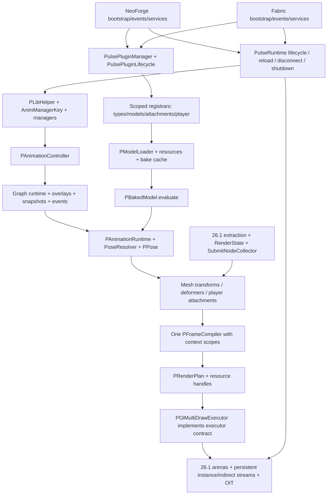

# PulseLib 26.1.2 MultiLoader: журнал и план переноса

Дата инвентаризации: **2026-10-21**. Рабочая ветка: **`26.1.2-multiloader`**.

**Этап 0 и подэтап 1.1 выполнены. Этап 1 выполнен частично; подэтап 1.2 и этапы 2–7 не начаты.** Созданы Gradle-модули Common/NeoForge/Fabric и convention plugins из канонической MultiLoader-ветки с адаптацией к Minecraft 26.1.2/Java 25. Все 308 исходных Java/resource/template файлов `26.1` перемещены без изменения байтов. Современное функциональное ядро и исправления ещё предстоит перенести. Клиенты, dedicated servers и JUnit-регрессии библиотеки пока не проверены. Текущая контрольная точка и следующий шаг описаны в разделе 10.

## 1. Источники и безопасное продолжение

| Назначение | Ветка | Зафиксированный HEAD |
| --- | --- | --- |
| Техническая основа Minecraft 26.1.2, NeoForge, RenderState, GPU | `26.1` | `67bea7ccc6bd1d4d15f417179ef82d5a7b8aacb1` |
| Канонический публичный API, MultiLoader, современная функциональность и регрессии | `1.21.1-multiloader` | `7ce6f024b307bb821ce543344d3896c8e1fcf26b` |

Локальные ветки и `origin/*` совпали; HEAD обеих веток дополнительно проверены через GitHub API. Исходники анализировались из этих Git objects, а не из неотслеживаемых файлов рабочего каталога. [Технический источник](https://github.com/ArcAnc/PulseLib/tree/67bea7ccc6bd1d4d15f417179ef82d5a7b8aacb1), [функциональный источник](https://github.com/ArcAnc/PulseLib/tree/7ce6f024b307bb821ce543344d3896c8e1fcf26b).

Перед работой прочитан [AGENTS.md функционального источника](https://github.com/ArcAnc/PulseLib/blob/7ce6f024b307bb821ce543344d3896c8e1fcf26b/AGENTS.md). Для переносимого Java: TAB indentation, Allman braces, точка цепочки на предыдущей строке, развёрнутые методы/блоки, сохранение Javadoc/import groups, авторов и дат по Git history, лицензионные заголовки, package nonnull annotations и точные `@Nullable`. В подэтапе 1.1 `AGENTS.md` и Java `.editorconfig` перенесены в рабочее дерево из pinned MultiLoader source.

Исходное состояние: активна `26.1-multiloader`, HEAD `67bea7c`, отслеживаемых изменений нет. Целевая `26.1.2-multiloader` отсутствовала и создана непосредственно от `26.1`. Найдены **165 неотслеживаемых файлов** в `common/logs/` и `fabric/runs/` — игровые миры, настройки, логи и диагностика прежних запусков. Они не являются исходниками миграции и не включаются в commit. Не очищать их через `git clean`, не использовать как disposable test worlds. В текущей сессии их содержимое сохранено.

Исходные ветки не изменять; полного merge не делать; push и публикации требуют отдельного разрешения. Зафиксированные SHA использовать даже при продвижении удалённых веток. Обновление baseline — отдельное осознанное решение, а не следствие нового HEAD.

При следующем запуске:

1. Прочитать этот документ и `git log --oneline --decorate -8`.
2. Проверить `git status --short --branch`, HEAD исходных веток и принадлежность текущей истории `26.1.2-multiloader`.
3. При чужих изменениях сохранить их; существующую целевую ветку не пересоздавать и не reset-ить.
4. Начать **подэтап 1.2** ниже. После каждого подэтапа — проверки, запись результата здесь, отдельный локальный commit. После крупного этапа остановиться.

## 2. Артефакты этапа 0 и методика

Все пути в таблице относительны к этому документу.

| Артефакт | Содержание |
| --- | --- |
| [api-1.21.1-multiloader.ndjson](26.1.2-multiloader/api-1.21.1-multiloader.ndjson) | Канонический baseline: 373 доступных public/protected типа и 2236 членов |
| [api-26.1.ndjson](26.1.2-multiloader/api-26.1.ndjson) | Технический baseline: 334 доступных типа и 2042 члена |
| [api-delta.ndjson](26.1.2-multiloader/api-delta.ndjson) | Разность объявленных сигнатур, заголовков и import contexts по FQCN |
| [class-migration-map.tsv](26.1.2-multiloader/class-migration-map.tsv) | Все 533 именованных типа обеих веток, включая внутренние; наличие, API delta, этап, целевой слой, решение и адаптация |
| [source-dependencies.ndjson](26.1.2-multiloader/source-dependencies.ndjson) | Все production Java units: packages, imports, внутрибиблиотечные зависимости, Minecraft/loader references, package annotations, Git blob SHA |
| [source-manifest.json](26.1.2-multiloader/source-manifest.json) | SHA источников, охват модулей, перечни тестов/testmod/assets/shaders, Mixins и точные service providers |
| [checksums.sha256](26.1.2-multiloader/checksums.sha256) | SHA-256 шести сгенерированных файлов данных |
| [ExtractApi.java](tools/ExtractApi.java), [inventory.py](tools/inventory.py), [verify_inventory.py](tools/verify_inventory.py) | Воспроизводимая инвентаризация и проверка её корректности |

`ExtractApi` использует JDK 25 Compiler Tree API в режиме **parse-only**: разрешение внешних классов, Gradle и загрузка Minecraft не нужны. Единица идентичности — package + цепочка имён объявленных типов, включая вложенные, а не имя Java-файла. Методы учитываются по возвращаемому типу, generic bounds, именам, типам/порядку параметров, varargs, throws и modifiers. Сохранены annotations, defaults аннотаций, параметры с именами, поля с initializers, extends/implements/permits, record components, imports и исходный blob SHA.

Интерфейсные public members, public/protected вложенные типы, enum constants/`values`/`valueOf`, default constructors, record canonical constructors/accessors/`equals`/`hashCode`/`toString` учитываются, даже когда не написаны явно. Private/package-private типы входят в общую карту; недоступные через внешний тип объявления не попадают в публичный baseline. Данные охватывают production Common/Fabric/NeoForge, включая публичные implementation/Mixin/backend классы, без автоматического исключения `@ApiStatus.Internal`. Testmod и JUnit учитываются отдельно, не как API библиотеки.

**Границы baseline:** это полный перечень доступных исходных объявлений с контекстом, а не доказательство бинарной/поведенческой совместимости. Типы в сигнатурах записаны в исходном написании; imports позволяют различить, например, старый и новый `RenderType`. Wildcard imports, наследуемые внешние Minecraft методы, bridges, erasure и annotation propagation требуют semantic/compiled проверки на этапе 7. `api-delta` — консервативное сравнение заголовков, сигнатур и используемых imports; annotation metadata/default values/constant initializers нужно дополнительно сравнивать по baseline. `same-declarations` **не означает** одинаковое поведение: `AnimManagerKey` и `PAnimationPoseResolver` — реальные примеры.

Воспроизведение без изменения исходников и без сети, из корня репозитория, с Python 3.12+ и полным JDK 25 в PATH:

```bash
python3 docs/porting/tools/inventory.py --check
python3 docs/porting/tools/verify_inventory.py
```

Для намеренного пересоздания данных из тех же pinned SHA: `python3 docs/porting/tools/inventory.py`. Инструмент читает Git objects во временный каталог, не переключает ветки и не меняет runtime-код. На этапе 7 извлекать **результат миграции отдельно**, не перезаписывать канонический baseline. Сначала сверить FQCN и declared signatures, затем разрешить imports/иерархию с classpath обеих версий; каждому несовпадению назначить adapter/overload либо документированную Minecraft-причину. Одного rename `ResourceLocation` или списка файлов недостаточно.

| Охват | `26.1` | `1.21.1-multiloader` |
| --- | ---: | ---: |
| Всего tracked files | 344 | 582 |
| Production Java units, включая package-info | 286 | 342 |
| Все именованные типы, включая вложенные/внутренние | 416 | 458 |
| Доступные public/protected типы | 334 | 373: Common 353, Fabric 10, NeoForge 10 |
| JUnit source files, включая support/package-info | 0 | 22: 20 test classes и 2 вспомогательных файла |
| Java-файлы внешнего testmod | 0 | 62 |
| Testmod resource files | 0 | 46 |
| Shader resources | 10 | 40 |

Объединённая карта: **341 общий FQCN**, **117 только в MultiLoader**, **75 только в 26.1**. Среди общих — **122 с разницей деклараций/import context**, **219 с одинаковыми декларациями**. Это показатели статического анализа, не результаты компиляции или игровых тестов.

## 3. Dependency map и границы модулей

Целевая структура: `common/`, `fabric/`, `neoforge/`, `buildSrc/`, `tests/`. Common содержит единое ядро и единый клиентский renderer; наличие Minecraft client classes в Common допустимо, загрузка их на dedicated server — нет. Common не содержит ссылок на NeoForge/Fabric API. Loader-код не копирует граф, managers, loaders, pose evaluation, compiler или GPU backend.



Это карта целевых runtime-зависимостей; точные статические import edges обеих исходных веток находятся в `source-dependencies.ndjson`. `same_package_candidates` — консервативные зависимости по идентификаторам внутри package, а не доказанный call graph. Imports могут быть неиспользуемыми; reflective discovery, service providers и callback lifecycle представлены отдельно в manifest и на диаграмме.

В `26.1` обнаружено **14 production units с прямыми NeoForge references**. Их нельзя целиком положить в Common:

| Классы/подсистема | Разделение при переносе |
| --- | --- |
| `PLib`, `CommonEvents`, `ClientEvents`, `PulseLibEvents` | Bootstrap/events остаются в NeoForge; с этапа 2 регистрация расширений только через современные plugins |
| `PLibAnimationTicker`, `InstanceAnimationManager`, `SingletonAnimationManager` | Вычисления и cache lifecycle в Common; подписки/tick/entity leave callbacks в loader |
| `PLibRegistration` | Канальные/event/deformer registries в Common; DeferredRegister игрового demo content в testmod |
| `PRenderStagesHandler`, `PRenderTypes`, `PResourceCache` | Стадии/ресурсы и pipeline logic в Common; event wiring и регистрация shaders/atlas/reload в loader |
| `PAttachmentAnchorResolvers`, `PLibArmorHandler` | Общие операции установки anchors/layers; loader вызывает их из своих hooks |
| `PArmorClientExtensions` | NeoForge; в Common современный `PArmorModelProvider`, Fabric использует свой armor hook |

В современном Common прямых loader imports/references не найдено. Три ServiceLoader-контракта: `IPulsePlatform`, `IPulseCameraService`, `IPulsePluginFinder`; в manifest зафиксированы все шесть descriptors, по три на загрузчик. `PulseClientServices` и client registrars не должны инициализироваться на физическом сервере. Ровно один provider каждого сервиса должен попадать в соответствующий loader JAR.

## 4. Class migration map: ключевые контракты

Package prefix: `com.arcanc.pulselib`. В столбце «наличие» сначала `26.1`, затем MultiLoader. Полные FQCN, вложенные типы и все declared signature deltas см. в TSV/NDJSON; здесь зафиксированы смысловые решения, которые нельзя вывести из совпадения имён.

| Класс/подсистема | Наличие | API и современные изменения | Что переиспользовать / что перенести | Адаптация Minecraft 26.1.2 |
| --- | --- | --- | --- | --- |
| `content.animatable.PAnimatable<T>` | да / да | Две основные сигнатуры совпадают; современный контракт доступа после завершения owner construction | Сохранить FQCN/generic/методы; применить современную семантику manager access | Ключ из extract phase передавать в submit state; не создавать controllers в owner constructor |
| `PAnimationController<T>` | да / да | Добавлен `setGraphSnapshotContexts`; precise graph events, snapshot base, cyclic/reverse cursor fixes | Современная реализация, без восстановления старых event loops | Узкая адаптация запросов entity/render state; core math не зависит от loader |
| `PAnimationManager<T>` | да / да | Добавлены `getManager(AnimManagerKey)`, synchronized `initializeControllers()`; H18, атомарное создание и защита рекурсии | Современные factories, registrar, maps; старый constructor callback удалить | Независимый owner/key; callbacks вызывать после construction, refresh usage из renderer/ticker |
| `instance.InstanceAnimationManager` | да / да | `removeUnused()` без NeoForge event; identity map и обновление last-used, L25 | Современный cache/lifecycle; platform ticks отдельно | `net.minecraft.Util` в старой ветке против `net.minecraft.util.Util` в 26.1; entity removal/chunk unload hooks |
| `singleton.SingletonAnimationManager` | да / да | Современный `getManager(key)`; shared cache индексируется owner identity + key, lazy controllers | Перенести современный owner-key cache; одна реализация managers | Client lifecycle вызывает cleanup; не разделять cache по renderer/platform |
| `AnimManagerKey` | да / да | Сигнатуры совпадают, поведение существенно изменено: runtime ID стека и зарезервированный sign bit | Современные factories; старый hash(item/count/components) убрать | ItemStack Mixin и реальные copy/split paths 26.1; UUID/block position/dimension factories адаптировать |
| `util.helpers.PLibHelper` | да / да | Современные `createInstanceManager`, `createSingletonManager`, `getManager(owner/key/stack)`, GUI helper; boolean factory overload сохранён | Современное единообразие доступа; state factories 26.1 допустимы как дополнительные overloads | `GuiGraphics` → `GuiGraphicsExtractor` и submit context; `ResourceLocation` → `Identifier` |
| `content.model.animation.PAnimation` | да / да | Добавлены `forEachCyclicEvent` overloads; modern sampling; C1/H1/H2 | Современные события/sampling/compiled data; форматные codecs согласовать с 26.1 | Resource identifier types; core time остаётся в ticks, `query.anim_time` в seconds |
| `PAnimationGraphRuntime` | да / да | 13 новых declared signatures; overlay speed/restart/stop, precise tracks, sampleBasePose/samplePose, L1/L4/reverse | Целиком современная runtime-семантика + PPoseSnapshot; не второй graph implementation | Адаптировать model binding/context capture, без привязки к loader/render backend |
| `PAnimationPoseResolver` | да / да | Основные сигнатуры совпадают; visibility и activeBones теперь берутся из вычисленной pose | Современная реализация и contexts; не отдельный bone sampler в renderer | Матрицы и render-state данные подавать через единый PPose pipeline |
| `PAnimationRuntime` | да / да | Два новых `captureGraphBase` overloads; graph samplePose и accumulated base, snapshot continuity | Современное вычисление TRS/visibility/masks; прежняя graph-layer approximation заменяется | `PBakedModel.evaluate` остаётся единой точкой; adapter к 26.1 mesh context |
| `content.model.PModel` | да / да | Поля `bones`, `meshes`, `boneMeshes`, `animations` и их generics совпадают; после удаления комментариев реализации совпадают | Публичные поля сохранить, не вводить новую модель данных | Сам класс не требует loader API; adapt loaders/baking вокруг него |
| `content.model.baked.PBakedModel` | да / да | Современные draw overloads и pose resolver; обе ветки уже имеют `evaluate` | Современное animation-facing API; 26.1 baking/material/buffer integration сохранить | `RenderType` новый package, `Identifier`, GPU-backed geometry и mesh deformation |
| `PBakedBone`, `PBakedMesh`, deformers | да / да; есть новые buffer/stream types | `mixBone` ещё существует в обеих ветках; это не основание использовать его как параллельный evaluator | Современный PPose и semantic channels; 26.1 GPU buffers/subdivision сохраняются | `PSubdividedMeshCache`, PGpuDeformerBuffers, buffer lifetime; legacy vertex buffer классы не копировать механически |
| `content.renderer.PRenderer` и Entity/Block/Item renderers | да / да | Старый современный contract принимает owner/MultiBufferSource; 26.1 принимает RS/CameraRenderState/SubmitNodeCollector, отличаются generics | FQCN/операции/extension hooks MultiLoader сохранить через adapter/overload; 26.1 state extraction/submission — техническая основа | EntityRenderState, BlockEntityRenderState, ItemStackRenderState, CameraRenderState, special item renderer; каждый unavoidable signature delta записать |
| `PRenderQueue`, `PRenderContexts` | queue да / да; contexts нет / да | Modern PGeometryData/PDynamicGeometry/PInstanceHeader; `flushOpaque`, combined sort, local scopes, destination-aware composition; cleanup spelling отличается | Одна современная очередь/compiler; scopes — контексты одного pipeline; никаких двух конкурирующих world queues | GUI/offscreen scope захватывать и восстанавливать при deferred SubmitNodeCollector исполнении, включая исключения |
| `plan.PFrameCompiler` | да / да | `<S,P,M,I>` → канонический `<S>` с handles; compileOpaque/Combined/All/discard; L18/H13 | Современный compiler и pass tests; убрать MC RenderType knowledge из compiler | OIT capability predicate передаёт backend, не loader; depth/alpha semantics сохраняются |
| `plan.PRenderPlan`, `PDrawGroup` | да / да | Modern негeneric plan имеет packed `groups` + `instances`, draw commands/baseInstance | Современная структура; bridge handles к существующей geometry arena | Сохранить baseVertex/baseInstance/indexCount/indexType, indirect draw и instance layout |
| `PRenderExecutor`, capabilities/matrix/host/frame | нет / да | Новые канонические contracts, включая fallback strategies | Перенести contracts; `PGlMultiDrawExecutor` реализует их непосредственно либо через узкий adapter | Capture frame по 26.1 RenderSystem/CameraRenderState; capability probe без смены алгоритмов |
| `renderer.gl.PGl*` | да / нет | Нативный 26.1 GPU backend; не заменять старым `legacy.Gl*` | Все шесть основных классов, fences, persistent streams, geometry batching, indirect paths, OIT и shaders сохраняются | RenderPipeline/RenderPass/GpuTextureView/ScissorState; modern render plan → существующие draw batches |
| `renderer.legacy.Gl*` | нет / да | Даже публичные backend классы входят в baseline | Не переносить второй работающий backend. Сначала проверить возможность source-compatible фасадов поверх PGl backend; несовместимости документировать по каждому FQCN | Старые raw GL/VertexBuffer API не соответствуют новой Blaze3D integration |
| `content.registration.PLibRegistration` | да / да | `init(IEventBus)` → `init()`; старые игровые DeferredRegister-подклассы в современном API отсутствуют | Современные AnimationChannelReg/AnimationEventReg/DeformerReg сохранить; demo registries вынести | Внутренние registry consumers остаются; public extension registration проходит через plugins |
| `api.plugin`, `api.registration`, `plugin` | нет / да | Канонические аннотация, common/client interfaces, 6 registrars, finder/scanner/candidate/lifecycle/manager | Перенести полностью; scoped/atomic registration, deterministic discovery, side filtering до class loading, model reload retry | NeoForge mod scan/root discovery; Fabric mod roots/dev classpath grouping; ASM поддержка bytecode Java 25 |
| `platform` | нет / да | IPulsePlatform, IPulseCameraService, PulseServices, PulseClientServices | Сохранить ServiceLoader architecture и ровно один provider на платформу | 26.1 passenger/camera API; client camera classes не трогать на server |
| `content.player.animation` и attachments | да / да | Современные frame/hierarchy/root/camera transformations, public spaces overloads, M-P2/M-P3 | Современные definitions/instances/masks/blend modes/first-person rig; per-player UUID runtime | Сохранить 26.1 setupAnim/submit/Camera.alignWithEntity/hand hooks, адаптировать к новой математике и state extraction |
| `data.PModelLoader`, `PLoadedModel`, parsers/cache | да / да | Modern `modelResourceCandidates(id)`, `loadModel(..., id)`; 26.1 bulk `loadModels(..., consumer)` и physical candidates | Сохранить канонические singular API через batch adapters; concurrent reload safety современного cache; не потерять 26.1 resource loading | PreparableReloadListener.SharedState в 26.1, atlas/Identifier/texture views; GLB embedded и внешние image URI сохраняются |
| `PResourceCache`, texture atlas, utilities | да / да | Modern plugin model declarations, loader-free registration hooks; другие metadata names и texture-name fallback | Публичные helper signatures и modern model registration; текущие 26.1 atlas/baking/URI algorithms адаптировать | `PLibSpriteMetadata`/`PLibMetadata`, reload signatures, atlas registration, Identifier; не заменять texture resolution только ради старого helper body |

Для каждого вспомогательного класса/вложенного типа TSV задаёт слой и соответствующую политику из этой таблицы. Решение `compatibility-review` означает обязательную проверку адаптера, а не разрешение удалить API. Переименование/удаление canonical PulseLib API в этапе 0 **не принято**.

## 5. Реестр исправлений и доказательства для следующих этапов

История функционального источника: `e591523` (исходная MultiLoader структура), `62eca18` (plugins/demos), `4b22a67` (C1 и группа исправлений), `5c22705` (M-P2), `a96f947` (M-P3), `a9d98d8` (reverse overlays), `5ae0264` (ItemStack identity), `2587dd2` (H13/H15/H18), `5b59617` (современные sampling/lifetime fixes и cleanup), `7ce6f02` (Gradle). Использовать итоговые файлы pinned HEAD: поздние изменения могут дополнять или заменять ранние patch hunks. Не cherry-pick-ить большие commits целиком.

| ID / контракт | Отличие и источник реализации | Обязательная проверка после переноса |
| --- | --- | --- |
| M-A3 | ticksToSeconds + sampling contexts; некоторые 26.1 contexts уже делят на 20, нужна согласованность всех paths | PAnimationTimeTest; sampling harness |
| M-A4 | PExpressionEvaluator больше не хранит глобальные TIME_ONLY values по quantized clip time | PExpressionEvaluationTest: разные query resolvers/contexts при одном времени |
| H2 | PAnimationTrackSampler + 4-point channel overloads; настоящие соседние pre/post control points | PCatmullRomSamplingTest, оригинальный animation fixture |
| H1 | PMolangEulerRotationValue.evaluateEuler + интерполяция до quaternion conversion | PGeckoEulerSamplingTest, Gecko 360°/720°; PGltfQuaternionSamplingTest сохраняет SLERP |
| L25 | InstanceAnimationManager identity map с refresh timestamp | InstanceAnimationManagerTest; 21+ секунд, два cleanup cycles, removal/chunk unload/disconnect в игре |
| C1 | PCyclicAnimationEvents, precise double tracks, directional boundary contract | PCyclicAnimationEventsTest: multi-cycle/large times/reverse/departure/arrival |
| H18 | Lazy initializeControllers, owner/key cache, единые helper getters | PAnimationManagerAccessTest; реальные field initializer owners, независимые graphs/stacks |
| L1 + reverse | Один runtime instance на overlay definition, frozen pose при нулевой скорости, независимые fades, finite negative speed | POverlayLifecycleTest/POverlayReverseTest и loaded-model lifecycle harness |
| L4 | PPoseSnapshot, PPoseMixer и graph captureGraphBase сохраняют последнюю вычисленную TRS/visibility при RESTART | PPoseMixerTransitionTest/PGraphRestartTest, не только сравнение имён/time |
| M-P2 | Современные PPlayerAnimationSpace/Frame/anchor matrices и visual root pivot | PPlayerHierarchyTest, PlayerMotionHarness phase mp2, несколько игроков/definitions/masks |
| M-P3 | Camera bind hierarchy и displacement в правильных пространствах | PPlayerCameraTest; actual Camera position/quaternion, phase all |
| H13 | compileOpaque + ранний flush Entity/Block opaque до transparency | PFrameCompilerPassTest; реальные depth/RGB перед водой/стеклом |
| H14 | Destination-aware OIT, Fabulous vanilla targets, depth peeling/composition и restoration | H14Harness: 38 offscreen cases + world/weather pixels, reload и resize |
| H15 | PRenderContexts local scope, GUI/entity dispatcher boundary, discard/restoration при исключении | RenderRegressionHarness: GUI/offscreen/nested targets и реальные renderer entrypoints |
| L18 | compileCombined сортирует обычную alpha transparency глобально между нужными stages; OIT batches отдельно | PFrameCompilerPassTest + пересекающиеся Entity/BlockEntity transparency pixels |
| ItemStack identity | transient volatile ID; copy намеренно сохраняет identity, частичный split разделяет, полный перенос переносит ID; counter не держит stacks/controllers | PItemStackAnimationIdsTest + ItemStackIdentityHarness: copy/split/stacking, реальные menu/network/NBT round trips, cache cleanup/reentry |

Molang persistent variables, root motion, overlays, typed channels, custom interpolation и negative playback входят в функциональный контракт. ID стека не попадает в NBT/Data Components; новый deserialized Java stack получает новую runtime identity. Идентичность не обещается между сетевыми заменами объектов. Преобразования времени ограничить Molang query boundary: нельзя глобально заменить ticks на seconds во всех clip/event clocks.

## 6. Toolchain и потенциальные конфликты

| Компонент | В `26.1` | В MultiLoader source | Решение для этапа 1 |
| --- | --- | --- | --- |
| Minecraft / Java | 26.1.2 / 25 | 1.21.1 / 21 | 26.1.2 / 25, включая Gradle JVM и compilation toolchain |
| NeoForge | 26.1.2.95 | 21.1.216 | Сначала сохранить 26.1.2.95; подтвердить artifact resolution/metadata |
| ModDevGradle | 2.0.141 | 2.0.140 | 26.1-compatible MDG, starting point 2.0.141; проверить Common NeoForm setup |
| Gradle wrapper | 9.2.1 | 9.2.1 | Проверить совместимость выбранного Loom; при необходимости отдельное изменение wrapper |
| Fabric Loader / API | отсутствуют | 0.19.5 / 0.116.17+1.21.1 | Выбрать и зафиксировать подтверждённые 26.1.2 versions по Fabric metadata; старый API не подходит |
| Fabric Loom | отсутствует | 1.12.7, `fabric-loom` | Unobfuscated `net.fabricmc.fabric-loom`; конкретную версию и Gradle requirement проверить перед изменениями |
| Mappings / NeoForm | Нет Parchment в base | Parchment 2024.11.17, NeoForm 1.21.1-20240808.144430 | Старые mappings не переносить. Для Common подтвердить 26.1.2 NeoForm/vanilla setup; plain Minecraft, без NeoForge patches |
| Runtime libraries | jgltf 2.0.3, Jackson 2.13.x с ranges | Те же библиотеки pinned; JUnit 5.11.4, ASM 9.9.1 | Сохранить нужные transitive libs и loader jar inclusion; проверить ASM/Mixin чтение Java 25 classfiles |
| Library version | 1.1.5.3 | 1.2.0 | На этапе 0 без изменений; для функционального MultiLoader релиза ориентир 1.2.x, не 2.0 |

Официальная документация подтверждает: 26.1 unobfuscated, Fabric использует новый Loom plugin без mappings/remap, обычные dependency configurations и `jar` вместо `remapJar`; Java 25 обязательна. Для NeoForm изменён формат версии; NeoForge рекомендует MDG 2.0.141 на момент release article. Это не подтверждение текущих последних версий и не проверка сборки. [Fabric 26.1](https://www.fabricmc.net/2026/03/14/261.html), [NeoForge 26.1](https://neoforged.net/news/26.1release/).

Основные конфликты, требующие отдельных проверяемых адаптаций:

1. `ResourceLocation` → `Identifier`, перемещение `RenderType`, `Util`, reload API, texture atlas и special item renderers. Сохранить имена PulseLib; Minecraft types менять по необходимости.
2. Owner-facing PRenderer против extraction/submission RS contract. Сначала проверить overloads/adapters; нельзя молча сократить extension hooks или потерять nullable/additionalData semantics.
3. Singular model loading API против рабочего 26.1 batch/physical resource discovery. Обернуть batch в современный контракт, сохранив atlas order и ошибку missing resource; не откатывать обновлённую 26.1 resource loading реализацию.
4. Современные resource handles/packed commands против PBakedMesh + InstanceData в PGl executor. Согласовать layout, index offsets и GPU deformation offsets; capability fallback не должен превращать instancing в обычный per-object renderer.
5. H14 source использует старую vanilla transparency chain. Переносить поведение через 26.1 RenderPass/targets, а не копировать старые JSON/injection descriptors. В текущем PGl backend уже четыре OIT слоя и target-indexed state; их сохранить.
6. GUI extraction/deferred submission: scope должен пережить правильный участок collector execution; одних ThreadLocal guards вокруг extract недостаточно без проверки порядка выполнения.
7. Общий пакет с client types не равен server-safe classloading. Проверять bootstrap graph, plugin side filtering до `Class.forName`, client factory isolation, Mixins lists и ServiceLoader descriptors.
8. ItemStack 26.1 registry-bound construction/ItemStackTemplate: runtime ID применяется к живому ItemStack; tests не должны создавать stacks до готовности registries. Проверить актуальные copy/split signatures. [Fabric: ItemStackTemplate](https://www.fabricmc.net/2026/03/14/261.html).
9. `legacy.Gl*` присутствуют в публичном baseline; фасады должны использовать тот же backend. Необоснованное удаление этих типов или создание второго GPU engine недопустимы.
10. В обеих ветках `pulselib*.mixins.json` указывает JAVA_21 при Java 25 target. Не менять в этапе 0; проверить поддерживаемые Mixin compatibility levels в выбранном 26.1 toolchain.
11. Common sources компилируются и включаются в loader JARs по convention plugins MultiLoader. Исключить двойные resources/package-info, service providers чужой платформы и demo assets в release JAR.
12. Старые testmod README ссылки на удалённые `docs/reviews/*` не являются доступными результатами проверки. Changelog содержит исторические счётчики тестов; текущий source manifest точнее. Ни прежние логи в рабочем дереве, ни прошлый PASS не подтверждают миграцию.

## 7. Поэтапный план и критерии приёмки

Подэтапы ниже — границы небольших локальных commits. Если один подэтап перестаёт быть обозримым, делить дальше и указывать точный integration debt. Крупный этап завершён только после всех его критериев; успешная компиляция не заменяет запуск игры.

| Этап / подэтап | Работа и отдельный результат | Проверки для завершения |
| --- | --- | --- |
| **0 — выполнен** | Pin SHA, новая ветка от 26.1, dependency/class/API map, план и воспроизводимые tools | AST + javac/javap fixture; полное покрытие sources/types; regeneration/checksums; diff scope; сохранность веток и исходных untracked файлов |
| **1.1 — выполнен** | buildSrc/common/neoforge/fabric skeleton от 26.1; verified dependency pins/Java 25; AGENTS/style; источник/ресурсы остаются 26.1 | `:common:compileJava`, `:neoforge:build`; Fabric project/tasks конфигурируются; Common compile classpath не опирается на NeoForge patches |
| **1.2 — не начат** | Отделить 14 NeoForge-bound units/hooks; сохранить 26.1 RenderState/GPU/shaders/atlas и рабочий bootstrap | Common без loader references; NeoForge client + dedicated server startup/normal stop; renderer на прежних assets. При необходимости минимальный изолированный test fixture, не полная миграция testmod |
| **2.1** | Canonical plugin/registrar/lifecycle/platform contracts и loader discovery; ServiceLoader descriptors | Scanner/manager/lifecycle JUnit перенести уже здесь; annotation sides, deterministic IDs, deduplication/atomic registration/model retry |
| **2.2** | Перевести registries/resources/attachments/player declarations на plugins; удалить старый extension event path | NeoForge common/client plugins реально обнаружены; dedicated server не загружает client plugin; нет повторных типов/controllers; registry smoke и normal exit |
| **3.1** | Canonical managers/helper/AnimManagerKey/ItemStack runtime ID + 26.1 ItemStackMixin | ManagerAccess/InstanceManager/ItemStackIds JUnit; реальная transformed stack copy/split/stacking identity; construction и cleanup |
| **3.2** | Modern channels/interpolation/Molang/Gecko/glTF sampling + события | Time/Expression/CatmullRom/GeckoEuler/GltfQuaternion/CyclicEvents JUnit и оригинальные fixtures; negative playback |
| **3.3** | Graph/overlays/transitions/PPoseSnapshot/runtime/resolver/masks/root motion; новый PPose — единственный evaluator | OverlayLifecycle/Reverse, PoseMixerTransition, GraphRestart JUnit; backend compile adapter локализован, без второго manager/pose pipeline |
| **4.1** | Modern PFrameCompiler/PRenderPlan/capabilities/handles; PGl executor bridge; одна очередь | PFrameCompilerPassTest; instanced/indirect command layout и baseInstance проверены; 26.1 native RenderPass paths сохраняются |
| **4.2** | Renderer + RenderState consumption modern poses, H13/L18, context-aware GUI H15 | NeoForge реальные Entity/BlockEntity/Item/GUI pixels/depth; opaque early flush; global alpha ordering; offscreen nesting/exceptions |
| **4.3** | H14 на native 26.1 targets; resource lifetime/reload/disconnect/shutdown | Четыре слоя/depth peeling, Fabulous/water/glass/particles/weather; GPU deformers/instancing; реальные buffer/texture deletion и GL state restoration |
| **5.1** | Modern player frames/spaces/masks/blend/root/camera math и attachment registration | PlayerHierarchy/PlayerCamera JUnit, независимость нескольких UUID/definitions |
| **5.2** | 26.1 first-/third-person rig/item/camera/ModelPart/armor/deformer hooks | NeoForge PlayerMotionHarness + обе model formats; ROOT masks, additive/override, camera quaternion/position, transform restoration |
| **6.1** | Fabric 26.1.2 bootstrap/discovery/services/reload/registration/events/Mixins/access rules | Fabric build + dedicated server/normal exit, plugins/side filtering; no NeoForge in Common |
| **6.2** | Fabric client/stage/GUI/transparency/armor hooks поверх того же Common/PGl backend | Fabric client, parity с NeoForge: ItemStack ID, H13/H14/H15, deformation/instancing/lifecycle/player. Ни одного дубликата ядра |
| **7.1** | Завершить перенос внешнего testmod/harnesses/реальных assets, автоматизированных disposable worlds, packaging и regression suites | Полный build/JUnit обоих loader JARs, Jar content checks, оба dedicated servers и jar plugin discovery |
| **7.2** | Полная client GPU matrix, API report against frozen baseline, renderer comparison against frozen 26.1 | Реальные игровые результаты с exit codes/артефактами; список каждого API delta с причиной; контролируемый GPU profiling при возможности |

Регрессионные тесты переносить вместе с соответствующим исправлением в этапах 2–6. Этап 7 завершает и объединяет testmod/harnesses, а не впервые включает тестирование. Не отключать существующие тесты и не заменять ожидания заглушками.

## 8. План проверки результата миграции

Команды ниже — **запланированные**, в этапе 0 не выполнялись. Они основаны на актуальном MultiLoader testmod README, но потребуют адаптации Gradle conventions/harness Mixins к 26.1; не считать их заранее рабочими.

```bash
./gradlew build --no-daemon
./gradlew :common:test :fabric:test :neoforge:test --no-daemon
./gradlew :neoforge:runServer -PpulseTestMod -PpulseSmokeAuto --no-daemon
./gradlew :fabric:runServer -PpulseTestMod -PpulseSmokeAuto --no-daemon
./gradlew :neoforge:runClient -PpulseTestMod -PpulseSmokeAuto -PpulseSmokeWorld --no-daemon
./gradlew :fabric:runClient -PpulseTestMod -PpulseSmokeAuto -PpulseSmokeWorld --no-daemon
```

Отдельные client runs на обоих loaders:

| Флаги помимо `-PpulseTestMod` | Что подтверждают |
| --- | --- |
| `-PpulseSmokeAuto`, затем `-PpulseGeckoDemo` | Реальные glTF/Gecko rigs, sampling, overlay/restart/reverse, GPU deformation и explicit cleanup |
| `-PpulseSmokeAuto -PpulseSmokeWorld` | H13/H15/H18, opaque world depth, GUI/offscreen, natural disconnect и manager lifetime |
| `-PpulseOitTest`, затем `-PpulseOitTest -PpulseSmokeWorld` | H14 offscreen/world/weather pixels, state restoration, reload, resize |
| `-PpulsePlayerMotionTest -PpulseMotionPhase=all` | M-P2/M-P3 actual camera/anchor/item poses, multiple definitions, reload и respawn |
| `-PpulseItemIdentityTest` | Реальные transformed ItemStack, inventory/menu operations, copy/split/merge, serialization, cleanup/reentry |
| `-PpulseOitPerf`, затем `-PpulseOitPerf -PpulseSmokeWorld` | Опциональные GPU timestamps/mean/p95/allocations, после функциональных проверок |
| `-PpulseTestJar` вместо `-PpulseTestMod` | Discovery установленного JAR отдельно от development roots; для 26.1 без старого intermediary remap |

Для каждой проверки сохранять source commit, команду, Java/loader/driver, exit code, JUnit XML либо screenshots/CSV, покрытые режимы и ограничения. Требуются ожидаемые assertions/PASS **и** нормальное завершение без crash/hang; gradle exit 0 при перехваченной server ошибке недостаточен. Fast/Fancy/Fabulous проверять, если режимы доступны в 26.1.2. Старые пользовательские миры не использовать.

Перед финалом сравнить API по всем FQCN, включая implementation types, вложенные registrars и fields/constants. Отчёт должен отдельно перечислить сохранённые, изменённые, отсутствующие types/signatures и Minecraft-specific причины; adapter/overload проверяется перед признанием несовместимости. Новый render-state generic допустим по необходимости, удаление modern plugin/graph API ради сборки — нет.

Renderer сравнивать с `67bea7c`: persistent buffers/fences, instance/indirect draws, CPU/GPU deformers, четыре OIT слоя и cleanup. Дополнительно подтвердить новые исправления из таблицы. Для performance сравнения нужны одинаковые сцены/resolution/settings/driver/warmup и GPU timings; FPS несопоставимых запусков не является доказательством.

## 9. Проверки и контрольная точка этапа 0

В этой сессии использован OpenJDK **25.0.4.1**. Реально пройдено:

- `python3 docs/porting/tools/inventory.py` — оба frozen source trees успешно разобраны, seven artifacts сформированы.
- `python3 docs/porting/tools/verify_inventory.py` — generic/varargs/throws, protected/private/nested/interface members, record accessors/compact constructors, enum members и несколько declarators проверены; количество членов семи fixture types сверено с независимо скомпилированным `javac`/`javap`; source/type/policy coverage и checksums прошли.
- `python3 docs/porting/tools/inventory.py --check` — все семь артефактов воспроизводятся из pinned commits.
- `git diff --cached --check` и проверка staged paths — только `docs/porting/`; исходные Java/Gradle/resources не менялись.
- Проверены неизменность SHA исходных веток и содержимого 165 первоначальных untracked файлов.

Это проверки **инвентаризации**, а не tests/build PulseLib. Не выполнялись `./gradlew build`, JUnit библиотеки, client/server/GPU runs или profiling. Работоспособность исходного renderer принимается из технического источника по условию задачи и не была повторно подтверждена в игре этой сессией.

Контрольный локальный commit этапа 0: **`588c15e22389d22934bf9a572c8bf3c415f824bf`**, `docs: inventory PulseLib 26.1.2 multiloader migration (stage 0)`.

На момент завершения этапа 0 оставались открыты точные Fabric/Loom/NeoForm pins, render-state API adapters, legacy public facades, 26.1 transparency/GUI injection points и игровые регрессии. Pins подтверждены в 1.1; остальные вопросы остаются для следующих этапов. Массовый перенос Java в этапе 0 не выполнялся.


## 10. Контрольная точка 1.1 — структура Gradle и компилируемая общая основа

**Дата: 2026-10-21. Статус подэтапа 1.1: выполнен. Статус всего этапа 1: частично выполнен.** Продолжение начато с commit `588c15e` после чтения журнала, Git history и канонического AGENTS.md. Исходные ветки по-прежнему указывают на frozen SHA из раздела 1. Этап 0 не выполнялся повторно, baseline не пересоздавался.

### Изменения и граница переноса

- Корневой проект теперь агрегирует `common`, `neoforge`, `fabric`. В `buildSrc` перенесены `multiloader-common`, `multiloader-loader`, `multiloader-publishing` из `7ce6f02`, с узкими изменениями для Java 25 и unobfuscated Minecraft. Common sources/resources включаются в loader JARs по исходной MultiLoader convention, без копий исходников.
- **Common: 135 Java units** — 117 существующих типов/файлов без package-info, 16 существующих package-info и 2 добавленных package-info. Это замкнутая по зависимостям часть модели/анимационной математики, channels/interpolation/Molang, deformer definitions/packing, player pose value types, resource descriptors, helpers и registry storage. Код остаётся из `26.1`; современная семантика ещё не объявляется перенесённой.
- **NeoForge: 153 собственных Java units**; вместе с Common `compileJava` получает 288 уникальных исходников. Временно здесь остаются managers/controllers/runtime, baked model/loaders, renderer, Mixins и bootstrap, зависящие от пока не отделённых hooks. Это **переходная граница 1.1**, а не окончательное размещение общего ядра. В 1.2 остаток платформенно-независимого кода необходимо переместить в Common после отделения 14 NeoForge-bound units и проверок patched API.
- Все шесть PGl-классов остаются одной неизменённой реализацией в `neoforge/src/main/java/.../renderer/gl/`. RenderState implementations, Entity/Block/Item renderer и shader algorithms не редактировались. Нет второго GPU backend и нет Fabric-копии renderer.
- Все исходные assets, 10 shader resources и `logo.png` перемещены в `common/src/main/resources`; AT и Mixins config находятся в `neoforge/src/main/resources`, NeoForge metadata — в `neoforge/src/main/templates`. В NeoForge JAR сохраняются прежние resource paths и байты, включая исходные Gecko/glTF ZIPs и player templates.
- Fabric подключён через `net.fabricmc.fabric-loom`, без mappings/Parchment/remapping. Его собственных Java entrypoints и Mixins пока нет; он компилирует ту же общую основу и формирует **неполный skeleton JAR**, не подтверждающий функциональность Fabric. Полная платформа остаётся этапом 6. Incomplete Fabric variant исключён из существующих upload aggregates/Maven repository publication tasks; Common не публикуется как самостоятельный мод. Публикация не запускалась.
- NeoForge client/server/gameTestServer/data run configurations перенесены в модуль. Они ещё не запускались. Старый root `localRuntime` и root data paths больше не служат точками настройки: loader build настраивается в `neoforge/build.gradle`.
- `AGENTS.md` и `.editorconfig` перенесены из MultiLoader. Существующие Java headers/style/package annotations сохранены без форматирующей переработки; два отсутствовавших package-info в `content.registration` и `content.model.textures` перенесены из канонической ветки с адаптацией к JSpecify. В 26.1 отсутствуют `net.minecraft.FieldsAreNonnullByDefault` / `MethodsReturnNonnullByDefault`; используется `@NullMarked`, как в технической ветке. Поддельные Minecraft annotation classes не создавались.
- `mod_version` сохранён **1.1.5.3**: эта контрольная точка не является готовым MultiLoader релизом. Gradle heap 3 GiB и отключённый configuration cache следуют исходной MultiLoader architecture. Для wrapper зафиксирован executable bit. Добавлены ignore rules для module runs/logs/crash diagnostics; 165 исходных игровых файлов сохранены, ни один не добавлен в commit.

Существующие FQCN, методы, generic-параметры, поля и тела Java-классов не менялись. Канонический API baseline `1.21.1-multiloader` остаётся замороженным; совместимость с ним пока не достигнута и не заявляется. Новая структура не вводит альтернативных managers/plugins/pose evaluators.

### Подтверждённый toolchain

Публичные Maven/Fabric metadata и точные артефакты прочитаны 2026-10-21; Gradle дополнительно разрешил их при сборке. Выбран совместимый набор, без требования использовать каждую последнюю опубликованную версию.

| Компонент | Закреплённая версия | Доказательство |
| --- | --- | --- |
| Minecraft / Java target | 26.1.2 / 25 | vanilla NeoForm и оба loader compile; PulseLib classfile major 69 |
| Gradle / JVM | 9.2.1 / OpenJDK 25.0.4.1 | `stage11Evidence` report; wrapper не обновлялся |
| NeoForge | 26.1.2.95 | [точный POM](https://maven.neoforged.net/releases/net/neoforged/neoforge/26.1.2.95/neoforge-26.1.2.95.pom), успешная сборка |
| NeoForm для Common | 26.1.2-1 | [точный POM](https://maven.neoforged.net/releases/net/neoforged/neoform/26.1.2-1/neoform-26.1.2-1.pom); тот же coordinate указан в NeoForge moddev config |
| ModDevGradle | 2.0.141 | Сохранён из технической ветки; plugin resolved/configured, оба MDG модуля собраны |
| Loom | 1.15.5 | [Gradle module metadata](https://maven.fabricmc.net/net/fabricmc/fabric-loom/1.15.5/fabric-loom-1.15.5.module): runtime plugin API 9.2.0, plugin JVM 21; реально работает на JVM 25/Gradle 9.2.1 |
| Fabric Loader | 0.19.5 | [Fabric metadata для 26.1.2](https://meta.fabricmc.net/v2/versions/loader/26.1.2) помечает версию stable; artifact разрешён Gradle |
| Fabric API | 0.155.3+26.1.2 | [точный POM](https://maven.fabricmc.net/net/fabricmc/fabric-api/fabric-api/0.155.3+26.1.2/fabric-api-0.155.3+26.1.2.pom), artifact разрешён Gradle |

Runtime jgltf/Jackson версии перенесены pinned из канонической MultiLoader convention. MDG 26.1 отклоняет `additionalRuntimeClasspath` из старого loader build; удалена только эта устаревшая configuration, библиотеки поступают через обычный `implementation` и NeoForge JarJar/Fabric include. NeoForm/Parchment настройки 1.21.1 и Fabric `modImplementation`/`remapJar` не перенесены.

### Реально выполненные проверки

```bash
./gradlew :common:compileJava :neoforge:build :fabric:tasks --no-daemon --console=plain
./gradlew build stage11Evidence -I docs/porting/tools/stage1-evidence.gradle --no-daemon --console=plain
```

Обе итоговые команды завершились **exit 0 / BUILD SUCCESSFUL**. Второй запуск включает полный `build` всех трёх модулей. Первая попытка со старым `additionalRuntimeClasspath` не прошла конфигурацию и была исправлена; первая версия вспомогательного evidence script обращалась к Project через task delegate и была исправлена до успешной проверки. Ошибки не скрыты переходом к следующему подэтапу.

[stage1-evidence.gradle](tools/stage1-evidence.gradle) воспроизводимо сохраняет `build/reports/porting/stage-1.1-build.json`: Gradle/JVM, реальные compile inputs/classpaths и пути JAR. Проверка завершилась `STAGE 1.1 CLASSPATH PASS`:

- Common компилируется с **`common/build/moddev/artifacts/vanilla-26.1.2-1.jar`**; в resolved artifacts нет NeoForge, FML, Fabric Loader или Fabric API. Допустимый `net.neoforged:mergetool:api` — annotation/tooling dependency vanilla NeoForm, не NeoForge-patched Minecraft.
- Common compiler получает 135 уникальных Java source paths; NeoForge — 288, Fabric — те же 135 Common paths. Дубликатов compile inputs нет.
- Проверкой ZIP/classfile содержимого подтверждены отсутствие дублирующихся entries и major version 69 у всех PulseLib classes. NeoForge metadata и Fabric JSON развернуты без `${...}` placeholders. В NeoForge JAR присутствуют все шесть PGl-классов и `PAnimationManager`; внутри обоих loader JAR по шесть bundled library JAR.
- Все **308 tracked source/resource/template файлов** исходной `26.1` найдены ровно в одном целевом месте и совпали побайтно с frozen Git objects. Assets/shaders/logo внутри всех трёх JAR также совпали побайтно с исходными ресурсами. Исходные SHA и 165 первоначальных неотслеживаемых игровых файлов проверены отдельно — без изменений.

Полученные локальные артефакты:

| Модуль | JAR | PulseLib class files |
| --- | --- | ---: |
| Common, development artifact | `common/build/libs/pulselib-26.1.2-common-1.1.5.3.jar` | 197 |
| NeoForge | `neoforge/build/libs/pulselib-26.1.2-neoforge-1.1.5.3.jar` | 472 |
| Fabric skeleton | `fabric/build/libs/pulselib-26.1.2-fabric-1.1.5.3.jar` | 197 |

JUnit sources ещё не перенесены: итоговые test tasks имеют `NO-SOURCE`. Это **не** успешный прогон канонических регрессий. Client/server/GPU tests, resource reload, disconnect и profiling в 1.1 не запускались. Идентичность исходников и наличие PGl classes подтверждают сохранность реализации, но не заменяют проверку renderer в игре. Это обязательная часть 1.2/4, а не выполненный критерий всего этапа 1.

Loom сообщает, что исходная Jackson version `2.13.2.1` не соответствует semver при include; сборка проходит, версия зависимости не менялась. В промежуточном полном запуске Gradle также сообщил о deprecated features относительно Gradle 10; целевой wrapper остаётся 9.2.1. Эти сообщения не являются результатами игровых проверок.

Контрольный локальный commit: **`build: establish 26.1.2 multiloader modules (stage 1.1)`**; SHA находится через `git log -1 --format='%H %s' --grep='stage 1.1'` и приводится в отчёте сессии. Push/publish не выполнялись.

### Следующее действие — подэтап 1.2

1. Работать с уже созданными модулями; не повторять перенос структуры и анализ frozen baseline.
2. Отделить event wiring у 14 NeoForge-bound units (перечень раздела 3), затем переместить оставшиеся общие managers/runtime/baked/loaders/renderer/Mixins из NeoForge в Common по реальным compile dependencies. Не создавать новый renderer или копию для Fabric. Узкие 26.1 platform hooks не должны подменять канонический plugin API следующего этапа.
3. Сохранить текущие source bodies/алгоритмы PGl renderer и RenderState integration; проверить plain vanilla Common compile для ранее используемых NeoForge patched methods/fields. Источник их адаптации — техническая ветка, API — frozen MultiLoader.
4. Собрать NeoForge и провести **client + dedicated server startup/normal shutdown**, renderer smoke на исходных assets в отдельных новых run directories. Не использовать сохранённые `common/logs`/`fabric/runs` как новые тестовые миры.
5. Только после всех критериев 1.2 отметить весь этап 1 выполненным, обновить журнал, сделать отдельный локальный commit и остановиться перед plugins (этап 2).
